# 5 Using AGL

This chapter describes how AGL is used from day to day: checking your DCs and course, working in the graphics, and importing routes.

## 5.1 DC Checker Tab

Once initialisation is complete, the DC Checker Tab buttons become enabled. Additionally, any current DCs will be downloaded into the Delay Commands window. The tab should look like this once fully configured.

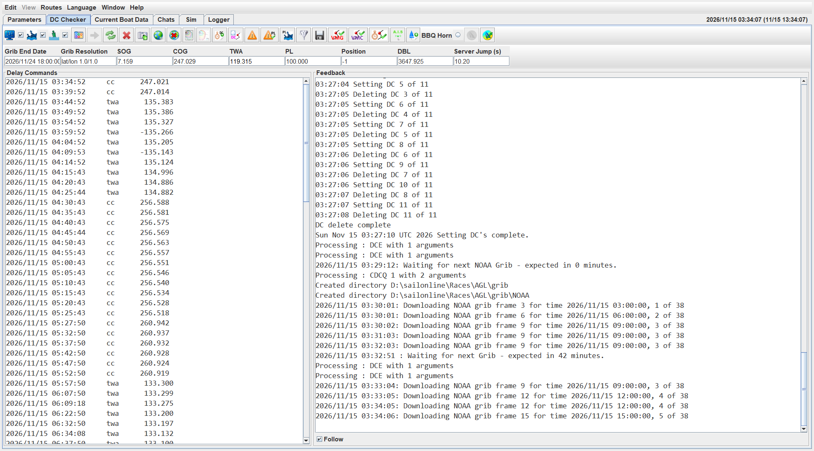

The features of this tab are described below.

### 5.1.1 Context Sensitive Editing Menus

There are two menus that can be used for copy and paste. The first is **Edit** which shows this menu.

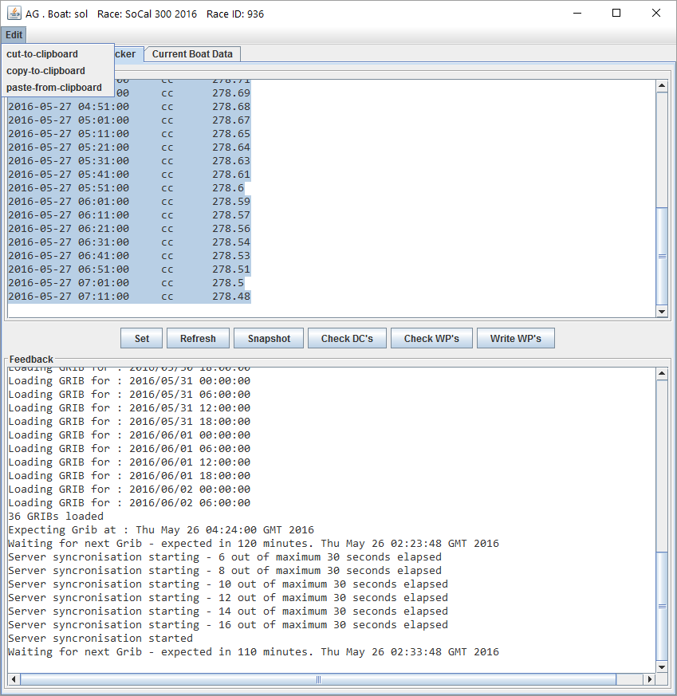

The second can be accessed by right mouse click in the Delay Commands window.

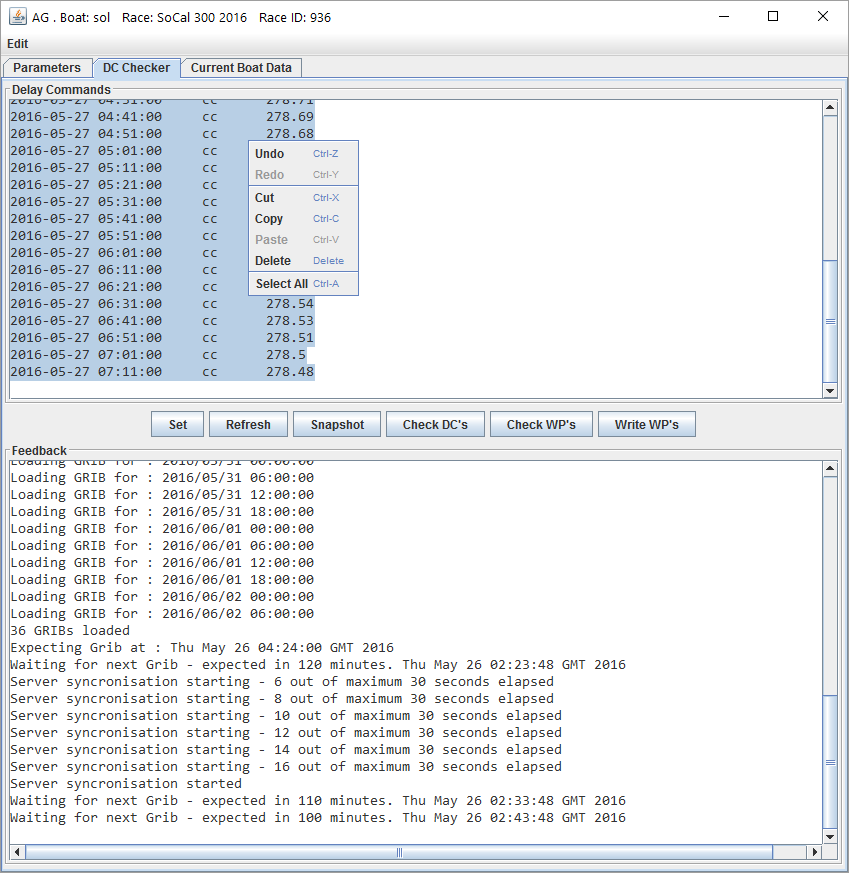

### 5.1.2 Set Button

This button is used to set any DCs that have been pasted into the window. The set operation will

1.  Check that all DCs are valid.

2.  Remove any duplicate DCs. That is, if the next DC command and value is the same as the previous, it will be deleted.

3.  Check that the bearing between two subsequent **cc** type DCs is less than 170 degrees. If not, the following dialog will appear

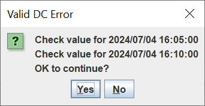

**Yes** will ignore and set the DCs, **No** will abort the setting process and allow editing.

The offending DC dates will be written back to the Feedback area as shown below.

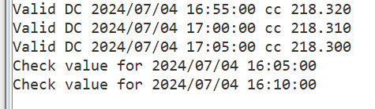

4.  Delete any DCs that are stale (that is, older than now).

5.  Delete any DCs on the server that do not match those in the DC area. Note that only one DC at a time can be deleted, so this may take a while depending on internet speed.

6.  If the race has not started, check that there is a DC before the race start time. If not, the user is asked if the first DC can be changed to 10 minutes before the race start.

7.  Update with the current valid set.

If the DCs include performance loss (PL) blocks, a DC that latency has made late (outside the **Recovery Time** setting) is sent again until its time is right, and the DCs on the server are checked against the DC area after the Set (up to 3 tries).

**Note**: A DC record must be in this format:

2016/05/27 01:51:00 twa 138.45

### 5.1.3 Refresh Button

The refresh button will request the list of current DCs from the server and display them.

### 5.1.4 Delete Button 

To delete all DCs, click the delete button . To delete a subset, highlight those to be deleted.

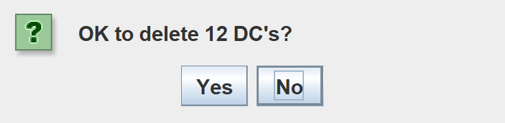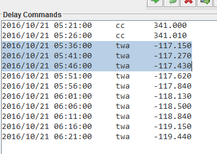

A confirmation popup will be displayed. Yes will delete and No will cancel.

### 5.1.5 Snapshot Button

This is used for debugging purposes. It writes a copy of the feedback window to a file and is needed to report any strange behaviour.

The snapshot file name will be similar to *snapshot_935_2016_05_25_0_28.txt* being made up of “snapshot\_&lt;Race_ID&gt;\_&lt;YYYY_MM_DD_HH_MM&gt;.txt”.

### 5.1.6 Display Graphics Button

Will display the OpenGL Graphics window.

**Note:** Scaling has been applied to the course waypoints in the classic graphical checker. The cross size is 10 metres across. The OpenGL crosshairs box is 10 m across as shown in the next figure.

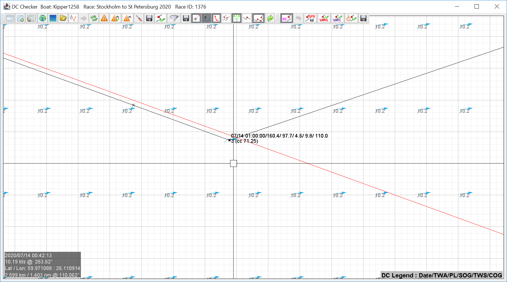

The  button restarts the graphics window (it can lock up and hang; this fixes the issue)

### 5.1.7 Alternate Polar Chooser 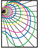

This will open the alternate polar file chooser and set up AGL to use the selected polar.

### 5.1.8 Show Polar Diagram 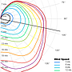

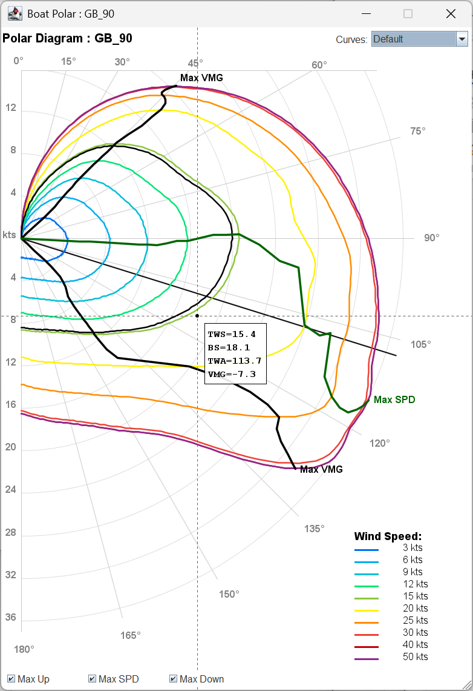This will open the boat polar diagram. The black polar curve shows the current speed curve being used. The black line is the current TWA; it is a separate line and is not part of the polar curve. The diagram is always on top, hit the close button to hide the diagram.

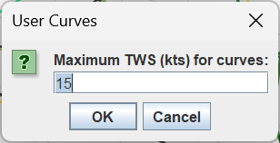The drop-down menu has three options, Default, Low Wind (&lt; 6 kts), and User. If user is used, the user will be required to enter the upper TWS to use for the curves.

The diagram also shows the Max VMG lines for both beating and running. The max SPD line shows the TWA that will achieve the maximum boat speed at that wind strength. Hovering the mouse over the diagram will show the TWS, Boat Speed (BS), TWA and VMG at that point.

### 5.1.9 DC Data Table 

This will launch the DC Data Table. Operation is described in section [6 DC Data Table](0600-dc-data-table.md).

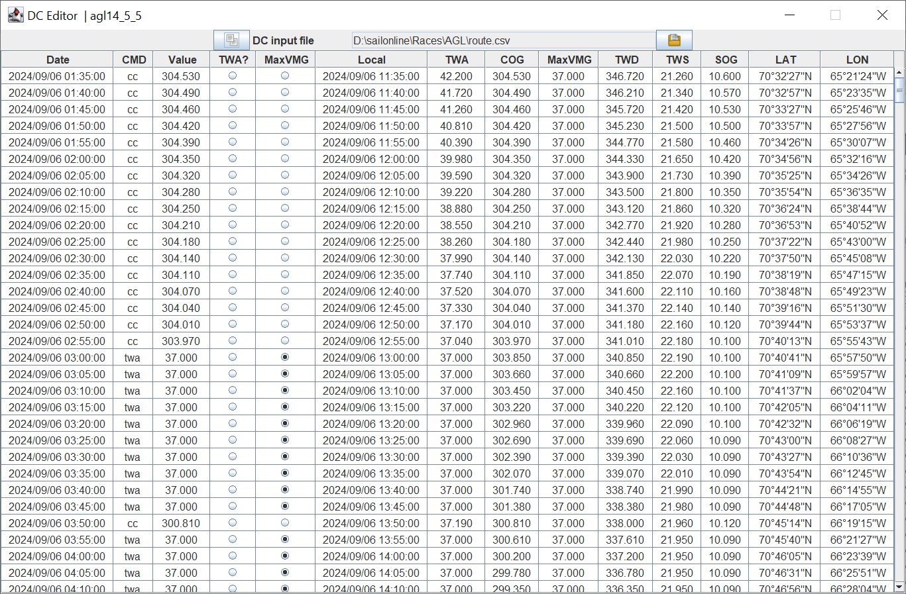

### 5.1.10 Check DCs Button 

This button will take whatever DCs are shown in the DC window and convert them into a plot as shown below.

**OpenGL Version of The DC Checker**

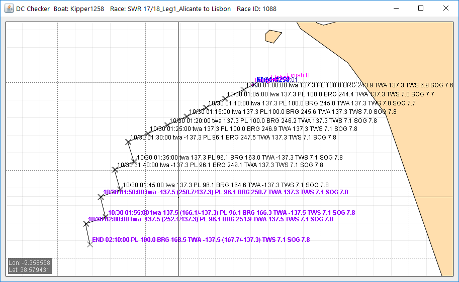

**Note:** If the first DC time falls inside the haulback period (one hour before the race start), the trace is modified to reflect the result in the real race. No changes are made to the actual DCs. This works in the following way.

A scan of the DCs is made and the last DC before the race start is determined. Any DCs earlier than that one are ignored ( the last DC to fire in the haulback period sets the boat’s course, the others are redundant). The time of that DC is adjusted to the race start time and the remaining DCs are then computed. This prevents the drift in the trace caused by the boat having velocity, but not actually moving in the haulback period.

We can now talk about what each of the parameters does, and how it works.

If the waypoint is highlighted in purple, the boat will be sailing **to** that waypoint outside the optimal TWA range. If the waypoint is highlighted orange, performance loss minimisation is possible for that DC.

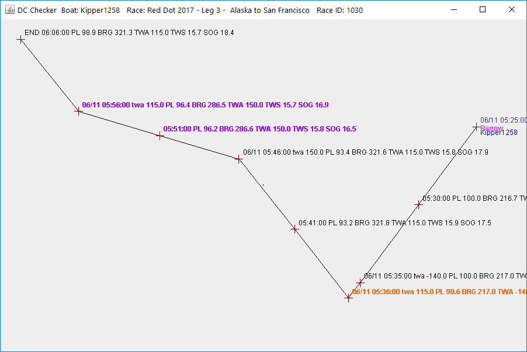

The same DCs conditioned for performance loss look like this. Notice that the performance loss is 2% less at 05:41:11 (95.3% vs 93.2%).

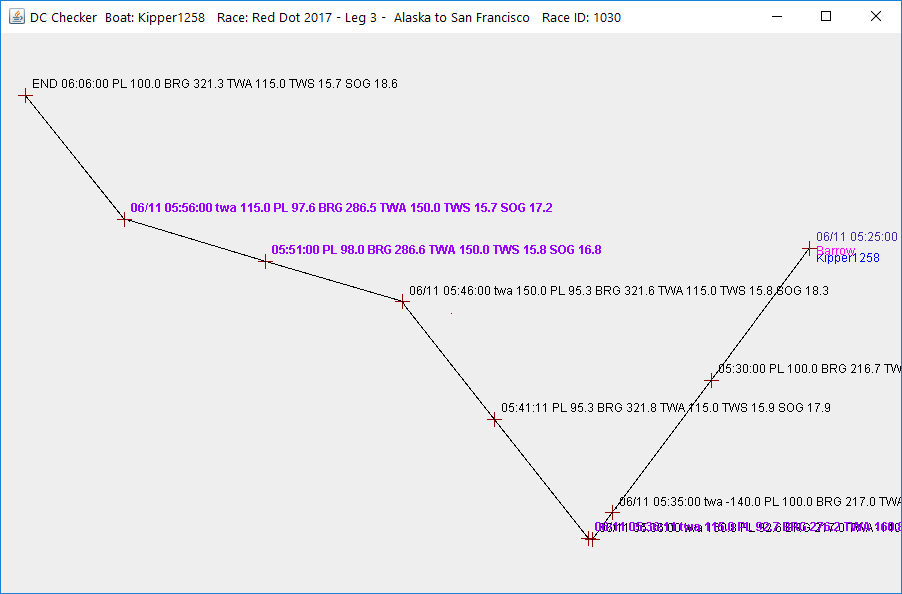

With **Use Performance Loss** ticked there are two Check buttons. The plain **Check**  checks the DCs exactly as the server holds them and changes nothing in the DC area. **Check PL**  works out the performance loss manoeuvres and adds the PL DCs to the DC area. It writes to the DC area only after a real change: a move, an edit, an insert, a delete, Condition, Undo or Redo. With **Use Performance Loss** off there is just the one Check button.

The **DC Editor** button 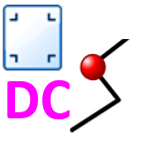 opens the DC Editor, which lists the DCs of the DC area (see [6.6 The DC Editor](0600-dc-data-table.md#66-the-dc-editor)).

#### 5.1.10.1 DC Parameters

You will find all of these on the Parameters tab.

**Check DC frequency (s):** This parameter (in seconds) decides how often additional points are plotted on the screen between each of the DCs. Waypoint **01:15:00/-172.3(87.4/-172.5)/100.0/4.3/9.6/71.3** shown below is one of these, and is 300 seconds away from the start. The waypoint name is the time that the boat will arrive, and the next values are TWA, PL, SOG, TWS and COG. The PL is the performance loss that the boat will be experiencing at that point, and TWA/COG is the TWA/COG that the boat will sail under **to** that waypoint. As the boat is sailing outside the optimal TWA range, it is coloured purple and the optimal value is added in brackets behind the TWA. In this case the **(87.4/-172.5)** represent the COG or TWA that must be set to achieve optimal TWA. The **Condition** function described later will do this interactively.

When a DC is reached, it is named in full. 07/14 01:29:52/-165.0/98.7/4.3/9.5/89.4 is the second DC that will be reached in the example shown.

**Note:** Waypoints shown in this colour are being sailed outside the optimal TWA range.

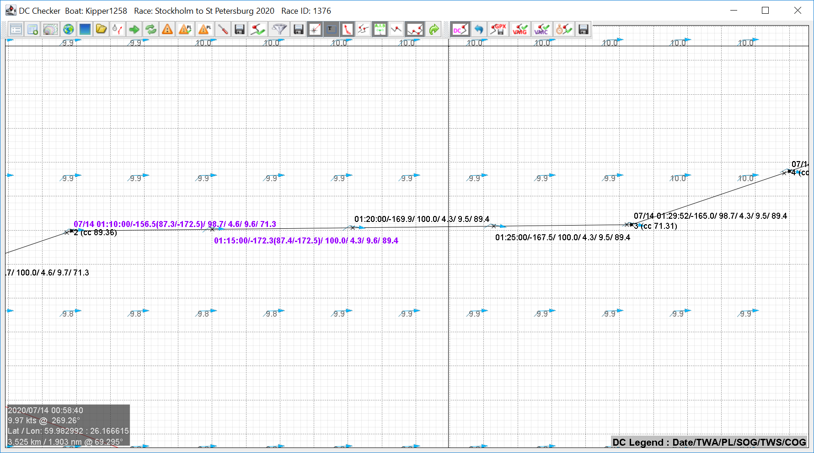

**Calculation duration (s):** This parameter (in seconds) determines how often the boat is advanced. Similar concept to the server jump. The points generated are not plotted, but are used to determine the coordinates of each waypoint, by sampling TWS and TWD after each advance and then using those numbers for the next advance.

**Use race start:** This allows the user to check DCs from the start. If checked, the checker will assume that the boat is at the start waypoint, and the time is the start time. Any DCs after that time will be processed in producing the route. If left unchecked, the start time will be now.

**Display boat position:** This is used when the boat is a long way away from the DCs of interest. It will not be plotted or considered in producing the route.

**Note:** If the boat is currently TWA 0, it means it is not moving. The only action that can be taken is to advance the clock to the first DC time, and assume that the boat will start moving on that course at that time. The start point will therefore be the current boat position, and the time of the first DC.

## 5.2 Checking the Course

AGL can check your course and your DCs before they reach the server, and keep checking while you race. It looks for three things:

- **BBQs:** the boat running into land.
- **Missed marks:** a sea mark that will not be rounded properly.
- **The finish:** a path that does not cross the finish line clear of its end.

When it finds a problem, AGL offers one or more fixes. You choose which to apply. Nothing is changed until you press **Fix** or **Apply**.

These checks are for SOL members only. For the checks to work in real time, **In Control** must be ticked on the DC Checker tab. Leave it off if you do not want the checks to run, for example in sprint races when you are in control yourself. You can also choose which checks are made with the BBQ Checker: BBQs only, marks (which includes the finish line) only, or both.

### 5.2.1 Switching the Checks On

On the Parameters tab, under DC's (or the check boxes on the DC Checker toolbar):

- **Check for BBQ** lets the BBQ Checker look along the course and the DCs for land and offer fixes.
- **Check mark roundings** lets it also check the mark roundings, and warn when the boat is going to miss a mark.

The real-time BBQ and missed-mark messages need **In Control** to be ticked. These two boxes do not switch them on or off; they decide whether the warning comes with a suggested fix.

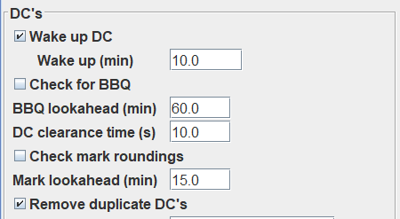

Each check has a look ahead, in minutes. The messages for it go out when the check finds the problem within that look ahead. The messages themselves, and when they go to your phone, are set on the Chats tab (see [Chats](0800-chats.md)).

These can also be enabled and disabled on the DC Checker toolbar.

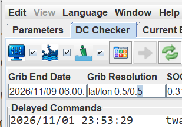

### 5.2.2 The BBQ Checker

The BBQ Checker looks at the DCs in the DC area for coastal collisions and deals with them one at a time. The BBQ Checker button  runs it. With **Use Performance Loss** ticked the button shows 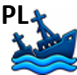 instead, and runs the check with performance loss.

For each collision AGL shows where it happens, for example "Potential collision after DC 0", and lists the fixes it has found. The suggested fix is ticked. You can tick another, or none, then press:

- **Fix** to make the change in the DC area.
- **Skip** to leave this collision in the DCs and go on to the next.
- **Cancel** to stop checking.

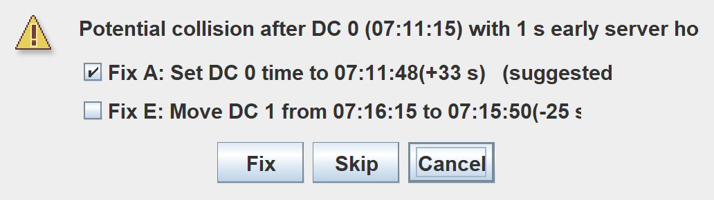

A fix can set a DC to a new time, move a DC, add a DC before the collision, or give a new course.

A fix never changes the DCs inside a performance loss (PL) block on its own. The one DC of a PL block it may move is the entry DC, and then the rest of the block moves with it, keeping its spacing and values. Where the collision depends on the server firing a DC a second or two early, the heading says so ("with 1 s early server hop") and the fixes allow for it.

If the boat's present course runs into land, AGL offers a turn to port or to starboard that clears it, with the course and the number of degrees.

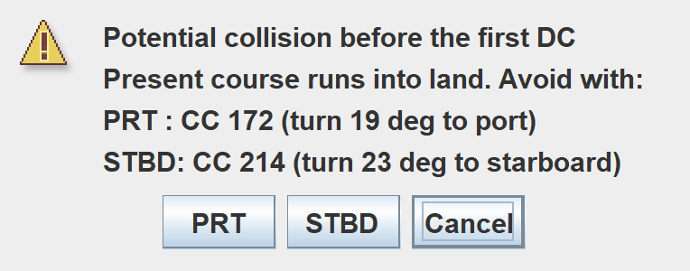

AGL also makes a png of the collision to send to Telegram, and will show the potential solutions in the graphics window. An example is shown below.

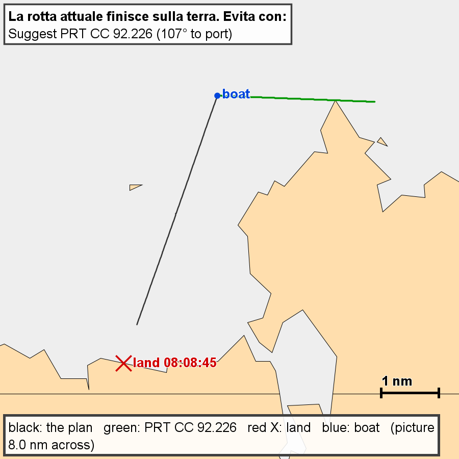

If there is nothing AGL can do, it says so, and you must correct the DCs yourself.

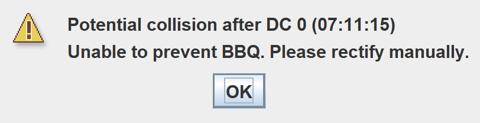

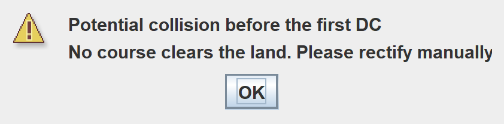

When every collision has been dealt with, AGL reports how many fixes were made and how many collisions were skipped. **Undo** in the graphics steps back through the fixes. If there was nothing to fix, you see:

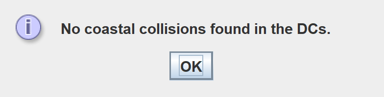

AGL may need a moment before it can check. If a server DC is about to fire and will change the course, it waits for it and then checks again.

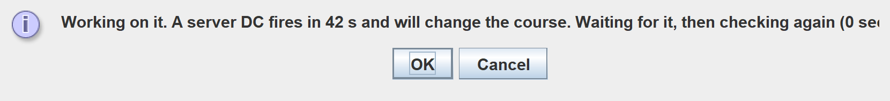

### 5.2.3 Missed Marks

AGL follows the course through the DCs and warns when the boat is going to miss a sea mark. Land marks are ignored as the BBQ checker handles them. The message names the mark, the time, and the reason. The reasons include:

- a DC is firing too early,
- a DC turns the wrong way round the mark,
- a later DC will unround the mark,
- the path passes too close to the mark, or on the wrong side,
- no DC turns the boat after the mark.

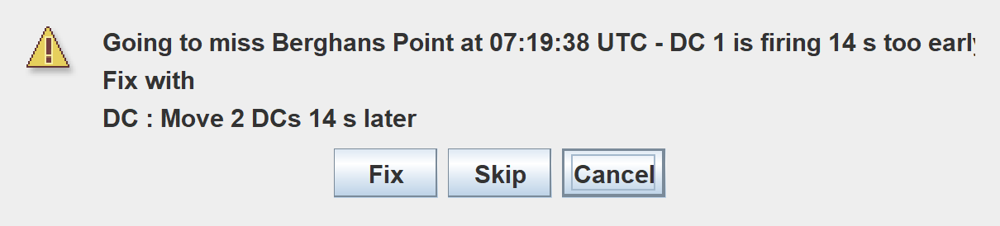

Where the miss can be mended by moving DCs or by changing course, AGL offers the fix, with where the boat will pass the mark if you apply it.

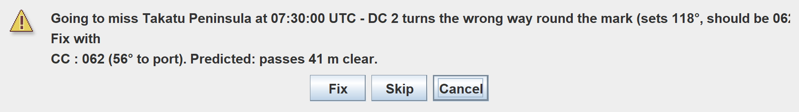

If it cannot be mended that way, AGL says so.

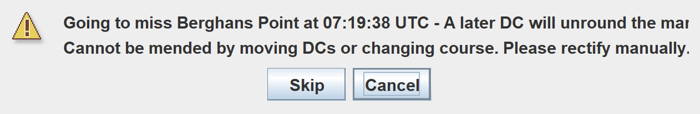

The graphics zooms to the problem area and shows the potential solutions. png images are made and sent to Telegram if Missed Marks is enabled.

### 5.2.4 The Finish

For the finish line the path has to cross the line clear of its end. A path that crosses beyond the end of the line is reported in the same way as a missed mark. AGL offers a new route to the line, or a pivot route to the mark, when it can find one.

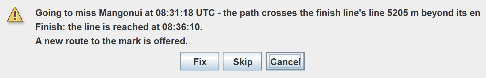

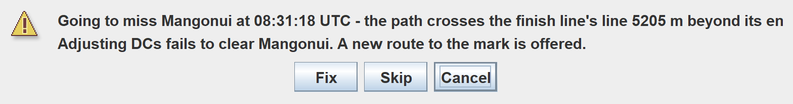

If the direct course to the line is outside maxVMG, AGL may stay on the present tack and turn later, and say so.

Once again, the graphics zooms to the problem area and creates a png for Telegram.

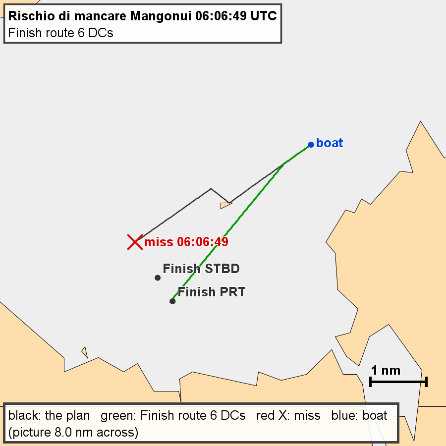

### 5.2.5 Suggestions While You Race

While you race, AGL runs the checks itself and shows a suggestion window when it finds a problem. The window has the same fixes, with **Apply**, **Apply (PL)** and **Dismiss**.

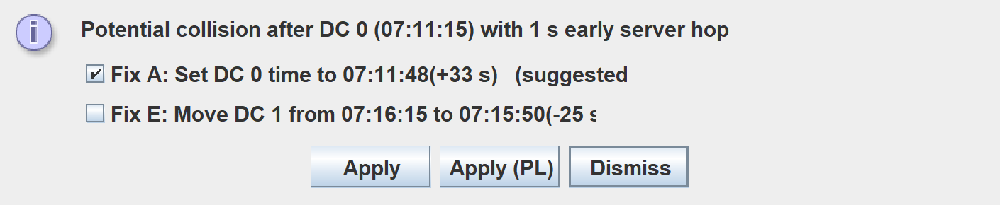

If you do not answer, the suggestion can go to your phone as well, by Pushover or Telegram. With Telegram it arrives with **Apply** and **Dismiss** buttons, so you can answer from the phone. See [Chats](0800-chats.md) for how to set that up.
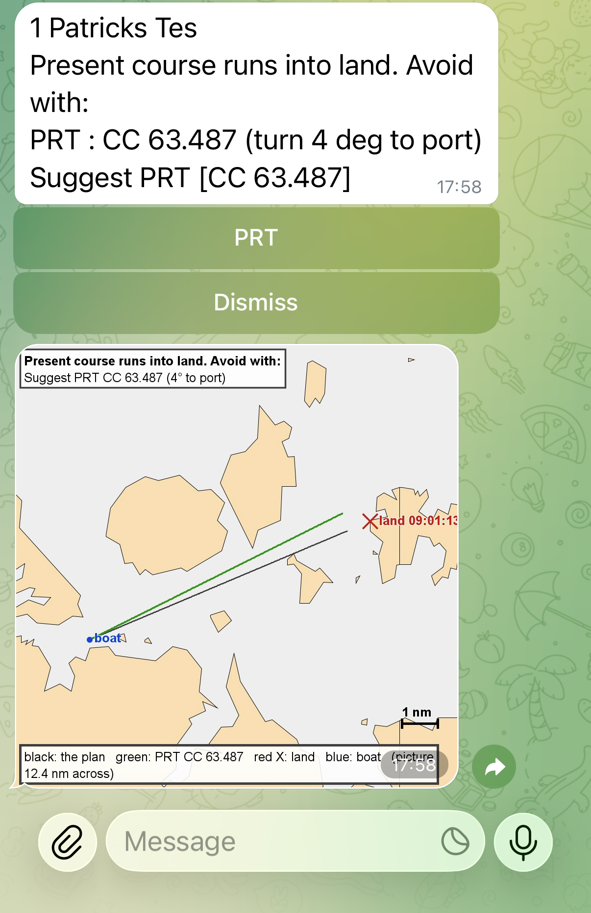 

If you hit **Apply**, the command is sent to AGL to execute. AGL will then update the message with the status of the boat after the **Apply**.

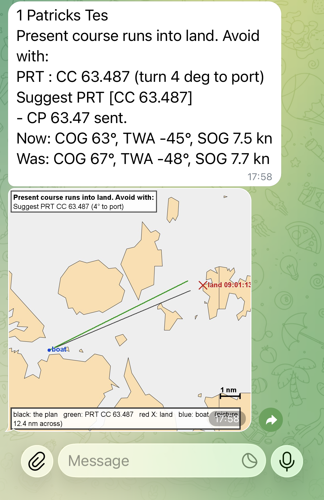

### 5.2.6 DCs Not Yet Set

If there are DCs in the DC area that are not on the server, AGL can ask whether to set them now.

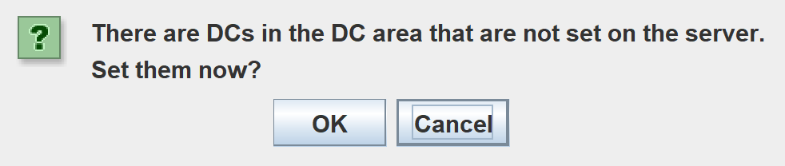

## 5.3 View

This section covers moving around the graphics, copying positions from them, and choosing what they show.

### 5.3.1 Moving Around the Graphics

#### 5.3.1.1 Zoom and Pan

The zoom function is only enabled by the use of a mouse with a wheel (on its back, not underneath). Scrolling the mouse wheel zooms in and out. Pan is achieved by holding the left mouse button down, and dragging to the desired location.

#### 5.3.1.2 Mouse Click

A **Shift + left** mouse click copies the current mouse coordinates to the paste buffer in the same format as the SOL client, that is

*38.605778,-9.485908*

A plain left click no longer copies the coordinates.

### 5.3.2 View Options

The  button on the graphics toolbar opens the View Options form. It stays open while you work, so you can switch things on and off and watch the graphics change. **Close** closes it.

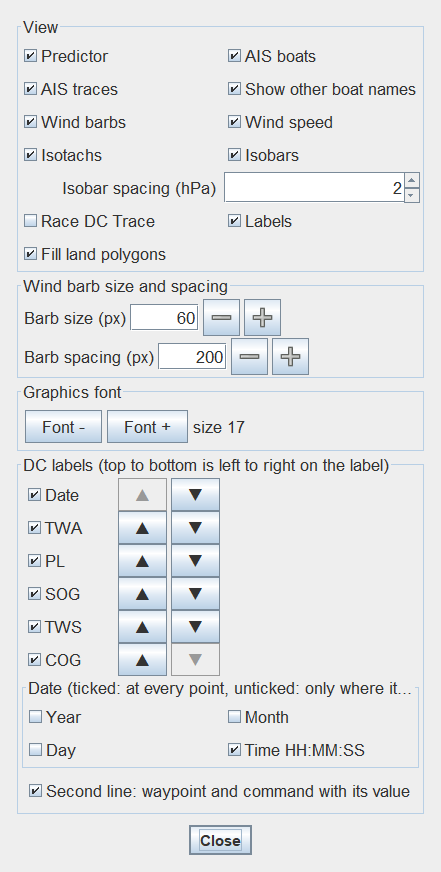

#### 5.3.2.1 View

Each check box switches one thing on or off in the graphics.

- **Predictor** shows the predictor line.
- **AIS boats** shows the boats in the AIS list.
- **AIS traces** shows the traces of the AIS boats.
- **Show other boat names** shows the names of the boats that are not in the AIS list. The boats in the AIS list always show their names.
- **Wind barbs** shows the wind barbs.
- **Wind speed** shows the wind speed numbers.
- **Isotachs** shows lines of equal wind speed.
- **Isobars** shows lines of equal pressure. **Isobar spacing (hPa)** sets the pressure between the lines, from 1 to 50.
- **Race DC Trace** shows the DCs that have fired in this race (see [5.3.3.3 Race DC Trace](0500-using-agl.md#5333-race-dc-trace)).
- **Labels** shows the DC labels, set up below.
- **Fill land polygons** fills the land shapes.

The display below shows AIS boats and their traces, and the predictor line. The number beneath each AIS boat is their current position. The four numbers below your own boat are position, TWA, SOG and performance loss.

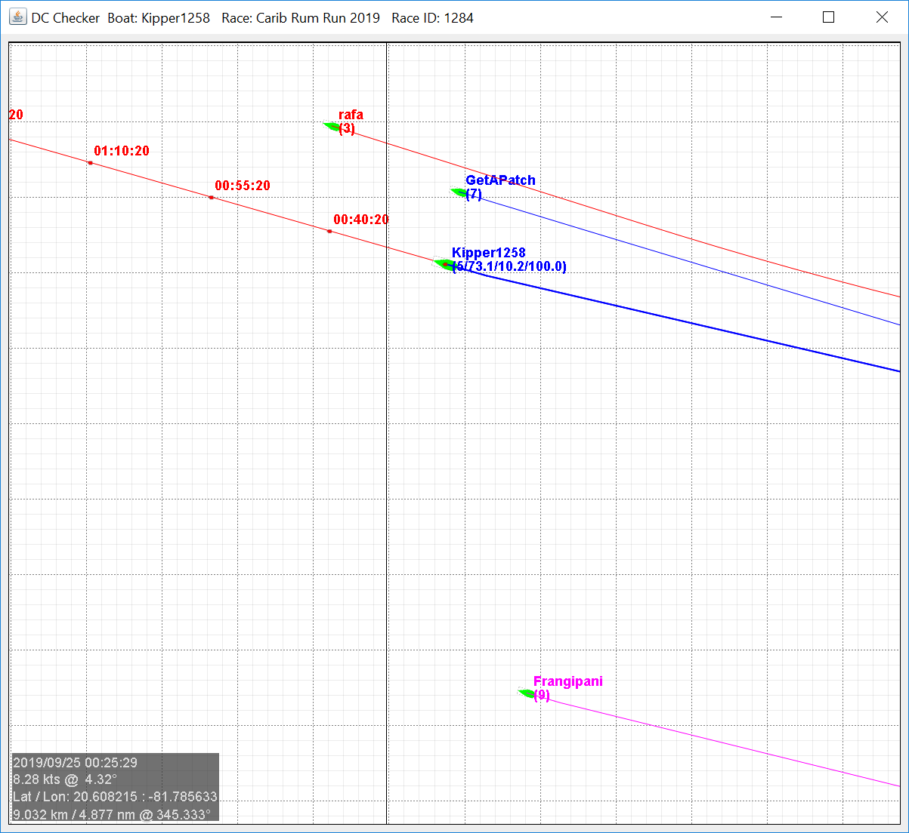

Also, if your boat is in the AIS list, it will be shown in black in the position that it was when all the other AIS boats were updated. This is the actual position of your boat relative to the others shown on the screen.

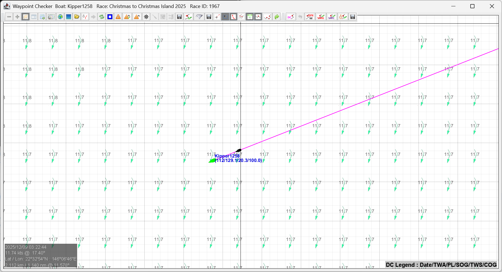

**Wind barb size and spacing:** the **Wind barbs** box sets how big the barbs are (**Barb size**, 10 to 300 pixels) and how far apart they are (**Barb spacing**, 20 to 1000 pixels). The **-** and **+** buttons make the value 1.1 times smaller or larger with each click, or you can type a value. The graphics change at once, and the values are saved. They are also on the Parameters tab (see [Graphics](0300-configuration.md#310-graphics)).

**Other boats:** a boat that has finished the race is drawn as a small grey dot at its last position, with no name. The boats that are named (the AIS list, or **Show other boat names**) show their ranking in brackets under the name. Hold the mouse over any boat to see its details, and its trace is drawn as a line in the colour of its name until the mouse moves away.

#### 5.3.2.2 Graphics Font

**Font -** decreases the graphics font size by 1 and **Font +** increases it by 1. The current size is shown beside the buttons.

#### 5.3.2.3 DC Labels

This sets what is written on each DC label in the graphics.

- Tick a field to show it: **Date**, **TWA**, **PL**, **SOG**, **TWS** and **COG**.
- The arrows move a field up or down. From top to bottom in the list is left to right on the label.
- The **Date** group chooses which parts of the date are shown. If a part is ticked it is shown at every point; if it is not ticked it is shown only where it changes. The parts are **Year**, **Month**, **Day** and **Time HH:MM:SS**.
- **Second line: waypoint and command with its value** adds a second line to the label with the waypoint and the command and its value.

The **PL** field shows the performance loss the boat arrives at the DC with and, in brackets, the performance loss after the turn, for example 97.4 (95.7). The labels of PL DCs are grey.

### 5.3.3 Traces

Whenever you check, change or set the DCs, AGL draws the result in the graphics as a trace. The **Traces** button on the graphics toolbar opens the Traces form, where you choose which traces to show.

#### 5.3.3.1 The Traces Form

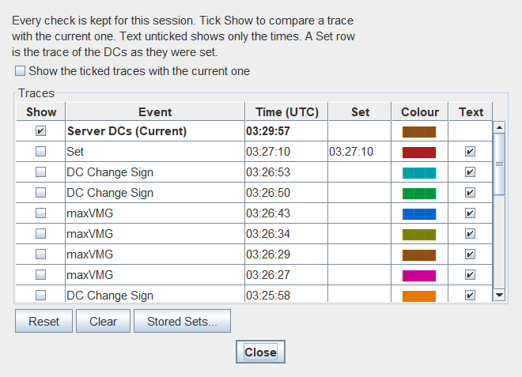

- The bold first row is the **current** trace, the latest thing done. It has a **Show** tick like the others. It is ticked again for every new current trace, so it is never left hidden by mistake. Untick it to look at an earlier trace more closely.
- The other rows are earlier traces. Tick **Show** to compare them with the current one. **Event** says what was done, and **Time (UTC)** when. **Set** is the time of a Set. **Colour** is the colour of the trace.
- **Text** shows the labels on the trace. When it is ticked the labels show the fields chosen in [DC Labels](0500-using-agl.md#5323-dc-labels), and when it is not ticked they show only the times.
- **Show the ticked traces with the current one** switches the compared traces on and off. It does not affect the current trace.
- **Reset** removes all the traces except the current one and the Sets. **Clear** removes the traces that are ticked **Show**. The current trace always stays. Click a row to select it (it is highlighted, one row at a time, and stays selected when the list refreshes).
- **Export GPX...** saves the selected trace as a GPX file in the race folder, in the same layout as the Stored Sets export: one route, with the DC number as the name of each point. Only the DCs are written. The file is named "Trace &lt;race&gt; &lt;event&gt; &lt;time&gt;.gpx".

A trace is made only for what you do: Send, an edit (Move, Change Sign, Condition, Delete, Insert, or an edit in the DC Editor), Undo or Redo, a Check or BBQ check, and a Set. A check that AGL makes by itself is shown only while it is the last thing done, and goes as soon as you make a real trace. A Set that AGL makes by itself (Condition DCs after new weather, or Set Anyway) is labelled **Set AGL**; a Set you make is labelled **Set**.

Each trace starts at the boat as it was when the trace was made, marked with a boat icon (port or starboard, like the other boats). The current trace starts at the boat's live position and has no icon.

#### 5.3.3.2 Stored Sets

Every Set you make is kept with the race: for each DC its position, the wind, the speed, the PL, and the boat. The **Stored Sets...** button on the Traces form opens the Stored Sets form.

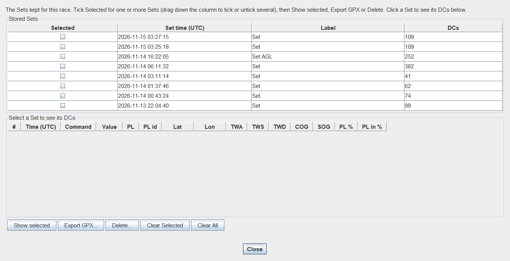

- Tick the **Selected** boxes of the Sets you want (drag down the column to tick several), and press **Show selected** to draw them as traces.
- Click a Set to see its DCs. The table shows the Value in degrees and Lat and Lon in degrees, minutes and seconds.
- **Export GPX** writes the selected Sets to a GPX file, one route for each Set. AGL can read the file again. Each DC keeps the id the server gave it, and the file carries it as `agl:serverId` in the extensions and as `id N` in the description. A DC the server has not listed yet has no id until the next list; Sets made before this version have none unless they are the newest Set and their DCs are still on the server.
- **Delete** deletes the selected Sets, after asking. **Clear Selected** unticks them, and **Clear All** unticks every Set.

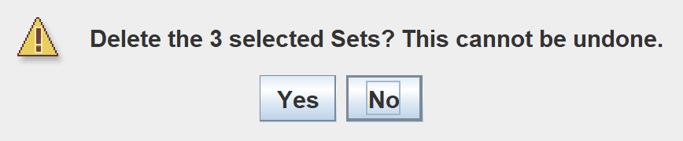

A Set made before positions were kept has none, and AGL says so. A DC without a kept position is left out of the drawing.

The Sets are kept in the race database, `db/dc_<race id>.db`, in the race folder. There is one file for each race, so Sets from one race never show in another. Only the Sets are kept between sessions. The file is not cleaned up automatically, and it can be deleted after the race.

#### 5.3.3.3 Race DC Trace

Tick **Race DC Trace** in View Options to see the DCs that have fired in this race. Each is a dark red dot with its time in UTC. The DCs that fired in earlier races of the same name are orange dots with no label. The record is kept in the hub with the race. Use **Info** on the right click menu to read the details of a dot.

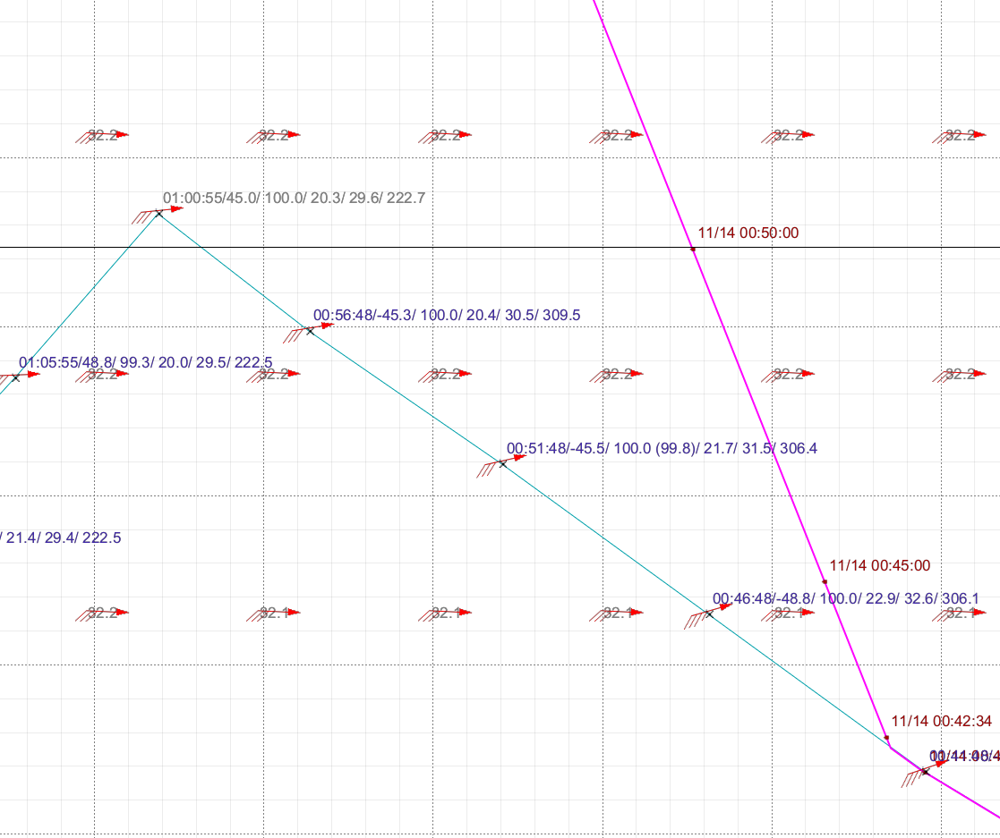

A DC that fires while a Set is being sent (a Set can take minutes) is recorded once the Set has finished, placed from the boat's own updates. A DC that the Set deletes from the server is never recorded as fired.

#### 5.3.3.4 Boat Traces

The traces of the AIS boats and of your own boat are kept for the whole race, in `db/traces_<race id>.db` in the race folder. The server cuts the old part of long traces, but AGL keeps what it has had, and adds what the server sends each time it loads the traces. The whole trace is drawn, also after AGL has been closed and started again. A stretch with no points, because AGL was off and the server had already cut it, is drawn as a gap and filled in when the server's traces arrive. The record is for viewing only. It can be deleted after the race.

## 5.4 OpenGL Graphics Specific Commands

The OpenGL Engine has several keyboard commands that are specific to the OpenGL Engine only.

**R** – Refreshes the screen

**F** – Fits the displayed data to the screen

**B** – Centres the display on the boat

**C** – Starts the course setter (see [5.4.3 Setting a Course](0500-using-agl.md#543-setting-a-course))

**W** – Clears the traces, the DC points and the routes that are not active (the same as **Clear** on the right click menu)

### 5.4.1 Toolbar Icons

The graphics toolbar has these buttons, from the left.

The 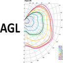 button pops the AGL window to the top.

The 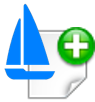 pops the boat data table.

The  launches the alternative polar file chooser.

The  opens the polar diagram.

The  creates a subset of the current grib. The file will be placed in the grib folder with the prefix SUB\_. The message below pops up when the creation of the subset is complete.

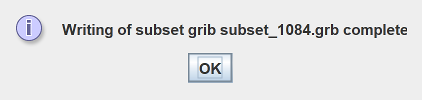

The  button drops a list of the routes of the race, with the active one ticked. The route you click becomes the active route (see [5.5.2 The Active Route](0500-using-agl.md#552-the-active-route)).

The 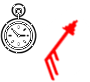 sets the grib date to the date of a waypoint, as **Set Grib Date** does on the right click menu.

The  applies the current DC list. Greyed out if no changes have been made.

The  reloads the DCs from the server.

The  opens the DC Editor, the  checks the DCs, and with **Use Performance Loss** ticked the  checks them with performance loss. The  runs the BBQ Checker ( with performance loss). See [5.1.10 Check DCs Button](0500-using-agl.md#5110-check-dcs-button) and [5.2.2 The BBQ Checker](0500-using-agl.md#522-the-bbq-checker).

The 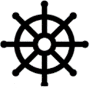 starts the course setter (see [5.4.3 Setting a Course](0500-using-agl.md#543-setting-a-course)).

The  conditions a DC, the  conditions all the DCs, and the  sets a DC to max VMG. See [5.4.4 Conditioning DCs](0500-using-agl.md#544-conditioning-dcs).

The  shows the active route with any redundant waypoints left out, using a filter tolerance. It changes nothing. The next  does the same, and then takes the redundant waypoints out of the active route.

The  button opens the View Options form, where the predictor line, AIS boats and traces, wind barbs, race DC trace, DC labels, land fill and the graphics font are set. See [5.3.2 View Options](0500-using-agl.md#532-view-options).

The  and  buttons zoom in and out about the middle of the graphics view, by the **Zoom step** set on the Parameters tab. The  fits the view to the trace of the last check, and the  fits it to the race area (the pink box).

The **Traces** button opens the Traces form (see [5.3.3 Traces](0500-using-agl.md#533-traces)).

The  button turns the grey DC trace on and off. See [6.3.1 How it works](0600-dc-data-table.md#631-how-it-works).

The  toggles between working with DCs and waypoints.

The  undoes DC and waypoint edits one at a time, and the same icon turned over puts the edit back.

The **Routes** button opens the Routes and Waypoints form (see [5.5.1 The Routes and Waypoints Form](0500-using-agl.md#551-the-routes-and-waypoints-form)).

The  computes waypoints and DCs into a route using maxVMG for waypoints.

The  computes waypoints and DCs into a route using maxVMC for waypoints.

The  converts waypoints and DCs into DCs only using maxVMG for waypoints.

The toolbars can also be undocked and re-docked by clicking and holding the grey stippled area of the toolbar next to the first icon as shown below.


Undocked toolbars are shown below


### 5.4.2 The Right Click Menu

A mouse right click in the graphics window will invoke a quick menu of options. The items shown depend on what is on the chart and on whether you are working on DCs or on waypoints.

  

*The menu with DCs Active, Routes Active and Neither Active.*

Some items are always shown: Steer, Tack, Gybe, Max Up, Max Down, Set Grib Date, VMG, Undo, Redo, Centre Boat, Fit Screen, Info, Clear and Cancel. **Set DC Active / Set WP Active** and **Switch CMD** are shown only when a DC trace is on the chart. With no DC trace on the chart the DC edit button is greyed.

The other items depend on what you are working on. A dash means the item is not shown, and "greyed" means it is shown but cannot be chosen.

| **Item**       | DCs Active | Routes Active | Neither Active |
|----------------|:--:|:--:|:--:|
| Set Active     | –  | ✓  | greyed |
| New            | –  | ✓  | ✓  |
| Add            | –  | ✓  | greyed |
| Remove         | –  | ✓  | greyed |
| Edit           | –  | ✓  | greyed |
| Follow (members) | – | ✓ | greyed |
| Insert         | ✓ (DCs) | ✓ | greyed |
| Move           | ✓ (DCs) | ✓ | greyed |
| Delete         | ✓ (DCs) | ✓ | greyed |
| WP On/Off, Condition, Condition All, maxVMG | ✓ | – | – |

**Switch CMD** can be chosen when DCs are Active or there is an active route. The active route always shows its waypoints.

 **Steer:** Invokes Setting a Course

**Tack:** Will tack the boat onto the opposite tack at max VMG. Pops a confirmation window showing the commands and includes performance loss minimisation. On selecting OK, the command is executed immediately.


**Gybe:** Will gybe the boat onto the opposite tack at max VMG. Pops a confirmation window showing the commands and includes performance loss minimisation. On selecting OK, the command is executed immediately.


**Max Up:** Will set the boat at max VMG upwind on the same tack. Pops a confirmation window showing the commands and includes performance loss minimisation. On selecting OK, the command is executed immediately.

**Max Down:** Will set the boat at max VMG downwind on the same tack. Pops a confirmation window showing the commands and includes performance loss minimisation. On selecting OK, the command is executed immediately.

 **Set Grib Date:** Sets the boat at the selected waypoint and updates the isotachs and wind barbs to that time

 **Set DC Active / Set WP Active:** Toggles between working on DCs and waypoints

**Set Active** (no icon),  **New**,  **Add**,  **Insert**,  **Follow**,  **Move**,  **Edit**,  **Remove** and  **Delete** work on waypoints and routes. They are described in [5.5.3 Editing Waypoints on the Graphics](0500-using-agl.md#553-editing-waypoints-on-the-graphics) and [5.5.4 Follow](0500-using-agl.md#554-follow).

With DCs Active, **Insert**, **Move** and **Delete** work on DCs instead. Follow the prompts in the top right corner. Note with DCs:

1.  If the DC type is TWA, the move will not set the twa to outside the optimal maxVMG range

2.  If the DC is moved over land, it will be moved back so as not to BBQ

3.  A DC inside a PL block is not moved on its own. The entry DC of the block carries the DC's number, and moving it moves the whole block. The PL DCs and the exit DC are labelled PL and cannot be picked.

**WP On/Off:** Shown with DCs Active. It switches the sign on a TWA DC. Follow the prompts in the top right corner

**Switch CMD:** DC only. Toggles CC and TWA and updates value accordingly. Follow the prompts in the top right corner.

 **VMG:** Computes waypoints and DCs into a route using maxVMG for waypoints, as the toolbar button does.

 **Condition:** Conditions DCs that are outside optimal VMG range to the optimal VMG

 **Condition All:** DC only. Conditions all the DCs that are outside the optimal VMG range to the optimal VMG.

 **maxVMG:** DC only. Sets the selected DC value to the max VMG.

 **Undo:** Undoes the last DC or waypoint edit. The number of edits that can be undone is shown in brackets.

 **Redo:** Puts back the edit that was undone.

 **Centre Boat:** Centres the screen on the boat

 **Fit Screen:** Fits the screen to the current waypoint/DC plot extents

 **Info:** Shows the details of a DC. Choose **Info**, then click any DC: in the DC area, on the DC trace, on a trace you are showing (a stored Set too), or a dot of the Race DC Trace. A box beside it lists the DC's title (a dot is titled "Race <race id> DC (fired)"), Lat and Lon, the time in UTC, CMD and its value in degrees, TWA, TWS, TWD, COG, SOG and PL (and the PL on arrival), whether it is a PL DC, and for a stored Set the time it was set. Click another DC to see it. The box stays until you right click (or Ctrl + click).


**Clear:** Takes the traces, the DC points and the routes that are not active off the chart, so you can start with a clean view. The active route stays. Routes that are shown from the hub are switched off, and the Routes form follows. The wind, the map and the Race DC Trace dots stay. Nothing is deleted, and the next check draws again. The **W** key does the same. The traces are hidden, not deleted: each stays in the Traces form with **Show** cleared, and ticking **Show** brings it back.

 **Sim:** Starts the Simulator, or restarts it if it is already running. Left click where the boat is to start. Members only. See [9.1 Starting and Stopping the Simulator](0900-simulator.md#91-starting-and-stopping-the-simulator).

When the Simulator is running, an additional item, **Move Mark**, is added to the popup menu. The one on the left is for waypoints and the one on the right is for DCs.

 

 **Move Mark:** Moves a mark of the course while the Simulator is running, to test a missed mark or the finish line. The real race information is not changed. See [9.4 Marks and the Finish](0900-simulator.md#94-marks-and-the-finish).

### 5.4.3 Setting a Course 

The course setter is invoked with the letter C. Move the mouse until the desired course is found and left click with the mouse.


The mouse click pops the setter form.


The radio buttons toggle between TWA and CC commands. The required value can also be entered manually.  applies the command and sets the course immediately.  aborts and cancels the command.

### 5.4.4 Conditioning DCs 

If some DCs show up as purple, they can be fixed using the **Condition** or **Condition All** option.


Select the DC to condition and follow the prompts in the top right corner. The DC will then be conditioned.


Continue until no DCs are left purple.

### 5.4.5 Danger Point

The DC Checker has been enhanced to include the danger point, inside which the execution of a round has the risk of failing. The boat may execute the rounding any time from the danger mark to the main DC. The danger mark is a scalable (10 m across) mark that is shown just before the main DC. This is shown below as the unlabelled cross.


### 5.4.6 AIS Button 

Opens the AIS Boat Chooser. Select the desired boats and click Add. Then click Apply to update the AIS boat list. The icon is on both the Parameters and DC Checker tabs.

### 5.4.7 Boat Data Table Button 

Opens the Boat Data Table shown below based on the AIS selected boats. Each of the columns is sortable by clicking on the column name. This is the same information that is used to create the AIS data feed. The top table is the standard data. The bottom table is the differences from the selected boat.

The table will now show the boat polar being used for that boat. The polar must exist in the polar library, and the polar library must have been set.


### 5.4.8 Boat Horn Radio Button

When checked, the boat horn will sound if

1.  The race has started

2.  The boat has not finished the race

3.  The boat has left the start, and

4.  The boat is twa 0.

### 5.4.9 qtVlm 

If you are a SOL member, and **qtVlm integration** is enabled on the Parameters tab, you will see two additional icons on the toolbar.

Launches qtVlm. This will perform the checks it needs and configure qtVLM as follows:

- Checks that the SOL map tiles and the race's links are in place, and that the qtVlm install is still the version the race was linked to. If not, it asks before it downloads or links anything

- Sets the grib to current_grib.grb

- Sets the polar to the current race polar

- Sets the boat name to match your user name

- Sets the maps to the matching resolution

- Turns the NMEA RMB messages on

- Sets the qtVlm NMEA port to match the AGL one (if different). If qtVlm is already connected on that port, it is left alone and no second qtVlm is started

  Minimises or maximises qtVlm, depending on the qtVlm current iconified state. This allows the user to pop the qtVlm session linked to this race, and not try to find it on the taskbar.

qtVlm's **Routing**, **Converting Routing to Route**, **Simplification result** and **Optimization results** windows can open behind other windows. The AGL Hub brings them to the front for you, one at a time, and shows a light orange frame round the AGL windows while one is open without the focus. This is described in [2.3.3.6 Managing qtVlm Dialogs](0200-installing-agl.md#2336-managing-qtvlm-dialogs) and is switched on and off with **Manage qtVlm dialogs?** on the hub's Launcher tab.

**Note:** On Linux, if this icon set is not on the toolbar, it means that there is no X11 support installed. To check if you have a real X11 session, enter

```
echo $XDG_SESSION_TYPE; command -v xdotool || echo "xdotool not installed"
```

If **xdotool not installed** is returned, you do not have X11. Install by entering the following in a Terminal window

```
sudo apt install xdotool
```

## 5.5 Routes and Waypoints

A **route** is a named list of waypoints. A **waypoint** that is in no route is a free waypoint. AGL keeps the routes and waypoints of every race in the hub's database, in a folder next to the install folder (`agl_db`, with `agl_db_Beta` and `agl_db_Test` for the beta and test installs). It no longer reads or writes waypoint files. You put routes in with **Import**, and get them out with **Export GPX**.

One route at a time is the **active route**. The edits you make in the graphics, and the commands that use waypoints, work on the active route. Edits are kept at once, so there is no Save.

### 5.5.1 The Routes and Waypoints Form

The **Routes** menu on the AGL window and the **Routes** button on the graphics toolbar open the same form. It stays open while you work, remembers its position and size for each race, and updates itself after every change.


The form lists only what belongs to the race area: the routes whose waypoints are all inside it, and the waypoints inside it. The race's own course marks are listed too, but they are read only.

**Routes list**

- **Active:** the route the commands use. Only one route can be ticked.
- **Show:** tick it to draw the route on the graphics. Waypoints start hidden; the waypoints of a shown route are drawn with the route anyway. The active route is drawn blue, and each other shown route takes the next free colour. The **Colour** box shows it.
- **Name:** click to rename the route. Names must be different from each other and cannot contain `!`.
- The waypoints a route has passed are ticked **Passed**, and the segments leading to them are grey. **Clear Passed** unticks them.

**Waypoints list.** Select a route to see its waypoints. You can change the name of a waypoint of your own, and its Lat and Lon (inside the race area only). **In routes** says how many routes use a waypoint. A waypoint of a route shows its command, for example `WP10 (+P)`.

**Buttons:**

- **Import** reads a GPX file into a route (an older .wpt file can also be imported). If a name is already in use, AGL asks what to do. A route that crosses the edge of the race area is not imported, but the waypoints of it that are inside are added as free waypoints.

  

- **Export GPX** saves the selected route as a GPX file.
- **New route** asks for a name, makes an empty route and makes it the active route. Put waypoints in it with **Insert**, **New** and **Add** on the graphics.
- **Copy route** makes a copy of the selected route together with a copy of each of its waypoints. A form asks for the route name, a waypoint prefix and a waypoint suffix, which are added to the name of every new waypoint. One of them is needed. If any new name is already in use, nothing is copied and the form lists the names.

  

- **Delete route** deletes the selected routes, after one question.
- **Delete waypoint** and **Copy waypoint** work on the selected waypoints.
- **Refresh** reads the lists again. It is rarely needed.

When you open a race that has routes from earlier years, the form can move them to this race (**Yes**, **No**, **Always** or **Never**).

#### 5.5.1.1 The Deleted Tab

Nothing you delete is lost at once. The **Deleted** tab lists the routes and waypoints you have deleted.


- Tick **Select** for the routes or waypoints you want. For a route, **Waypoints** also brings back its deleted waypoints.
- **Restore** puts them back.
- **Delete...** deletes them for good, after asking. The question gives the true number.
- **Merge duplicates** merges duplicate entries.
- **Select All** and **Clear All** are in the right click menu of the lists.

### 5.5.2 The Active Route

There are three ways to choose the active route:

- Tick **Active** on the Routes and Waypoints form.
- Use the  button on the graphics toolbar. It drops a list of the routes, with the active one ticked.
- Choose **Set Active** on the right click menu, then click a drawn route line or one of its waypoints.

The old active route stays shown when another becomes active, so you can switch between two routes quickly with **Set Active**. Hide a route with its **Show** tick, or take it off with **Clear** (Clear never hides the active route). A **Set Active** also clears the undo list, because Undo belongs to the route that was being edited.

The active route is the route that **Verify Course**, the waypoint run and **Timed Race** use. The route box those commands read follows the active route by itself, so there is nothing to choose in a box.


*Two routes shown: the active route is blue.*

### 5.5.3 Editing Waypoints on the Graphics

The waypoint items of the right click menu work on the active route. Follow the prompts in the top right corner of the graphics, and right click ends or cancels. **Make sure waypoint editing mode is active.** The  icon must not be selected (grey borders). If it is, click the icon to deselect DC editing. Every segment of the active route is drawn while you pick, blue, and grey where the segment leads to a passed waypoint.

- **Set Active:** click a route line or one of its waypoints to make that route the active one.
-  **New:** puts a free waypoint where you click. It is shown as a black square and is named in the waypoint editor window (a prefix and an increment). Click again for the next one.
-  **Insert:** puts a new waypoint where you click into the segment of the active route that you pick. Near the start of the route it goes in front, otherwise it goes on the end. The waypoint editor pops up.
-  **Add:** the first click picks the segment, or the end of the active route. Then click existing drawn waypoints (free waypoints, waypoints of other shown routes, course marks) and they go in, in the order you click, with the control set in the waypoint editor. After the first click a line shows which two waypoints the next one goes between. A waypoint already in the route is refused.
-  **Move:** moves a waypoint.
-  **Edit:** edits a waypoint. The Waypoint Values form pops up, with the name, the position, and the control type and waypoint date. The date is shown even when it has already passed.

  

-  **Remove:** takes the waypoint out of the active route. It stays as a free waypoint, and stays shown.
-  **Delete:** takes the waypoint out of the route and deletes it. It can be brought back with **Restore** on the Deleted tab. A free waypoint can be deleted too: click it, then click again to confirm. A course mark, or a waypoint another route still uses, is only removed.
-  **Follow:** see [5.5.4 Follow](0500-using-agl.md#554-follow).

Move, Insert, New and Add refuse a position outside the race area, and the waypoint stays picked up for Move. The course marks of the race cannot be edited. If there is no active route, the edits are not kept and the Feedback says so.

While you edit waypoints, the keys **D** (delete), **E** (edit), **I** (insert) and **M** (move) also work.

### 5.5.4 Follow

Follow inserts waypoints that go round the coast between two waypoints, so that a route that crosses an island or headland is taken round it. It is for waypoints only, not DCs, and it is available to SOL members. You need at least two waypoints.

1. Choose **Follow** from the right click menu. The prompt at the top right says **Select segment to insert ( right click cancel)**.

2. Click the line between the two waypoints that crosses the land. Inactive waypoints (those with a ! at the start of the name) are skipped: the segment is between the two active waypoints either side of your click. The waypoint editor pops up, as it does for **Insert**. The new waypoints take the name and command of the first waypoint of the segment, so change the control type there if you want something else.

   

3. The prompt now says **Click the side of the segment to pass on ( right click cancel)**, and a thin line follows the mouse from the segment. Click on the side of the segment that you want to pass the first island on. That side applies to the first island only. If there are more islands on the segment, each takes whichever side gives the shortest route.

   

4. AGL finds the coast that the segment crosses and inserts a waypoint at each corner of the coast that the route must go round (the convex hull), between where the segment first enters the coast and where it last leaves it. The Feedback area says how many waypoints were inserted. If there is nothing to insert, it says why, for example **The segment does not enter and leave any coastline**, and you can click another segment.

   

5. Right click cancels at either step. **Undo** and **Redo** on the menu and toolbar take the new waypoints out and put them back.

Two values on the **Parameters** tab, in the **Waypoints** box, set where the waypoints go. **Follow: offset from coast (m)** (10 to start with) moves each point that many metres out from the shore. **Follow: offset along track (m)** (0 to start with) then moves each point along the direction of travel. AGL then checks once more, and adds a point wherever the moved route would still cross the coast.

### 5.5.5 MaxVMG Waypoints 

This section describes how to use the maxVMG waypoints and associated tools. The maxVMG waypoints are driven by a waypoint command stored with the waypoint. The command is made up of up to three characters, e.g. 1P+. The applicable commands are described below.

#### 5.5.5.1 Waypoint Commands

First letter controls for two letter commands are as follows

| **Command** | **Behaviour**                                                                                                                  |
|-------------|--------------------------------------------------------------------------------------------------------------------------------|
| **T**       | Drive twa                                                                                                                      |
| **C**       | Drive CC                                                                                                                       |
| **+**       | Drive maxVMG, starboard first and then tack/gybe on port. Honours the waypoint.                                                |
| **-**       | Drive maxVMG, port first and then tack/gybe on starboard. Honours the waypoint.                                                |
| **1**       | Drive maxVMG only, based on current boat TWA until the closest point to the waypoint is reached. Does not honour the waypoint. |
| **2**       | Drive direct and then maxVMG if required. Does not honour the waypoint.                                                        |
| **3**       | Drive maxVMG only qtVlm style. Will tack/gybe as necessary to reach the waypoint. Does not honour the waypoint.                |

The second letter controls performance loss, either P or N. e.g. CP will drive CC and apply performance loss when driving **TO** that waypoint. CN will drive CC and not apply PL when driving **TO** that waypoint.

**Caution:** Performance loss behaviour at the **current waypoint** that is **being rounded** is determined by the setting on the **waypoint being driven to**.

There are three commands which use three letters. Their behaviour is documented below

| **1<sup>st</sup>** | **2<sup>nd</sup>** | **3<sup>rd</sup>** | **Behaviour**                                                                                    |
|--------------------|--------------------|--------------------|--------------------------------------------------------------------------------------------------|
| **1, 2 or 3**      | **P or N**         | **+**              | Same behaviour as above, but starts out on starboard. Does not honour the waypoint. e.g. **2P+** |
| **1, 2 or 3**      | **P or N**         | **-**              | Same behaviour as above, but starts out on port. Does not honour the waypoint. e.g. **3P-**      |

Some examples of these waypoint types

**-P**


**+P (with waypoint date)**


**1P- (with waypoint date)**


**3P+ (with waypoint date)**


If the boat has already sailed the pivot of a **+P**, **-P**, **FP+** or **FP-** waypoint (for example after a DC regeneration), AGL goes direct to the mark if it can. If not, it sails one maxVMG leg on the tack the boat is on, and if that cannot reach the mark it makes the route for the opposite sign.

#### 5.5.5.2 Editing a Waypoint 

To change the waypoint name or command, use the Edit option and follow the prompts in the top right corner.

**Caution:** Make sure waypoint editing mode is active. This  icon must not be selected (grey borders). If it is, click the icon to deselect DC editing.

The maxVMG waypoint also supports a waypoint-based start time. A waypoint start can be delayed until a specific time and any existing DCs will be used to fill in the time from when the previous waypoint was reached until the time specified. The format is the same as before, and the date picker can be used.


### 5.5.6 Using Waypoint To DC 

After checking that the waypoints produce the desired result, the  can be used. The command generates a set of DCs that match the waypoint path. 

**Note:** If the boat is not moving, the DCs will be a snapshot at that time, and the DCs will move as time moves on. The only time that they are valid with a stopped boat is during the haulback, and the boat is stopped.

### 5.5.7 Waypoints and Routes in the Hub

The hub has a **Routes > Waypoints and Routes...** window that shows the routes and waypoints of every race, with a **Race** column and no race area filter. Use it to clear out the routes and waypoints of old races. There is no import in this window.


- Tick the routes or waypoints and press **Delete**. A waypoint that a route uses is refused, and the route names are given.
- The **Deleted** tab has **Restore** and **Delete...** (for good, after asking). **Select All** and **Clear All** are in the right click menu of the lists.


## 5.6 Import File Formats

### 5.6.1 GPX File

The import supports gpx files that have been exported in the route format. The file must be similar to the below.

*&lt;?xml version="1.0" encoding="UTF-8"?&gt;*

***&lt;gpx** version="1.1" **creator="Expedition** - https://www.ExpeditionMarine.com" xmlns:xsi="http://www.w3.org/2001/XMLSchema-instance" xmlns:exp="https://www.expeditionmarine.com/xmlschemas" xsi:schemaLocation="http://www.topografix.com/GPX/1/1 http://www.topografix.com/GPX/1/1/gpx.xsd https://www.expeditionmarine.com/xmlschemas https://www.expeditionmarine.com/xmlschemas/GpxExtensions.xsd" xmlns="http://www.topografix.com/GPX/1/1"&gt;*

***&lt;rte&gt;***

***&lt;rtept lat="-35.968317" lon="27.760750"&gt;***

***&lt;time&gt;**2025-06-17T10:07:40Z&lt;/time&gt;*

*&lt;/rtept&gt;*

*&lt;rtept lat="-35.922217" lon="27.844973"&gt;*

*&lt;time&gt;2025-06-17T10:32:20Z&lt;/time&gt;*

*&lt;/rtept&gt;*

*&lt;/rte&gt;*

*&lt;/gpx&gt;*

It must contain the tags of **&lt;gpx, &lt;rte&gt;, &lt;rtept lat =”….” lon =”…”&gt;** and **&lt;time&gt;**. Other tags may and will exist, but they are ignored. For example, the full Expedition **&lt;rtept&gt;** tag contains the following. Only the lat, lon and time are used. The rest are ignored.

*&lt;rtept **lat="-35.968317" lon="27.760750"**&gt;*

*&lt;name&gt;Opt0&lt;/name&gt;*

***&lt;time&gt;2025-06-17T10:07:40Z&lt;/time&gt;***

*&lt;extensions&gt;*

*&lt;exp:twd&gt;280&lt;/exp:twd&gt;*

*&lt;exp:tws&gt;20.2&lt;/exp:tws&gt;*

*&lt;exp:twa&gt;-136&lt;/exp:twa&gt;*

*&lt;exp:targtwa&gt;172&lt;/exp:targtwa&gt;*

*&lt;exp:bsp&gt;12.0&lt;/exp:bsp&gt;*

*&lt;exp:brg&gt;056&lt;/exp:brg&gt;*

*&lt;exp:rng&gt;4.95&lt;/exp:rng&gt;*

*&lt;exp:awa&gt;-101&lt;/exp:awa&gt;*

*&lt;exp:aws&gt;14.2&lt;/exp:aws&gt;*

*&lt;exp:motor&gt;false&lt;/exp:motor&gt;*

*&lt;exp:mslp&gt;1017.31&lt;/exp:mslp&gt;*

*&lt;/extensions&gt;*

*&lt;/rtept&gt;*

The **&lt;gpx** tag must contain the attribute **creator=”….”** It must also have the word **Expedition** or **qtVlm** somewhere in the value.

### 5.6.2 CSV File

**Important**: Whilst the CSV file works, it does require a valid data format to be entered and produces a less precise route to the **Route>Export** in qtVlm. This method is not recommended.

The importer has been written to suit qtVlm csv file formats, but may suit other file formats. For the importer to work, it must have a header row with column names as defined below.

**Date; TWS ; TWD ; TWA ; SOG ; COG (T) ; AWS ; AWA ; LON BOAT ; LAT BOAT ;**

The column and data separator is set as “**;”** and no other separator will work. The file may have additional columns and the column order does not matter. **COG** may be defined as **COG** or **COG(T)** only. No other variants will work. Column names are not case-sensitive.

**Note:** The sign on **TWA** in the input file is ignored and is determined from **AWA** where a negative AWA has a positive TWA and vice versa.

Provided the file format matches these requirements, the loader should work.

#### 5.6.2.1 Date Format

The **Parameters** tab has a field called **DC import date format.** This is used to specify the date format of the DC import file. From qtVlm, csv route export, these will typically be either dd/MM/yyyy HH:mm or MM/dd/yyyy HH:mm. Other formats can be defined as per [SimpleDateFormat (Java SE 25 & JDK 25) (oracle.com)](https://docs.oracle.com/en/java/javase/25/docs/api/java.base/java/text/SimpleDateFormat.html).

