# 6 DC Data Table

The DC Data Table loads the DCs from a route file made by your routing package. This chapter shows how to export the route, how the DC Data Table reads it, how the DCs are sent to the DC Checker, and what the other buttons do. It ends with the DC Editor, the same table in its second mode, which shows and edits the DCs that are in the DC area.

## 6.1 Exporting Route Data from the Routing Package

### 6.1.1 Expedition GPX File

On the optimisation results, select the route to export and click the -&gt; gpx button. Save the file to your race folder, ensuring that it has a .gpx extension. If the route is not selected, Expedition will export both routes and AGL will only use the last route in the file.

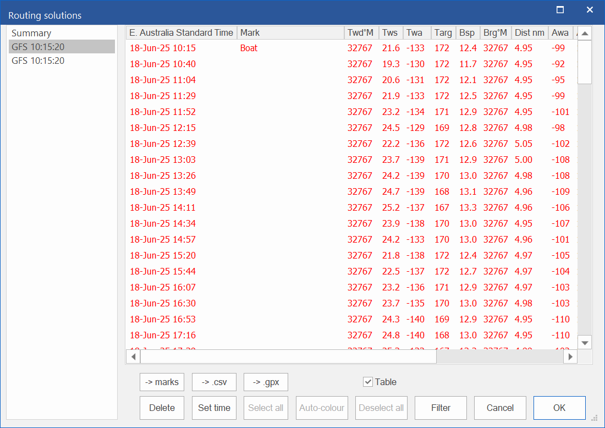

### 6.1.2 qtVlm GPX File

In qtVlm, select Route &gt; Export and then select the route to export. A file chooser will pop up, choose or create a file in your race folder, ensuring it has the extension .gpx. e.g. gpxroute.gpx.

On selecting save, this pop up will appear. Select **Detail** and make sure **As list of WPs** is not checked.

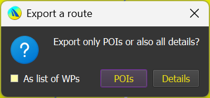

**Important**: This is the best and most reliable way to transfer the route from qtVlm to AGL.

### 6.1.3 qtVlm CSV File

**Important**: Whilst this method is supported, it requires the user to enter a correct date format, and the results are less accurate due to the rounding of values that qtVlm makes. Use the gpx route. 

From the Route Logbook tab, select **Export (CSV Format)**, and select or create a file in your race folder with the extension .csv. e.g. route.csv. Make sure the **With raw data** is off.

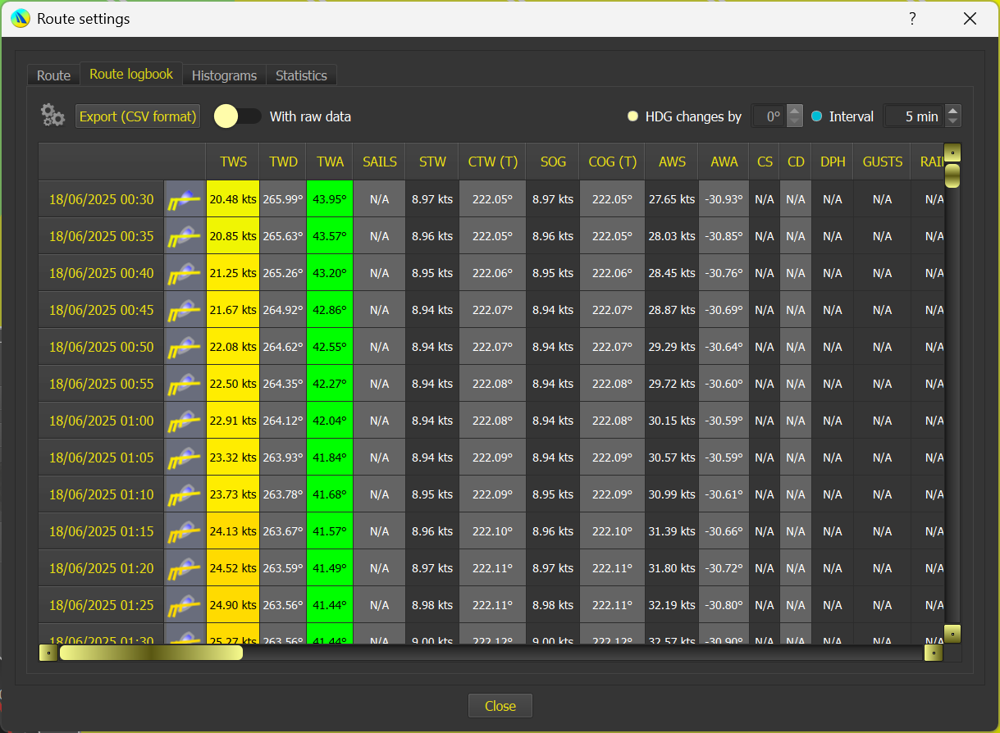

## 6.2 Loading the File

On the first time of using, a file chooser will be launched as shown below.

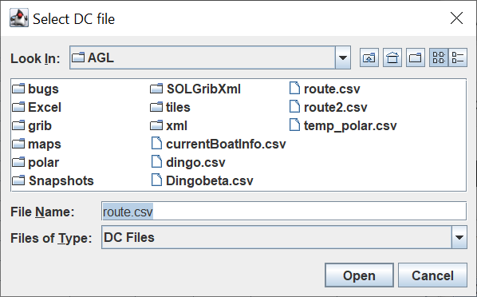

Select the import file and select **Open**. Provided the file is valid the DC Data table will be launched.

If the file is not valid, AGL says so and the DC Data table is not launched. 

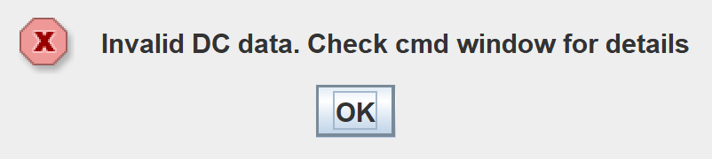

If the file that is already set can no longer be read, AGL asks whether to select a new file.

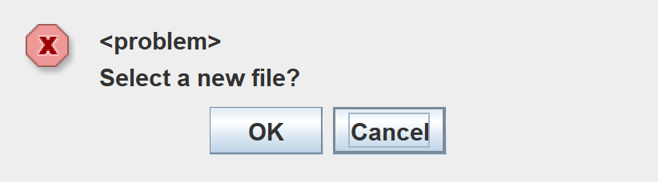

The command (cmd) window says what is wrong, for example a missing column or the line with bad data. Correct the file, or choose another one. The table then opens as shown below, ready for use.

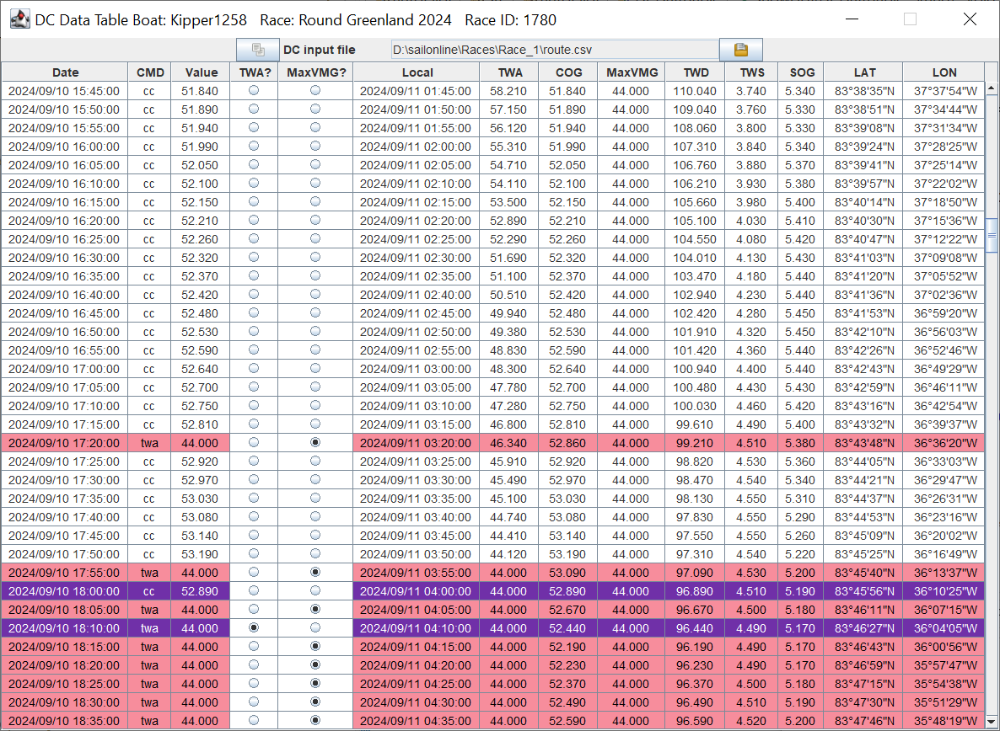

**Note:** AGL watches the DC file and loads the new data whenever it is modified (see [6.3 DC File Change Detection](0600-dc-data-table.md#63-dc-file-change-detection)). This allows the user to keep reusing the same file for each import from the csv file.

During the load, AGL has checked if any DCs are outside the optimum VMG range, and if so, has automatically set the command to “twa” and the value to maxVMG. This can be turned off by deselecting the MaxVMG radio button, in which case the value and command will be set to COG/cc.

### 6.2.1 The Control Panel

Across the top of the DC Data Table is the control panel.

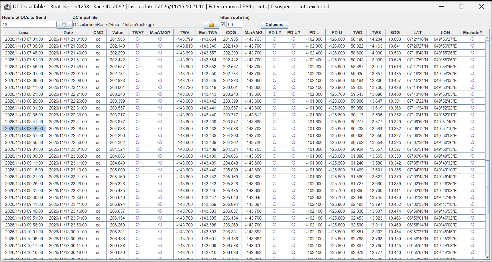

- **Hours of DCs to Send** is used by **Send Hr** (see [6.4.2 Send Hr](0600-dc-data-table.md#642-send-hr)). The  button next to it sends the selected DCs, as **Send** does.
- **DC input file** shows the file that is loaded. The  button opens the file chooser (see [6.5.3 Select File Button](0600-dc-data-table.md#653-select-file-button)).
- **Filter route (m)** cleans a GPX route as it is loaded (see [6.2.2 Filter Route](0600-dc-data-table.md#622-filter-route)).
- **Columns** shows or hides columns (see [6.2.4 Columns](0600-dc-data-table.md#624-columns)).

The title bar of the window reads **DC Data Table | <boat> | last updated <time>**. After a GPX route has been loaded it can also end with **| Filter removed N points** and **| N suspect points excluded**.

### 6.2.2 Filter Route

A qtVlm GPX route can hold points that add nothing, such as a point a few seconds after the one before it. Left alone, they turn into near duplicate DCs, or into false performance loss blocks. When a GPX route is loaded, AGL takes out:

- every point that lies within the tolerance of the straight line between its neighbours, and
- the earlier of two points that are closer in time than the recovery time.

The first point (the boat) always stays. Tick the box to switch the filter on, and enter the tolerance in metres in the box next to it (the default is 2). The file reloads when you change the tolerance, and the tick takes effect on the next load (**Reload**). The GPX file itself is not changed, and CSV files are not filtered. Feedback shows one line when points were removed, for example "Route filter: 766 points to 205".

### 6.2.3 Suspect Points and the Exclude? Column

While qtVlm honours a waypoint it sometimes puts a very short leg with a sharp change of course into a GPX route. When a route is loaded, AGL ticks the first point of such a leg in the last column, **Exclude?**. A point is suspect when its leg takes less than half the median leg time, the leg after it is not short, and the course turns sharply into the leg and back the other way. A tack or a gybe turns one way and stays turned, so it is not flagged. The first point is never flagged.

A ticked row is magenta and shows no values of its own. Excluded points are not sent (Send, Send To, Send Hr, Append and Copy), are not drawn on the grey DC trace, and are left out when the legs of the other rows are worked out. You can tick any other point, or untick a suspect one, and the table is worked out again at once. The file is not changed, and reloading it starts again from AGL's own choice. AGL writes each detection and each tick or untick to `logs/route_suspects_<race id>.csv`, so that the rules can be tuned later.

### 6.2.4 Columns

The **Columns** button opens the Show or hide columns window, with a tick box for each column. Date, CMD, Value and Exclude? cannot be hidden (they are greyed and ticked). The DC and PL columns are not used in the file table, so they are not listed. The choice is kept for the race and applied again at every load. Nothing is hidden at first. The DC Editor has its own choice.

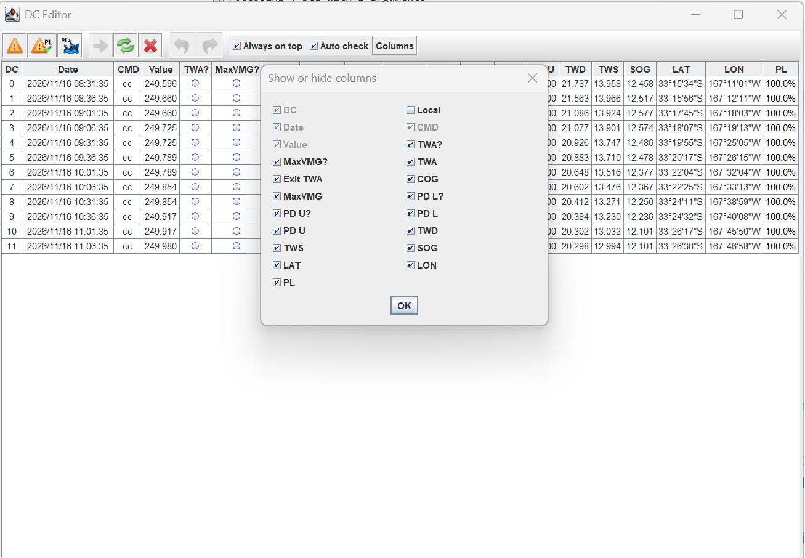

## 6.3 DC File Change Detection

AGL watches the DC file loaded in the DC Data Table, so you do not need to reload it by hand.

### 6.3.1 How it works

- When AGL starts, if the DC input file shown in the DC Data Table already exists, AGL begins watching it straight away. The DC Data Table stays hidden until it is needed. If the file does not exist yet, nothing is watched until you open the DC Data Table for the first time.
- When the DC file changes (for example, after you export a new route from qtVlm), AGL waits a moment to make sure the file has finished being written, then reloads it. The DC Data Table is brought to the front, and if the main AGL window was minimised it is restored first.
- Each time the DC Data Table loads, the DCs are also plotted in the graphics window as a grey trace: a grey dot for each DC, joined by a line, with a label (day and time) on every fourth DC. The  button on the graphics toolbar turns the trace on and off. The trace appears once the DC Data Table has been shown.
   The DC Data Table sends the trace straight to the graphics. It does not write a file. Points that are excluded (see [6.2.3 Suspect Points and the Exclude? Column](0600-dc-data-table.md#623-suspect-points-and-the-exclude-column)) are left out. An example of the grey trace is shown below.

  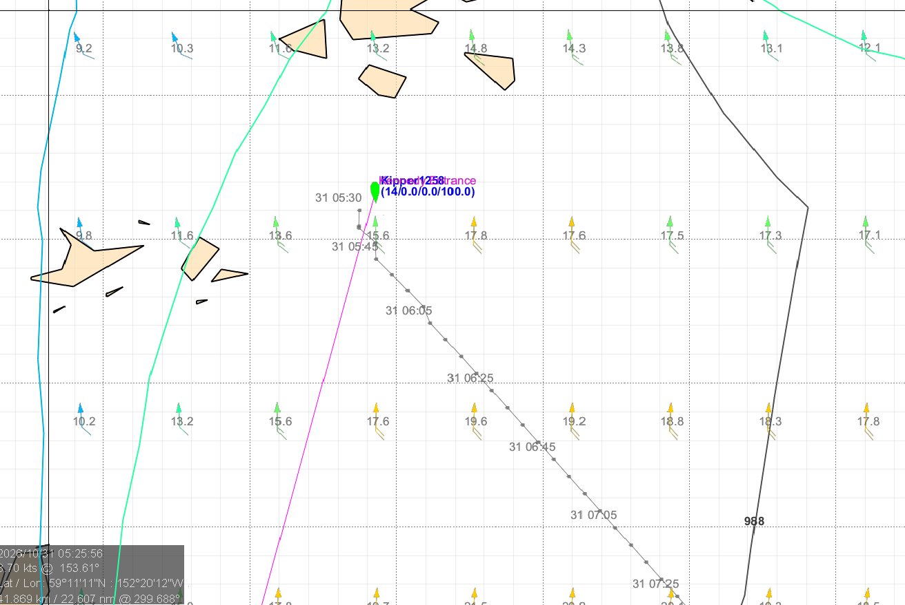

### 6.3.2 Changes to a different file

qtVlm can save its exports in a different folder from the one AGL is watching. To guard against this, when qtVlm shows its Save As confirmation after you export a route or a roadbook, AGL checks for 30 seconds for changes to files of the same type in the race folder, the qtVlm folder and the grib folder. If it finds a changed file that is not the one currently in use, it asks:

“A change has been detected in &lt;file&gt; which is not the file being used (&lt;current file&gt;). Use that file instead?”

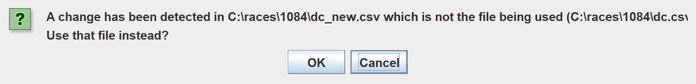

- **OK** loads the changed file, and it becomes the DC input file.

- **Cancel** keeps the current file.

You are asked once for each change to a file, whatever you answer.

**Note:** If the DC file cannot be read when AGL starts, AGL says nothing. You will be asked about it when you open the DC Data Table.

## 6.4 Setting the DCs

The DCs first need to be transferred to the Delay Commands area on the DC Checker tab in the main AGL window. There are four possible options.

**Send To**, **Send Hr**, **Send** and **Append** do three things in one step: they put the DCs in the DC area, they check them, and they open the DC Editor (see [6.6 The DC Editor](0600-dc-data-table.md#66-the-dc-editor)) in place of the DC Data Table, which is hidden. The graphics are fitted to the new trace. Rows that are ticked **Exclude?** are not sent. **Copy** only copies the DCs to the clipboard. If nothing is selected, none of these clear the DC area.

### 6.4.1 Send To

DCs can be sent to the **DC Checker** using the **Send To** option. All DCs from the first row of the table up to and including the selected DC will be sent to the **DC Checker**. In the example below, all DCs up to and including **2024/09/18 12:25:00** will be sent to the **DC Checker.**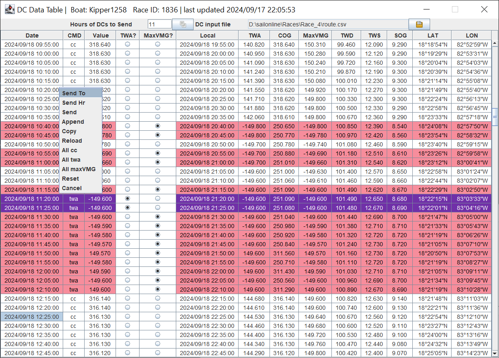

### 6.4.2 Send Hr

This option will send all DCs that are earlier than the number of hours specified in **Hours of DCs to Send** on the parameters bar at the top of the table. The number of hours (11) is added to the first DC time (2024/09/17 23:55:00) and all DCs up to 11 hours later (2024/09/18 10:55:00) are transferred to the **DC Checker**. The DCs that were sent are also highlighted as shown below.

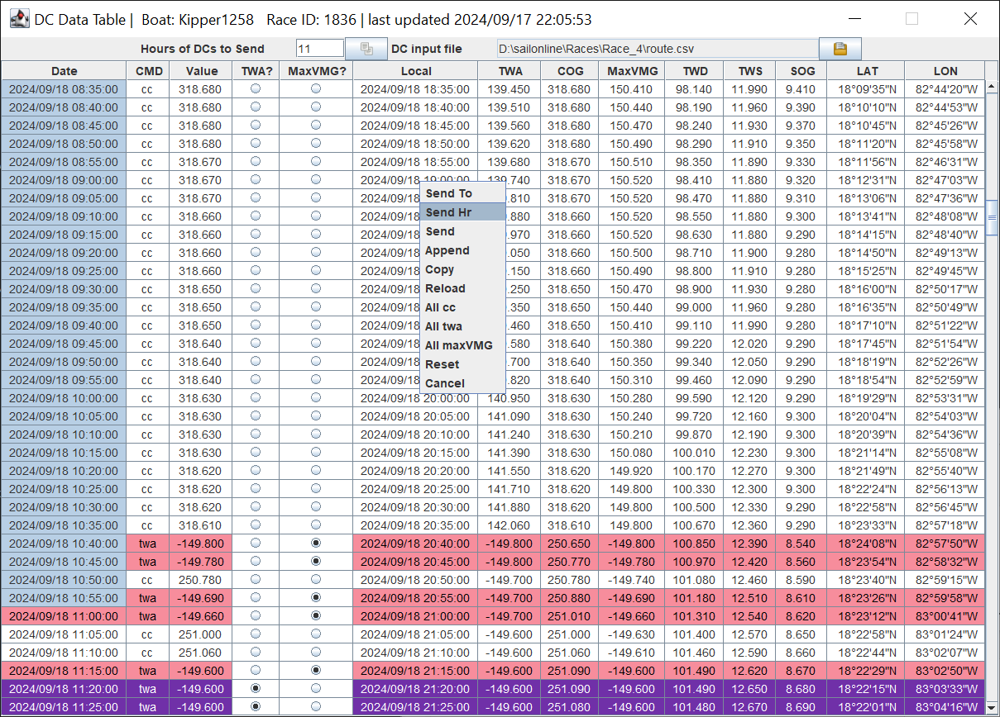

### 6.4.3 Send

The following steps do this.

1.  Select the desired DCs in the DC Data Table by clicking in the first cell and holding down the left mouse button to cover the rows of interest. The rows do not need to be contiguous.

    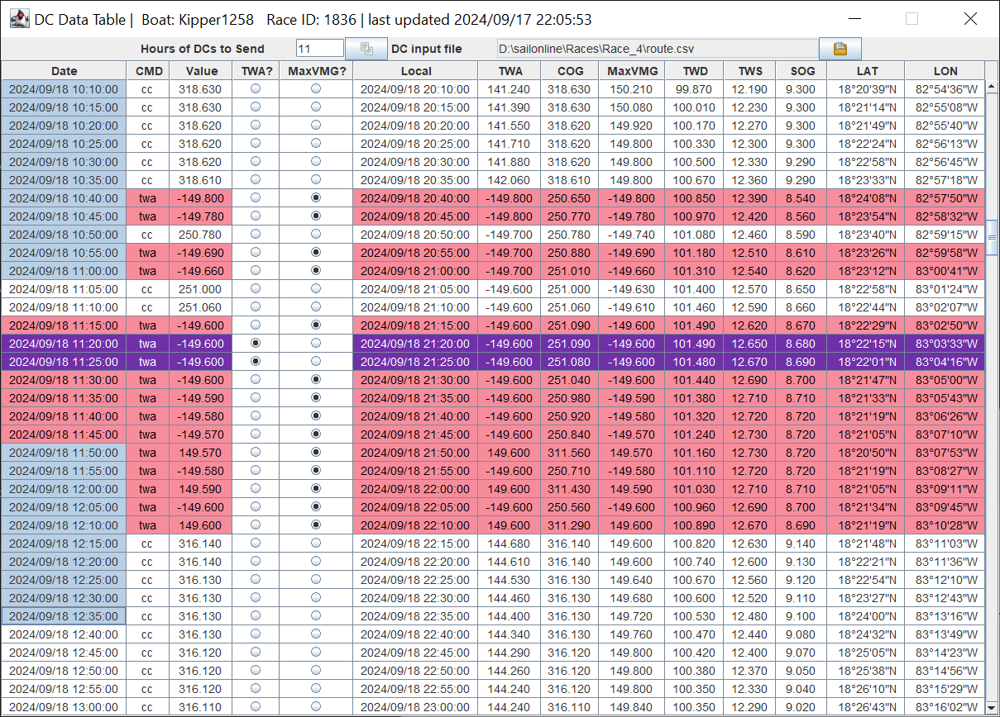

2.  The transfer can happen in one of three ways

    - Using the  button at the top of the table.

    - Using the right mouse click **Send** option

      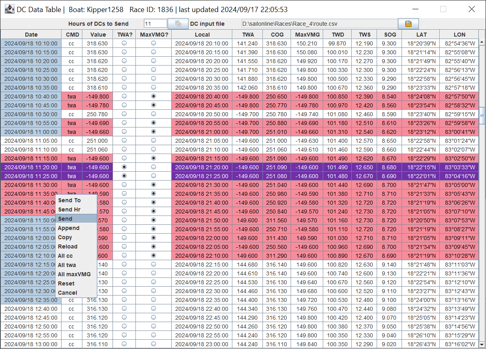

3.  Using Ctrl C / Ctrl V or right click **Copy** and Ctrl V in the **Delay Command** area on the **DC Checker** tab. (This only places the DCs there. Check them yourself.)

The DCs will now be transferred and ready for checking and setting in the normal way.

### 6.4.4 Append

All the previous DC transfers cleared the **Delay Commands** area with a complete new set. It is possible to append the selected DCs to those already sent to the **DC Checker.** To append, select the desired DCs (they must be selected as shown below) and use the **Append** option.

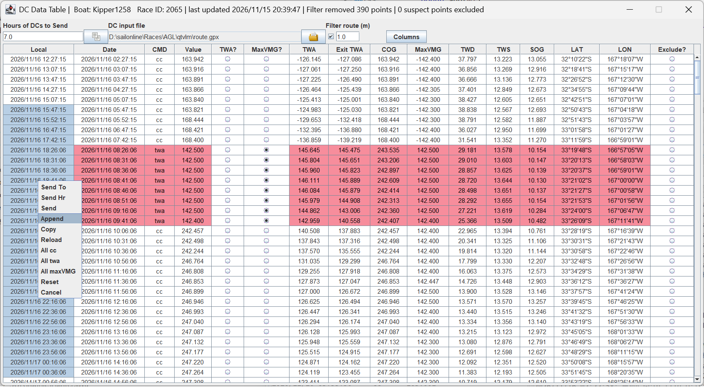

The selected DCs are added to the end of the existing ones as shown below, and can be processed in the normal way. Out of sequence appends and duplicates do not matter; the **DC Checker** will sort that out.

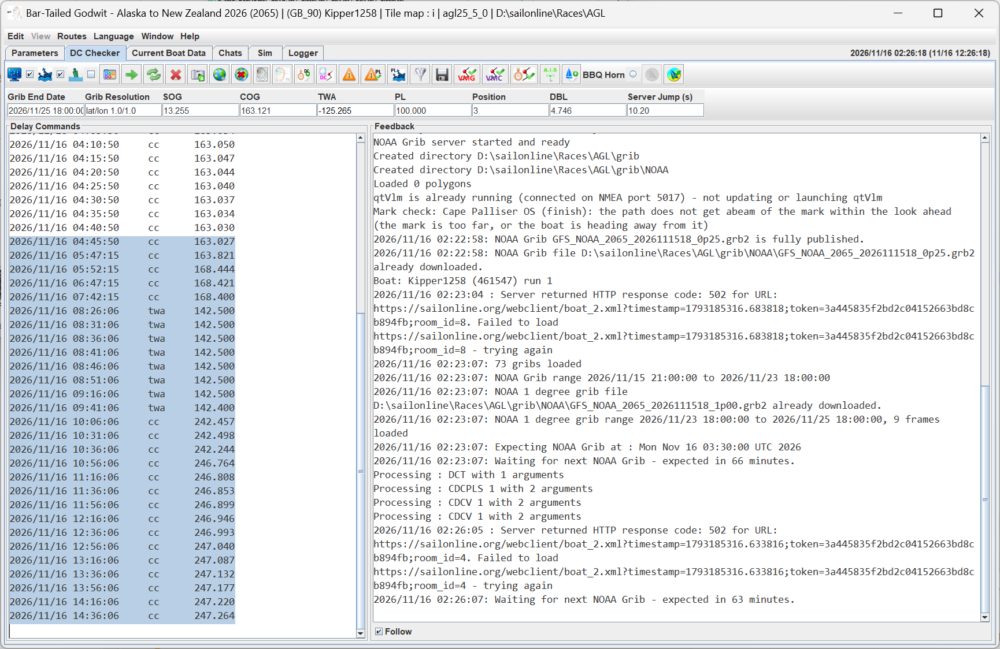

## 6.5 Other Buttons

### 6.5.1 Right Click Menu

The right click menu has the following options as shown below.

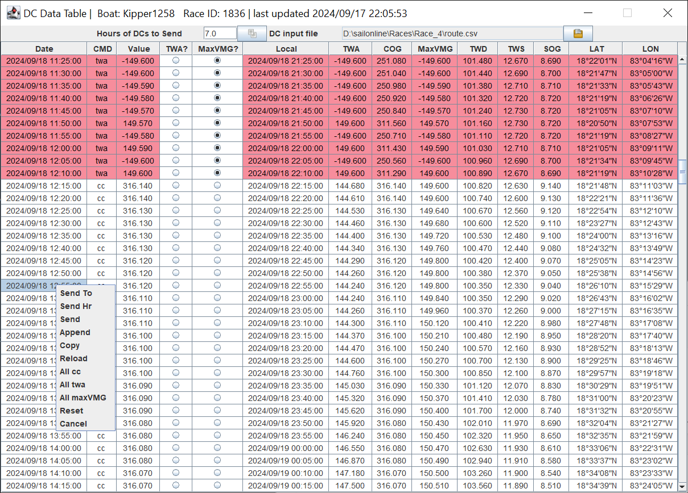

**Send To:** Sends all DCs from the first row to the selected row to the DC Checker.

**Send Hr:** Sends the number of hours of DCs specified to the DC Checker.

**Send**: Sends the selected DCs to the DC Checker.

**Append:** Appends the selected DCs to those already in the DC Checker.

**Copy:** Copies the selected DCs to clipboard.

**Reload:** Reloads the current selected DC input file. Useful if the same file name is used with each DC update.

**Reset:** Loads the file again and scrolls the table back to the top.

**All cc:** Sets the selected DC values to the COG values and command to **cc**.

**All twa:** Sets the selected DC values to the **TWA** values and command to **twa**.

**All maxVMG:** Sets the selected DC values to the **MaxVMG** and command to **twa**.

**Cancel:** Aborts the pop-up menu and does nothing.

### 6.5.2 Send DC Button 

Same function as **Send** above. The tip reads "Transfers selected DCs to DC area and checks them".

### 6.5.3 Select File Button 

Opens the file chooser.

**Open** will open the selected file and update the table. **Cancel** will do nothing.

## 6.6 The DC Editor

The DC Editor is the same table, showing the DCs that are in the DC area instead of the DCs of a file. Use it to look at the DCs the checker has worked on, and to change their time, command or value before you set them. Nothing you do here reaches the server until you set the DCs.

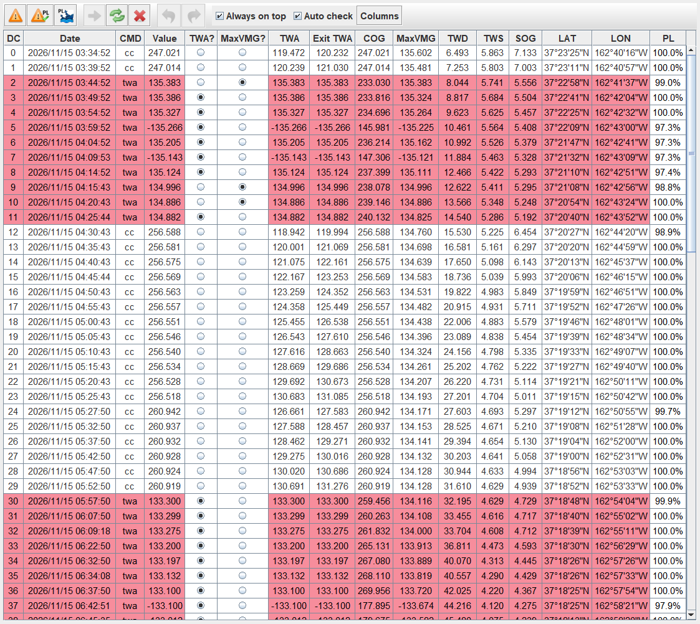

### 6.6.1 Opening the DC Editor

The DC Editor opens when you use **Send**, **Send To**, **Send Hr** or **Append** in the DC Data Table, and when you click the DC Editor button  on the Gui toolbar or the graphics toolbar. The window keeps its size and position for each race.

### 6.6.2 The Toolbar

From the left, the buttons do what the same buttons do on the Gui toolbar:

-  **Check** checks the DCs. With **Use Performance Loss** ticked,  **Check PL** is shown as well, and checks them with performance loss (see [5.1.10 Check DCs Button](0500-using-agl.md#5110-check-dcs-button)).
-  the BBQ Checker ( with performance loss), see [5.2.2 The BBQ Checker](0500-using-agl.md#522-the-bbq-checker).
-  applies the DCs to the server. It is greyed if nothing has changed.
-  reloads the DCs from the server. If you have changed the DCs, AGL asks first.

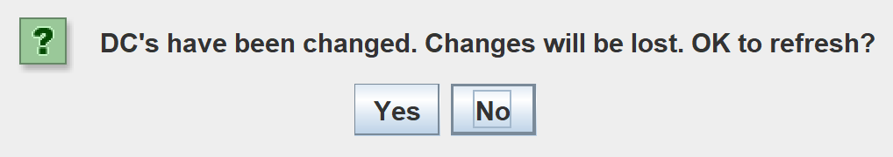

-  **Delete** takes out the selected DCs (see [6.6.6 Deleting DCs](0600-dc-data-table.md#666-deleting-dcs)).
-  and the same icon turned over undo and redo the last edit. They are the same ones as on the graphics toolbar, so an edit made on the graphics can be undone here.

The two tick boxes are **Always on top**, which keeps the window over the others, and **Auto check**, which is ticked at first. With **Auto check** on, every edit is followed by a check, so the values in the table and the trace in the graphics are up to date. The graphics keep their zoom. **Columns** opens the Show or hide columns window.

### 6.6.3 The Columns

| **Column** | **What it shows** |
|---|---|
| DC | The DC's number, counting from 0. It is the number the graphics shows for that DC, so a DC you picked on the graphics can be found here. PL DCs have no number. Always shown. |
| Local | The time in your time zone. Hidden at first. |
| Date | The time the DC fires, in UTC. |
| CMD | The command, **cc** or **twa**. |
| Value | The value of the command, in degrees. |
| TWA? and MaxVMG? | Choose what the DC follows: its own TWA, or the maxVMG limit. |
| TWA | The true wind angle of the boat after the DC. |
| Exit TWA | The true wind angle at the end of the leg. |
| COG | The course over the ground. |
| MaxVMG | The best angle to the wind, upwind or downwind, for the wind at that DC. |
| TWD, TWS, SOG | Wind direction, wind speed and boat speed. |
| LAT, LON | The position, in degrees and minutes. |
| PL | The performance loss at the DC as a percentage. 100% means no loss. A value under 93% is shown in orange bold. |

The values come from the last check. The **Columns** button shows or hides all but DC, Date, CMD and Value, and the choice is kept for the race.

### 6.6.4 Editing DCs

- Click on a **Date**, **CMD** or **Value** cell and change it. One click is enough. The date is changed one part at a time (day, hour, minute, second).
- To pick a row without editing it, click its number in the DC column. Ctrl + click adds or removes a row, Shift + click or a drag over the numbers picks a range. Press Escape, or click on the empty part of the table below the rows, to clear the selection.
- Click the **MaxVMG?** choice and the DC's value follows the maxVMG limit. The limit moves a little with each check, so the value follows it. AGL does this for up to five rounds after an edit. A **TWA?** choice keeps the DC at that angle.
- A row is highlighted when its TWA is outside the maxVMG limits. AGL sets such a row to maxVMG for you, as if you had ticked its **MaxVMG?** choice, so the DC area then counts as edited and, with **Auto check** on, the DCs are checked again.
- The right click menu holds **Copy**, **All cc**, **All twa**, **All maxVMG** and **Remove**, which work on the selected rows.

### 6.6.5 Performance Loss Blocks

A performance loss (PL) block is the group of DCs that carry out a tack or a gybe. The block shows as one DC in the **DC** column: its first DC (the entry DC) holds the number. The PL DCs have a light green background and grey text, and cannot be edited. The last DC of the block (the exit DC) can be edited for its CMD and Value, but not its Date.

To move the block, change the **Date** of the entry DC. The whole block moves with it. To remove a block, delete its entry DC. The PL DCs go with it.

### 6.6.6 Deleting DCs

**Delete**  takes the selected DCs out of the DC area. The server is not touched until you set the DCs. If nothing is selected, AGL asks whether to delete all of them.

