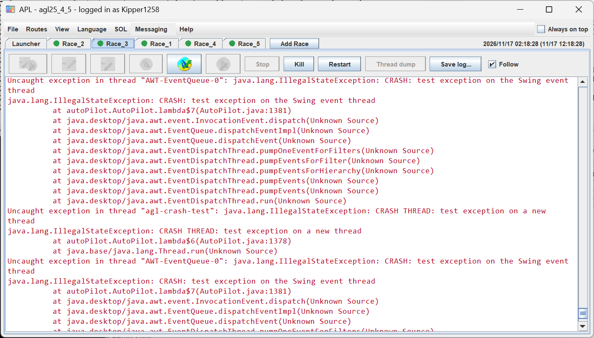

# 10 Known Issues and Bugs

There are no known bugs.

If something goes wrong, AGL shows an exception, in red, on the race's tab in the hub (and in the command window or Terminal). It starts with "Uncaught exception in thread" and is followed by lines starting "at". The example below is a test exception.

If you see one, or something does not work as it should, choose **Help > Mail logs**. AGL zips the hub log and the logs of your races, with your keys and passwords taken out, opens a new message addressed to the author, and shows you the zip so you can attach it. Say what you were doing when it happened, and then send the email with the zip attached.
