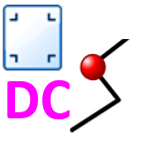
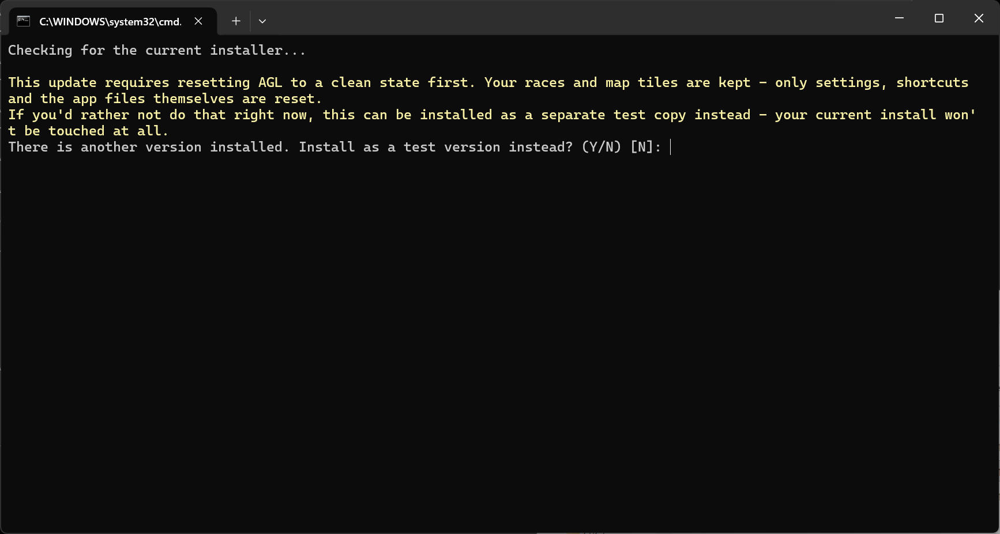

# AGL 25 Release Notes

AGL 25.5.X is another major release chain with a lot of new functionality. The focus of this has been to move waypoint files (now routes) and DCs into an SQLite database to preserve historic data, and allow comparison of current to past data in the graphics. There are several changes, with a significant number of button icon changes and buttons removed. Please read the release notes for what they are, and the User Manual for how to use them.

**Important**: Login in is now handled by the hub. On upgrade, you must enter your credentials into the hub and validate before starting any races. See [2.3.3.9 The SOL Login](manual/0200-installing-agl.md#2339-the-sol-login) and [3.1 Login & Race](manual/0300-configuration.md#31-login-race).

## Version 25.5.1

### Enhancements

#### Editing and checking DCs

1. A new DC Editor shows the DCs of the DC area as a table you can edit directly. See [6.6 The DC Editor](manual/0600-dc-data-table.md#66-the-dc-editor).

    a. Click a cell to edit it. Times use a date spinner limited to the neighbouring DC times, and the graphics updates automatically.

    b. Performance loss (PL) blocks are shown and moved as one block.

    c. A PL column shows the performance loss at each DC, and DCs outside maxVMG are set to maxVMG for you.

    d. Undo and Redo are shared with the graphics.

2. With Use Performance Loss ticked there are two check buttons: Check PL , which adds the PL DCs to the DC area, and a plain Check  that shows the DCs exactly as the DC Editor holds them. A DC Editor  button sits beside them on the graphics toolbar. See [5.1.10 Check DCs Button](manual/0500-using-agl.md#5110-check-dcs-button).

3. The PL labels in the graphics show the PL the boat arrives with and, in brackets, the PL after the turn. See [5.3.2.3 DC Labels](manual/0500-using-agl.md#5323-dc-labels).

4. A new message, **DCs edited, not set**, warns you by Pushover, Telegram or on screen when you have edited the DCs and not set them for a chosen time, and lets you Set Now, Refresh or Leave, on the screen and on Telegram. See [5.2.6 DCs Not Yet Set](manual/0500-using-agl.md#526-dcs-not-yet-set).

5. Setting the DCs now looks after PL blocks, and resends a DC that latency has made late. See [5.1.2 Set Button](manual/0500-using-agl.md#512-set-button).

#### The DC Data Table

1. Routes loaded from qtVlm GPX files are cleaned of redundant points. The tolerance, 2 m to start with, is set in the **Filter route (m)** box. See [6.2.2 Filter Route](manual/0600-dc-data-table.md#622-filter-route).

2. A point where the route turns sharply in and straight back out, over a short leg, is treated as a suspect point. It is ticked in the **Exclude?** column, shown in magenta, and is not sent or drawn. See [6.2.3 Suspect Points and the Exclude? Column](manual/0600-dc-data-table.md#623-suspect-points-and-the-exclude-column).

3. Send, Send To, Send Hr and Append now check the DCs and open the DC Editor, hiding the DC Data Table. See [6.4 Setting the DCs](manual/0600-dc-data-table.md#64-setting-the-dcs).

#### Multiple traces and records of the race

1. The multiple traces option in the graphics has been improved. See [5.3.3.1 The Traces Form](manual/0500-using-agl.md#5331-the-traces-form).

    a. Each trace starts at the boat's position when it was made, marked with a boat icon.

    b. Each new trace made in the graphics (Condition, Move, Switch Sign, etc) is stored and can be recalled as an overlay.

2. A new Stored Sets form lists every Set kept for the race, so you can show them as traces, export them as GPX routes or delete them. See [5.3.3.2 Stored Sets](manual/0500-using-agl.md#5332-stored-sets).

3. Race DC Trace keeps every DC that fired, with what was known when it was set, and shows them on the chart, with those of earlier years of the same race. See [5.3.3.3 Race DC Trace](manual/0500-using-agl.md#5333-race-dc-trace).

4. A new **Info**  item in the graphics right-click menu shows the details of any DC you click, current or past. See [5.4.2 The Right Click Menu](manual/0500-using-agl.md#542-the-right-click-menu).

5. Boat traces are kept for the whole race, also after AGL is restarted, with any gaps filled in when the server's traces arrive. See [5.3.3.4 Boat Traces](manual/0500-using-agl.md#5334-boat-traces).

6. A trace can be exported as a GPX route from the Traces form, and the GPX export of stored Sets carries the id the server gave each DC. See [5.3.3.1 The Traces Form](manual/0500-using-agl.md#5331-the-traces-form).

#### Routes and waypoints

1. Routes and waypoints are now kept in an SQLite database, managed by the hub, for all your races, and AGL no longer reads or writes waypoint files. See [5.5.1 The Routes and Waypoints Form](manual/0500-using-agl.md#551-the-routes-and-waypoints-form).

    a. A Routes menu and a graphics button open the Routes form, to import and export routes and to make, copy and delete them.

    b. Each route can be shown in its own colour, and one route is the active route.

    c. Only routes inside the race area are listed. Deleted routes can be restored.

2. Waypoints can be edited on the graphics, with new right-click commands, and edits are kept as you make them (there is no Save). See [5.5.3 Editing Waypoints on the Graphics](manual/0500-using-agl.md#553-editing-waypoints-on-the-graphics).

3. The WP Route box on the Parameters tab chooses the route from a list, and so does the Open  button on the graphics toolbar. See [3.2 Waypoints](manual/0300-configuration.md#32-waypoints) and [5.5.2 The Active Route](manual/0500-using-agl.md#552-the-active-route).

4. A Waypoints and Routes window in the hub shows the routes and waypoints of every race. Old routes of any race can be managed there. See [5.5.7 Waypoints and Routes in the Hub](manual/0500-using-agl.md#557-waypoints-and-routes-in-the-hub).

5. The additional course waypoints have been removed, and replaced by Import Route and Show Route. See [3.2 Waypoints](manual/0300-configuration.md#32-waypoints).

6. A route can be built and changed in the Routes form: Edit, Add, Remove, Up and Down work on the waypoints of the route. See [5.5.1.2 Changing the Waypoints of a Route](manual/0500-using-agl.md#5512-changing-the-waypoints-of-a-route).

7. When more than one waypoint is at the spot you click for Edit, Add, Remove or Delete, a small dialog lets you choose which. See [5.5.3 Editing Waypoints on the Graphics](manual/0500-using-agl.md#553-editing-waypoints-on-the-graphics).

#### Graphics window

1. Four new zoom buttons: zoom in, zoom out, zoom to the current trace and zoom to the race area. See [5.4.1 Toolbar Icons](manual/0500-using-agl.md#541-toolbar-icons).

2. Commands no longer reset your zoom. The view is fitted to the new trace only when you Send from the DC Data Table.

3. Other boats are easier to read. See [5.3.2.1 View](manual/0500-using-agl.md#5321-view).

    a. A finished boat is shown as a grey dot with no name.

    b. Every named boat shows its ranking.

    c. Hover over a boat to show its statistics and its trace.

4. The graphics right-click menu now shows only the items that apply to what is on the chart. See [5.4.2 The Right Click Menu](manual/0500-using-agl.md#542-the-right-click-menu).

5. A new **Clear** item in the right-click menu, and the W key, clear the chart of traces, DC points and routes that are not active. See [5.4.2 The Right Click Menu](manual/0500-using-agl.md#542-the-right-click-menu).

6. View Options has a new Wind barbs box to set the barb size and spacing. See [5.3.2 View Options](manual/0500-using-agl.md#532-view-options).

#### Messages and Chats

Items 1 to 3 are for members only.

1. Pushover, Telegram and the messages are now set up once in a new hub **Messaging** form, which replaces the Pushover and Telegram hub menus. See [8.1.2 Setting Up Pushover](manual/0800-chats.md#812-setting-up-pushover).

    a. The form holds the Pushover settings, the Telegram bot and the table of messages. Changes reach every running race as you make them.

    b. Each race has a **Use Hub** tick, to follow the hub's settings or keep its own.

2. The active times for Pushover and Telegram are set once in the hub; a race can follow them or keep its own. See [8.1.4 In Each Race](manual/0800-chats.md#814-in-each-race).

3. The Chats tab shows the boat data (SOG, COG, TWA, PL, Position, DBL and Server Jump) in a row at the top, so it can be read while chatting. See [8 Chats](manual/0800-chats.md#8-chats).

4. Every text box now has the right-click menu (Undo, Cut, Copy, Paste, Select All). See [8.1.1 Replying To Messages](manual/0800-chats.md#811-replying-to-messages).

#### The NOAA grib

1. When you open Routing settings in qtVlm, AGL warns you if the grib qtVlm has loaded is older than the one AGL is using. See [7.3.1 current_grib.grb](manual/0700-noaa-server.md#731-current_gribgrb).

2. AGL warns you before the NOAA download if it does not have enough memory for the grib, and again if it runs out of memory while loading it. See [7.4 Memory](manual/0700-noaa-server.md#74-memory).

#### The hub

1. The hub now manages the SailOnline login for all races. Enter your user name and password once in SOL > Login, and every race uses it. A race can still sail as another user, and you can switch user in a running race without closing it.  Ticking or clearing Use SOL in a running race also changes its login at once.
2. A new Races tab in the hub lists every SailOnline race with its registration status and start time. Tick Register? to be registered, and Ignore? to put a race aside, then click Apply. You can open a race to look at it before registration opens (logged in as sol), and the hub registers you automatically when it opens. Timed races are registered at the start and again after they finish. The tab finds the races you are registered in by itself, including ones you registered on the website. See [2.3.3.10 The Races Tab](manual/0200-installing-agl.md#23310-the-races-tab).
3. Closing the hub now closes all its races, which come back on the restart. See [2.3.3.8 Closing the Hub](manual/0200-installing-agl.md#2338-closing-the-hub).
4. Window frames show the state of a race: red for the Simulator, orange while qtVlm is waiting, and purple when Use SOL is ticked. See [2.3.3.11 Window Frame Colours](manual/0200-installing-agl.md#23311-window-frame-colours).
5. A hub for production and one for beta can run on the same computer without overwriting each other's settings. See [2.3.3.1 The Hub Window](manual/0200-installing-agl.md#2331-the-hub-window).
6. When you complete setting DCs for a race, the hub switches to that race's tab to allow you to stow all that race's windows (this can be turned off in the Launcher tab). See [2.3.3.3 The Launcher Tab](manual/0200-installing-agl.md#2333-the-launcher-tab).
7. A new Stow All button beside Add Race minimises all the AGL and qtVlm windows of every race in one click. See [2.3.3.1 The Hub Window](manual/0200-installing-agl.md#2331-the-hub-window).

#### Logging

1. The Logger tab now holds the essentials, and **View > Detailed logging** adds the working detail of checks and routes. The log is much smaller. See [2.3.4.2 The View Menu](manual/0200-installing-agl.md#2342-the-view-menu) and [2.3.4.3 The Help Menu](manual/0200-installing-agl.md#2343-the-help-menu).

### Bug fixes – 25.5.1

1. +P / -P and FP+ / FP- waypoints no longer go direct when the boat has already sailed the pivot. See [5.2 Checking the Course](manual/0500-using-agl.md#52-checking-the-course).
2. BBQ and mark warnings have been corrected. The phone's BBQ warning now agrees with the predictor trace, so there are no false run-aground warnings, and the warnings are sent whenever In Control is ticked. See [5.2.1 Switching the Checks On](manual/0500-using-agl.md#521-switching-the-checks-on).
3. The Traces list no longer fills with checks AGL makes by itself.
4. In the DC Table, Delete, Send and Copy with nothing to act on no longer clear the whole DC area.
5. The hub, the race window, the Waypoints and Routes window, the DC Editor and the Chats window no longer grow a little each time AGL restarts. Resize each once after updating.
6. Add Race is held off while the hub is still restarting your races.
7. The VMC check for waypoints no longer gives travel times that are too optimistic. See [5.4.1 Toolbar Icons](manual/0500-using-agl.md#541-toolbar-icons).
8. The BBQ Checker no longer fails to fix a collision because a route exporter put a DC with almost the same course next to the DC it moves. Such DCs are now ignored by the checks. See [5.2.2 The BBQ Checker](manual/0500-using-agl.md#522-the-bbq-checker).
9. A finish line missed just after the last DC is now found, and the BBQ Checker says so in the Logger when the path does not reach the finish. See [5.2.4 The Finish](manual/0500-using-agl.md#524-the-finish).
10. The graphics could stop redrawing when the BBQ red dots were on screen and the current trace was hidden. Each trace now keeps its own dots. See [5.3.3.1 The Traces Form](manual/0500-using-agl.md#5331-the-traces-form).
11. The release notes now open in the browser after a Beta update as well (the beta page for a Beta install).

## Version 25.4.3

### Bug fixes – 25.4.3

1. A race restarted from a folder that already has a DC Data Table file no longer hangs at "Waiting for the NOAA grib to load". It happened when some DCs in the file are dated beyond the SOL weather (more than about 7 days ahead), where only the NOAA weather has data. The DC Data Table file is now read without waiting, and the NOAA download starts as normal.

2. PL blocks no longer drift away from the target PL causing PL DCs not to be recognised as such.

3. The BBQ Checker handles PL blocks properly when it offers a correction. The checker now offers that fix and moves the whole block with it, instead of reporting "Unable to prevent BBQ". See [5.2 Checking the Course](manual/0500-using-agl.md#52-checking-the-course).

4. A race that hangs now leaves a thread dump, and Kill in the hub zips the logs and opens an email to the author.

5. The build number is shown when AGL starts and in the patch dialog.

## Version 25.4.1

**IMPORTANT – updating to 25.4.1 on Linux:** On some Linux desktops (seen on Linux Mint) the update does not start when AGL is started from its desktop icon: you choose **Update Now**, nothing opens, and the next time you start AGL it says an update is in progress. This is fixed in 25.4.1, but earlier versions have it, so to get to 25.4.1:

1. Open a Terminal window and start AGL from it, then choose **Update Now** as usual. The update window opens. For a Production install type

    ```
    sh -c "'$HOME/SOL/Java25/AGL_start.sh'"
    ```

    (use the folder AGL is installed in if it is not ~/SOL/Java25; for a Beta install use `Java25Beta` and add `--channel=beta` after the closing quote of the path). Or run the installer yourself, as described in section [2.1.3 Linux](manual/0200-installing-agl.md#213-linux) of the User Manual.

2. If AGL says an update is in progress and no update window is open, delete the update lock and start AGL again:

    ```
    find ~ -maxdepth 3 -path '*sessions*' -name update.lock -delete
    ```

### Enhancements

#### Checking your course before it goes to the server

1. AGL can now pre-check DCs for BBQs, missed sea marks and the finish line, with solutions offered to you before the DCs are set. Nothing is changed until you accept a suggestion. The DC Checker also marks the BBQs it finds with red dots, and Tack/Gybe later is available for land avoidance. See [5.2 Checking the Course](manual/0500-using-agl.md#52-checking-the-course).

2. When a DC falls outside maxVMG, AGL now conditions the whole DC list, with Condition All and Set Anyway. See [5.4.4 Conditioning DCs](manual/0500-using-agl.md#544-conditioning-dcs).

3. A new Follow command in the graphics popup menu adds waypoints along a coastline between two waypoints. See [5.4.2 The Right Click Menu](manual/0500-using-agl.md#542-the-right-click-menu).

#### Messages to your phone

1. AGL can now message your phone live through Pushover and Telegram: weather arrived, about to run aground or run aground, going to miss or missed a mark, a race starting with no course, and the server DCs running out before the next Wx (No DCs). Emergency messages repeat until you acknowledge them on the phone. See [8 Chats](manual/0800-chats.md#8-chats).

2. Pushover is set up once in the hub for all races. See [8 Chats](manual/0800-chats.md#8-chats).

3. Telegram runs from a single bot in the hub, with channels for each race. AGL can propose a course change on your phone, and it is applied only when you confirm it there. A set of commands lets you check status and send course changes from the phone. See [8 Chats](manual/0800-chats.md#8-chats).

4. Replication of the SOL client chat rooms in a tear off chat tab. See [8 Chats](manual/0800-chats.md#8-chats).

5. Messages sent from AGL over 187 characters in length are split into parts and transmitted at once, and AGL attempts to join split messages into one message. See [8 Chats](manual/0800-chats.md#8-chats).

#### Graphics window

1. A View Options form in the graphics window replaces several toolbar icons, and adds DC label fields, a legend, Fill land polygons and Font -/+ for the graphics. See [5.3.2 View Options](manual/0500-using-agl.md#532-view-options).

2. Grey DC trace in the graphics window, fed directly by the DC Data Table, with an on/off button; the additional waypoints are no longer overwritten by the DCs. See [6 DC Data Table](manual/0600-dc-data-table.md#6-dc-data-table).

3. AIS boats are now plotted after a race has finished.

#### qtVlm, gribs and DCs

1. AGL warns you when you open Routing settings in qtVlm and the grib has not been refreshed since the last Wx download.

2. The linked qtVlm can be set up in Production mode, or in Test mode to try a new qtVlm release before upgrading. AGL offers to link it again if its set-up is broken, and checks that its map tiles are the set that goes with the SOL maps. See [3.7 qtVlm](manual/0300-configuration.md#37-qtvlm).

3. AGL plots isobars from the pressure in the grib (SOL and NOAA), and keeps them when a new NOAA download starts. See [5.3.2.1 View](manual/0500-using-agl.md#5321-view).

4. AGL checks that it has enough memory for the NOAA grib. If it runs out, the grib already loaded stays in use.

5. The DC Data Table now starts watching the DC file when AGL starts, reloads it when it changes, and asks whether to switch if qtVlm saves a changed file in a different folder. See [6.3 DC File Change Detection](manual/0600-dc-data-table.md#63-dc-file-change-detection).

6. Manage qtVlm dialogs: the qtVlm windows Routing, Converting Routing to Route, Simplification result and Optimization results are brought to the front, one at a time, when they are hidden behind other windows. See [2.3.3.6 Managing qtVlm Dialogs](manual/0200-installing-agl.md#2336-managing-qtvlm-dialogs).

7. Races that start with a haulback are handled: AGL knows the boat does not move until the race starts, so waypoint conversion and the course commands wait for the start.

8. Downloads from the SailOnline server (race information, gribs, DCs and boats) are compressed where the server allows, retried if they fail, and the login is renewed if it expires.

#### The AGL Hub and starting AGL

1. The AGL Hub: one window on the taskbar with a tab for each race, showing the race's console and its controls (Pop, Stow, qtVlm Pop, qtVlm Stow, Stop, Kill, Restart, Thread dump, Save log). It replaces a window on the taskbar for each race. See [2.3.3 The AGL Hub](manual/0200-installing-agl.md#233-the-agl-hub).

2. Add Race can start several race folders at once. Open starts AGL in each; Start also presses Apply for you. Folders that already have an AGL running are greyed and skipped. See [2.3.3.5 Adding a Race](manual/0200-installing-agl.md#2335-adding-a-race).

3. Closing the hub can leave the races running (Close / Leave / Cancel). The next hub takes the running races up again. See [2.3.3.8 Closing the Hub](manual/0200-installing-agl.md#2338-closing-the-hub).

4. Restart races after a shutdown: the hub starts the races again after a Windows update restart, a crash or a power cut. See [2.3.3.7 Restarting Races After a Shutdown](manual/0200-installing-agl.md#2337-restarting-races-after-a-shutdown).

5. AGL_autostart.bat sets up AGL to start when you sign in to Windows, Windows signing in by itself, and locking the screen after that sign-in. See [2.3.3.7 Restarting Races After a Shutdown](manual/0200-installing-agl.md#2337-restarting-races-after-a-shutdown).

6. The hub has its own text size (View \> Text Size), an Always on top box, a UTC clock with the computer's time in brackets, and a hub icon on each race's window that brings the hub to the front. See [2.3.3.1 The Hub Window](manual/0200-installing-agl.md#2331-the-hub-window).

7. AGL starts in the hub and never starts a race or asks for a race folder by itself. Starting AGL again while the hub is open brings the hub to the front. See [2.3.1 Starting AGL Launcher](manual/0200-installing-agl.md#231-starting-agl-launcher).

#### Help, documentation and the Simulator

1. A Help menu in the hub and in every race window: Documentation, Manual, Release notes and Mail logs. Mail logs gathers the logs needed to find a problem, removes passwords and tokens from them, and opens an email to the author with the zip ready to attach. Nothing is sent until you press Send. See [2.3.4.3 The Help Menu](manual/0200-installing-agl.md#2343-the-help-menu).

2. The User Manual and Release Notes are now web pages. They are installed with AGL and open from the Help menu without the internet, and they are also online at https://alov1258.github.io/AGL-Release/. The PDF versions and their desktop shortcuts are no longer installed, and the installer removes the old ones when you update.

3. The Simulator (members only) stands in for the SailOnline server, so you can test AGL, and what you will see on your phone, without touching your real boat. It has its own Sim tab. Refer to [9 Simulator](manual/0900-simulator.md#9-simulator).

#### Windows, Parameters and logs

1. Text Size and Icon Size on the Parameters tab: Font -/+ and Icon -/+ with a preview of the icon size, applied with Apply Font. The font is always Dialog, so the font choice is gone. See [3.10 Graphics](manual/0300-configuration.md#310-graphics).

2. Parameters are saved to the ini file as they are changed, so the Save and Refresh buttons are gone. A value that is not valid is not saved, and Feedback says so. See [3 Configuration](manual/0300-configuration.md#3-configuration).

3. AGL remembers the hub and AGL window positions, and restores them on startup. A window whose size is wrong after it moves between screens of different scaling is repaired.

4. The Timed Race toolbar wraps on narrow windows.

5. Feedback now shows key information only. A new Logger tab holds the debug output. Logs are kept in `logger_<race>_current.txt` and rolled, and DC firing times can be logged to a file.

### Bug fixes – 25.4.1

1. General reliability and stability fixes

2. The wake up DC implementation was not working

3. Projection error when determining intersections with coastlines. Resulted in false intersections being determined

4. Fixed lock up if DCs were checked exactly when the Wx download started.

5. On Linux, the update window did not open when AGL was started from a desktop icon that runs in a terminal. It does now.

## Version 25.3.1

### Enhancements

1. A new grib file called current_grib.grb is made and is an exact replica of the gribs loaded into AGL’s memory. This grib file is updated every time a new grib or grib frame is replaced in memory. This can be loaded once into your routing package and simply refreshed to get the latest version.

2. NOAA gfs grib frames are loaded into memory as they arrive, updating AGL to be the same as the server will be when the SOL Wx arrives. Only available to SOL members.

3. Updating from versions earlier than 25.2.7 will follow the 25.2.7 update route.

4. All popup dialogs now launch at the mouse.

5. AGL detects existing sessions and will prevent multiple sessions starting from the same project.

Windows and Linux only. macOS will follow once working and will be enabled through the launcher when tested.

6. AGL can now make a separate instance of qtVlm which is linked to the current race. AGL can launch qtVlm with the correct polar for the race and current_grib.grb in slot 1.

> **Note:** This feature is available to SOL members only. It is a trial and may require a subscription payment to qtVlm for ongoing use.

7. Icons added to toolbar to maximise and minimise the qtVlm window linked to the race.

8. Validates port on startup to ensure no port mismatch for existing projects

9. Sets up qtVlm for SOL, and sets the matching tile set (High or Intermediate)

10. Sets the qtVlm polar to the race polar

11. Updates your boat name to match your SOL boat name

### Bug fixes – 25.3.1

1. The test to check if a file exists on disk now returns the correct answer.

2. General robustness and error trapping improvements

3. Fixed hang when boat list is empty, or not returned from the server

4. Fixed connection errors not being trapped by some classes.

## Version 25.2.7

**IMPORTANT:**

AGL 25.2.7 is a major update that builds on 25.1.5. The User Manual describes the installation procedure in Section [2.1 Installing and Upgrading AGL 25](manual/0200-installing-agl.md#21-installing-and-upgrading-agl-25) for each of the operating platforms. For the upgrade from 25.1.5, AGL needs to do a major reorganisation plus upgrade the runtime environment. This means that AGL can no longer run out of the current Java25 folder, and it needs to completely remove all files in that folder associated with previous releases. You will see the following prompt when you first try to upgrade. Entering **Y** will make a clean test install of the new version and will not touch your current install. You can use this if you would like to have a look at the new version, whilst still using the old version.



Once you are ready to upgrade, run the installer again and just press **Enter**. The installer will upgrade your system to the new version, and then clean up the test environment.

Once you have upgraded to 25.2.7, the AGL launcher will manage upgrades as described in the documentation.

**NOTE:** If you do decide to go down the test install path, only use that to be comfortable with what AGL does, and then move to the production system as soon as possible.

### Enhancements

1. Parameters tab usability improved. Tab key will now move between editable fields only and select the contents ready for overwriting.

2. Usability of date spinner improved. Date spinner now moves between the components with Tab, shift-Tab and a mouse click.

3. Releases now come from GitHub and the installer has been rewritten. It is started from a link in the User Manual, works the same way on Windows, Linux and macOS (aarch64 only), and no longer needs environment variables. Refer to section [2.1 Installing and Upgrading AGL 25](manual/0200-installing-agl.md#21-installing-and-upgrading-agl-25) of the User Manual.

4. The installer is split into components (application, Java runtime, libraries, launcher, map tiles and documents) and only gets what it needs. A file already in your Downloads folder is re-used only if it is the current version. Clean installs and patching are now the same process.

5. A cleaner script removes AGL’s settings, shortcuts and program files, so the computer looks as if AGL had never been installed. Race folders and map tiles are never removed. Refer to section [2.2 Completely Removing AGL](manual/0200-installing-agl.md#22-completely-removing-agl) of the User Manual.

6. Documents are no longer named by version. The installer adds the current User Manual and Release Notes to the install folder (in Italian if your computer is set to Italian) and puts a link to each on the desktop. The title of each document shows the release it applies to, and the release version is controlled by the GitHub release.

7. AGL checks for a newer version each time it starts and, when you confirm, closes and runs the installer. If other AGL sessions are running, it asks to close them for you; each one closes as if you had clicked its close button, so its settings are saved. AGL cannot be started while an update is running. Refer to section [2.4 Updating AGL](manual/0200-installing-agl.md#24-updating-agl) of the User Manual.

8. A release can require AGL to be cleaned before it is installed, for example when upgrading from an old version. AGL does this after you confirm, keeping your race folders and map tiles.

9. Java runtime has been upgraded to the latest version.

### Bug fixes – 25.2.7

1. Potential hangs and other reliability issues investigated and fixed.

## Version 25.2.1

### Enhancements

1. Parameters tab reorganised for readability. Number of columns and row spacing options provided to the user. View menu added to control behaviour.

2. Password is encrypted in the .ini file, and a show checkbox has been added.

3. NOAA download now checks if it is in the download window and if the previous grib is already downloaded. If not, it will get that first before starting the new download. Prevents needing to wait for the downloads to finish for the first grib.

4. New installer and patch scripts for Windows, Linux and macOS. The installer downloads the release, lets you choose where to install it, downloads the map tiles if they are missing, sets up the AGL environment and offers to create the desktop icon. The patch script applies an update to an existing install and restores the original files if anything goes wrong. Only the files for your operating system are installed. Refer to sections 2.1 and 2.2 of the User Manual.

### Bug fixes – 25.2.1

1. Condition All DCs will no longer hang

2. Converting waypoints to DCs no longer requires another DC Check

## Version 25.1.5

### Enhancements

1. Upgraded to Java 25

2. Upgraded to JOGL 2.6.0

3. Supports Linux (tested under Mint)

4. Several enhancements to the boat polar diagram.

### Bug fixes – 25.1.5

1. Icons are now visible again

2. Fixed the encoding used by the qtVlm csv export, which now loads correctly into the DC Data Table

## Version 24.2.3

### Enhancements

1. Installation and upgrade method simplified. Creates a desktop icon from which to launch AGL

2. A launcher has been written which

    1.  Checks for version changes and updates to the new version on confirmation

    2.  Launches a file chooser to select or create and select a parent race folder, then select or create and select a race folder. Once the parent folder has been created, the chooser launches with that folder as the working folder.

    3.  Launches AGL in the selected folder.

3. Supports macOS

### Bug fixes – 24.2.3

1. Flickering polygon fill no longer occurs. Polygon fill can be turned on

2. Current boat speed in Polar Diagram is now in kts, not m/s

## Version 24.2.0

### Enhancements

1. Add boat polar diagram. Opened with  icon.

2. Released version 2.4.7 maps in preparation for server upgrade.

### Bug fixes – 24.2.0

1. Timeout increased on obtaining token from server. Was causing logins to fail.

2. Enhanced map processing to cater for invalid map polygons.

## Version 24.1.8

### Enhancements

1. If your boat is in the AIS list, it will be shown in black following your boat. This is the actual position of your boat relative to all other boats.

2. Date spinner behaviour changed in both Parameters and DC Data Table. Refer to page 6 of User Manual

3. Added drop down lists for all waypoint commands.

### Bug fixes – 24.1.8

1. DC Data Table not handling -180/+180 latitudes correctly when gpx import was used.

## Version 24.1.1

### Enhancements

1. DC Data Table now supports the import of qtVlm and Expedition gpx files in route format. Read Section [6 DC Data Table](manual/0600-dc-data-table.md#6-dc-data-table) in the user manual before using the DC Data Table.

2. File chooser now uses the directory of the current file as the default folder.

### Bug fixes – 24.1.1

1. Changed parameters are now saved when the font size is changed.

## Version 24.1.0

### Enhancements

1. Upgraded to run under Java 24.

**Important:** This version must be installed as a complete new install as described in the manual under section **2.1 Installing AGL 23 For the First Time**

### Bug fixes – 24.1.0

1. Fixed map creation exception where race area spans 180E/W.

## Version 23.1.21

### Enhancements

1. Sharing gribs is now user configurable. Share folder no longer needs to be removed to stop sharing.

2. Share grib lock added to prevent collisions if two people decide to share to the same location. The share lock uses the computer name and creates a locking file called \<computer name\>.share

### Bug fixes – 23.1.21

1. Fixed grib reduction routine to handle 180E/W where the grib spans that longitude and the race area does not.

## Version 23.1.16

### Enhancements

1. Reducing grib file to race limits is now user configurable.

2. Current working directory has been added to AGL window title

3. Current boat ranking has been added to the currentBoatInfo.csv as POSN.

4. AGL no longer waits for server synchronisation update on initialisation.

### Bug fixes – 23.1.16

1. Fixed grib reduction routine.

## Version 23.1.8

### Enhancements

1. Zoom limits have been removed from OpenGL DC Checker graphics.

2. Grib files and maps are now limited to the race area, reducing the amount of redundant data that is loaded.

3. Turning on and off of boat traces, additional route waypoints, wind barbs and contours and DC text is now saved and remembered on an AGL restart.

### Bug fixes – 23.1.8

1. Fixed wind barb rendering not extending to the full extent of the screen.

2. Fixed map generation failing if there was only one polygon on a level.

### Bug fixes – 23.1.5

1. Map folder location was using the setup for AGL14, not AGL23. So if AGL14 did not exist, the map folder could not be found.

## Version 23.1.3

### Enhancements

1. Added workaround for OpenGL polygon rendering issues. A new icon () has been added to the graphics window which toggles polygon fill on and off.

## Version 23.1.0

### Enhancements

1. Upgrade to Java 23

### Bug fixes – 23.1.0

1. VMG waypoints checker no longer crashes if it runs out of grib frames

2. Graphics font selection now maintains the selected font, if it was not selected as Arial
