# 2 Installazione di AGL

Questo capitolo spiega come installare AGL sul computer, avviarlo, aggiornarlo e rimuoverlo.

## 2.1 Installazione e Aggiornamento di AGL 25

### 2.1.1 Windows

#### 2.1.1.1 Production

Per installare o aggiornare AGL sono necessari i seguenti passaggi. Se AGL 25 è già installato, l'installer lo trova e chiede *Update it? (Y/N) \[Y\]* invece di mostrare il selettore di cartelle: premi **Enter** per accettare. Vengono scaricati solo i file che sono cambiati.

1.  Fai clic sul link [AGL Installer](https://github.com/alov1258/AGL-Release/releases/latest/download/agl-install-windows.bat) (agl-install-windows.bat). Se compare questo errore, fai clic su **Keep**.

    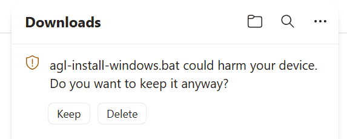

2.  Fai clic su **Open File**

    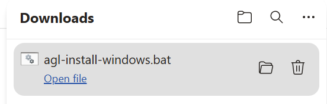

3.  Se compare questo avviso, fai clic su **Run**

    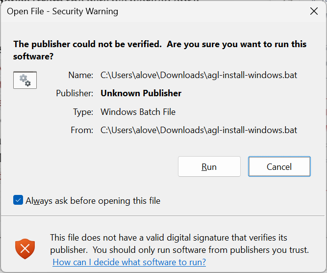

4.  Si aprirà un selettore di cartelle con **C:\SOL** evidenziata. Potrebbe essere necessario scorrere verso il basso per trovarla. Fai clic su OK oppure vai alla cartella principale desiderata. AGL viene installato in una cartella Java25 creata all'interno della cartella che scegli.

    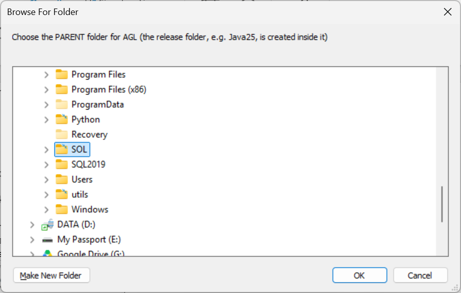

5.  L'installer scaricherà e installerà ora i file necessari. Durante i download e la decompressione lo schermo può sembrare bloccato per un po': è normale, quindi abbi pazienza. Le tile delle mappe sono un download separato e di grandi dimensioni. I file già presenti nella cartella Downloads vengono riutilizzati se sono le versioni correnti.

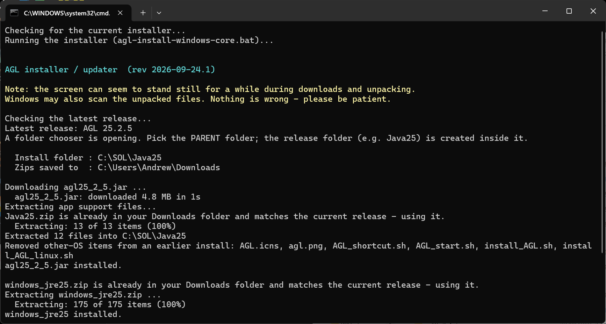

Se l'installer rileva che AGL si trova in una posizione imprevista (come Downloads o temp), ti verrà chiesto di selezionare una nuova posizione, come mostrato di seguito.

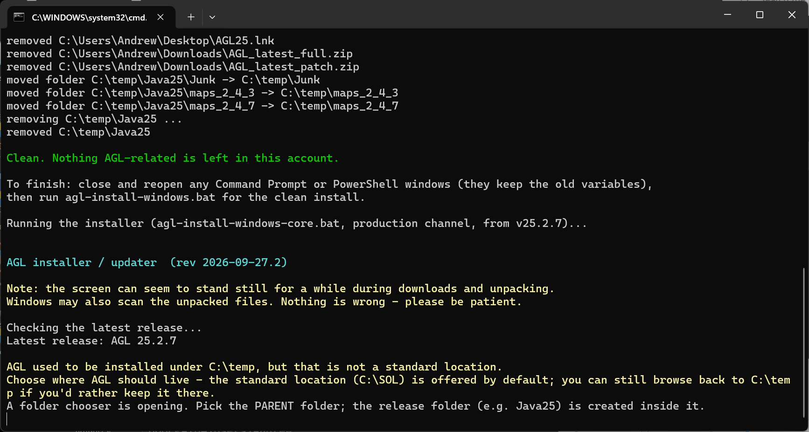

Seleziona una cartella conforme al percorso previsto per AGL.

6.  Durante il processo verranno mostrate alcune richieste. Accetta i valori predefiniti, a meno che tu non abbia una precisa necessità di cambiare qualcosa. Il messaggio finale sarà

*Install complete.*

*AGL is in C:\SOL\Java25*

*Press Enter to close:*

Premi Invio (Enter) per chiudere la finestra.

7.  Se l'installer fallisce per qualsiasi motivo e perdi l'icona sul desktop, ripeti semplicemente il passaggio 2.

8.  Sul desktop dovrebbe essere creata un'icona come quella qui sotto.

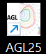

Fai doppio clic su di essa per avviare AGL e procedere con la configurazione come descritto in 2.3 Avvio di AGL. Il Manuale Utente e le Note di Rilascio vengono installati con AGL e si aprono dal suo menu Help (vedi 2.3.4.3 Il Menu Aiuto); non ci sono file separati né collegamenti sul desktop per essi.

#### 2.1.1.2 Beta

È tipicamente disponibile una release beta di AGL. Le build beta sono pre-release e possono contenere bug. Come per Production, scegli la cartella principale (C:\SOL è il valore predefinito) e la beta viene installata in una propria cartella Java25Beta al suo interno, separata dall'installazione Production, così puoi mantenerle entrambe. Crea una propria serie di icone AGL25Beta. I passaggi per installare la versione beta sono come quelli per Production, tranne che non c'è l'opzione per creare una versione Test, poiché è proprio a questo che serve la beta. Se una beta è già installata, l'installer si limita ad aggiornarla. Fai clic su [AGL Beta Installer](https://github.com/alov1258/AGL-Release/releases/download/beta/agl-install-windows-beta.bat) per scaricare l'installer. Avvia la beta dalla sua icona AGL25Beta anziché dall'icona AGL25.

### 2.1.2 macOS

#### 2.1.2.1 Production

Per installare o aggiornare AGL sono necessari i seguenti passaggi.

***Nota*:** Gli screenshot in questa sezione sono stati acquisiti su Linux; macOS è molto simile. Su macOS il selettore di cartelle è la finestra di dialogo standard di macOS.

1.  Apri una finestra del Terminale.

2.  Digita

**find ~/Downloads -maxdepth 1 -type f -name "\*.sh"**

Se il comando riporta

*/\<la tua cartella home\>/Downloads/agl-install-macos.sh*

hai già scaricato l'installer, quindi salta il passaggio successivo. (Se risulta essere una versione vecchia, l'installer lo rileverà, si rifiuterà di eseguire, e ti dirà di scaricare una copia più recente.)

3.  Se il passaggio precedente non mostra questo file, fai clic sul link [AGL Installer](https://github.com/alov1258/AGL-Release/releases/latest/download/agl-install-macos.sh) (agl-install-macos.sh). Se compare un errore simile (questo è quello di Windows), fai clic su **Keep**.

    

4.  Nella finestra del Terminale, digita **cd ~/Downloads** (oppure la posizione della tua cartella di download)

5.  Digita **ls \*.sh**. e dovresti vedere **agl-install-macos.sh**. Digita

    **chmod +x agl-install-macos.sh**

6.  Ora digita

    > **./agl-install-macos.sh** (oppure bash agl-install-macos.sh se preferisci non modificare i permessi del file)

7.  Apparirà un selettore di cartelle simile a questo, con ~/SOL selezionata come area di installazione predefinita per AGL. Se AGL 25 è già installato, l'installer lo trova e chiede *Update it? (Y/N) \[Y\]* nella finestra del Terminale invece di mostrare il selettore di cartelle: premi **Enter** per accettare. Vengono scaricati solo i file che sono cambiati. Se serve una modifica, vai a quella cartella e poi fai clic su OK. Se quella predefinita va bene, fai semplicemente clic su OK.

    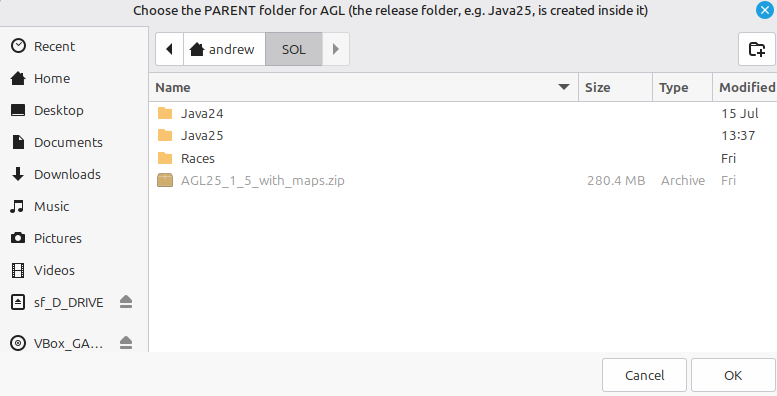

8.  L'installer scaricherà e installerà ora i file necessari. Durante i download e la decompressione lo schermo può sembrare bloccato per un po': è normale, quindi abbi pazienza. Le tile delle mappe sono un download separato e di grandi dimensioni.

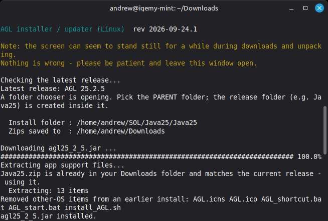

Se l'installer rileva che AGL si trova in una posizione imprevista (come Downloads o temp), ti verrà chiesto di selezionare una nuova posizione, come mostrato di seguito.

Seleziona una cartella conforme al percorso previsto per AGL.

9.  Durante il processo verranno mostrate alcune richieste. Accetta i valori predefiniti, a meno che tu non abbia una precisa necessità di cambiare qualcosa. Il messaggio finale sarà

*Install complete.*

*AGL is in /Users/\<tuo nome\>/SOL/Java25*

*Press Enter to close*

Premi Invio (Enter) per chiudere la finestra.

10. Se l'installer fallisce per qualsiasi motivo e perdi l'icona sul desktop, ripeti semplicemente il passaggio 6.

11. L'installer avrà creato un'icona del launcher simile a questa.

Fai doppio clic sull'icona AGL25 sul Desktop (un collegamento ad AGL_Launcher.app nella cartella Java25) per avviare AGL e procedere con la configurazione come descritto in 2.3 Avvio di AGL. Il Manuale Utente e le Note di Rilascio vengono installati con AGL e si aprono dal suo menu Help (vedi 2.3.4.3 Il Menu Aiuto); non ci sono file separati né collegamenti sul desktop per essi.

#### 2.1.2.2 Beta

È tipicamente disponibile una release beta di AGL. Le build beta sono pre-release e possono contenere bug. Come per Production, scegli la cartella principale (~/SOL è il valore predefinito) e la beta viene installata in una propria cartella Java25Beta al suo interno, separata dall'installazione Production, così puoi mantenerle entrambe. Crea una propria serie di icone AGL25Beta. I passaggi per installare la versione beta sono come quelli per Production, tranne che non c'è l'opzione per creare una versione Test, poiché è proprio a questo che serve la beta. Se una beta è già installata, l'installer si limita ad aggiornarla. Fai clic su [AGL Beta Installer](https://github.com/alov1258/AGL-Release/releases/download/beta/agl-install-macos-beta.sh) per scaricare l'installer. Nei passaggi Production sopra, usa agl-install-macos-beta.sh al posto di agl-install-macos.sh ovunque compaia. Avvia la beta dalla sua icona AGL25Beta anziché dall'icona AGL25.

### 2.1.3 Linux

#### 2.1.3.1 Production

Per installare o aggiornare AGL sono necessari i seguenti passaggi.

***Nota*:** Linux richiede i pacchetti unzip, curl e python3. Se l'installer segnala che ne manca uno, installalo con **sudo apt install unzip curl python3**.

1.  Apri una finestra del Terminale.

2.  Digita

**find "\$(xdg-user-dir DOWNLOAD)" -maxdepth 1 -type f -name "\*.sh"**

Se il comando riporta

*/\<la tua cartella home\>/Downloads/agl-install-linux.sh*

hai già scaricato l'installer, quindi salta il passaggio successivo. (Se risulta essere una versione vecchia, l'installer lo rileverà, si rifiuterà di eseguire, e ti dirà di scaricare una copia più recente.)

3.  Se il passaggio precedente non mostra questo file, fai clic sul link [AGL Installer](https://github.com/alov1258/AGL-Release/releases/latest/download/agl-install-linux.sh) (agl-install-linux.sh). Se compare un errore simile (questo è quello di Windows), fai clic su **Keep**.

    

4.  Nella finestra del Terminale, digita **cd ~/Downloads** (oppure la posizione della tua cartella di download)

5.  Digita **ls \*.sh**. e dovresti vedere **agl-install-linux.sh**. Digita

    **chmod +x agl-install-linux.sh**

6.  Ora digita

    > **./agl-install-linux.sh**

7.  Apparirà un selettore di cartelle simile a questo, con ~/SOL selezionata come area di installazione predefinita per AGL. Se AGL 25 è già installato, l'installer lo trova e chiede *Update it? (Y/N) \[Y\]* nella finestra del Terminale invece di mostrare il selettore di cartelle: premi **Enter** per accettare. Vengono scaricati solo i file che sono cambiati. Se serve una modifica, vai a quella cartella e poi fai clic su OK. Se quella predefinita va bene, fai semplicemente clic su OK.

    

8.  L'installer scaricherà e installerà ora i file necessari. Durante i download e la decompressione lo schermo può sembrare bloccato per un po': è normale, quindi abbi pazienza. Le tile delle mappe sono un download separato e di grandi dimensioni.

Se l'installer rileva che AGL si trova in una posizione imprevista (come Downloads o temp), ti verrà chiesto di selezionare una nuova posizione, come mostrato di seguito.

Seleziona una cartella conforme al percorso previsto per AGL.

9.  Durante il processo verranno mostrate alcune richieste. Accetta i valori predefiniti, a meno che tu non abbia una precisa necessità di cambiare qualcosa. Il messaggio finale sarà

*Install complete.*

*AGL is in /home/\<tuo nome\>/SOL/Java25*

*Press Enter to close*

Premi Invio (Enter) per chiudere la finestra.

10. Se l'installer fallisce per qualsiasi motivo e perdi l'icona sul desktop, ripeti semplicemente il passaggio 6.

11. Sul desktop dovrebbe essere creata un'icona come quella qui sotto.

Fai doppio clic su di essa per avviare AGL e procedere con la configurazione come descritto in 2.3 Avvio di AGL. Il Manuale Utente e le Note di Rilascio vengono installati con AGL e si aprono dal suo menu Help (vedi 2.3.4.3 Il Menu Aiuto); non ci sono file separati né collegamenti sul desktop per essi.

***Nota*:** L'installer esegue install_AGL_linux.sh al posto tuo (imposta i permessi sul Java incluso), quindi non c'è altro da eseguire. Alcuni desktop Linux potrebbero chiederti di considerare attendibile il launcher la prima volta che ci fai doppio clic (Linux Mint non lo chiede). Se richiesto, scegli l'opzione per considerarlo attendibile o consentirne l'avvio.

***Potenziale Problema*:** su alcuni desktop Linux (osservato su Linux Mint) un aggiornamento avviato da una versione di AGL precedente alla 25.4.1 non fa nulla: scegli **Aggiorna ora**, non si apre nessuna finestra di aggiornamento e al successivo avvio di AGL compare il messaggio che un aggiornamento è in corso. La causa è nel launcher della versione precedente, quindi AGL 25.4.1 è la prima che lo evita. Per superarlo:

1.  Apri una finestra del Terminale e avvia AGL da lì, poi scegli **Aggiorna ora** come al solito. Si apre la finestra di aggiornamento. Per un'installazione Production digita

    **sh -c "'$HOME/SOL/Java25/AGL_start.sh'"**

    Se AGL è installato in una cartella diversa, usa quella cartella. Per un'installazione Beta usa **Java25Beta** nel percorso e aggiungi **--channel=beta** dopo le virgolette di chiusura del percorso.

2.  Oppure esegui tu stesso l'installer, seguendo i passaggi da 1 a 10 sopra. Aggiorna l'installazione esistente.

3.  Se AGL dice che un aggiornamento è in corso e non c'è nessuna finestra di aggiornamento aperta, elimina il file di blocco dell'aggiornamento, poi avvia di nuovo AGL:

    **find ~ -maxdepth 3 -path '\*sessions\*' -name update.lock -delete**

#### 2.1.3.2 Beta

È tipicamente disponibile una release beta di AGL. Le build beta sono pre-release e possono contenere bug. Come per Production, scegli la cartella principale (~/SOL è il valore predefinito) e la beta viene installata in una propria cartella Java25Beta al suo interno, separata dall'installazione Production, così puoi mantenerle entrambe. Crea una propria serie di icone AGL25Beta. I passaggi per installare la versione beta sono come quelli per Production, tranne che non c'è l'opzione per creare una versione Test, poiché è proprio a questo che serve la beta. Se una beta è già installata, l'installer si limita ad aggiornarla. Fai clic su [AGL Beta Installer](https://github.com/alov1258/AGL-Release/releases/download/beta/agl-install-linux-beta.sh) per scaricare l'installer. Nei passaggi Production sopra, usa agl-install-linux-beta.sh al posto di agl-install-linux.sh ovunque compaia. Avvia la beta dalla sua icona AGL25Beta anziché dall'icona AGL25.

## 2.2 Rimozione Completa di AGL

### 2.2.1 Windows

Se vuoi rimuovere completamente AGL e riportare il computer a uno stato in cui AGL non è mai stato installato, esegui i seguenti passaggi. Nota che le mappe non vengono rimosse, a causa delle loro dimensioni e del tempo necessario per reinstallarle. Le cartelle delle regate non vengono mai toccate.

***Nota*:** Chiudi tutte le finestre di AGL prima di iniziare. Il cleaner non rimuoverà un'installazione ancora in esecuzione.

1.  Fai clic sul link [AGL Cleaner](https://github.com/alov1258/AGL-Release/releases/latest/download/agl-clean-windows.bat) (agl-clean-windows.bat). Se compare questo errore, fai clic su **Keep**.

    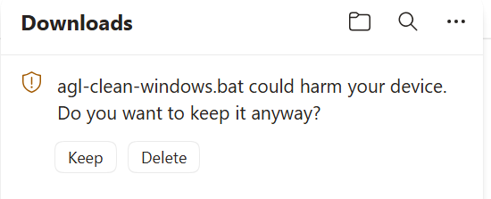

2.  Fai clic su **Open File**

    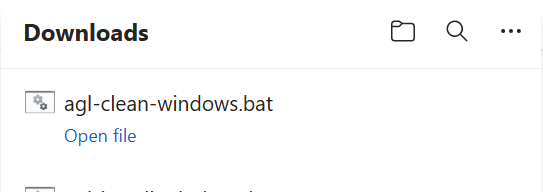

3.  Se compare questo avviso, fai clic su **Run**

    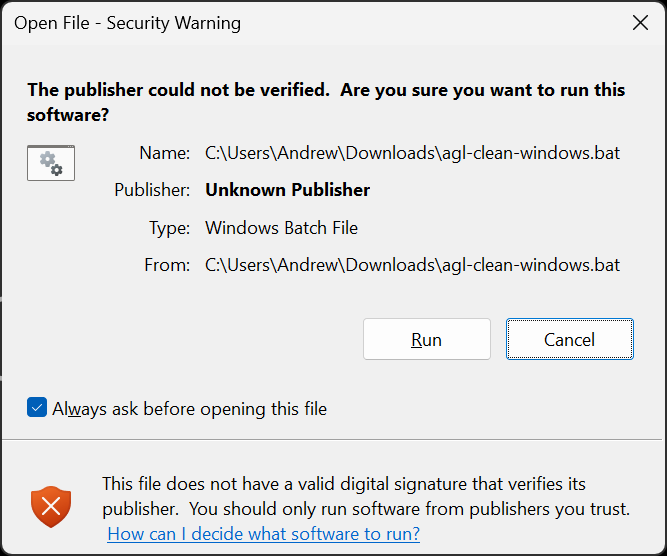

4.  Verrà mostrata una finestra cmd come la seguente, che indica cosa verrà rimosso. Premi **Enter** per continuare, oppure digita un'altra cartella di installazione di AGL, ad es. AGL24

    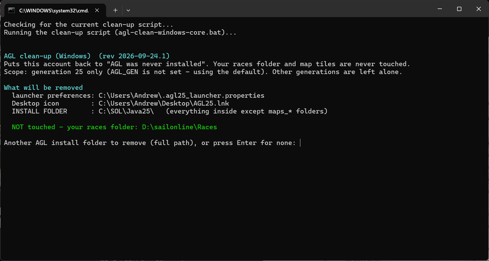

5.  Ti verrà ora chiesto di digitare **Sì** per continuare.

6.  Al termine, premi **Enter per chiudere la finestra** e continua con [2.1 Installazione e Aggiornamento di AGL 25](#21-installazione-e-aggiornamento-di-agl-25). L'ultima riga della finestra ti dice di eseguire agl-install-windows.bat: è l'installer descritto in 2.1.

Per rimuovere un'installazione Beta, segui gli stessi passaggi, ma fai clic invece sul link [AGL Beta Cleaner](https://github.com/alov1258/AGL-Release/releases/download/beta/agl-clean-windows-beta.bat) (agl-clean-windows-beta.bat).

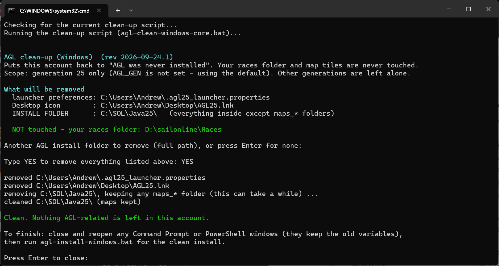

### 2.2.2 macOS

Se vuoi rimuovere completamente AGL e riportare il computer a uno stato in cui AGL non è mai stato installato, esegui i seguenti passaggi. Nota che le mappe non vengono rimosse, a causa delle loro dimensioni e del tempo necessario per reinstallarle. Le cartelle delle regate non vengono mai toccate.

***Nota*:** Chiudi tutte le finestre di AGL prima di iniziare. Il cleaner non rimuoverà un'installazione ancora in esecuzione.

***Nota*:** Gli screenshot in questa sezione sono stati acquisiti su Linux; macOS è molto simile.

1.  Apri una finestra del Terminale.

2.  Digita

**find ~/Downloads -maxdepth 1 -type f -name "\*.sh"**

Se il comando riporta

*/\<la tua cartella home\>/Downloads/agl-clean-macos.sh*

hai già scaricato il cleaner, quindi salta il passaggio successivo. (Se risulta essere una versione vecchia, il cleaner lo rileverà, si rifiuterà di eseguire, e ti dirà di scaricare una copia più recente.)

3.  Fai clic sul link [AGL Cleaner](https://github.com/alov1258/AGL-Release/releases/latest/download/agl-clean-macos.sh) (agl-clean-macos.sh). Se compare un errore simile (questo è quello di Windows), fai clic su **Keep**.

    

4.  Nella finestra del Terminale, digita **cd ~/Downloads** (oppure la posizione della tua cartella di download)

5.  Digita **ls \*.sh**. e dovresti vedere **agl-clean-macos.sh**. Digita

    **chmod +x agl-clean-macos.sh**

6.  Ora digita

    > **./agl-clean-macos.sh**

7.  Verrà mostrato quanto segue (equivalente per macOS), che indica cosa verrà rimosso. Premi **Enter** per continuare, oppure digita un'altra cartella di installazione di AGL, ad es. AGL24

    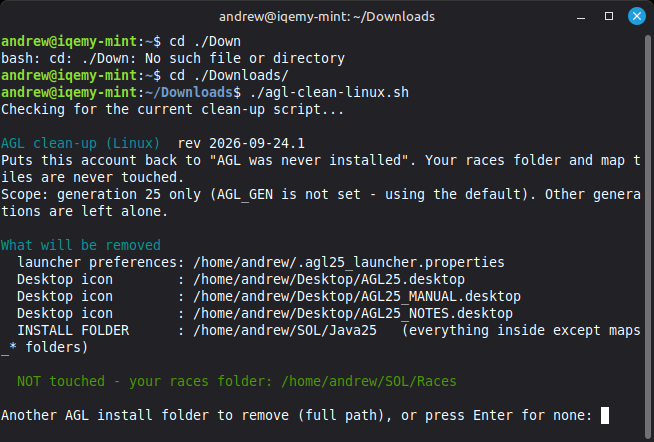

8.  Ti verrà ora chiesto di digitare **Sì** per continuare.

9.  Al termine, premi **Enter** e continua con [2.1 Installazione e Aggiornamento di AGL 25](#21-installazione-e-aggiornamento-di-agl-25). Se agl-install-macos.sh è già stato scaricato, puoi eseguire subito quello script.

Per rimuovere un'installazione Beta, segui gli stessi passaggi, ma fai clic sul link [AGL Beta Cleaner](https://github.com/alov1258/AGL-Release/releases/download/beta/agl-clean-macos-beta.sh) (agl-clean-macos-beta.sh) e usa agl-clean-macos-beta.sh al posto di agl-clean-macos.sh ovunque compaia.

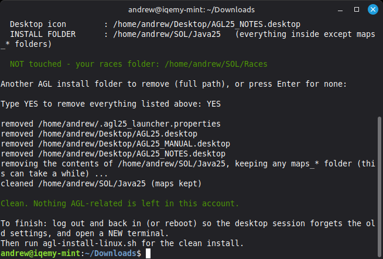

### 2.2.3 Linux

Se vuoi rimuovere completamente AGL e riportare il computer a uno stato in cui AGL non è mai stato installato, esegui i seguenti passaggi. Nota che le mappe non vengono rimosse, a causa delle loro dimensioni e del tempo necessario per reinstallarle. Le cartelle delle regate non vengono mai toccate.

***Nota*:** Linux richiede i pacchetti unzip, curl e python3. Se l'installer segnala che ne manca uno, installalo con **sudo apt install unzip curl python3**.

***Nota*:** Chiudi tutte le finestre di AGL prima di iniziare. Il cleaner non rimuoverà un'installazione ancora in esecuzione.

1.  Apri una finestra del Terminale.

2.  Digita

**find "\$(xdg-user-dir DOWNLOAD)" -maxdepth 1 -type f -name "\*.sh"**

Se il comando riporta

*/\<la tua cartella home\>/Downloads/agl-clean-linux.sh*

hai già scaricato il cleaner, quindi salta il passaggio successivo. (Se risulta essere una versione vecchia, il cleaner lo rileverà, si rifiuterà di eseguire, e ti dirà di scaricare una copia più recente.)

3.  Fai clic sul link [AGL Cleaner](https://github.com/alov1258/AGL-Release/releases/latest/download/agl-clean-linux.sh) (agl-clean-linux.sh). Se compare un errore simile (questo è quello di Windows), fai clic su **Keep**.

    

4.  Nella finestra del Terminale, digita **cd ~/Downloads** (oppure la posizione della tua cartella di download)

5.  Digita **ls \*.sh**. e dovresti vedere **agl-clean-linux.sh**. Digita

    **chmod +x agl-clean-linux.sh**

6.  Ora digita

    > **./agl-clean-linux.sh**

7.  Verrà mostrato quanto segue, che indica cosa verrà rimosso. Premi **Enter** per continuare, oppure digita un'altra cartella di installazione di AGL, ad es. AGL24

    

8.  Ti verrà ora chiesto di digitare **Sì** per continuare.

9.  Al termine, premi **Enter** e continua con [2.1 Installazione e Aggiornamento di AGL 25](#21-installazione-e-aggiornamento-di-agl-25). Se agl-install-linux.sh è già stato scaricato, puoi eseguire subito quello script.

Per rimuovere un'installazione Beta, segui gli stessi passaggi, ma fai clic sul link [AGL Beta Cleaner](https://github.com/alov1258/AGL-Release/releases/download/beta/agl-clean-linux-beta.sh) (agl-clean-linux-beta.sh) e usa agl-clean-linux-beta.sh al posto di agl-clean-linux.sh ovunque compaia.

## 2.3 Avvio di AGL

### 2.3.1 Avvio di AGL Launcher

**Windows:** fai doppio clic sull'icona AGL25 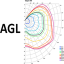 sul desktop, oppure scegli **AGL25** nel menu Start. L'installer inserisce un'icona in entrambi i posti. Per avviare AGL dalla barra delle applicazioni, fai clic con il tasto destro su una delle due icone e scegli **Pin to taskbar**. Una finestra di comando può comparire per un momento, poi si chiude da sola: l'hub è la finestra di AGL che resta.

**Linux:** fai doppio clic sull'icona AGL25 sul desktop.

**macOS:** Fai doppio clic su "AGL_Launcher.app" (oppure sull'icona AGL25 sul Desktop, che ne è un collegamento). La prima volta che lo apri, macOS potrebbe mostrare l'avviso "non può essere aperto perché Apple non può verificare che non contenga software dannoso". In tal caso, fai clic con il tasto destro (o Control-clic) sull'app, scegli "Apri", quindi conferma "Apri" nella finestra di dialogo che appare. Devi farlo solo una volta. Dopodiché, il doppio clic funzionerà normalmente.

Per tenerlo nel Dock: trascina "AGL_Launcher.app" sul Dock, oppure fai clic con il tasto destro sulla sua icona mentre è in esecuzione e scegli "Opzioni \> Mantieni nel Dock". Puoi lasciarlo dove si trova nella cartella Java25: non è necessario spostarlo in Applicazioni.

L'avvio di AGL apre l'**AGL Hub**: l'unica finestra di AGL nella barra delle applicazioni, con una scheda per ogni regata. Se l'hub è già aperto, avviando di nuovo AGL viene semplicemente portato in primo piano. La prima volta che AGL viene avviato chiede prima alcune cose (vedi Avvio di AGL per la Prima Volta), poi si apre l'hub (vedi L'AGL Hub).

### 2.3.2 Avvio di AGL per la Prima Volta

Se è disponibile una versione più recente di AGL, viene mostrata per prima la finestra di aggiornamento descritta in 2.4 Aggiornamento di AGL. Si verificheranno alcuni o tutti i seguenti passaggi:

Alla prima esecuzione può accadere tutto o in parte quanto segue:

1. Se la **cartella delle regate** (races directory) non è stata impostata, AGL la richiede. Succede una sola volta. La cartella delle regate è la cartella che contiene tutte le tue cartelle di regata, ad esempio D:\sailonline\Races.

   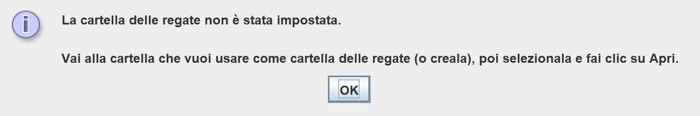

2. Fai clic su **OK**. Si apre un selettore di cartelle nella cartella sopra la cartella di installazione di AGL. Vai alla tua cartella delle regate, oppure creala: digita un nome nella casella **Nome della nuova cartella** e fai clic su **Crea cartella**. Seleziona la cartella e fai clic su **Apri**.

   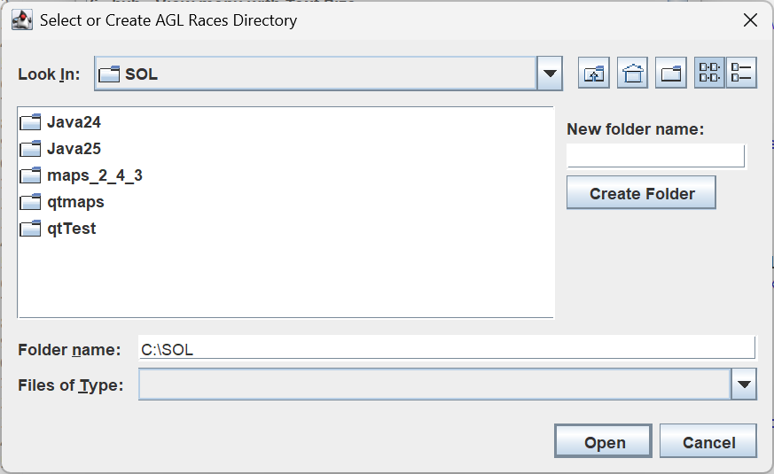

   **Non** usare la cartella Java25 come cartella delle regate, perché è lì che è installato AGL. Rischieresti che un'installazione di AGL elimini quella cartella e tutte le tue regate.

3. AGL conferma la cartella che ha impostato.

   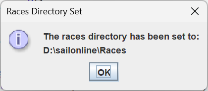

4. Se stai aggiornando da una generazione precedente di AGL che aveva già una cartella delle regate, AGL la usa e te lo dice, invece di chiederla.

   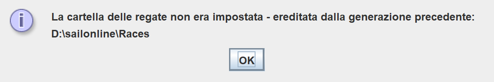

5. Si apre l'**AGL Hub** con la scheda **Launcher**. Nessuna regata è stata avviata: AGL non avvia mai una regata, né chiede una cartella di regata, da solo. Fai clic su **Aggiungi regata** per avviare la tua prima regata (vedi Aggiungere una Regata).

6. 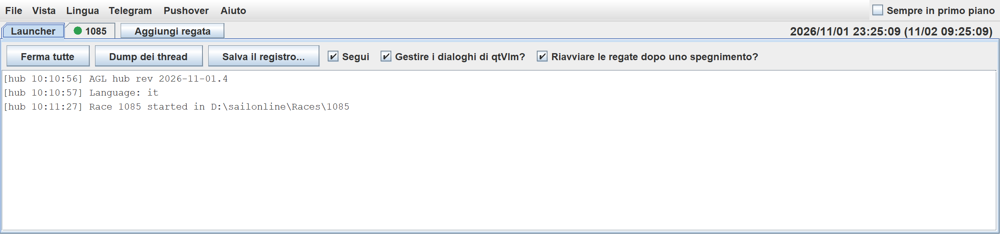

La scheda Launcher mostra cosa ha fatto AGL per arrivare fin qui: la revisione del launcher, la cartella di installazione, la versione e il canale, il controllo degli aggiornamenti e la cartella delle regate.

***Nota*:** È **indispensabile** disporre di una buona connessione a Internet perché questo funzioni.

### 2.3.3 L'AGL Hub

L'hub è l'unica finestra di AGL nella barra delle applicazioni. Ogni regata continua a essere eseguita come programma a sé, nella propria cartella di regata, quindi una regata bloccata può essere terminata senza toccare le altre, e le regate proseguono se l'hub viene chiuso.

#### 2.3.3.1 La Finestra dell'Hub

L'hub si apre in alto a sinistra dello schermo principale. Il suo titolo mostra la versione di AGL.

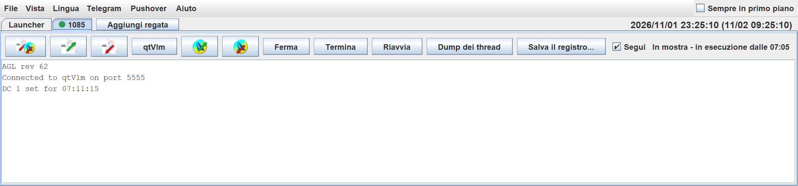

- La barra delle schede ha la scheda **Launcher**, poi una scheda per ogni regata, con il nome della sua cartella di regata. Tieni il mouse su una scheda di regata per vedere il nome e il numero della regata.

- Il pulsante **Aggiungi regata** si trova dopo l'ultima scheda.

- All'estremità destra della barra delle schede c'è un orologio. Mostra prima l'ora UTC, poi l'ora del computer tra parentesi.

- Seleziona **Sempre in primo piano** (in alto a destra) per tenere l'hub sopra le altre finestre. AGL lo ricorda.

- L'icona dell'hub  accanto all'icona In Control  nella scheda Controllo DC porta l'hub in primo piano.

L'hub non si chiude mai da solo. Resta aperto finché non lo chiudi tu (vedi Chiusura dell'Hub).

#### 2.3.3.2 I Menu dell'Hub

- **File &gt; Aggiungi regata...** (Ctrl+N) sceglie le cartelle di regata e avvia AGL in esse (vedi Aggiungere una Regata).

- **File &gt; Ferma tutte le regate** chiude ogni regata in esecuzione come fa il suo Quit.

- **File &gt; Esci dall’hub, lascia le regate in corso** termina solo l'hub (vedi Chiusura dell'Hub).

- **File &gt; Esci** chiude l'hub e chiede cosa fare delle regate in esecuzione.

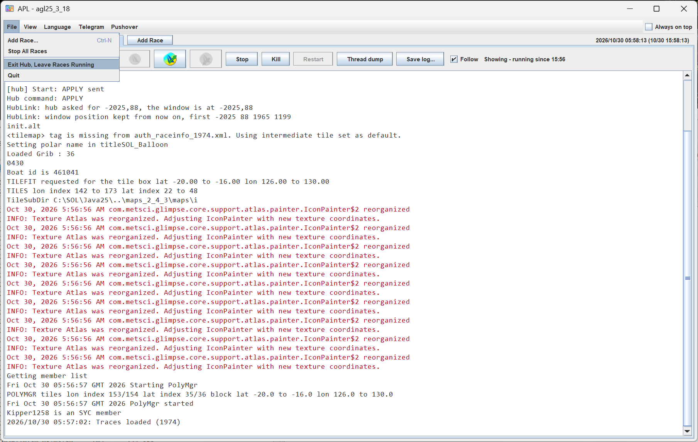

- **Vista &gt; Dimensione testo** imposta la dimensione del testo nell'hub: scegli una dimensione dall'elenco, oppure usa **Più grande** (Ctrl e +), **Più piccolo** (Ctrl e -) o **Ripristina** (Ctrl e 0). La dimensione è propria dell'hub e viene ricordata. Le console usano un font monospaziato più grande.

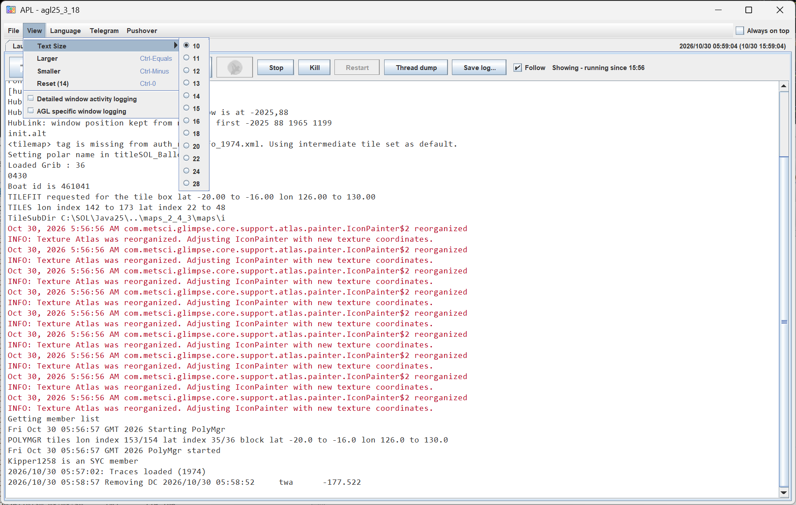

- **Vista &gt; Registro dettagliato delle finestre** e **Vista &gt; Registro finestre specifico di AGL** sono entrambi disattivati all'inizio. Aggiungono alla console del Launcher righe sulle finestre di qtVlm e sul focus, per scoprire perché una finestra di qtVlm è stata o non è stata portata in primo piano. Lasciali disattivati a meno che ti venga chiesto di attivarli.

- Il menu **Lingua** sceglie la lingua di AGL (inglese o italiano). L'hub cambia subito, le regate in esecuzione vengono avvisate e anche le regate che avvii in seguito la usano. AGL ricorda la scelta. Una finestra di regata ha un proprio menu **Lingua**, che cambia quella finestra e le sue finestre di dialogo solo per la sessione: l'impostazione dell'hub non viene modificata.

- Il menu **Telegram** configura il bot Telegram. È descritto nella sua sezione.

- Il menu **Pushover** ha **Impostazioni...**, dove inserisci una volta per tutte le regate il token dell'applicazione Pushover, la tua user key e le altre impostazioni. È descritto in Configurazione di Pushover.

- Il menu **Aiuto** apre la documentazione e invia i tuoi log per email. È descritto in Il Menu Aiuto, più avanti.

#### 2.3.3.3 La Scheda Launcher

La console di questa scheda mostra cosa fa AGL all'avvio, una riga per ogni regata avviata e i messaggi dell'hub stesso, che iniziano con \[hub\]. Includono quale qtVlm appartiene a ciascuna regata, se la regata è di un membro e cosa fa il gestore delle finestre di dialogo di qtVlm (vedi Gestione delle Finestre di Dialogo di qtVlm).

- **Ferma tutte** chiude ogni regata in esecuzione come fa il suo Quit.

- **Dump dei thread** stampa, in questa console, cosa sta facendo ogni thread dell'hub. Serve solo se ti viene richiesto.

- **Salva il registro...** salva il testo di questa console in un file.

- **Segui** scorre fino alla riga più recente man mano che arriva. Deselezionalo per leggere le righe precedenti.

- **Gestire i dialoghi di qtVlm?** (vedi Gestione delle Finestre di Dialogo di qtVlm).

- **Riavviare le regate dopo uno spegnimento?** (vedi Riavvio delle Regate dopo uno Spegnimento).

#### 2.3.3.4 Le Schede delle Regate

Ogni regata ha una propria scheda. La sua console mostra tutto ciò che la regata scrive mentre è in esecuzione: la cartella di lavoro, la dimensione del font, i grib e le tile che carica, le tracce e così via. L'output degli errori è mostrato in rosso. Alcuni messaggi Java sono in rosso anche se non c'è nulla di sbagliato. Lo stesso testo viene salvato in agl_console.log nella cartella della regata e sostituito a ogni avvio della regata.

Il pallino sulla scheda di una regata ne mostra lo stato: **verde** se è in esecuzione, **ambra** se la regata ha scritto output di errore dall'ultima volta che hai guardato la sua scheda, e **rosso** se è terminata con un errore. La riga di stato a destra dei pulsanti dice cosa sta facendo la regata, ad esempio "In mostra - in esecuzione dalle 22:22".

I pulsanti nella scheda di una regata sono:

- **Mostra** mostra la finestra AGL di questa regata. È grigio mentre la finestra è visibile, ma funziona comunque, perché la finestra potrebbe essere dietro altre. Anche un doppio clic sulla scheda della regata fa lo stesso.

- **Riponi** mette via tutte le finestre di questa regata. È grigio quando sono già state messe via.

- **qtVlm** avvia qtVlm per questa regata. Compare quando la regata ha qtVlm configurato.

- **qtVlm Mostra** porta in primo piano il qtVlm di questa regata, ripristinandolo prima se è ridotto a icona. **qtVlm Riponi** lo riduce a icona. Funzionano una volta che la regata ha comunicato all'hub quale qtVlm è il suo, e seguono lo stato reale della finestra se la sposti tu. Non sono mostrati su macOS.

- **Ferma** chiude la regata come fa il suo Quit, e salva prima. Se non si è chiusa dopo 10 secondi, lo stato dice "Non si ferma - usa Termina".

- **Termina** termina subito la regata senza salvare nulla, quindi usalo solo per una regata bloccata. AGL ti chiede di confermare. Su una regata già terminata, Kill chiude la sua scheda.

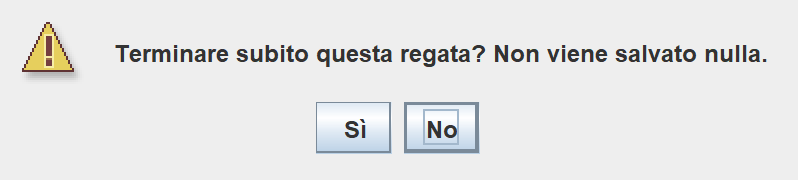

- **Riavvia** avvia di nuovo, nella stessa cartella, una regata che è terminata.

- **Dump dei thread** stampa, nella console della regata, cosa sta facendo ogni thread della regata. Serve solo se ti viene richiesto.

- **Salva il registro...** salva il testo della console di questa regata in un file.

- **Segui** scorre fino alla riga più recente man mano che arriva. Deselezionalo per leggere le righe precedenti.

Se in una regata c'è una finestra di dialogo aperta, lo stato dice "C’è un dialogo aperto nella regata - rispondi prima a quello".

Quando una regata termina perché l'hai chiusa tu (con il suo Quit, o con Stop), la sua scheda scompare. Se termina in qualsiasi altro modo, la sua scheda resta con un pallino rosso e lo stato "Terminata con codice di uscita ... - la console ne spiega il motivo", e l'hub viene portato in primo piano. Leggi la console, poi fai clic su **Riavvia**, oppure su **Termina** per chiudere la scheda.

#### 2.3.3.5 Aggiungere una Regata

Fai clic su **Aggiungi regata** (o **File &gt; Aggiungi regata...**) e si apre il selettore delle cartelle di regata nella tua cartella delle regate. È l'unico modo per avviare una regata dall'hub: non apre mai il selettore da solo.

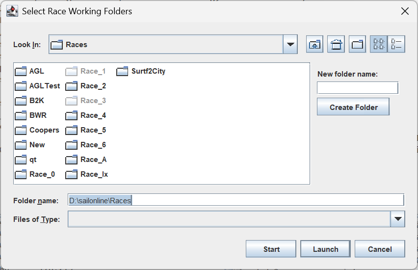

- Seleziona una o più cartelle di regata (tieni premuto Ctrl o Maiusc per selezionarne più di una). Per creare una nuova cartella di regata, digita il suo nome nella casella **Nome della nuova cartella** e fai clic su **Crea cartella**.

- Una cartella in cui è già in esecuzione un AGL è in grigio. Non puoi avviare un secondo AGL al suo interno: se la scegli, AGL te lo dice e devi scegliere di nuovo. Se ne scegli diverse e alcune sono già in esecuzione, queste vengono escluse e AGL ti dice quali.

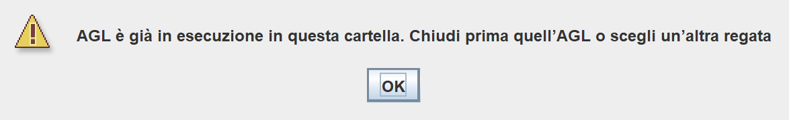 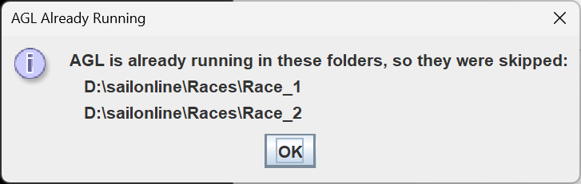

- **Apri** avvia AGL in ogni cartella che hai selezionato. Nella scheda Parametri di ciascuna regata il pulsante **Applica** è a quel punto disponibile, da premere quando sei pronto.

- **Avvia** avvia AGL in ogni cartella e preme Apply al posto tuo, non appena la finestra della regata è comparsa. Usalo per le regate già configurate.

- Le regate partono una dopo l'altra. Ogni nuova finestra di regata viene posizionata 40 pixel più in basso e a destra rispetto alla precedente, così non sono tutte una sopra l'altra.

Se scegli una cartella che non è nella tua cartella delle regate, AGL chiede cosa sia. Scegliendo **Questa è una cartella di regata** avvia una regata al suo interno e imposta come tua cartella delle regate la cartella in cui si trova. Scegliendo **Questa è la mia cartella delle regate** la imposta come tua cartella delle regate e mostra di nuovo il selettore, così puoi scegliere una cartella di regata al suo interno. Quando scegli più cartelle che si trovano tutte in un'altra cartella, AGL chiede se sono cartelle di regata.

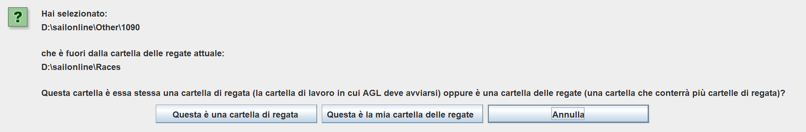 

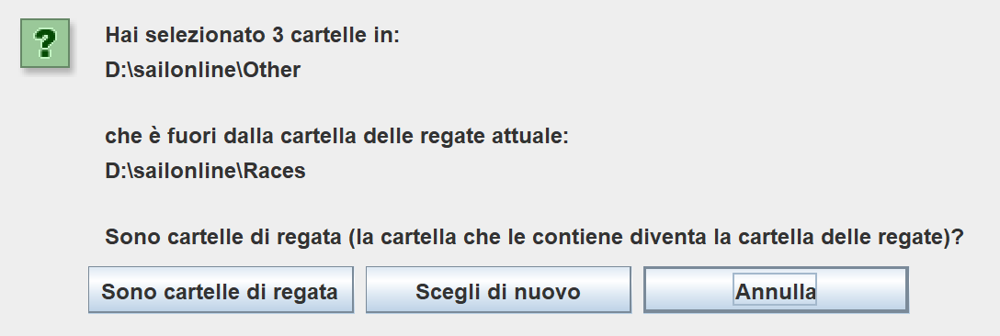

Avviare di nuovo AGL dalla sua icona mentre l'hub è aperto non avvia una regata: porta semplicemente l'hub in primo piano.

#### 2.3.3.6 Gestione delle Finestre di Dialogo di qtVlm

**Area membri SOL**. Questa sezione è disponibile solo ai membri paganti di SailOnline.

Le finestre dei risultati di qtVlm possono aprirsi dietro altre finestre. Con **Gestire i dialoghi di qtVlm?** selezionato, come lo è all'inizio, l'hub porta in primo piano queste finestre di qtVlm quando sono nascoste dietro altre finestre: **Routing**, **Converting Routing to Route**, **Simplification result** e **Optimization results**.

- Se ne arrivano diverse insieme, vengono mostrate una alla volta. La successiva arriva quando chiudi quella in mostra.

- Una finestra attende finché il focus è in una finestra di AGL, per tutto il tempo che vi resta. Attende anche mentre stai lavorando in un altro qtVlm: ha una finestra di dialogo o un menu aperto, il mouse si muove su di esso, oppure stai digitando o facendo clic al suo interno. Altrimenti viene portata in primo piano. Il focus in qualsiasi altro programma non la fa attendere.

- Mentre una finestra di dialogo di qtVlm è aperta e non ha il focus, una cornice arancione chiara compare intorno all'hub e alle finestre di regata, ovunque sia il focus. Scompare quando la finestra di dialogo ha il focus o viene chiusa.

- AGL non rimette poi in primo piano la finestra che era davanti. Quando hai finito con la finestra di dialogo, torna alla finestra che vuoi.

- Viene eseguito solo per le regate in cui AGL ha riconosciuto l'utente come membro SOL. La console del Launcher dice "&lt;boat&gt; is a member" quando lo ha fatto.

- Ogni finestra che il gestore esamina viene scritta nella console del Launcher: "already in front - left alone", oppure cosa ha fatto, e "closed" quando la chiudi.

Deseleziona la casella per disattivare il gestore. Ha effetto subito, su tutte le regate.

#### 2.3.3.7 Riavvio delle Regate dopo uno Spegnimento

Quando Windows si riavvia per un aggiornamento, o il PC va in crash o perde alimentazione, le regate si fermano e nulla protegge le tue barche finché qualcuno non avvia di nuovo AGL. **Riavviare le regate dopo uno spegnimento?** è disattivato all'inizio. Quando è selezionato:

- L'hub tiene un elenco delle regate che dovrebbero essere in esecuzione.

- Quando un hub si avvia, avvia di nuovo quelle regate, una ogni 4 secondi, come fa **Avvia**, quindi viene premuto anche Apply. La console del Launcher dice "Restarting ... - it was running when the hub was last ended".

- Una regata esce dall'elenco quando la termini di proposito: **Ferma**, **Ferma tutte**, **Termina**, **File &gt; Esci** con **Chiudi**, oppure il Quit della regata stessa. La chiusura della sessione da parte di Windows, un crash, un'interruzione di corrente o un aggiornamento che chiede ad AGL di chiudersi la lasciano nell'elenco.

Con la casella non selezionata, un hub che si avvia riprende solo le regate che trova ancora in esecuzione.

Questo serve solo se AGL si avvia quando si avvia il PC, e per questo Windows deve accedere da solo, altrimenti nulla viene eseguito finché qualcuno non accede. Su Windows, quando selezioni la casella e questo non è stato configurato, AGL chiede:

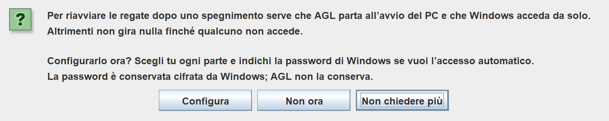

- **Configura** apre la finestra di configurazione (AGL_autostart.bat nella cartella di installazione di AGL), descritta più avanti.

- **Non ora** lo rimanda. Ti viene chiesto di nuovo al prossimo avvio di AGL con la casella selezionata.

- **Non chiedere più** interrompe la domanda. Puoi comunque eseguire la configurazione dalla cartella di installazione di AGL in qualsiasi momento.

La finestra di configurazione chiede prima a Windows l'autorizzazione (UAC). Poi mostra cosa è configurato ora e chiede **S** per configurare, **R** per rimuovere ciò che ha creato, o **Q** per uscire. Nulla viene modificato finché non rispondi. Se scegli S, scegli ciascuna delle tre parti:

1.  **Avviare AGL all'accesso.** Inserisce nella cartella Esecuzione automatica (Startup) un collegamento chiamato "AGL25 start with Windows". Attende 20 secondi la rete, poi avvia AGL, e AGL riavvia le tue regate. Seleziona anche **Riavviare le regate dopo uno spegnimento?** nell'hub. (Un'installazione AGL Beta o Test ha Beta o Test nel nome.)

2.  **Accedere a Windows da soli dopo un riavvio.** Richiede la tua password di Windows. La configurazione la verifica e Windows la conserva cifrata; AGL non la conserva. Un amministratore del PC può comunque leggerla, quindi usalo solo su un PC di cui ti fidi. Se accedi a Windows con un account Microsoft e un PIN, questo attiva l'accesso con password per il PC.

3.  **Bloccare lo schermo subito dopo quell'accesso.** Viene proposto solo se hai scelto la 2. Inserisce nella cartella Esecuzione automatica (Startup) un collegamento chiamato "AGL lock screen after sign-in". AGL e le regate continuano a funzionare, e nessuno può usare il PC senza la password.

Per annullare qualsiasi parte, esegui di nuovo la configurazione e scegli **R**. Rimuove i collegamenti, disattiva l'accesso automatico ed elimina la password salvata.

*Nota: Restart races after a shutdown è solo per Windows.*

#### 2.3.3.8 Chiusura dell'Hub

Fai clic sulla X dell'hub, oppure scegli **File &gt; Esci**. Se ci sono regate in esecuzione, AGL chiede:

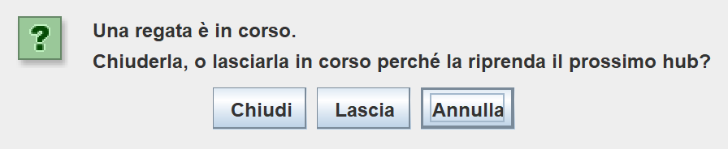

- **Chiudi** chiude anche le regate, e l'hub. Non vengono riavviate in seguito.

- **Lascia** chiude solo l'hub. Le regate continuano a funzionare, e il prossimo hub le riprende quando avvii AGL.

- **Annulla** lascia aperto l'hub.

**File &gt; Esci dall’hub, lascia le regate in corso** fa lo stesso di Leave, dopo averti chiesto di confermare.

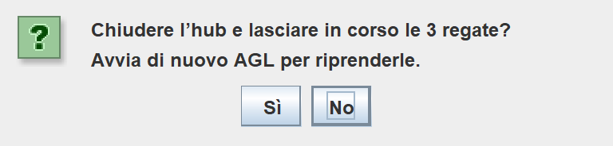

Una regata ripresa da un nuovo hub mostra la sua console da quel momento in poi. Ciò che ha scritto prima è in agl_console.log nella cartella della regata.

### 2.3.4 La Finestra di Regata di AGL

Quando una regata viene avviata dall'hub, si apre la sua finestra AGL, pronta per la configurazione (è il layout a due colonne). La finestra di regata ha una propria dimensione del testo e propri controlli di layout, qui sotto.

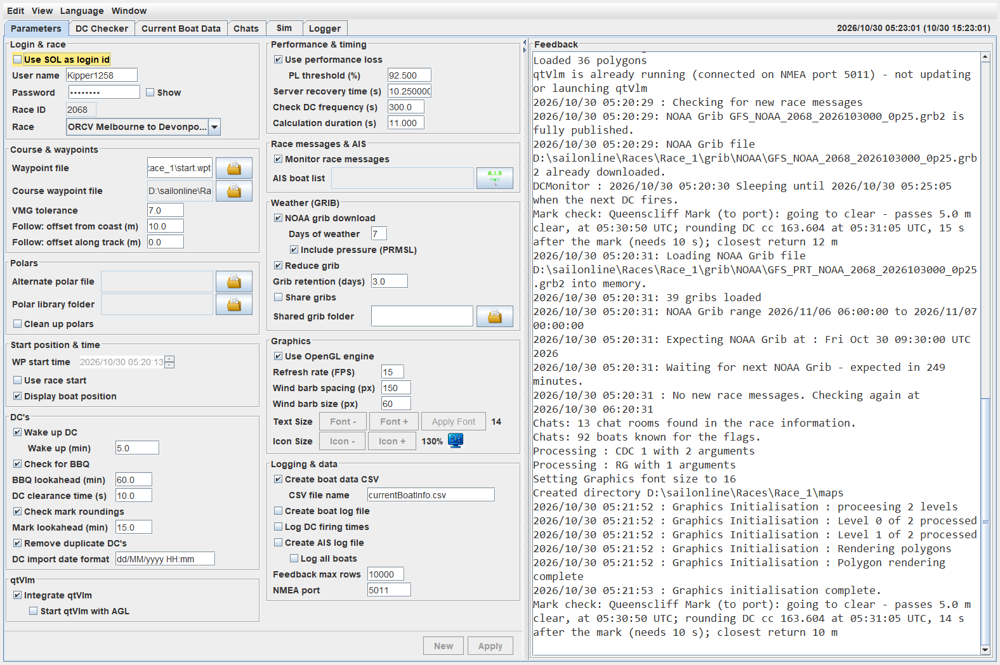

#### 2.3.4.1 Modifica della Scalatura (Graphics Box)

Se il testo è troppo piccolo o troppo grande, puoi regolare la dimensione e il tipo di carattere (font) per il testo e i pulsanti **prima** di premere **Applica**.

- **Carattere +** aumenterà la dimensione del carattere di 1

- **Carattere -** diminuirà la dimensione del carattere di 1

- Il menu a tendina Font permette di scegliere il carattere da utilizzare.

Premi **Applica carattere** per applicare le modifiche.

#### 2.3.4.2 Il Menu Vista

Puoi anche modificare l'interlinea e il numero di colonne da utilizzare. Il **Vista** menu ha quattro opzioni, come mostrato di seguito

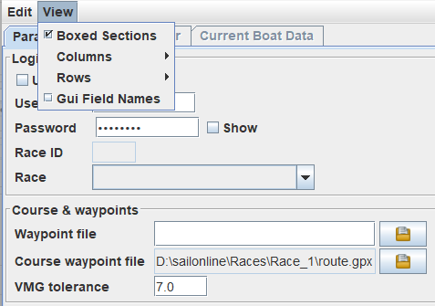

L'opzione **Sezioni riquadrate** modifica il modo in cui vengono mostrati i riquadri dei titoli. L'opzione **Colonne** permette all'utente di scegliere quante colonne usare per mostrare i parametri. La voce **Righe** regola come viene mostrata la spaziatura delle righe. **Nomi dei campi** mostra i nomi dei campi del file .ini.

#### 2.3.4.3 Il Menu Aiuto

L'hub e ogni finestra di regata hanno un menu **Aiuto**.

- **Documentazione** apre la pagina iniziale di questa documentazione.

- **Manuale** apre la prima pagina del Manuale Utente.

- **Note di rilascio** apre le Note di Rilascio.

- **Invia i log...** raccoglie i log necessari per individuare un problema e prepara un'email all'autore (vedi Invio dei Log per Email, più avanti).

Le pagine si aprono nel tuo browser web. Sono installate con AGL, nella cartella **docs** della cartella Java25, e vengono mostrate dal tuo computer, quindi funzionano senza internet e corrispondono sempre alla versione di AGL che stai usando. Se quella cartella non c'è, AGL apre invece le stesse pagine sul web. Le pagine sono nella lingua della finestra, se esiste una traduzione, e in inglese se non esiste.

Una finestra di regata chiede all'hub di aprire la pagina, quindi ce n'è sempre una sola per tipo. Se la pagina è già aperta nel browser, AGL te lo dice invece di aprirla di nuovo, e la trovi tra le schede del browser. Qualsiasi pagina del manuale vale come Manuale: se hai proseguito su un altro capitolo, **Manuale** non lo apre di nuovo.

##### Invio dei Log per Email

Se hai un problema e l'autore ti chiede i tuoi log, scegli **Aiuto > Invia i log...**. AGL:

1.  Crea un file zip dei log. Da una finestra di regata sono il log corrente della regata, il log precedente più recente e il suo output della console. Dall'hub sono il log dell'hub stesso e gli stessi file per ogni regata nell'hub. Viene incluso solo l'ultimo tratto di ogni file (fino a 1,5 MB), perché un problema è quasi sempre verso la fine.

2.  Rimuove da essi tutto ciò che è segreto prima di comprimerli: il token SOL, il token e la user key di Pushover, il token del bot Telegram, e tutto ciò che è scritto dopo le parole *token*, *password*, *secret* o *key*. I nomi delle barche e i numeri delle regate restano, perché servono per seguire cosa è successo. Lo zip contiene anche un breve **about.txt** con le revisioni di AGL e le versioni di Java e del sistema.

3.  Apre una nuova email indirizzata all'autore, con l'oggetto e alcune righe già compilati. Aggiungi per favore cosa stavi facendo e cosa è andato storto.

4.  Apre la cartella che contiene lo zip, con il file zip selezionato. Trascina il file da lì nell'email, poi invia.

AGL non invia nulla da solo: nulla lascia il tuo computer finché non premi **Invia** nel tuo programma di posta. Lo zip è **agl_logs_**&lt;data e ora&gt;**.zip** nella cartella **AGL-Logs** della tua cartella home; ogni volta che usi **Invia i log...** gli zip precedenti lì vengono eliminati. Puoi aprire prima lo zip per vedere esattamente cosa contiene.

Se AGL non riesce ad aprire un programma di posta, lo dice e fornisce il nome del file zip. Apri tu la cartella **AGL-Logs** e allega lo zip a un'email all'indirizzo indicato dal messaggio.

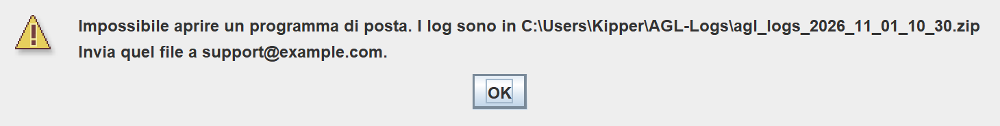

Se AGL non riesce ad aprire un programma di posta (ad esempio perché non ne è configurato nessuno), o non riesce ad aprire la cartella, mostra un messaggio con la posizione del file zip e l'indirizzo, così puoi allegarlo e inviarlo tu.

Una volta soddisfatto del layout, sei pronto per la configurazione.

## 2.4 Aggiornamento di AGL

A ogni avvio, AGL controlla se è stata rilasciata una versione più recente. Se non riesce a raggiungere internet, il controllo viene saltato e AGL si avvia normalmente. Se esiste una versione più recente, l'aggiornamento procede come segue. Vengono scaricati solo i file che sono cambiati, e le cartelle delle regate e le tile delle mappe vengono conservate.

1.  Se è disponibile una versione più recente, AGL mostra questa finestra di dialogo prima di fare qualsiasi altra cosa.

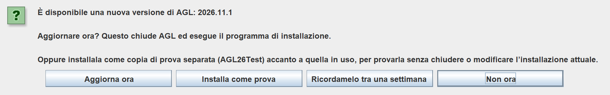

- **Aggiorna ora** avvia l'aggiornamento. Rimuoverà anche eventuali installazioni Test presenti contemporaneamente.

- **Installa come prova** installerà AGL come una nuova installazione in una cartella chiamata Java25Test, e creerà una serie di icone AGL25Test.

- **Ricordamelo tra una settimana** chiude la finestra di dialogo e non lo richiede più per sette giorni.

- **Non ora** chiude la finestra di dialogo e la ripropone al successivo avvio di AGL.

***Nota:*** Se stai usando una Beta, compare la stessa finestra di aggiornamento. **Aggiorna ora** aggiorna quindi solo la Beta e non tocca alcuna installazione Production o Test. Allo stesso modo, l'aggiornamento di Production non tocca un'installazione Beta.

Occasionalmente una release richiede che AGL venga riportato a uno stato pulito prima di essere installato; le Note di Rilascio indicano quando. La finestra di dialogo aggiunge allora *this release also resets AGL to a clean state first*, e dopo aver fatto clic su **Aggiorna ora** ti viene chiesto di confermare. Le cartelle delle regate e le tile delle mappe vengono conservate, ma AGL potrebbe chiederti di nuovo la cartella Races al primo avvio successivo (vedi 2.3). Scegli la stessa cartella di prima.

2.  Se sono in esecuzione altre sessioni di AGL, AGL le elenca per cartella della regata e chiede di chiuderle, perché usano tutte gli stessi file. Se non ce ne sono, questo passaggio viene saltato.

    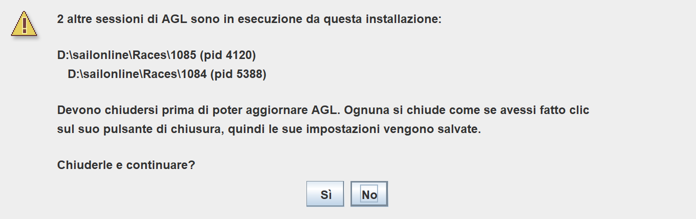

    Fai clic su **Sì**. Ogni sessione si chiude come se avessi fatto clic sul suo pulsante di chiusura, quindi le sue impostazioni vengono salvate. Normalmente ci vogliono pochi secondi, ma una sessione occupata (ad esempio una che sta scaricando dati) può impiegare fino a 30 secondi. Se una non si è ancora chiusa, AGL offre di forzarne la chiusura, il che non salva le impostazioni di quella sessione. Fai clic su **No** per annullare l'aggiornamento: non viene modificato nulla e AGL si avvia normalmente.

3.  AGL ora si chiude e si apre una finestra **Aggiornamento di AGL**. Attende che AGL abbia finito di chiudersi e poi esegue l'installer descritto in 2.1. Se è necessaria una pulizia, vedrai prima **Step 1 of 2** mentre AGL viene riportato allo stato pulito, seguito da **Step 2 of 2**. Per un aggiornamento normale l'installer trova l'installazione esistente e chiede *Update it? (Y/N) \[Y\]*: premi **Enter** per accettare.

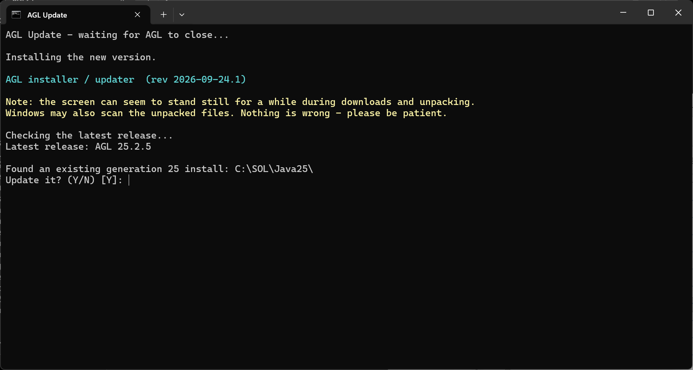

L'installer scarica i file che sono cambiati, compresi il Manuale Utente e le Note di Rilascio che si aprono dal menu Help. Termina con *Update complete.* Premi **Enter** per chiudere la finestra, quindi avvia AGL dalla sua icona sul desktop.

***Nota*:** Non avviare AGL mentre la finestra di aggiornamento è aperta. In caso contrario, AGL ti avvisa che è in corso un aggiornamento e ti chiede di attendere. Su Linux e macOS la finestra di aggiornamento è una finestra di terminale e funziona allo stesso modo.
