# 3 Configurazione

Ora sei pronto per configurare e compilare i campi come segue:

## 3.1 Accesso e regata

**Usa SOL come ID di accesso:** Seleziona questa opzione se vuoi accedere come SOL.

***Nota*:** Se il tuo **User name** non è **sol** e questa opzione è selezionata, verrai automaticamente disconnesso come **sol** e connesso con il tuo **Nome utente** una volta iniziata la regata.

**Nome utente:** Il tuo username SOL (nome della barca)

**Password:** La tua password SOL

**Regata:** Utilizzando il menu a tendina Race, seleziona la regata corrente. Questo compilerà automaticamente l'ID della regata.

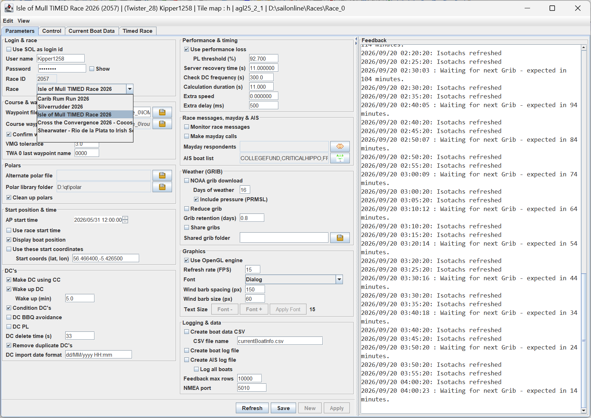

***Nota*:** Se non ci sono regate nell'elenco, molto probabilmente si tratta di un errore di connessione a internet. Controlla la connessione, chiudi l'app e riavviala.

## 3.2 Percorso e waypoint

**File di waypoint:** Nome del file di waypoint da utilizzare; può essere un file gpx.

**File di waypoint del percorso:** Consente di caricare un file in formato waypoint o gpx come waypoint aggiuntivi del percorso. Seleziona l'icona  che aprirà il selettore file.

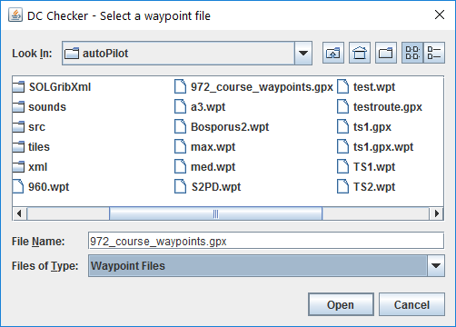

Seleziona il file da utilizzare e fai clic su **Apri**. Selezionando **Annulla** verrà cancellato il file attualmente selezionato. Questo file verrà ora utilizzato automaticamente ogni volta che si usa il DC Checker.

**Tolleranza VMG:** Utilizzato dalla routine Waypoint to DC per determinare con quanta precisione rispettare un waypoint durante una virata o una strambata verso un waypoint. Si tratta di un processo iterativo: più fine è la tolleranza, più tempo richiederà (e potrebbe anche fallire).

**Segui: distanza dalla costa (m):** Quanto al largo dalla costa, in metri, il comando Follow mette i suoi waypoint. Il valore predefinito è 10.

**Segui: distanza lungo la traccia (m):** Di quanto, in metri, i waypoint di Follow vengono poi spostati lungo la direzione di marcia. Il valore predefinito è 0.

## 3.3 Polari

**File polare alternativo:** Consente di utilizzare un file polare alternativo, che sostituisce la polare predefinita specificata nel file di informazioni della regata per tutte le operazioni. Seleziona l'icona  che aprirà il selettore file, utilizzando l'impostazione Polar Library come directory predefinita.

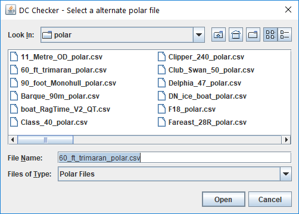

Seleziona il file da utilizzare e fai clic su **Apri**. Selezionando **Annulla** verrà cancellato il file attualmente selezionato e si tornerà alla polare predefinita della regata.

Le polari non cambieranno finché non viene premuto **Nuovo** oppure **Applica**.

**Cartella delle polari:** Specifica dove memorizzare e cercare le polari alternative della barca. Seleziona l'icona  che aprirà il selettore file.

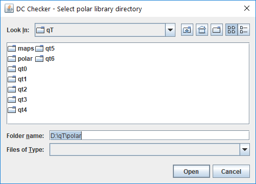

Seleziona il file da utilizzare e fai clic su **Apri**. Selezionando **Annulla** verrà cancellata la cartella attualmente selezionata e si tornerà alla cartella polare predefinita di AGL.

**Pulisci le polari:** Se selezionato, tutti i dati polari e altri dati di regata non applicabili alla regata corrente verranno eliminati dalla cartella delle polari. Questo non influirà sulla libreria delle polari.

## 3.4 Posizione e ora di partenza

**Ora di inizio waypoint:** Utilizzato dal convertitore Waypoint to DC per stabilire quando iniziare a utilizzare i waypoint. I DC esistenti verranno inseriti e utilizzati prima di questo orario. Il formato è lo stesso formato dei DC, AAAA/MM/GG HH:MM:SS, in UTC e con orologio a 24 ore. Il campo dispone di un tooltip che ne descrive il funzionamento.

Alla selezione, l'anno verrà evidenziato. Usa le frecce sinistra e destra, oppure Tab e Shift-Tab, per spostarti tra i componenti di data e ora. Puoi anche fare clic con il mouse su ciascun componente. Quando un componente è evidenziato, le frecce su e giù ne aumentano e diminuiscono rispettivamente il valore. Lo stesso vale per le frecce alla fine del campo.

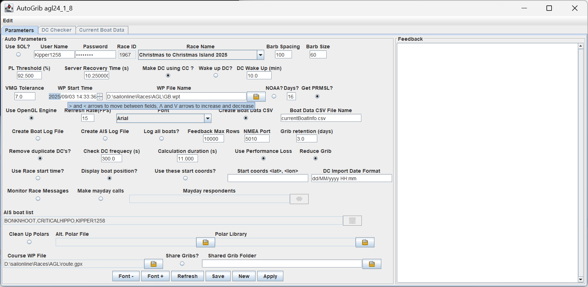

**Usa la partenza della regata:** Consente all'utente di controllare i DC fin dall'inizio. Se selezionato, il checker presumerà che la barca si trovi al waypoint di partenza e che l'orario sia quello di partenza. Eventuali DC successivi a tale orario verranno elaborati nella produzione della rotta. Se deselezionato, l'orario di partenza sarà quello attuale.

**Mostra la posizione della barca:** Utilizzato quando la barca si trova molto lontana dai DC di interesse. Non verrà tracciata né considerata nella produzione della rotta. Più applicabile quando **Use these start coordinates** è selezionato.

**Use these start coordinates:** La rotta verrà calcolata presupponendo che la barca si trovi alle **Start coords (lat, lon)**, e l'orario verrà portato avanti fino all'orario del primo DC.

**Start coords (lat, lon):** Le coordinate di partenza per la rotta. Sono nel formato che può essere incollato direttamente dal client SOL. Per copiare le coordinate dal client SOL, tieni premuto il tasto Alt e fai clic con il pulsante sinistro del mouse. Questo copia le coordinate del mirino negli appunti.

## 3.5 DC

**Make DC using CC:** Utilizzato dal convertitore da waypoint a DC per determinare come dirigersi verso il waypoint successivo. Dovrebbe essere lasciato selezionato.

**DC di risveglio:** Se selezionato, verranno inseriti DC aggiuntivi al tempo definito prima che il DC successivo debba scattare. Se per un po' non vengono eseguiti DC, il jump del server si allunga fino a 30 secondi. Questo può essere un problema nei giri di boa, poiché si crea un'incertezza di 30 secondi su quando scatterà il DC. Questa opzione serve a far "svegliare" il server nei giri di boa, in modo che i DC scattino a intervalli di 10 secondi.

**Risveglio (min):** Il tempo in minuti per inserire un DC aggiuntivo prima che scatti il successivo. 5 minuti è una buona durata.

**Mark clearance (m):** Di quanto, in metri, la barca deve passare al largo di una boa del percorso perché conti come girata, e di quanto oltre la boa deve attivarsi il DC che fa virare la barca. Il valore predefinito è 5.

**Controllo BBQ:** Se selezionato, AGL controlla lungo la rotta della barca e i tuoi DC alla ricerca di terraferma, invia i messaggi BBQ e propone soluzioni. Richiede anche che In Control sia attivo.

**Anticipo BBQ (min):** Quanto in anticipo, in minuti, Check for BBQ guarda lungo la rotta o i DC. Il valore predefinito è 60.

**Controllo delle boe:** Se selezionato, AGL ti avvisa quando la barca sta per mancare la prossima boa che deve girare. Richiede anche che In Control sia attivo.

**Anticipo boa (min):** Quanto in anticipo, in minuti, il controllo delle boe cerca la boa. Il valore predefinito è 15.

**Rimuovi i DC duplicati:** Eventuali DC successivi con lo stesso comando e valore vengono rimossi dall'elenco dei DC.

**Formato data di importazione DC:** Utilizzato per specificare il formato data del file di importazione dei DC. Nell'esportazione della rotta da qtVlm, questi saranno tipicamente dd/MM/yyyy HH:mm oppure MM/dd/yyyy HH:mm. Altri formati possono essere definiti come indicato in [SimpleDateFormat (Java SE 25 & JDK 25) (oracle.com)](https://docs.oracle.com/en/java/javase/25/docs/api/java.base/java/text/SimpleDateFormat.html).

La DC Data Table è spiegata nella sezione [6 DC Data Table](0600-dc-data-table.md).

**Attenzione:** un formato di data non valido causerà un'eccezione di analisi della data e può mandare in crash il DC Table Editor definito più avanti. Un metodo migliore è esportare la rotta come gpx e lasciare che AGL ricalcoli i DC usando il grib attuale.

## 3.6 Prestazioni e tempi

**Usa la perdita di prestazione:** Se selezionato, la perdita di prestazioni (performance loss) e il recupero vengono inclusi e dovrebbero corrispondere all'impostazione di performance loss della regata. Occasionalmente, come nelle regate su barche a vela su ghiaccio, la performance loss è disattivata, e in tal caso questa opzione dovrebbe essere deselezionata.

**Soglia PL (%):** La minimizzazione della Performance Loss (PL) cercherà di raggiungere questo valore prima di eseguire la manovra che causa la perdita maggiore. 92,5% è un buon valore, in modo che il recupero non superi la soglia del 93%.

**Tempo di recupero del server (s):** Questo valore è utilizzato dai calcoli di PL per determinare quanto recupero avverrà tra un DC e l'altro. 11 secondi è un buon valore e non dovrebbe essere inferiore al jump del server SOL di 10,25 sec.

**Frequenza di controllo DC (s):** Verrà creato un punto a questa frequenza quando si procede da un DC al successivo.

**Durata del calcolo (s):** Quando si calcola il percorso della barca a partire dai DC o dai waypoint, la barca viene fatta avanzare a intervalli in base a questa durata. Per un'elevata precisione, dovrebbe corrispondere al jump del server di circa 10–11 secondi.

## 3.7 qtVlm

AGL supporta la creazione e l'avvio di un'istanza di qtVlm specifica per la regata, **solo per i membri SailOnline**. Per utilizzare questa funzione in sicurezza, devi avere installate due istanze master di qtVlm: una come istanza Test e la seconda come istanza Production. Il motivo è che un aggiornamento di qtVlm nella stessa posizione di installazione aggiorna istantaneamente ogni regata collegata a quell'installazione. Se aggiorni l'installazione Production, viene aggiornata ogni regata configurata con Production. Se l'aggiornamento di Production presenta dei problemi, tutte le regate Production avranno gli stessi problemi. Per questo motivo dovresti avere un'installazione Test. Se qualcosa va storto, puoi continuare a regatare mentre risolvi i problemi.

La prima istanza è tipicamente installata in C:\Program Files\qtVlm su Windows e in ~/qtVlm sulle altre piattaforme. Usala come copia Production. Installa la seconda istanza nella tua cartella C:\SOL (~/SOL per Linux/macOS) e chiamala qtTest.

**Nota:** Linux richiede il supporto X11. Per verificare se hai una vera sessione X11, digita

> ***echo \$XDG_SESSION_TYPE command -v xdotool \|\| echo "xdotool not installed"***

Se viene restituito ***"xdotool not installed***", non hai X11. Installalo digitando quanto segue in una finestra del Terminale

***sudo apt install xdotool***

### 3.7.1 Passaggi di Integrazione – Ambiente Test

Per installare la copia di test, procedi come segue:

1.  Chiudi tutte le istanze di qtVlm. qtVlm non si installa se ci sono istanze aperte.

2.  Crea una cartella C:\SOL\qtTest (~/qtTest per Linux/macOS) e avvia l'installer come descritto nel Manuale Utente di qtVlm.

3.  Su Windows, quando si arriva alla posizione di installazione, cambiala in C:\SOL\qtTest. **Non** creare collegamenti sul desktop, perché sostituirebbero quelli di produzione già esistenti.

4.  Al termine dell'installer, al suo interno ci sarà una cartella chiamata qtVlm. È qui che risiede la tua istanza di test. Avvia qtVlm da lì e verifica che si apra correttamente. Scarica le mappe richieste, poi chiudi qtVlm.

Ora sei pronto per creare una nuova cartella di regata AGL di test, procedendo come segue.

1.  Avvia AGL e crea una nuova cartella di progetto chiamata AGLTest

2.  Configura AGL con il tuo login e con una regata a cui stai partecipando. Nel riquadro Logging & Data, imposta la NMEA port su un numero che non stai utilizzando. 5020 è un buon numero per il progetto di test.

3.  Seleziona **Integra qtVlm** solo in questa fase.

    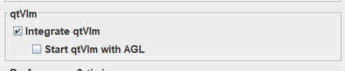

4.  Seleziona Apply. Se non sei un membro SOL, questo messaggio ti verrà mostrato due volte. Fai clic su OK. Chi non è membro SOL non può procedere oltre questo punto nella configurazione dell'integrazione di qtVlm.

    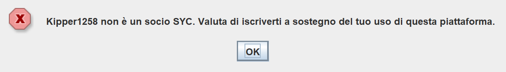

5.  AGL eseguirà l'intera procedura di avvio prima di integrare qtVlm. Al termine ti verrà chiesto quale integrazione configurare. Seleziona **Prova**

    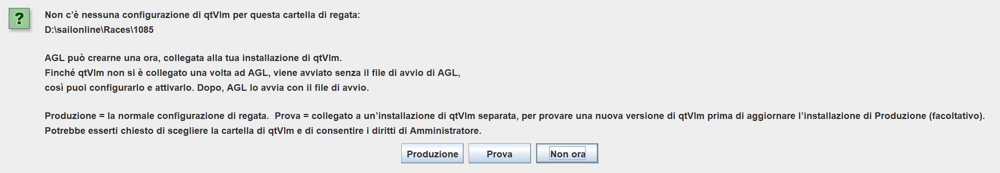

6. Se le mappe qtVlm utilizzate da AGL non sono ancora state scaricate, verrà mostrato questo messaggio.

   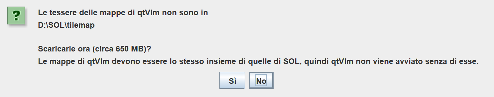

   Seleziona **Sì** per continuare. **No** annulla la configurazione dell'integrazione. Le mappe di qtVlm devono essere lo stesso set di quelle di SOL, quindi qtVlm non viene avviato senza di esse. Su Windows ti verrà chiesto di consentire modifiche a questo computer. Seleziona **Sì** per continuare.

7.  Ti verrà ora chiesta la posizione dell'istanza Test. Vai fino alla cartella C:\SOL\qtTest\qtVlm (oppure ~/qtTest\qtVlm per Linux/macOS nel relativo selettore di cartelle). Questa cartella deve contenere qtVlm.exe (oppure qtVlm per Linux/macOS).

    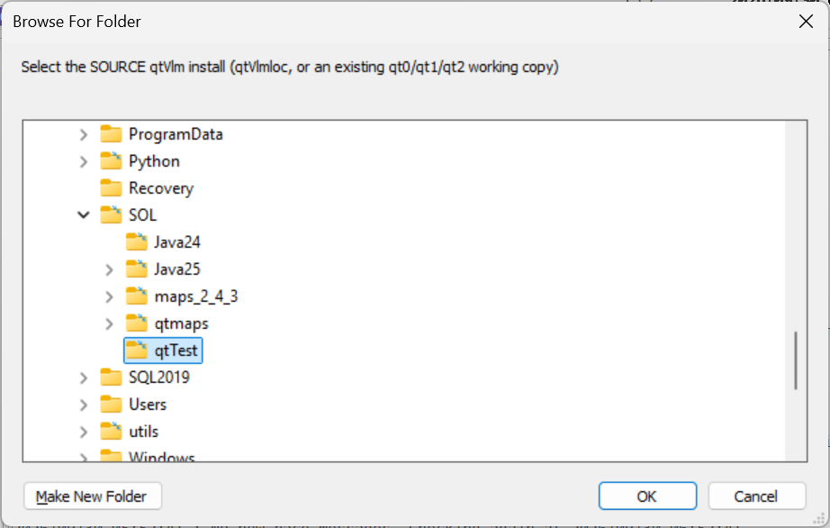

    Se scegli una cartella di installazione non valida, verrà mostrato questo messaggio. Seleziona **OK** per continuare l'integrazione. Il selettore di cartelle verrà mostrato di nuovo. Seleziona un'installazione di qtVlm valida.

    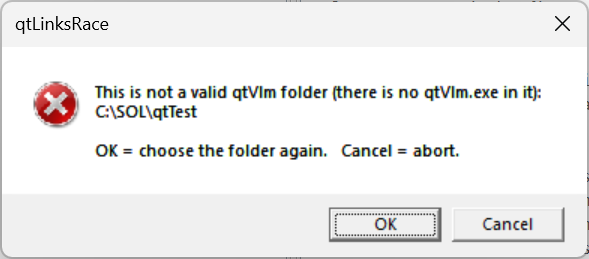

8.  Su Windows comparirà la finestra Administrator, che si chiuderà al termine.

    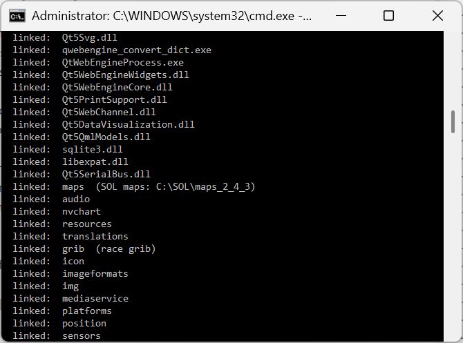

9.  L'icona qtVlm sulla toolbar sarà ora abilitata. Fai clic su di essa.

    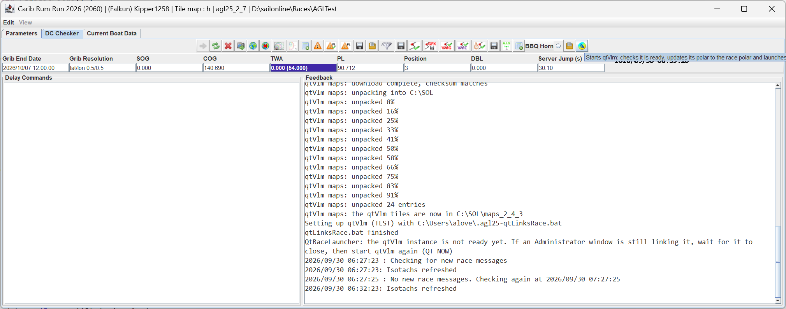

10. Verrà ora mostrata la pagina di avvio di qtVlm per una nuova installazione.

    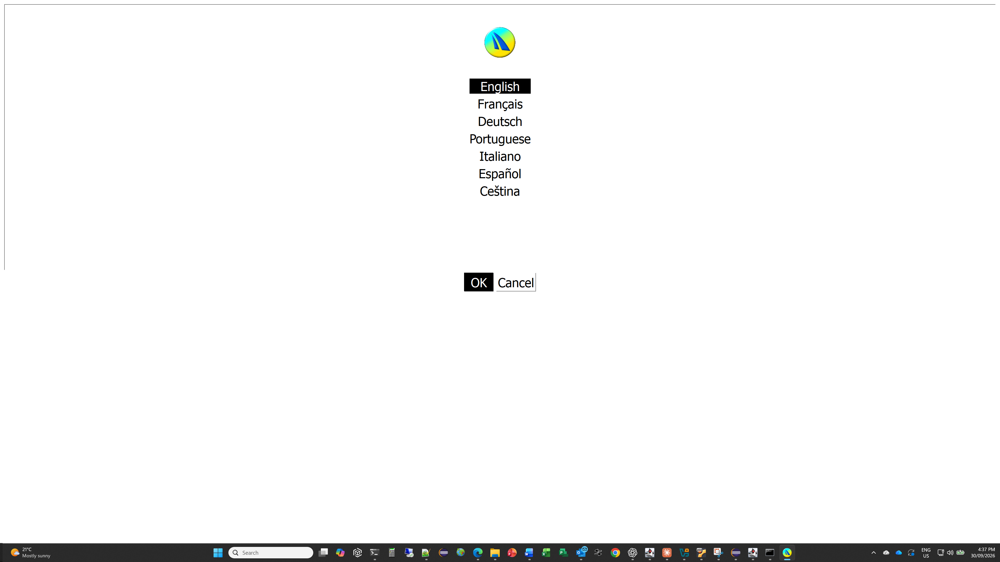

11. Potresti vedere questo errore. Fai semplicemente clic su **OK**.

    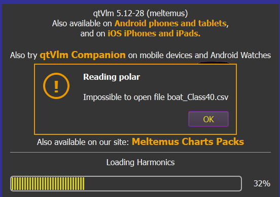

12. Dal menu **qtVlm**, seleziona **Configuration** per aprire il modulo **qtVlm Configuration**. Fai clic sulla scheda **NMEA Connections** e seleziona la scheda **Network Sources**. Configura TCP Server 1 come mostrato, supponendo che in AGL tu abbia scelto 5020 come numero di porta.

    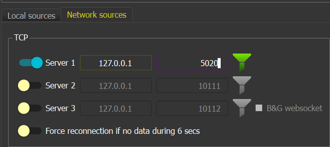

13. Ora fai clic su **OK.** Poi fai clic sul simbolo NMEA per avviare la connessione NMEA. Dovrebbe diventare verde se il numero di porta in AGL e in qtVlm coincidono.

14. Chiudi qtVlm.

15. L'icona qtVlm in AGL dovrebbe ora essere abilitata. Fai di nuovo clic su di essa e qtVlm verrà avviato con current_grib.grb caricato e con la polare impostata sulla polare della regata.

16. Ora puoi selezionare Start qtVlm with AGL, e qtVlm verrà avviato non appena AGL avrà completato l'inizializzazione (oppure si connetterà se qtVlm è già in esecuzione).

AGL ha ora creato una nuova istanza di qtVlm nella cartella della regata, in una cartella chiamata qtvlm. Sono stati creati due file batch chiamati qt_race.bat e qt_race_setup.bat (.sh per Linux/macOS) che AGL utilizza per avviare qtVlm a seconda dello stato di avanzamento dell'installazione. Le linee di costa in qtVlm sono state impostate in modo da corrispondere alla versione delle tile di AGL. Il metodo di interpolazione è stato impostato su SOL, il flag del messaggio NMEA RMB è stato impostato correttamente e la porta TCP NMEA è stata impostata sulla porta di AGL. AGL mantiene allineate queste impostazioni a ogni avvio di qtVlm.

AGL ora crea un grib chiamato current_grib.grb, che è una replica esatta di ciò che si trova in quel momento nella memoria di AGL. Questo grib viene sempre caricato nello slot Grib 1 a ogni avvio di qtVlm. Non è necessario aprire un nuovo grib: basta aggiornare (refresh) lo slot 1.

Nella tua cartella home è stato creato un file chiamato .agl25-qtvlm-link.properties, che memorizza la posizione degli ambienti Test e Production. Contiene due righe che puntano alle tue cartelle Production e Test.

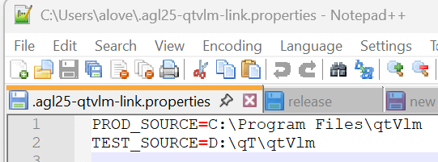

È improbabile che queste cambino, ma in tal caso è sufficiente eliminare le voci TEST_SOURCE o PROD_SOURCE e salvare il file. In questo modo il selettore di cartelle verrà mostrato la prossima volta che si eseguiranno i passaggi di integrazione per quel percorso.

Per forzare una nuova esecuzione dell'integrazione, elimina semplicemente il file (in realtà è un collegamento simbolico) **qtVlm.exe** (qtVlm per Linux e macOS) nella cartella qtvlm della regata. AGL dirà quindi che la configurazione di qtVlm della regata è danneggiata e offrirà di collegarla di nuovo (scegli Production o Test come in precedenza). Le sue impostazioni vengono conservate.

### 3.7.2 Passaggi di Integrazione – Ambiente Production

L'integrazione delle regate Production è sostanzialmente lo stesso processo. Dopo aver verificato che l'istanza Test funzioni, puoi avviare AGL in una cartella di regata esistente oppure crearne una nuova. Poi segui i passaggi per l'ambiente Test e seleziona **Produzione** invece di **Prova**.

Quando viene mostrato il selettore di cartelle, vai all'installazione Production di qtVlm e poi segui i passaggi descritti in 3.7.1 Passaggi di Integrazione – Ambiente Test.

### 3.7.3 Aggiornamento di qtVlm

**Attenzione:** Ogni volta che qtVlm segnala che è disponibile un aggiornamento, è **fortemente consigliato** aggiornare prima l'ambiente Test e verificare che qtVlm di test si avvii e funzioni correttamente. L'aggiornamento dell'installazione qtVlm principale aggiornerà istantaneamente ogni istanza di regata creata a partire da essa. Se la nuova versione presenta un problema e hai aggiornato la tua installazione Production, ogni istanza nelle cartelle di regata avrà lo stesso problema. Per questo motivo devi eseguire il test prima di aggiornare.

#### 3.7.3.1 Windows - Test

Il primo passo è assicurarsi che l'ambiente di test funzioni, eseguendo i passaggi seguenti

1.  Chiudi qtVlm e installa la nuova versione nella cartella qtVlm utilizzata dalla tua regata Test.

2.  Avvia AGL per la cartella della regata Test e avvia qtVlm da AGL (si avvia da solo se è selezionato Start qtVlm with AGL, altrimenti fai clic sull'icona qtVlm). AGL rileverà quindi che è stata installata una nuova versione e chiederà

    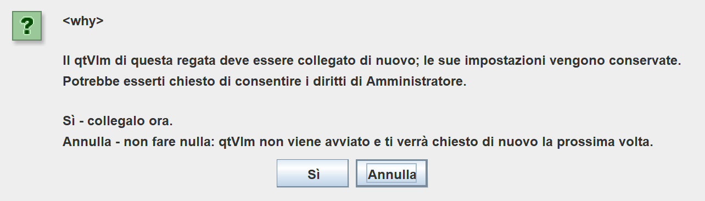

    **Annulla** non fa nulla e qtVlm non viene avviato. **Sì** avvia il collegamento e potrebbe esserti chiesto di concedere il permesso al programma: fai clic su Yes

3.  Una volta completato il collegamento, AGL proverà ad avviare qtVlm automaticamente. Su Windows il collegamento viene eseguito nella finestra Administrator. Se sta ancora lavorando quando AGL controlla, il riquadro Riscontro indica che l'istanza di qtVlm non è ancora pronta: attendi che la finestra Administrator si chiuda, poi fai clic sull'icona qtVlm.

4.  Potresti vedere questa finestra di dialogo se mancano le mappe oppure se il set di qtVlm non corrisponde a quello di SOL.

**Annulla** non fa nulla. **Sì** avvia il collegamento e potrebbe esserti chiesto di concedere il permesso al programma: fai clic su Yes.

Se le mappe richieste non sono state scaricate, ti verrà chiesto

Fai clic su **Sì**. Se le tile che hai già appartengono a un'altra versione, AGL chiede di spostarle da parte e di scaricare il set corretto: rispondi Yes. Se sono in esecuzione sessioni di qtVlm, vedrai

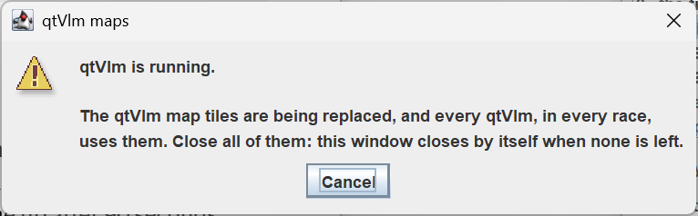

Chiudi tutte le sessioni di qtVlm aperte. La finestra di dialogo scomparirà quando tutte le sessioni saranno chiuse e il download proseguirà.

Se fai clic su No, verrà mostrato questo. Se non è possibile scaricare le mappe (ad esempio per un problema di connessione al repository), la prima riga lo indica e qtVlm non viene avviato.

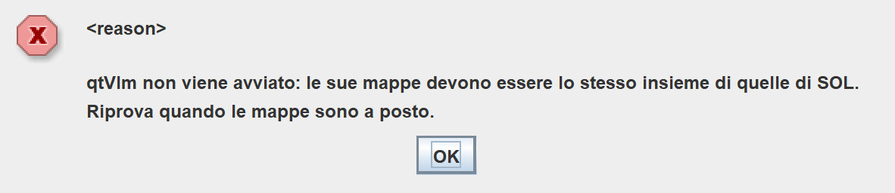

Controlla la tua connessione a Internet per eventuali errori e attendi che si risolvano. In caso contrario, attendi qualche minuto e riprova ad avviare qtVlm dall'icona.

Potrebbero comparire altri messaggi relativi alle mappe. Se viene richiesto di scaricare, rispondi **Sì**.

5.  Se qtVlm non si avvia dopo 90 secondi (ad esempio perché qtVlm mostra un errore relativo a file o mappe mancanti e si ferma), si apre una finestra che indica che qtVlm non è stato avviato. Una soluzione è rimuovere tutti i collegamenti e ricollegare.

    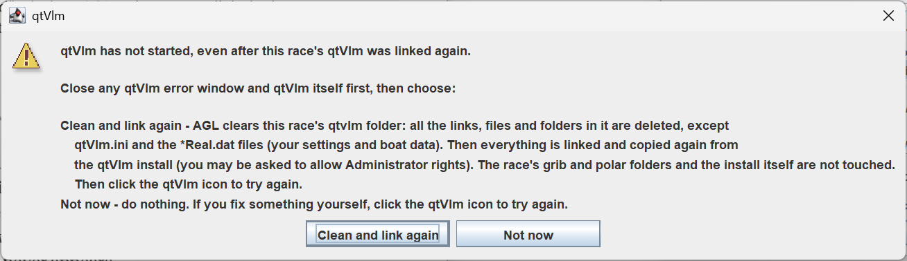

6.  Seleziona **Clean and link again**, che dovrebbe risolvere il problema. In caso contrario, devi verificare al di fuori di AGL cosa non va nell'installazione di qtVlm.

#### 3.7.3.2 Windows – Production

Una volta aggiornato l'ambiente Test e verificato che funzioni, puoi aggiornare in sicurezza l'ambiente Production. Non è necessario eseguire prima il Test, ma si corre il rischio di danneggiare l'ambiente Production. I passaggi sono gli stessi dell'ambiente Test.

### 3.7.4 Risoluzione dei Problemi di Connessione NMEA

La porta NMEA può occasionalmente bloccarsi sul lato qtVlm, e questo farà sì che AGL avvii un'altra sessione di qtVlm. In tal caso, chiudi la nuova sessione e quella precedente di qtVlm, in quest'ordine. Ogni volta che disconnetti NMEA in qtVlm, vedrai questo messaggio nella finestra Riscontro di AGL, con il numero di porta corrispondente al tuo.

2026/09/30 22:36:40 NMEA connection 0 on port 5012 closed

Se non vedi quel messaggio quando fermi NMEA in qtVlm, la porta si è bloccata. Chiudi qtVlm e avvialo di nuovo dal pulsante qtVlm in AGL. Dovresti di nuovo vedere un messaggio di connessione del tipo

2026/09/30 22:37:10 NMEA connection 1 on port 5012 established

a condizione che tu abbia configurato correttamente qtVlm e che in passato abbia funzionato. Se ciò non accade, chiudi sia AGL sia qtVlm, riavvia AGL, quindi avvia di nuovo qtVlm da AGL. Se ancora non si connettono, devi riavviare il computer per reimpostare le porte a livello di sistema.

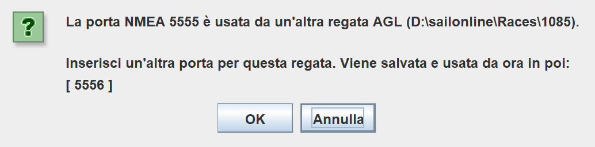

Se la porta NMEA impostata in AGL è già in uso all'avvio di AGL da parte di un'altra regata AGL o di un altro programma, AGL te lo segnalerà e ti chiederà un nuovo numero di porta. Come suggerimento userà la successiva porta disponibile.

Inserisci la porta che vuoi che questa regata utilizzi. AGL la verifica e, se è libera, la salva e avvia su di essa la connessione NMEA, in modo che la sessione successiva parta correttamente. Se anche la porta inserita è in uso, ti viene chiesto di nuovo. Ogni regata ha bisogno di una propria porta univoca.

Se fai clic su **Annulla**, AGL mantiene la porta originale e attende che si liberi. La prossima volta che AGL avvia qtVlm, imposta la porta TCP di qtVlm in modo che corrisponda a quella di AGL. Se qtVlm è già in esecuzione, chiudilo e avvialo di nuovo da AGL in modo che si connetta sulla nuova porta.

## 3.8 Messaggi di regata e AIS

**Controlla i messaggi di regata:** Questo monitorerà il feed dei messaggi della regata e, se arriva un nuovo messaggio, le informazioni sulla regata verranno aggiornate

**Make mayday calls:** Se selezionato, verrà attivata la funzione di soccorso BBQ. La funzione è descritta in dettaglio più avanti.

**Mayday respondents:** Chi può rispondere alle tue chiamate mayday. Trattato più avanti.

**Elenco barche AIS:** L'elenco delle barche le cui informazioni AIS verranno inviate nel feed NMEA. Se vuoto, vengono inviate tutte le barche. Selezionando l'icona si apre l'AIS Boat Chooser. Seleziona le barche desiderate e fai clic su Add. Quindi fai clic su Apply per aggiornare l'elenco delle barche AIS. L'icona si trova sia nella scheda Parametri che nella scheda Controllo DC.

***Nota:***

1.  Lo stesso elenco viene utilizzato per popolare la Boat Data Table. Dovresti aggiungere la tua barca all'elenco.

2.  Il selettore delle barche non sarà attivo finché l'inizializzazione non sarà completa, poiché è necessario un login valido al server per recuperare le barche attive.

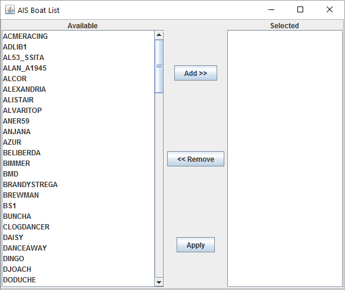

## 3.9 Meteo (GRIB)

**Download grib NOAA:** Se selezionato, scarica i file meteo direttamente da NOAA non appena disponibili.

**Giorni di meteo:** Il numero di giorni di dati NOAA da scaricare.

**Includi la pressione (PRMSL):** Scarica anche la pressione al livello medio del mare oltre ai dati del vento?

**Nota:** Il comportamento del server NOAA è spiegato più avanti in **Server NOAA**.

**Riduci il grib:** Se selezionato, i grib SOL e NOAA verranno ridotti in modo da essere di poco più grandi dell'area di regata. Anche la mappa verrà creata di poco più grande dell'area di regata. Selezionando questa opzione si riduce il traffico di download per NOAA e si velocizza il funzionamento di AGL.

**Conservazione grib (giorni):** I file meteo nelle cartelle *grib* e *SOLGribXml* che sono più vecchi di questo valore verranno controllati ed eliminati all'avvio del download meteo (Wx).

**Condividi i grib:** Attiva o disattiva la condivisione dei grib.

**Cartella grib condivisa:** Se il campo non è vuoto, una copia dei grib SOL e NOAA (se selezionato) verrà scritta in questa posizione, in una cartella con lo stesso nome dell'ID della regata. Se il campo è vuoto, non verrà creata alcuna copia. Questa funzione è pensata per consentire la condivisione dei grib tramite servizi cloud come OneDrive, iCloud o Google Drive.

Seleziona l'icona  che aprirà il selettore file.

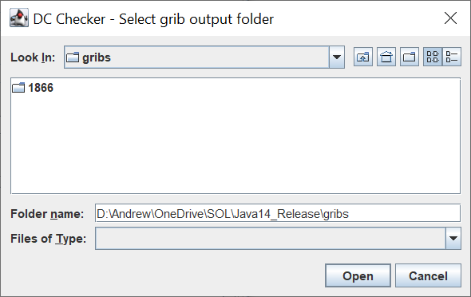

Seleziona la cartella da utilizzare e fai clic su **Apri**. Selezionando **Annulla** verrà cancellata la cartella attualmente selezionata. Le copie dei grib verranno ora scritte in questa posizione non appena disponibili.

AGL ora crea un grib chiamato current_grib.grb che è una replica esatta di ciò che si trova in quel momento nella memoria di AGL. Questo grib può essere caricato una sola volta nel tuo software di weather routing e poi semplicemente aggiornato ogni volta che vuoi usarlo.

## 3.10 Grafica

**Usa il motore OpenGL:** Questo utilizzerà il nuovo motore OpenGL. L'inizializzazione all'avvio richiederà alcuni secondi

***Attenzione:*** L'utilizzo del motore OpenGL comporterà l'uso di tutte le tile di gara per l'area della regata. Se la libreria delle tile non è stata configurata, non verrà caricata alcuna mappa.

**Frequenza di aggiornamento (FPS):** Definisce il numero di volte al secondo in cui i dati della finestra grafica verranno aggiornati. Può essere regolato in base alla potenza di elaborazione del computer.

**Spaziatura barbe del vento (px):** La spaziatura in pixel con cui verranno disegnate le barbe del vento.

**Dimensione barbe del vento (px):** La dimensione in pixel con cui verranno disegnate le barbe del vento.

**Dimensione testo:** La dimensione del testo e dei pulsanti nelle finestre di AGL. Font - e Font + cambiano la dimensione di 1, e mostrano la nuova dimensione accanto a quella in uso. Apply Font la applica. Il font è sempre Dialog, quindi non c'è un font da scegliere.

**Dimensione icone:** La dimensione delle icone, come percentuale della loro dimensione normale (da 50 a 300, normalmente 100). Icon - e Icon + la cambiano di 10, e l'icona In Control viene mostrata alla nuova dimensione come anteprima. Apply Font la applica.

## 3.11 Registrazione e dati

**Crea il CSV dei dati barca:** Se selezionato, verrà creato un file csv con tutti i dati della barca a ogni jump del server. Verrà scritto nel file specificato in **CSV file name.** Il file di dati CSV contiene due righe, come mostrato di seguito.

TimeStamp, TWS, TWA, SOG, LAT, LON, COG, PL, TWD, POSN

2025/04/10 03:21:44,5.73,-3.03,8.37,-20.27,49.972,3.15,1.0,0.125,000026

Sono semplicemente i dati provenienti dalla dashboard del tuo client SOL. Nota però che il TWS viene restituito in m/s e gli angoli in radianti.

***Attenzione:*** Se il file CSV viene aperto in Excel o in alcuni altri editor, viene bloccato e non può essere aggiornato. Potresti ritrovarti con dati non aggiornati nel file. Assicurati che il file non sia bloccato durante la lettura. Ad esempio, crea una connessione dati in Excel per leggere il CSV e aggiornarla, oppure usa un editor come NotePad++.

**Crea il file di log della barca:** Se selezionato, l'applicazione creerà automaticamente un file di log con tutti i dati della barca a ogni jump del server. Questo intervallo varia da 10 a 30 secondi. Il nome del **Log File** sarà simile a boat_log_935_2016_05_25_0_28.txt, cioè è composto come "boat_log\_\<Race_ID\>\_\<YYYY_MM_DD_HH_MM\>.txt".

Ha lo stesso formato di **Crea il CSV dei dati barca** ma con molte più righe e i seguenti campi aggiuntivi:

Dist Lost: Non utilizzato

CMD: Comando DC corrente, cc o twa

DTG: Distanza da percorrere in nm

POSN: Posizione corrente

DBL: Distanza dal primo in nm

VMG+: TWA per il massimo VMG di bolina, in gradi decimali

VMG-: TWA per il massimo VMG in poppa, in gradi decimali

Max TWA: TWA al quale si verifica la velocità massima della barca

Max Speed: La velocità massima in nodi

**Nota:** Il file di log può essere caricato nel checker grafico.

**Crea il file di log AIS:** Se selezionato, l'applicazione creerà automaticamente un file di log con tutti i dati delle barche AIS a ogni jump del server. Questo intervallo varia da 10 a 30 secondi.

Il nome del **Log File** AIS sarà simile a AIS_log_935_2016_05_25_0_28.txt, cioè è composto come "AIS_log\_\<Race_ID\>\_\<YYYY_MM_DD_HH_MM\>.txt".

Il file CSV contiene i seguenti campi:

TimeStamp: L'orario in cui i dati sono stati scritti e calcolati

BoatName: Nome della barca

POSN: Posizione corrente

DTG: Distanza da percorrere in nm

DBL: Distanza dal primo in nm

SOG: Velocità sul fondo in nodi

COG: Rotta sul fondo in gradi decimali

TWS: Intensità del vento reale in nodi

TWA: Angolo del vento reale in gradi decimali

TWD: Direzione del vento reale in gradi decimali

VMG: Velocità effettiva (VMG) in nodi

VMC: Velocità verso la rotta (VMC) in nodi (verso la prossima boa di percorso)

Target: Nome della boa target

DTT: Distanza dal target in nm

DTG: Distanza da percorrere fino al centro della linea di arrivo (riportata dal server)

LAT: Latitudine corrente in gradi decimali

LON: Longitudine corrente in gradi decimali

VMG+: TWA per il massimo VMG di bolina, in gradi decimali

VMG-: TWA per il massimo VMG in poppa, in gradi decimali

Max TWA: TWA al quale si verifica la velocità massima della barca

Max Speed: La velocità massima in nodi

**Registra tutte le barche:** Se selezionato, verranno registrate tutte le barche della regata. Se deselezionato, verranno riportate solo le barche presenti nell'elenco barche AIS corrente.

**Attenzione:** Il file di log potrebbe crescere molto rapidamente se sono selezionate tutte le barche. Il tasso di crescita sarà di circa 20–30 MB all'ora.

**Righe massime del Riscontro:** I dati nella finestra Riscontro vengono memorizzati in memoria, e la memoria dell'applicazione può crescere molto se questo valore non viene limitato. Il valore predefinito di 10000 va bene per la maggior parte dei computer.

**Porta NMEA:** L'applicazione inizierà ad ascoltare una connessione sulla NMEA Port e, quando avviene una connessione, inizierà a trasmettere le frasi NMEA. Le frasi supportate sono:

- GGA - Dati di posizionamento GPS

- HDT - Prua vera

- MWD - Direzione e velocità del vento

- RMB - Informazioni minime di navigazione raccomandate

- RMC - Dati GNSS minimi specifici raccomandati

- VHW - Velocità e prua rispetto all'acqua

- VWR - Velocità e angolo del vento relativo

- VWT - Velocità e angolo del vento reale

- WPL - Posizione del waypoint

Invierà anche i waypoint del percorso, inclusa la linea di arrivo.

Vengono inviati anche i dati delle altre barche su SailOnline come messaggi AIS di classe A:

- Messaggio 1 - Rapporto di posizione

- Messaggio 5 - Dati statici della nave e relativi al viaggio

Se il client si disconnette, l'applicazione interromperà la trasmissione e attenderà una nuova connessione. L'applicazione consente più connessioni NMEA contemporaneamente.

***Nota:*** L'avvio del flusso di dati può richiedere fino a 30 secondi. I waypoint verranno inviati immediatamente, ma il flusso di dati attende il jump successivo del server per iniziare.

Per avviare l'applicazione, seleziona **Applica**. Verranno applicate le impostazioni e avviati i componenti selezionati.

I parametri vengono scritti in un file .ini, che per impostazione predefinita si chiama **autoGribLoader.ini**. L'applicazione supporta diversi file .ini in due modi. Per impostazione predefinita, il file AGL_run.bat specifica il file .ini come argomento a riga di comando alla fine del file .bat, in questo modo:

*"!INSTALL_DIR!\windows_jre%AGL_GEN%\bin\java.exe" ^*

*-Dsun.java2d.uiScale.enabled=false ^*

*-Dfile.encoding=UTF8 ^*

*--enable-native-access=ALL-UNNAMED ^*

*--add-opens=java.base/sun.nio.ch=ALL-UNNAMED ^*

*--add-opens=java.base/jdk.internal.ref=ALL-UNNAMED ^*

*--add-exports=java.base/java.lang=ALL-UNNAMED ^*

*--add-exports=java.desktop/sun.awt=ALL-UNNAMED ^*

*--add-exports=java.desktop/sun.java2d=ALL-UNNAMED ^*

*-classpath "!INSTALL_DIR!\\VERSION!.jar;!INSTALL_DIR!\agl%AGL_GEN%\_lib\\;" ^*

*main.AGMain ^*

***autoGribLoader.ini***

Puoi modificare il file .bat con un editor di testo e specificare un file .ini diverso, oppure nessuno. Se non viene specificato alcun file .ini, come mostrato di seguito,

*"!INSTALL_DIR!\windows_jre%AGL_GEN%\bin\java.exe" ^*

*-Dsun.java2d.uiScale.enabled=false ^*

*-Dfile.encoding=UTF8 ^*

*--enable-native-access=ALL-UNNAMED ^*

*--add-opens=java.base/sun.nio.ch=ALL-UNNAMED ^*

*--add-opens=java.base/jdk.internal.ref=ALL-UNNAMED ^*

*--add-exports=java.base/java.lang=ALL-UNNAMED ^*

*--add-exports=java.desktop/sun.awt=ALL-UNNAMED ^*

*--add-exports=java.desktop/sun.java2d=ALL-UNNAMED ^*

*-classpath "!INSTALL_DIR!\\VERSION!.jar;!INSTALL_DIR!\agl%AGL_GEN%\_lib\\;" ^*

*main.AGMain*

verrà visualizzato un selettore file quando esegui il file .bat, e sarà possibile selezionare il file ini come mostrato di seguito.

Per Linux e macOS, gli script AGL_run.sh contengono un comando simile alla fine del file e possono essere modificati allo stesso modo.

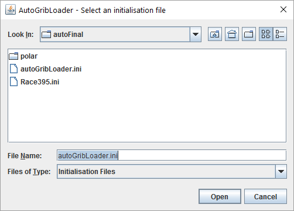

Seleziona il file oppure Cancel per uscire completamente.

Le modifiche ai parametri vengono salvate nel file ini man mano che le fai: una casella di testo viene salvata quando premi Invio o Tab, oppure fai clic in un altro campo. Se un valore non è valido non viene salvato: la casella torna all'ultimo valore valido e un messaggio in Riscontro lo segnala.

**Nuovo** forzerà un nuovo download delle informazioni di regata e dei file grib. Dovrebbe essere usato quando ci sono cambiamenti nelle informazioni di regata o nel formato Wx.

Per **uscire** dall'applicazione, fai semplicemente clic sulla X nell'angolo in alto a destra dello schermo.
