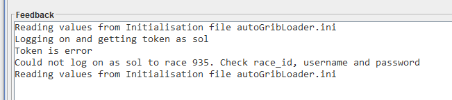
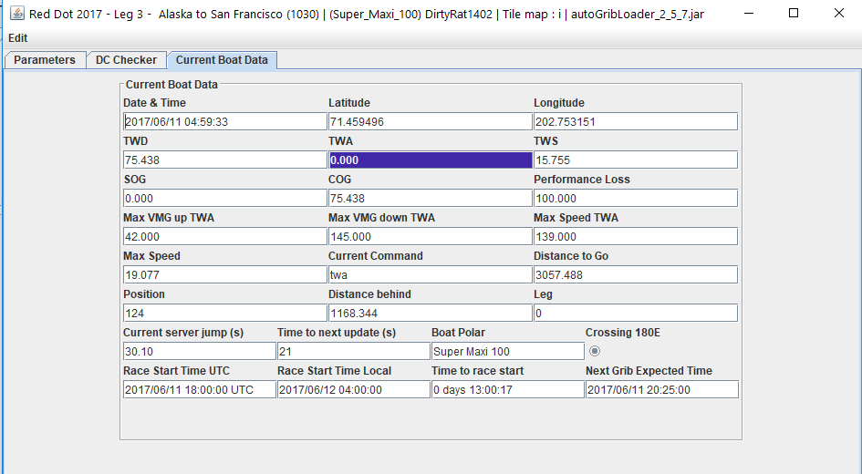

# 4 Inizializzazione

Applicando i parametri, e a condizione che tu abbia inserito username, password e regata corretti (devi essere iscritto a quella regata), l'applicazione eseguirà un processo di inizializzazione che potrebbe richiedere fino a 30 secondi per completarsi. Se non vedi quanto segue nella finestra di feedback, controlla la regata, lo username e la password, e riprova. Nota che lo stesso risultato può verificarsi anche in assenza di connessione a internet.

**Nota:** Il download delle informazioni di regata (che include la polare della barca) e delle informazioni meteo può bloccarsi. Dopo circa due minuti, l'applicazione dovrebbe interrompere questi download per timeout e riprovare. Se ciò non accade, chiudi l'applicazione e ricomincia.

Dopo un accesso riuscito, verrai portato alla scheda Controllo DC. I pulsanti e le schede rimarranno inattivi finché non saranno configurati e pronti per l'uso. Inoltre, se i server richiesti per quella funzionalità non sono stati avviati, non verranno abilitati. A questo punto, il file grib meteo e la polare della barca saranno già stati creati, e la registrazione sarà stata avviata se richiesta.

**Nota:** Il titolo della finestra dell'applicazione si aggiornerà per mostrare la barca, il nome della regata e l'ID della regata. Questo può essere usato per verificare a quale regata si riferisce questa istanza. È possibile eseguire più istanze dell'applicazione sullo stesso computer, ma ciascuna dovrebbe essere eseguita nella propria cartella.

## 4.1 Polari Barca QtVLM ed Expedition

Parte del processo di inizializzazione consiste nel creare ***polar***i barca dettagliate in stile QtVLM ed Expedition, se non esistono già. L'applicazione crea una directory chiamata polar e colloca il file in quella cartella. Si chiama \<Boat Type\>\_polar.csv, ad esempio *Twister_28_polar.csv.* Questo file può essere copiato nella cartella polar di Qt e utilizzato. Per Expedition, si chiama \<Boat Type\>\_expd_polar.csv, ad esempio *Twister_28_expd_polar.csv.*

## 4.2 GPX dei Waypoint del Percorso

L'applicazione creerà un file gpx dei waypoint del percorso e una rotta che collega tali waypoint nell'ordine in cui devono essere percorsi. Questi dati possono poi essere caricati in pacchetti di routing come Expedition e Qt. Il file viene creato nella directory ***polar*** e si chiama \<Race ID\>\_course_waypoints.gpx. Ad esempio, per la regata con id 565, il file gpx sarà *565_course_waypoints.gpx*.

L'applicazione aggiunge anche le estremità della linea di arrivo, ma non le include nella rotta.

## 4.3 Scheda Dati barca attuali

Una volta completata l'inizializzazione, l'applicazione inizierà a riportare i dati attuali della barca in questa scheda. I dati si presentano così. Tutti i dati sono espressi in gradi decimali, miglia nautiche e nodi.

Viene inoltre calcolata la durata attuale del jump del server (varia da circa 10 a 30 secondi) e il tempo mancante al prossimo aggiornamento previsto. La data e l'ora dei dati sono accurate a circa un secondo.

Nota che il TWA è stato evidenziato poiché è al di fuori dell'intervallo 42,0 - 145,0.

## 4.4 Scheda Parametri

Fai clic su questa scheda per tornare ai parametri. Questi possono essere modificati in qualsiasi momento e l'applicazione risponderà di conseguenza. Ad esempio, cambiare la regata causerà una reinizializzazione completa.
