# 5 Utilizzo di AGL

Questo capitolo descrive come si usa AGL giorno per giorno: controllare i tuoi DC e il percorso, lavorare nella grafica e importare le rotte.

## 5.1 Scheda Controllo DC

Una volta completata l'inizializzazione, i pulsanti della scheda Controllo DC diventano attivi. Inoltre, eventuali DC correnti verranno scaricati nella finestra Comandi ritardati. La scheda dovrebbe apparire così una volta configurata completamente.

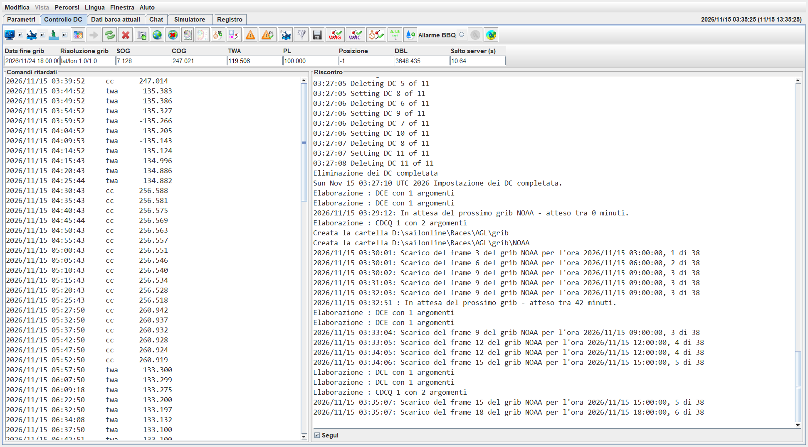

Le funzionalità di questa scheda sono descritte di seguito.

### 5.1.1 Menu di Modifica Contestuali

Sono disponibili due menu utilizzabili per copiare e incollare. Il primo è il menu **Modifica** che mostra questo menu.

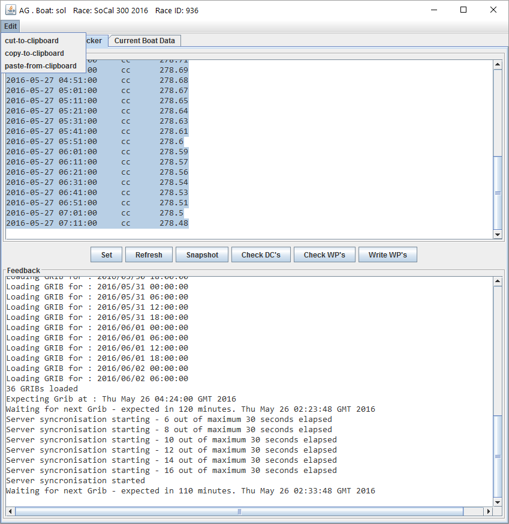

Il secondo è accessibile facendo clic con il tasto destro del mouse nella finestra Comandi ritardati.

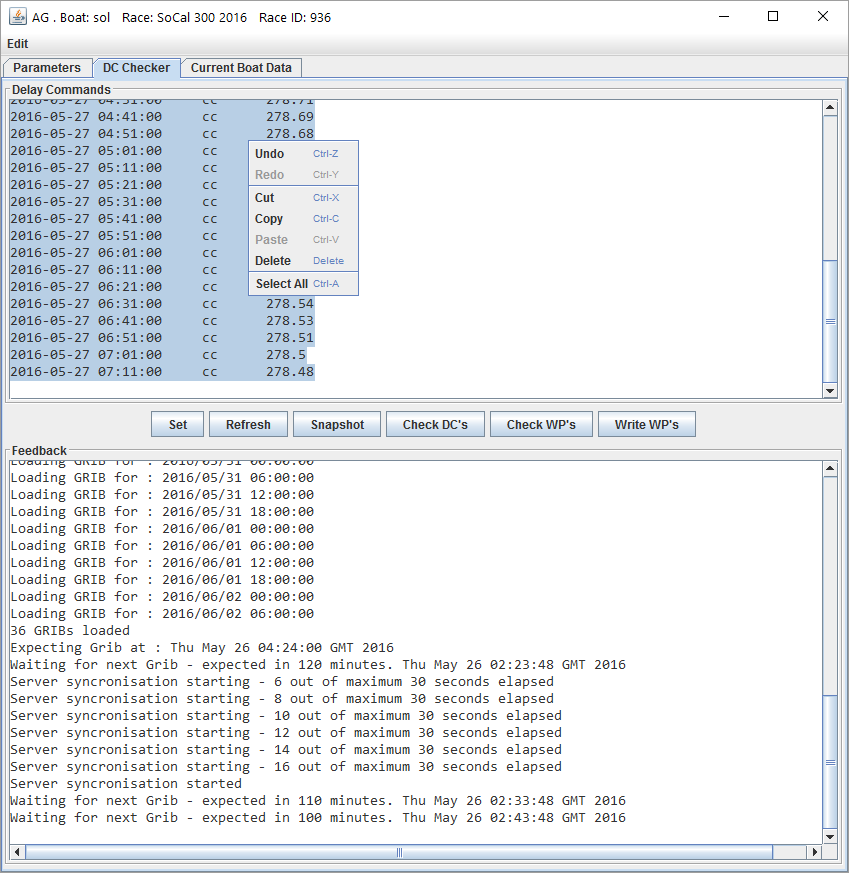

### 5.1.2 Pulsante Set

Questo pulsante viene utilizzato per impostare tutti i DC che sono stati incollati nella finestra. L'operazione di set eseguirà quanto segue:

1.  Verifica che tutti i DC siano validi.

2.  Rimuove eventuali DC duplicati. Cioè, se il comando e il valore del DC successivo sono uguali a quelli del precedente, verrà eliminato.

3.  Verifica che l'orientamento (bearing) tra due DC di tipo **cc** consecutivi sia inferiore a 170 gradi. In caso contrario, verrà visualizzata la seguente finestra di dialogo

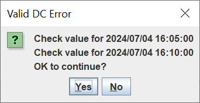

**Sì** ignorerà l'avviso e imposterà i DC, **No** interromperà il processo di impostazione e consentirà la modifica.

Le date dei DC incriminati verranno scritte nell'area Riscontro come mostrato di seguito.

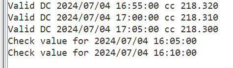

4.  Elimina eventuali DC obsoleti (cioè precedenti al momento attuale).

5.  Elimina eventuali DC sul server che non corrispondono a quelli presenti nell'area DC. Nota che è possibile eliminare un solo DC alla volta, quindi l'operazione potrebbe richiedere tempo a seconda della velocità della connessione internet.

6.  Se la regata non è ancora iniziata, verifica che ci sia un DC prima dell'orario di partenza della regata. In caso contrario, viene chiesto all'utente se il primo DC può essere spostato a 10 minuti prima della partenza della regata.

7.  Aggiorna con l'insieme valido corrente.

Se i DC comprendono blocchi di perdita di prestazione (PL), un DC reso in ritardo dalla latenza (fuori dall'impostazione **Tempo di recupero del server**) viene inviato di nuovo finché il suo orario non è giusto, e dopo il Set i DC sul server vengono confrontati con l'area DC (fino a 3 tentativi).

**Nota:** Un record DC deve avere questo formato:

2016/05/27 01:51:00 twa 138.45

### 5.1.3 Pulsante Refresh

Il pulsante refresh richiederà l'elenco dei DC correnti al server e li visualizzerà.

### 5.1.4 Pulsante Delete 

Per eliminare tutti i DC, fai clic sul pulsante delete . Per eliminarne un sottoinsieme, evidenzia quelli da eliminare.

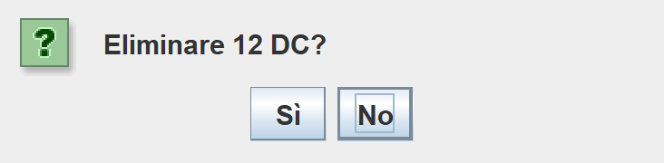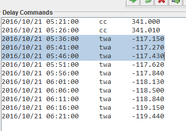

Verrà visualizzato un popup di conferma. Yes eliminerà, No annullerà.

### 5.1.5 Pulsante Snapshot

Utilizzato a scopo di debug. Scrive una copia della finestra di feedback in un file ed è necessario per segnalare eventuali comportamenti anomali.

Il nome del file di snapshot sarà simile a *snapshot_935_2016_05_25_0_28.txt*, composto come “snapshot\_\<Race_ID\>\_\<YYYY_MM_DD_HH_MM\>.txt”.

### 5.1.6 Pulsante Display Graphics

Visualizza la finestra grafica OpenGL.

**Nota:** Ai waypoint del percorso è stato applicato un ridimensionamento nel checker grafico classico. La dimensione della croce è di 10 metri. Il riquadro del mirino OpenGL è di 10 m, come mostrato nella figura successiva.

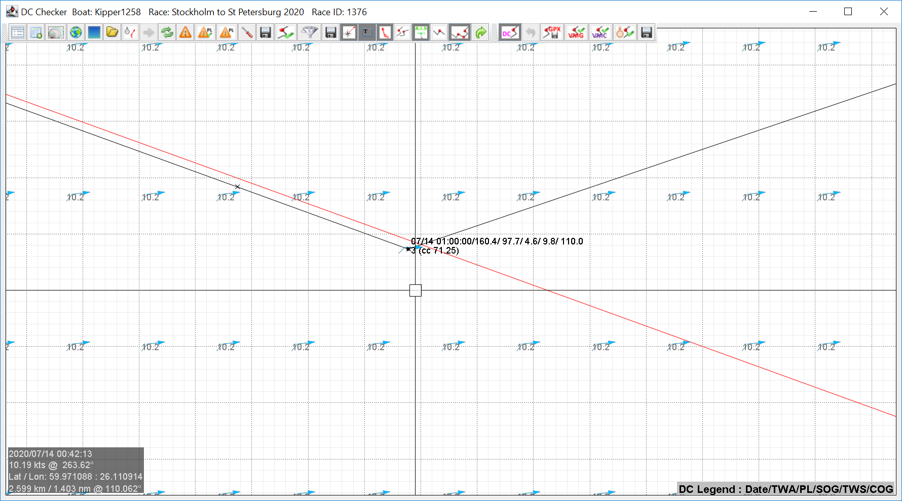

Il pulsante  riavvia la finestra grafica (che può bloccarsi; questo risolve il problema)

### 5.1.7 Selettore Alternate Polar 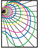

Questo aprirà il selettore del file polare alternativo e configurerà AGL per utilizzare la polare selezionata.

### 5.1.8 Show Polar Diagram 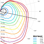

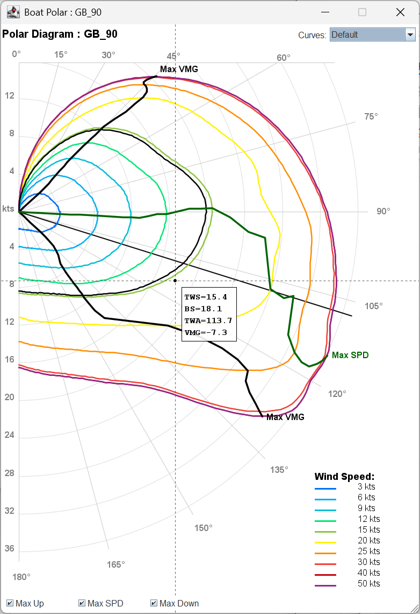

Questo aprirà il diagramma polare della barca. La curva polare nera mostra la curva di velocità attualmente in uso. La linea nera indica il TWA corrente: è una linea separata e non fa parte della curva polare. Il diagramma rimane sempre in primo piano; premi il pulsante di chiusura per nasconderlo.

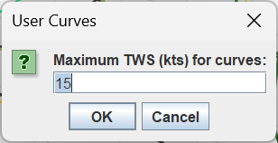

Il menu a tendina presenta tre opzioni: Default, Low Wind (\< 6 kts) e User. Se viene utilizzata l’opzione User, sarà necessario inserire il TWS massimo da utilizzare per le curve.

Il diagramma mostra anche le linee Max VMG sia per la bolina che per la poppa. La linea max SPD mostra il TWA che consente di raggiungere la velocità massima della barca a quell’intensità di vento. Passando il mouse sopra il diagramma verranno mostrati TWS, velocità della barca (BS), TWA e VMG in quel punto.

### 5.1.9 DC Data Table 

Questo avvierà la DC Data Table. Il funzionamento è descritto nella sezione [6 DC Data Table](0600-dc-data-table.md#6-dc-data-table).

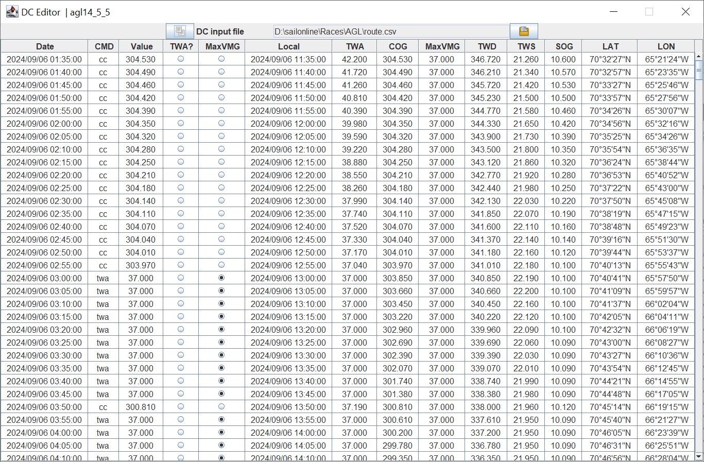

### 5.1.10 Pulsante Check DCs 

Questo pulsante prenderà tutti i DC mostrati nella finestra DC e li convertirà in un grafico come mostrato di seguito.

**Versione OpenGL del DC Checker**

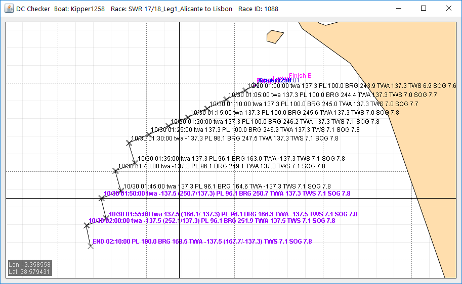

**Nota:** Se l'orario del primo DC ricade nel periodo di haulback (l'ora precedente alla partenza della regata), la traccia viene modificata per riflettere il risultato nella regata reale. Non vengono apportate modifiche ai DC effettivi. Questo funziona nel modo seguente.

Viene eseguita una scansione dei DC e viene determinato l'ultimo DC prima della partenza della regata. Eventuali DC precedenti a quello vengono ignorati (l'ultimo DC che scatta nel periodo di haulback imposta la rotta della barca, gli altri sono ridondanti). L'orario di quel DC viene adattato all'orario di partenza della regata e i DC rimanenti vengono quindi calcolati. Questo evita la deriva nella traccia causata dal fatto che la barca ha velocità, ma non si muove realmente durante il periodo di haulback.

Possiamo ora parlare di cosa fa ciascun parametro e di come funziona.

Se il waypoint è evidenziato in viola, la barca navigherà verso quel waypoint al di fuori dell'intervallo ottimale di TWA. Se il waypoint è evidenziato in arancione, per quel DC è possibile la minimizzazione della performance loss.

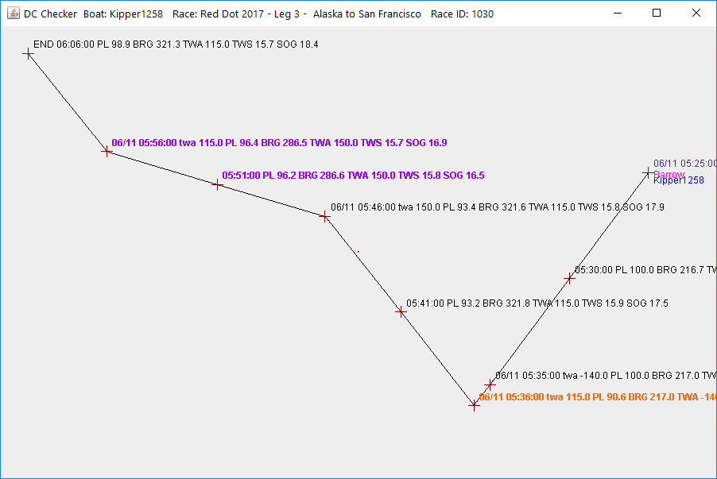

Gli stessi DC condizionati per la performance loss si presentano così. Nota che la performance loss è inferiore del 2% alle 05:41:11 (95,3% contro 93,2%).

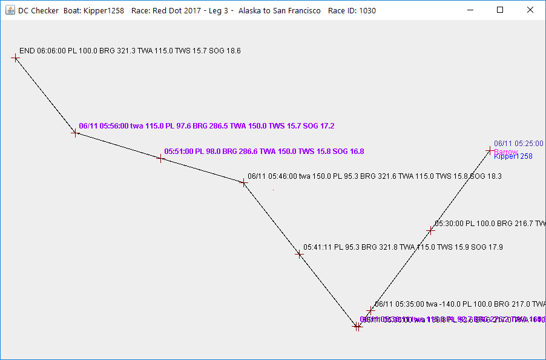

Con **Usa la perdita di prestazione** selezionato ci sono due pulsanti Check. Il semplice **Check**  controlla i DC esattamente come li ha il server e non cambia nulla nell'area DC. **Check PL**  calcola le manovre di perdita di prestazione e aggiunge i DC PL all'area DC. Scrive nell'area DC solo dopo una modifica reale: uno spostamento, una modifica, un inserimento, un'eliminazione, Condiziona, Annulla o Ripeti. Con **Usa la perdita di prestazione** disattivato c'è un solo pulsante Check.

Il pulsante **Editor DC**  apre l'Editor DC, che elenca i DC dell'area DC (vedi [6.6 L'Editor DC](0600-dc-data-table.md#66-leditor-dc)).

#### 5.1.10.1 Parametri DC

Troverai tutti questi parametri nella scheda Parametri.

**Frequenza di controllo DC (s):** Questo parametro (in secondi) determina ogni quanto vengono tracciati punti aggiuntivi sullo schermo tra un DC e l'altro. Il waypoint **01:15:00/-172.3(87.4/-172.5)/100.0/4.3/9.6/71.3** mostrato di seguito è uno di questi, e si trova a 300 secondi dalla partenza. Il nome del waypoint è l'orario in cui la barca arriverà, e i valori successivi sono TWA, PL, SOG, TWS e COG. Il PL è la performance loss che la barca sperimenterà in quel punto, e il TWA/COG è il TWA/COG con cui la barca navigherà verso quel waypoint. Poiché la barca sta navigando al di fuori dell'intervallo ottimale di TWA, è colorato in viola e il valore ottimale viene aggiunto tra parentesi dopo il TWA. In questo caso, **(87.4/-172.5)**rappresenta il COG o il TWA che deve essere impostato per ottenere il TWA ottimale. La funzione **Condiziona** descritta più avanti farà questo in modo interattivo.

Quando un DC viene raggiunto, viene indicato per esteso. 07/14 01:29:52/-165.0/98.7/4.3/9.5/89.4 è il secondo DC che verrà raggiunto nell'esempio mostrato.

**Nota:** I waypoint mostrati in questo colore vengono navigati al di fuori dell'intervallo ottimale di TWA.

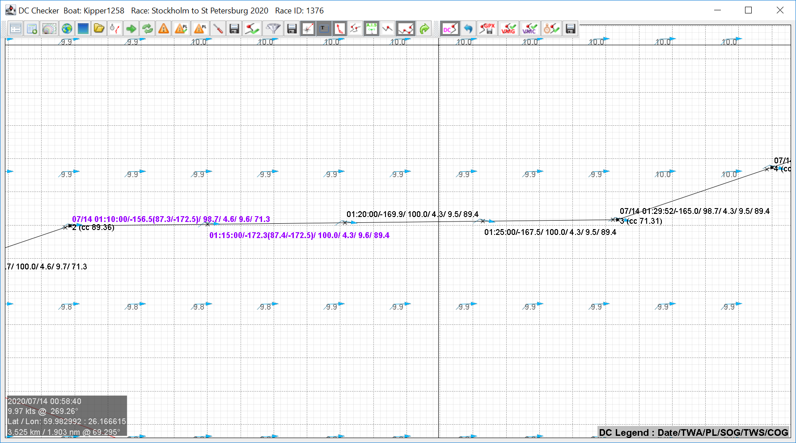

**Durata del calcolo (s):** Questo parametro (in secondi) determina ogni quanto la barca viene fatta avanzare. Concetto simile al jump del server. I punti generati non vengono tracciati, ma vengono utilizzati per determinare le coordinate di ciascun waypoint, campionando TWS e TWD dopo ogni avanzamento e utilizzando poi questi valori per l'avanzamento successivo.

**Usa la partenza della regata:** Consente all'utente di controllare i DC fin dall'inizio. Se selezionato, il checker presumerà che la barca si trovi al waypoint di partenza e che l'orario sia quello di partenza. Eventuali DC successivi a tale orario verranno elaborati nella produzione della rotta. Se deselezionato, l'orario di partenza sarà quello attuale.

**Mostra la posizione della barca:** Utilizzato quando la barca si trova molto lontana dai DC di interesse. Non verrà tracciata né considerata nella produzione della rotta.

**Nota:** Se la barca ha attualmente TWA 0, significa che non si sta muovendo. L'unica azione possibile è far avanzare l'orologio fino all'orario del primo DC, presupponendo che la barca inizi a muoversi su quella rotta in quel momento. Il punto di partenza sarà quindi la posizione attuale della barca, e l'orario sarà quello del primo DC.

## 5.2 Verifica del Percorso

AGL può controllare il tuo percorso e i tuoi DC prima che arrivino al server, e continuare a controllare mentre fai regata. Cerca tre cose:

- **BBQ:** la barca che finisce contro la terraferma.
- **Boe mancate:** una boa di mare che non verrà girata correttamente.
- **L'arrivo:** un percorso che non attraversa la linea di arrivo lontano dalle sue estremità.

Quando trova un problema, AGL propone una o più soluzioni. Scegli tu quali applicare. Nulla viene modificato finché non premi **Correggi** o **Applica**.

Questi controlli sono per i membri SOL. Perché funzionino in tempo reale serve anche che **In controllo** sia selezionato nella scheda Controllo DC. Lascialo disattivato se non vuoi che i controlli vengano eseguiti, ad esempio nelle regate sprint in cui hai il controllo tu. Puoi anche scegliere quali controlli eseguire: solo BBQ, solo boe (che comprendono la linea di arrivo) oppure entrambi.

### 5.2.1 Attivare i Controlli

Nella scheda Parametri, sotto DC's (oppure con le caselle nella barra degli strumenti della scheda Controllo DC):

- **Controllo BBQ** fa cercare al BBQ Checker la terraferma lungo il percorso e i DC e propone soluzioni.
- **Controllo delle boe** gli fa controllare anche le girate delle boe, e avvisa quando la barca sta per mancare una boa.

I messaggi BBQ e di boa mancata in tempo reale richiedono che **In controllo** sia selezionato. Queste due caselle non li attivano né li disattivano; decidono se l'avviso arriva con una soluzione suggerita.

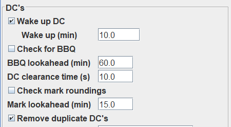

Ogni controllo ha un anticipo (look ahead), in minuti. I messaggi relativi partono quando il controllo trova il problema entro quell'anticipo. I messaggi stessi, e quando vanno al telefono, si impostano nella scheda Chat (vedi [8 Chat](0800-chats.md#8-chat)).

Possono essere attivati e disattivati anche nella barra degli strumenti della scheda Controllo DC.

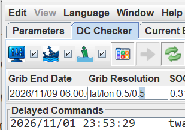

### 5.2.2 Il BBQ Checker

Il BBQ Checker esamina i DC nell'area dei DC alla ricerca di collisioni con la costa e li affronta uno alla volta. Il pulsante BBQ Checker  lo esegue. Con **Usa la perdita di prestazione** selezionato il pulsante mostra invece 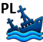 e lo esegue con la perdita di prestazione.

Per ogni collisione AGL mostra dove avviene, ad esempio "Potential collision after DC 0", ed elenca le soluzioni che ha trovato. La soluzione suggerita è selezionata. Puoi selezionarne un'altra, o nessuna, poi premere:

- **Correggi** per apportare la modifica nell'area dei DC.
- **Salta** per lasciare questa collisione nei DC e passare alla successiva.
- **Annulla** per interrompere il controllo.

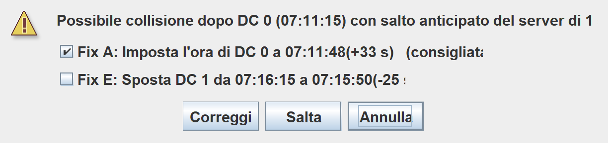

Una soluzione può impostare un DC a un nuovo orario, spostare un DC, aggiungere un DC prima della collisione, oppure dare una nuova rotta.

I DC che mantengono quasi la stessa rotta del DC che li precede (entro la tolleranza del filtro dei percorsi della Tabella Dati DC, 2 m all'inizio) non cambiano nulla, quindi il controllo BBQ, il BBQ Checker e il controllo prima di Imposta DC li lasciano fuori, e una soluzione non viene rifiutata a causa di uno di essi.

Una soluzione non cambia mai da sola i DC all'interno di un blocco di perdita di prestazione (PL). L'unico DC di un blocco PL che può spostare è il DC di ingresso, e allora si sposta con lui il resto del blocco, mantenendo distanze e valori. Quando la collisione dipende dal server che attiva un DC un secondo o due in anticipo, il titolo lo dice ("with 1 s early server hop") e le soluzioni ne tengono conto.

Se la rotta attuale della barca finisce contro la terraferma, AGL propone una virata a sinistra o a dritta che la evita, con la rotta e il numero di gradi.

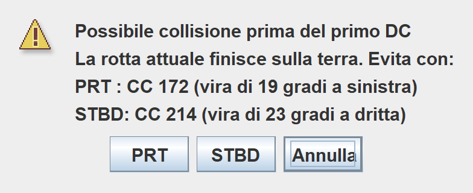

AGL crea anche un png della collisione da inviare a Telegram, e mostra le possibili soluzioni nella finestra grafica. Qui sotto un esempio.

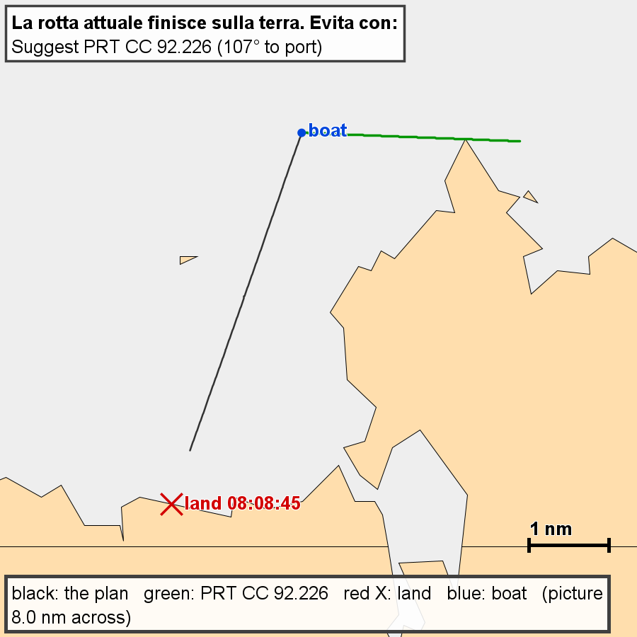

Se AGL non può fare nulla, lo dice, e devi correggere tu i DC.

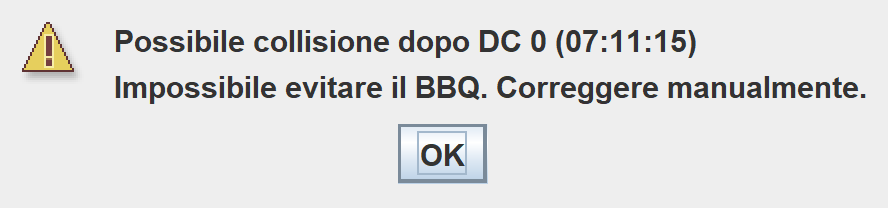

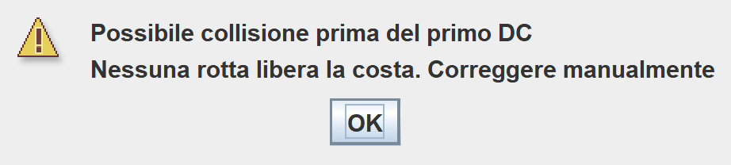

Quando ogni collisione è stata affrontata, AGL riporta quante correzioni sono state fatte e quante collisioni sono state saltate. **Annulla** nella grafica ripercorre all'indietro le correzioni. Se non c'era nulla da correggere, vedi:

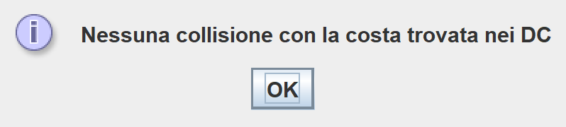

AGL può aver bisogno di un momento prima di poter controllare. Se un DC del server sta per attivarsi e cambierà la rotta, aspetta che lo faccia e poi controlla di nuovo.

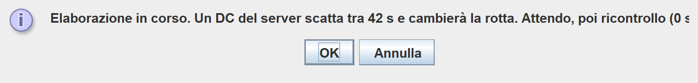

### 5.2.3 Boe Mancate

AGL segue il percorso attraverso i DC e avvisa quando la barca sta per mancare una boa di mare. Le boe a terra vengono ignorate perché se ne occupa il BBQ Checker. Il messaggio indica la boa, l'orario e il motivo. I motivi comprendono:

- un DC si attiva troppo presto,
- un DC gira dalla parte sbagliata intorno alla boa,
- un DC successivo annullerà la girata della boa,
- il percorso passa troppo vicino alla boa, o dalla parte sbagliata,
- nessun DC fa virare la barca dopo la boa.

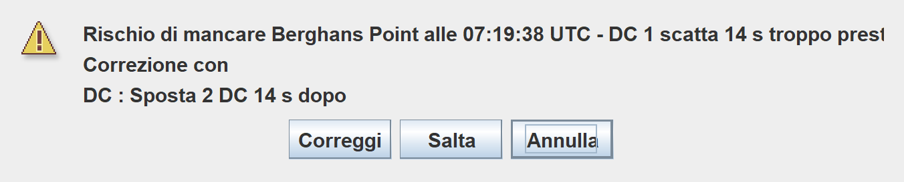

Quando la mancanza può essere rimediata spostando i DC o cambiando rotta, AGL propone la soluzione, indicando dove passerà la barca rispetto alla boa se la applichi.

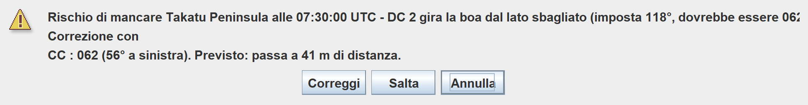

Se non può essere rimediata in questo modo, AGL lo dice.

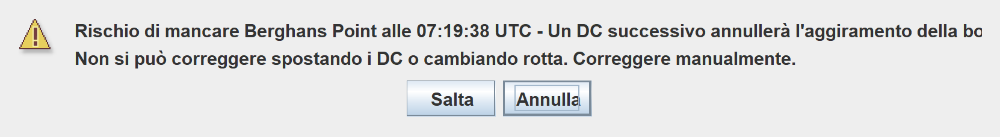

La grafica ingrandisce l'area del problema e mostra le possibili soluzioni. Se Missed Marks è abilitato, vengono creati png e inviati a Telegram.

### 5.2.4 L'Arrivo

Per la linea di arrivo il percorso deve attraversare la linea lontano dalle sue estremità. Un percorso che attraversa oltre l'estremità della linea viene segnalato come una boa mancata. Il BBQ Checker e il controllo prima di Imposta DC seguono i DC oltre l'ultimo DC per l'**Anticipo boa**, così un attraversamento subito dopo l'ultimo DC viene trovato. Se il percorso non raggiunge l'arrivo, il Logger lo dice. Una nuova rotta verso la linea non viene proposta quando richiederebbe un DC oltre l'Anticipo boa dopo l'ultimo DC. AGL propone una nuova rotta verso la linea, o una rotta con perno verso la boa, quando riesce a trovarne una.

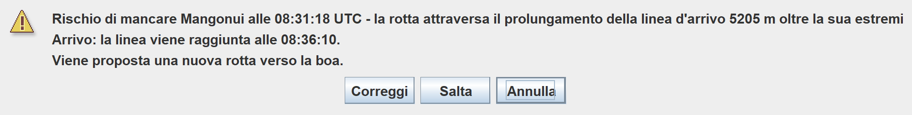

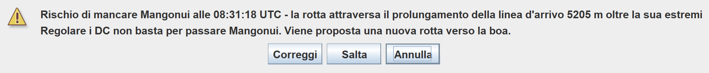

Se la rotta diretta verso la linea è fuori dal maxVMG, AGL può restare sulla mura attuale e virare più tardi, e lo dice.

Anche qui la grafica ingrandisce l'area del problema e crea un png per Telegram.

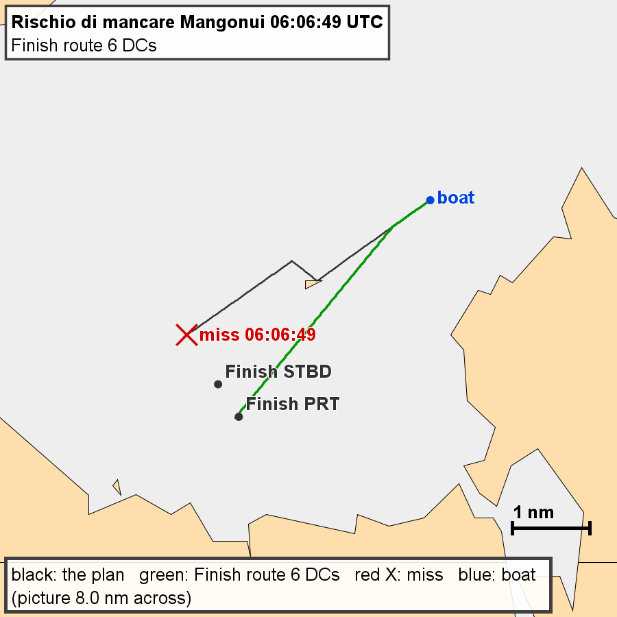

### 5.2.5 Suggerimenti Durante la Regata

Mentre fai regata, AGL esegue da solo i controlli e mostra una finestra di suggerimento quando trova un problema. La finestra ha le stesse soluzioni, con **Applica**, **Applica (PL)** e **Ignora**.

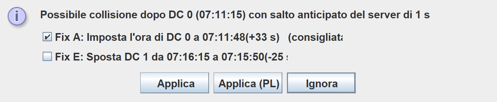

Se non rispondi, il suggerimento può andare anche al telefono, tramite Pushover o Telegram. Con Telegram arriva con i pulsanti **Applica** e **Ignora**, così puoi rispondere dal telefono. Vedi [8 Chat](0800-chats.md#8-chat) per come configurarlo.
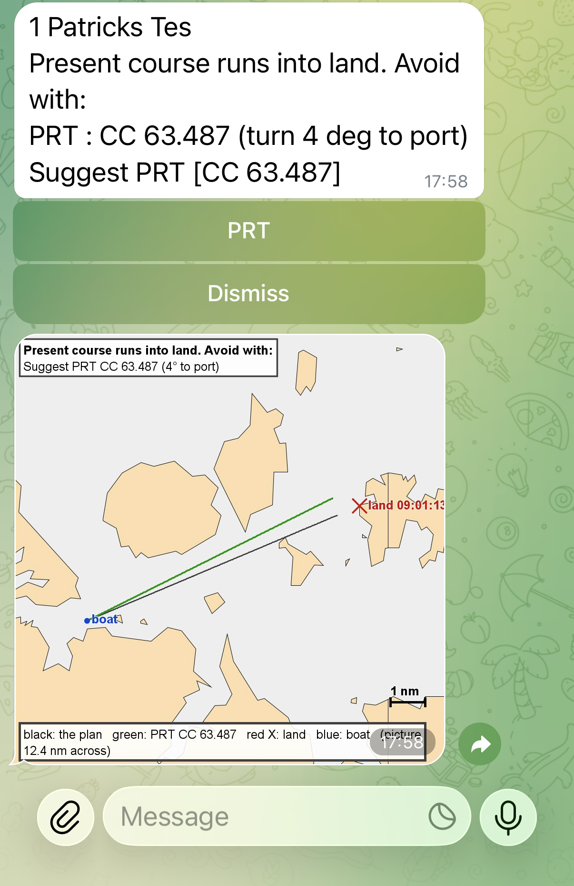 

Se premi **Applica**, il comando viene inviato ad AGL perché lo esegua. AGL aggiornerà poi il messaggio con lo stato della barca dopo l'**Applica**.

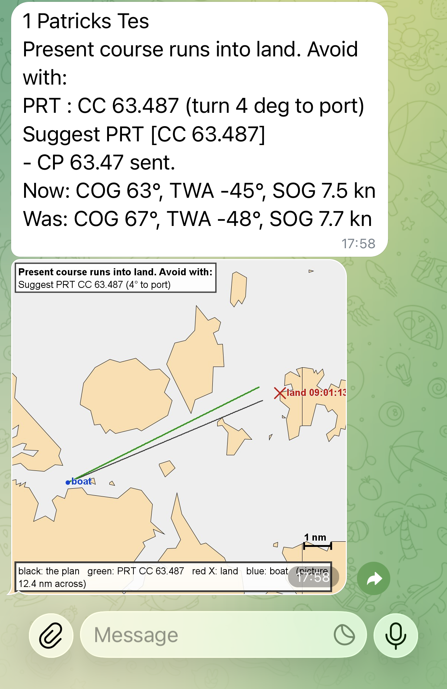

### 5.2.6 DC Non Ancora Impostati

Se nell'area dei DC ci sono DC che non sono sul server, AGL può chiedere se impostarli ora.

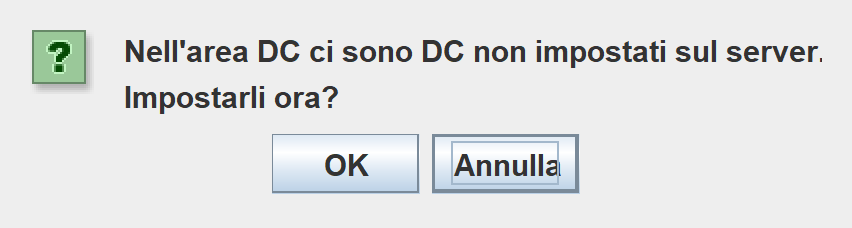

## 5.3 Visualizzazione

Questa sezione tratta di come muoversi nella grafica, copiarne le posizioni e scegliere cosa mostrare.

### 5.3.1 Muoversi nella Grafica

#### 5.3.1.1 Zoom e Pan

La funzione di zoom è disponibile solo utilizzando un mouse con rotellina (sul dorso, non sotto). Scorrendo la rotellina del mouse si esegue lo zoom avanti e indietro. Il pan si ottiene tenendo premuto il pulsante sinistro del mouse e trascinando fino alla posizione desiderata.

#### 5.3.1.2 Clic del Mouse

Un clic con **Shift + sinistro** del mouse copia le coordinate correnti del mouse negli appunti nello stesso formato del client SOL, cioè

*38.605778,-9.485908*

Un semplice clic sinistro non copia più le coordinate.

### 5.3.2 Opzioni di vista

Il pulsante  nella barra degli strumenti della grafica apre il modulo View Options. Resta aperto mentre lavori, così puoi attivare e disattivare le cose e vedere la grafica cambiare. **Chiudi** lo chiude.

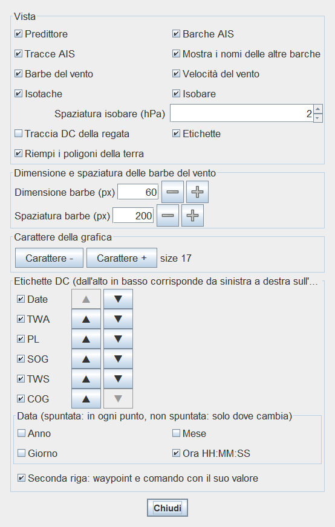

#### 5.3.2.1 Vista

Ogni casella attiva o disattiva una cosa nella grafica.

- **Predittore** mostra la linea del predictor.
- **Barche AIS** mostra le barche dell'elenco AIS.
- **Tracce AIS** mostra le tracce delle barche AIS.
- **Mostra i nomi delle altre barche** mostra i nomi delle barche che non sono nell'elenco AIS. Le barche dell'elenco AIS mostrano sempre il loro nome.
- **Barbe del vento** mostra le barbule del vento.
- **Velocità del vento** mostra i numeri della velocità del vento.
- **Isotache** mostra le linee di uguale velocità del vento.
- **Isobare** mostra le linee di uguale pressione. **Spaziatura isobare (hPa)** imposta la pressione tra le linee, da 1 a 50.
- **Traccia DC della regata** mostra i DC scattati in questa regata (vedi [5.3.3.3 Traccia DC della Regata](0500-using-agl.md#5333-traccia-dc-della-regata)).
- **Etichette** mostra le etichette dei DC, impostate in [5.3.2.3 Etichette dei DC](0500-using-agl.md#5323-etichette-dei-dc).
- **Riempi i poligoni della terra** riempie le forme della terraferma.

La visualizzazione seguente mostra le barche AIS e le loro tracce, e la linea di previsione. Il numero sotto ciascuna barca AIS è la sua posizione attuale. I quattro numeri sotto la tua barca sono posizione, TWA, SOG e performance loss.

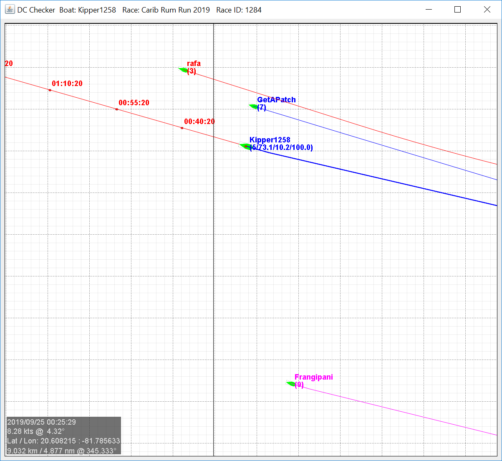

Inoltre, se la tua barca è nell'elenco AIS, verrà mostrata in nero nella posizione in cui si trovava quando tutte le altre barche AIS sono state aggiornate. Questa è la posizione effettiva della tua barca rispetto alle altre mostrate sullo schermo.

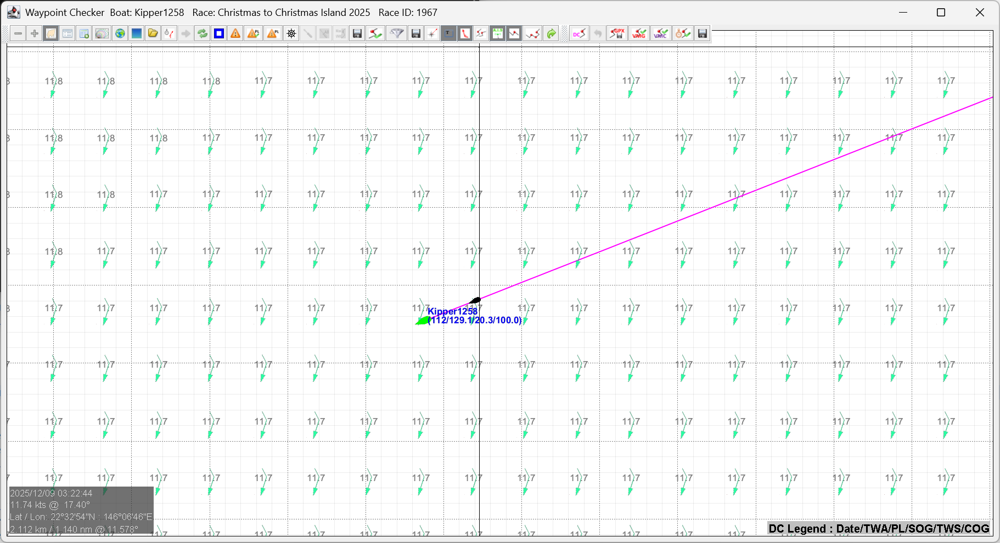

**Dimensione e spaziatura delle barbe del vento:** il riquadro **Barbe del vento** imposta la grandezza delle barbe (**Dimensione barbe (px)**, da 10 a 300 pixel) e la loro distanza (**Spaziatura barbe (px)**, da 20 a 1000 pixel). I pulsanti **-** e **+** rendono il valore 1,1 volte più piccolo o più grande a ogni clic, oppure puoi scrivere un valore. La grafica cambia subito e i valori vengono salvati. Si trovano anche nella scheda Parametri (vedi [3.10 Grafica](0300-configuration.md#310-grafica)).

**Altre barche:** una barca che ha finito la regata è disegnata come un piccolo punto grigio nella sua ultima posizione, senza nome. Le barche con nome (l'elenco AIS, o **Mostra i nomi delle altre barche**) mostrano la loro classifica tra parentesi sotto il nome. Tieni il mouse su una barca qualsiasi per vederne i dettagli: la sua traccia viene disegnata come una linea del colore del suo nome finché il mouse non si sposta.

#### 5.3.2.2 Carattere della grafica

**Carattere -** riduce di 1 la dimensione del font della grafica e **Carattere +** la aumenta di 1. La dimensione attuale è mostrata accanto ai pulsanti.

#### 5.3.2.3 Etichette dei DC

Qui si imposta cosa viene scritto su ogni etichetta DC nella grafica.

- Seleziona un campo per mostrarlo: **Date**, **TWA**, **PL**, **SOG**, **TWS** e **COG**.
- Le frecce spostano un campo su o giù. Dall'alto in basso nell'elenco corrisponde da sinistra a destra sull'etichetta.
- Il gruppo **Date** sceglie quali parti della data vengono mostrate. Se una parte è selezionata viene mostrata in ogni punto; se non è selezionata viene mostrata solo dove cambia. Le parti sono **Anno**, **Mese**, **Giorno** e **Ora HH:MM:SS**.
- **Seconda riga: waypoint e comando con il suo valore** aggiunge all'etichetta una seconda riga con il waypoint e il comando con il suo valore.

Il campo **PL** mostra la perdita di prestazione con cui la barca arriva al DC e, tra parentesi, la perdita di prestazione dopo la virata, ad esempio 97.4 (95.7). Le etichette dei DC PL sono grigie.

### 5.3.3 Tracce

Ogni volta che controlli, modifichi o imposti i DC, AGL disegna il risultato nella grafica come traccia. Il pulsante **Tracce** nella barra degli strumenti della grafica apre il modulo Tracce, dove scegli quali tracce mostrare.

#### 5.3.3.1 Il Modulo Tracce

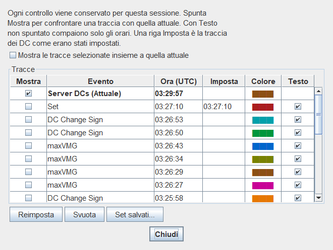

- La prima riga in grassetto è la traccia **attuale**, l'ultima cosa fatta. Ha una casella **Mostra** come le altre. Viene spuntata di nuovo a ogni nuova traccia attuale, così non resta mai nascosta per errore. Toglila per guardare più da vicino una traccia precedente.
- Le altre righe sono tracce precedenti. Spunta **Mostra** per confrontarle con quella attuale. **Evento** dice cosa è stato fatto, e **Ora (UTC)** quando. **Imposta** è l'ora di un Set. **Colore** è il colore della traccia.
- **Testo** mostra le etichette sulla traccia. Quando è spuntato le etichette mostrano i campi scelti in [5.3.2.3 Etichette dei DC](0500-using-agl.md#5323-etichette-dei-dc), e quando non lo è mostrano solo gli orari.
- Ogni traccia conserva i puntini rossi BBQ trovati per essa. Quando sono mostrate più tracce, ognuna ha i suoi puntini, e una traccia non mostrata non ha puntini. La traccia attuale mostra i puntini dell'ultimo controllo BBQ. I Set riletti dal database non hanno puntini.
- **Mostra le tracce selezionate insieme a quella attuale** attiva e disattiva le tracce confrontate. Non influisce sulla traccia attuale.
- **Reimposta** rimuove tutte le tracce tranne quella attuale e i Set. **Svuota** rimuove le tracce con **Mostra** spuntato. La traccia attuale resta sempre. Fai clic su una riga per selezionarla (viene evidenziata, una riga alla volta, e resta selezionata quando l'elenco si aggiorna).
- **Esporta GPX...** salva la traccia selezionata come file GPX nella cartella della regata, con lo stesso formato dell'esportazione dei Set salvati: un percorso, con il numero del DC come nome di ogni punto. Vengono scritti solo i DC. Il file si chiama "Trace &lt;regata&gt; &lt;evento&gt; &lt;ora&gt;.gpx".

Una traccia viene creata solo per ciò che fai: Send, una modifica (Sposta, Cambia segno, Condiziona, Elimina, Inserisci, o una modifica nell'Editor DC), Annulla o Ripeti, un Check o un controllo BBQ, e un Set. Un controllo che AGL fa da solo viene mostrato solo finché è l'ultima cosa fatta, e scompare appena crei una traccia vera. Un Set che AGL fa da solo (Condiziona i DC dopo il nuovo meteo, o Set Anyway) è etichettato **Set AGL**; un Set che fai tu è etichettato **Set**.

Ogni traccia parte dalla barca com'era quando la traccia è stata creata, segnata con l'icona di una barca (a sinistra o a dritta, come le altre barche). La traccia attuale parte dalla posizione in diretta della barca e non ha icona.

#### 5.3.3.2 Set Salvati

Ogni Set che fai viene conservato con la regata: per ogni DC la sua posizione, il vento, la velocità, la PL e la barca. Il pulsante **Set salvati...** nel modulo Tracce apre il modulo Set salvati.

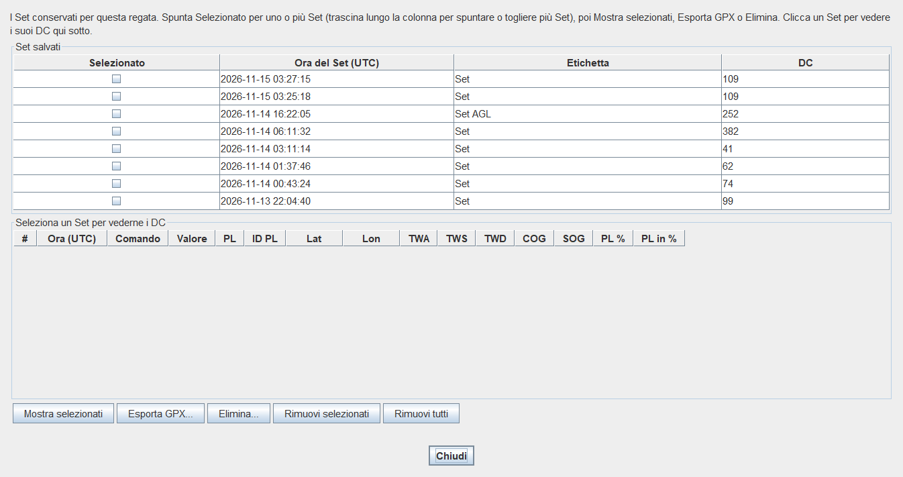

- Spunta le caselle **Selezionato** dei Set che vuoi (trascina lungo la colonna per spuntarne più d'uno) e premi **Mostra selezionati** per disegnarli come tracce.
- Fai clic su un Set per vederne i DC. La tabella mostra il Valore in gradi e Lat e Lon in gradi, minuti e secondi.
- **Esporta GPX...** scrive i Set selezionati in un file GPX, un percorso per ogni Set. AGL può rileggere il file. Ogni DC conserva l'id che gli ha dato il server, e il file lo riporta come `agl:serverId` nelle estensioni e come `id N` nella descrizione. Un DC che il server non ha ancora elencato non ha id fino all'elenco successivo; i Set fatti prima di questa versione non ne hanno, a meno che siano il Set più recente e i loro DC siano ancora sul server.
- **Elimina...** elimina i Set selezionati, dopo aver chiesto. **Rimuovi selezionati** li toglie dal grafico, e **Rimuovi tutti** toglie ogni Set mostrato.

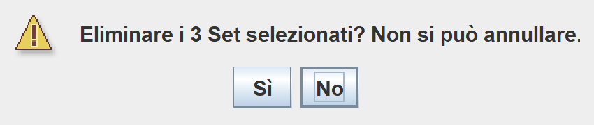

Un Set fatto prima che le posizioni venissero conservate non ne ha, e AGL lo dice. Un DC senza posizione conservata viene lasciato fuori dal disegno.

I Set sono conservati nel database della regata, `db/dc_<id regata>.db`, nella cartella della regata. C'è un file per ogni regata, quindi i Set di una regata non compaiono mai in un'altra. Tra una sessione e l'altra vengono conservati solo i Set. Il file non viene ripulito automaticamente e può essere eliminato dopo la regata.

#### 5.3.3.3 Traccia DC della Regata

Spunta **Traccia DC della regata** in [5.3.2 Opzioni di vista](0500-using-agl.md#532-opzioni-di-vista) per vedere i DC scattati in questa regata. Ognuno è un punto rosso scuro con il suo orario in UTC. I DC scattati nelle regate precedenti con lo stesso nome sono punti arancioni senza etichetta. Il registro è conservato nell'hub insieme alla regata. Usa **Info** nel menu del tasto destro per leggere i dettagli di un punto.


Un DC che scatta mentre un Set viene inviato (un Set può richiedere minuti) viene registrato a Set finito, posizionato in base agli aggiornamenti della barca stessa. Un DC che il Set elimina dal server non viene mai registrato come scattato.

#### 5.3.3.4 Tracce delle Barche

Le tracce delle barche AIS e della tua barca sono conservate per tutta la regata, in `db/traces_<id regata>.db` nella cartella della regata. Il server taglia la parte vecchia delle tracce lunghe, ma AGL conserva ciò che ha avuto e aggiunge quello che il server invia a ogni caricamento delle tracce. Viene disegnata l'intera traccia, anche dopo che AGL è stato chiuso e riavviato. Un tratto senza punti, perché AGL era spento e il server lo aveva già tagliato, viene disegnato come un vuoto e riempito quando arrivano le tracce del server. Il registro serve solo per la visualizzazione. Può essere eliminato dopo la regata.

## 5.4 Comandi Specifici della Grafica OpenGL

Il motore OpenGL dispone di diversi comandi da tastiera specifici solo per il motore OpenGL.

**R** – Aggiorna lo schermo

**F** – Adatta i dati visualizzati allo schermo

**B** – Centra la visualizzazione sulla barca

**C** – Avvia l'impostatore di rotta (vedi [5.4.3 Impostazione di un Percorso](0500-using-agl.md#543-impostazione-di-un-percorso))

**W** – Pulisce le tracce, i punti DC e i percorsi non attivi (come **Pulisci** nel menu del tasto destro)

### 5.4.1 Icone della Toolbar

La barra degli strumenti della grafica ha questi pulsanti, da sinistra.

Il pulsante 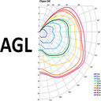 porta la finestra di AGL in primo piano.

Il pulsante  apre la boat data table.

Il pulsante  apre il selettore del file polare alternativo.

Il pulsante  apre il diagramma polare.

Il pulsante  crea un sottoinsieme del grib corrente. Il file verrà collocato nella cartella grib con il prefisso SUB\_. Il messaggio seguente appare al termine della creazione del sottoinsieme.

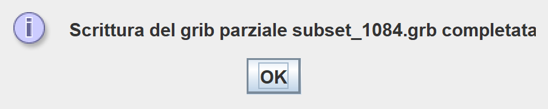

Il pulsante  apre un elenco dei percorsi della regata, con quello attivo spuntato. Il percorso su cui fai clic diventa il percorso attivo (vedi [5.5.2 Il Percorso Attivo](0500-using-agl.md#552-il-percorso-attivo)).

Il pulsante 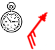 imposta la data del grib sulla data di un waypoint, come fa **Imposta data grib** nel menu del tasto destro.

Il pulsante  applica l'elenco DC corrente. È disattivato (in grigio) se non sono state apportate modifiche.

Il pulsante  ricarica i DC dal server.

Il pulsante  apre l'Editor DC, il pulsante  controlla i DC e, con **Usa la perdita di prestazione** selezionato, il pulsante  li controlla con la perdita di prestazione. Il pulsante  esegue il BBQ Checker ( con la perdita di prestazione). Vedi [5.1.10 Pulsante Check DCs](0500-using-agl.md#5110-pulsante-check-dcs) e [5.2.2 Il BBQ Checker](0500-using-agl.md#522-il-bbq-checker).

Il pulsante 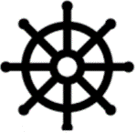 avvia l'impostatore di rotta (vedi [5.4.3 Impostazione di un Percorso](0500-using-agl.md#543-impostazione-di-un-percorso)).

Il pulsante 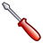 condiziona un DC, il pulsante  condiziona tutti i DC e il pulsante  imposta un DC al max VMG. Vedi [5.4.4 Condizionamento dei DC](0500-using-agl.md#544-condizionamento-dei-dc).

Il pulsante  mostra il percorso attivo senza i waypoint ridondanti, utilizzando una tolleranza di filtro. Non modifica nulla. Il pulsante successivo  fa lo stesso e poi toglie i waypoint ridondanti dal percorso attivo.

Il pulsante  apre il modulo Opzioni di vista, dove si impostano la linea del predittore, le barche e le tracce AIS, le barbe del vento, la traccia DC della regata, le etichette DC, il riempimento della terraferma e il carattere della grafica. Vedi [5.3.2 Opzioni di vista](0500-using-agl.md#532-opzioni-di-vista).

I pulsanti  e  ingrandiscono e riducono attorno al centro della vista della grafica, del **Passo dello zoom** impostato nella scheda Parametri. Il pulsante  adatta la vista alla traccia dell'ultimo controllo e il pulsante  la adatta all'area di regata (il riquadro rosa).

Il pulsante **Tracce** apre il modulo Tracce (vedi [5.3.3 Tracce](0500-using-agl.md#533-tracce)).

Il pulsante 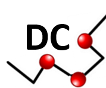 attiva e disattiva la traccia DC grigia. Vedi [6.3.1 Come Funziona](0600-dc-data-table.md#631-come-funziona).

Il pulsante  alterna tra il lavoro con i DC e con i waypoint.

Il pulsante  annulla le modifiche ai DC e ai waypoint una alla volta, e la stessa icona capovolta rimette la modifica.

Il pulsante **Percorsi** apre il modulo Percorsi e waypoint (vedi [5.5.1 Il Modulo Percorsi e Waypoint](0500-using-agl.md#551-il-modulo-percorsi-e-waypoint)).

Il pulsante  calcola i waypoint e i DC in una rotta utilizzando maxVMG per i waypoint.

Il pulsante  calcola i waypoint e i DC in una rotta utilizzando maxVMC per i waypoint.

Il pulsante  converte waypoint e DC in soli DC, utilizzando maxVMG per i waypoint.

Le toolbar possono anche essere sganciate e riagganciate facendo clic e tenendo premuto sull'area grigia puntinata della toolbar accanto alla prima icona, come mostrato di seguito.

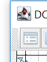

Le toolbar sganciate sono mostrate di seguito


### 5.4.2 Il Menu del Tasto Destro

Un clic destro del mouse nella finestra grafica richiama un menu rapido di opzioni. Le voci mostrate dipendono da cosa c'è sulla carta e dal fatto che si lavori sui DC o sui waypoint.

  

*Il menu con DC attivi, Percorsi attivi e Nessuno attivo.*

Alcune voci sono sempre mostrate: Steer, Vira, Abbatti, Max su, Max giù, Imposta data grib, VMG, Annulla, Ripeti, Centra barca, Adatta allo schermo, Info, Pulisci e Cancel. **Imposta DC attivo / Imposta WP attivo** e **Cambia CMD** sono mostrati solo quando sulla carta c'è una traccia DC. Senza traccia DC sulla carta il pulsante di modifica dei DC è in grigio.

Le altre voci dipendono da ciò su cui lavori. Un trattino significa che la voce non è mostrata, e "in grigio" che è mostrata ma non si può scegliere.

| **Voce**       | DC attivi | Percorsi attivi | Nessuno attivo |
|----------------|:--:|:--:|:--:|
| Imposta attivo | –  | ✓  | in grigio |
| Nuovo          | –  | ✓  | ✓  |
| Aggiungi       | –  | ✓  | in grigio |
| Rimuovi        | –  | ✓  | in grigio |
| Modifica       | –  | ✓  | in grigio |
| Segui (membri) | – | ✓ | in grigio |
| Inserisci      | ✓ (DC) | ✓ | in grigio |
| Sposta         | ✓ (DC) | ✓ | in grigio |
| Elimina        | ✓ (DC) | ✓ | in grigio |
| WP On/Off, Condiziona, Condiziona tutti, maxVMG | ✓ | – | – |

**Cambia CMD** si può scegliere quando i DC sono attivi o c'è un percorso attivo. Il percorso attivo mostra sempre i suoi waypoint.

 **Steer:** Richiama Impostazione di un Percorso

**Vira:** Porta la barca sulla mura opposta al max VMG. Fa comparire una finestra di conferma che mostra i comandi e comprende la minimizzazione della perdita di prestazioni. Selezionando OK, il comando viene eseguito subito.


**Abbatti:** Porta la barca sull'altra mura con una abbattuta, al max VMG. Fa comparire una finestra di conferma che mostra i comandi e comprende la minimizzazione della perdita di prestazioni. Selezionando OK, il comando viene eseguito subito.


**Max su:** Imposta la barca al max VMG di bolina sulla stessa mura. Fa comparire una finestra di conferma che mostra i comandi e comprende la minimizzazione della perdita di prestazioni. Selezionando OK, il comando viene eseguito subito.

**Max giù:** Imposta la barca al max VMG di poppa sulla stessa mura. Fa comparire una finestra di conferma che mostra i comandi e comprende la minimizzazione della perdita di prestazioni. Selezionando OK, il comando viene eseguito subito.

 **Imposta data grib:** Imposta la barca sul waypoint selezionato e aggiorna isotache e barbule del vento a quell'orario

 **Imposta DC attivo / Imposta WP attivo:** Passa dal lavorare sui DC al lavorare sui waypoint, e viceversa

**Imposta attivo** (senza icona),  **Nuovo**,  **Aggiungi**,  **Inserisci**,  **Segui**,  **Sposta**,  **Modifica**,  **Rimuovi** ed  **Elimina** lavorano su waypoint e percorsi. Sono descritti in [5.5.3 Modifica dei Waypoint nella Grafica](0500-using-agl.md#553-modifica-dei-waypoint-nella-grafica) e [5.5.4 Segui](0500-using-agl.md#554-segui).

Con i DC attivi, **Inserisci**, **Sposta** ed **Elimina** lavorano invece sui DC. Segui le indicazioni in alto a destra. Nota per i DC:

1.  Se il tipo di DC è TWA, lo spostamento non porterà il twa fuori dall'intervallo maxVMG ottimale

2.  Se il DC viene spostato sulla terraferma, viene rimesso indietro per non causare un BBQ

3.  Un DC dentro un blocco PL non si sposta da solo. Il DC di ingresso del blocco porta il numero del DC, e spostarlo sposta l'intero blocco. I DC PL e il DC di uscita sono etichettati PL e non si possono scegliere.

**WP On/Off:** Mostrato con i DC attivi. Cambia il segno di un DC TWA. Segui le indicazioni in alto a destra

**Cambia CMD:** Solo DC. Passa da CC a TWA e viceversa e aggiorna di conseguenza il valore. Segui le indicazioni in alto a destra.

 **VMG:** Calcola waypoint e DC in una rotta usando il maxVMG per i waypoint, come fa il pulsante della barra degli strumenti.

 **Condiziona:** Condiziona i DC che sono fuori dall'intervallo VMG ottimale al VMG ottimale

 **Condiziona tutti:** Solo DC. Condiziona tutti i DC che sono fuori dall'intervallo VMG ottimale al VMG ottimale.

 **maxVMG:** Solo DC. Imposta il valore del DC selezionato al max VMG.

 **Annulla:** Annulla l'ultima modifica ai DC o ai waypoint. Il numero di modifiche annullabili è mostrato tra parentesi.

 **Ripeti:** Rimette la modifica che era stata annullata.

 **Centra barca:** Centra lo schermo sulla barca

 **Adatta allo schermo:** Adatta lo schermo all'estensione del tracciato attuale di waypoint/DC

 **Info:** Mostra i dettagli di un DC. Scegli **Info**, poi fai clic su un DC qualsiasi: nell'area DC, sulla traccia DC, su una traccia che stai mostrando (anche un Set salvato), o su un punto della Traccia DC della regata. Un riquadro accanto elenca il titolo del DC (un punto ha il titolo "Race &lt;id regata&gt; DC (fired)"), Lat e Lon, l'ora in UTC, CMD e il suo valore in gradi, TWA, TWS, TWD, COG, SOG e PL (e la PL all'arrivo), se è un DC PL e, per un Set salvato, l'ora in cui è stato impostato. Fai clic su un altro DC per vederlo. Il riquadro resta finché non fai clic destro (o Ctrl + clic).


**Pulisci:** Toglie dalla carta le tracce, i punti DC e i percorsi non attivi, così puoi ripartire con una vista pulita. Il percorso attivo resta. I percorsi mostrati dall'hub vengono disattivati e il modulo Percorsi li segue. Il vento, la mappa e i punti della Traccia DC della regata restano. Non viene eliminato nulla e il controllo successivo disegna di nuovo. Il tasto **W** fa lo stesso. Le tracce sono nascoste, non eliminate: ognuna resta nel modulo Tracce con **Mostra** deselezionato, e selezionando **Mostra** torna visibile.

 **Simulatore:** Avvia il Simulatore, o lo riavvia se è già in esecuzione. Fai clic sinistro dove si trova la barca per iniziare. Solo per i membri. Vedi [9.1 Avvio e Arresto del Simulatore](0900-simulator.md#91-avvio-e-arresto-del-simulatore).

Quando il Simulatore è in esecuzione, al menu popup viene aggiunta una voce, **Move Mark**. Quello a sinistra è per i waypoint e quello a destra per i DC.

 

 **Move Mark:** Sposta una boa del percorso mentre il Simulatore è in esecuzione, per provare una boa mancata o la linea di arrivo. Le informazioni reali della regata non vengono modificate. Vedi [9.4 Boe e Arrivo](0900-simulator.md#94-boe-e-arrivo).

### 5.4.3 Impostazione di un Percorso

L'impostatore di rotta viene richiamato con la lettera C. Muovi il mouse finché non trovi la rotta desiderata, quindi fai clic con il tasto sinistro del mouse.


Il clic del mouse apre la finestra dell'impostatore.


I pulsanti di opzione alternano tra i comandi TWA e CC. Il valore richiesto può anche essere inserito manualmente.  applica il comando e imposta immediatamente la rotta.  interrompe e annulla il comando.

### 5.4.4 Condizionamento dei DC

Se alcuni DC appaiono in viola, possono essere corretti usando l'opzione **Condiziona** o **Condiziona tutti**.


Seleziona il DC da condizionare e segui le istruzioni nell'angolo in alto a destra. Il DC verrà quindi condizionato.


Continua finché non rimangono più DC in viola.

### 5.4.5 Punto di Pericolo

Il DC Checker è stato migliorato per includere il punto di pericolo, entro il quale l'esecuzione di una doppiata comporta il rischio di fallire. La barca può eseguire la doppiata in qualsiasi momento dal segnale di pericolo fino al DC principale. Il segnale di pericolo è un segnale scalabile (10 m di diametro) mostrato appena prima del DC principale. Questo è mostrato di seguito come la croce disabilitata.


### 5.4.6 Pulsante AIS

Apre l'AIS Boat Chooser. Seleziona le barche desiderate e fai clic su Add. Quindi fai clic su Apply per aggiornare l'elenco delle barche AIS. L'icona si trova sia nella scheda Parametri che nella scheda Controllo DC.

### 5.4.7 Pulsante Boat Data Table

Apre la Boat Data Table mostrata di seguito, basata sulle barche AIS selezionate. Ogni colonna può essere ordinata facendo clic sul nome della colonna. Queste sono le stesse informazioni utilizzate per creare il feed di dati AIS. La tabella superiore contiene i dati standard. La tabella inferiore mostra le differenze rispetto alla barca selezionata.

La tabella mostrerà ora la polare della barca utilizzata per quella barca. La polare deve esistere nella libreria delle polari, e la libreria delle polari deve essere stata impostata.


### 5.4.8 Pulsante di Opzione Boat Horn

Se selezionato, la sirena della barca suonerà se

1.  La regata è iniziata

2.  La barca non ha terminato la regata

3.  La barca ha lasciato la partenza, e

4.  La barca è a twa 0.

### 5.4.9 qtVlm

Se sei un membro SOL e **qtVlm integration** è abilitato nella scheda Parametri, vedrai due icone aggiuntive sulla toolbar.

Avvia qtVlm. Eseguirà i controlli necessari e configurerà qtVlm come segue:

- Verifica che le tile delle mappe SOL e i collegamenti della regata siano presenti e che l'installazione di qtVlm sia ancora la versione a cui la regata era stata collegata. In caso contrario, chiede prima di scaricare o collegare qualsiasi cosa

- Imposta il grib su current_grib.grb

- Imposta la polare sulla polare della regata corrente

- Imposta il nome della barca in modo che corrisponda al tuo nome utente

- Imposta le mappe sulla risoluzione corrispondente

- Attiva i messaggi NMEA RMB

- Imposta la porta NMEA di qtVlm in modo che corrisponda a quella di AGL (se diversa). Se qtVlm è già connesso su quella porta, viene lasciato com'è e non viene avviato un secondo qtVlm

Riduce a icona o ingrandisce qtVlm, a seconda dello stato attuale di qtVlm. Questo permette all'utente di portare in primo piano la sessione di qtVlm collegata a questa regata, senza doverla cercare nella barra delle applicazioni.

Le finestre **Routing**, **Converting Routing to Route**, **Simplification result** e **Optimization results** di qtVlm possono aprirsi dietro altre finestre. L'AGL Hub le porta in primo piano per te, una alla volta, e mostra una cornice arancione chiara intorno alle finestre di AGL mentre ce n'è una aperta senza il focus. È descritto in [2.3.3.6 Gestione delle Finestre di Dialogo di qtVlm](0200-installing-agl.md#2336-gestione-delle-finestre-di-dialogo-di-qtvlm) e si attiva e disattiva con **Gestire i dialoghi di qtVlm?** nella scheda Launcher dell'hub.

**Nota:** Su Linux, se questo set di icone non è presente sulla toolbar, significa che non è installato il supporto X11. Per verificare se hai una vera sessione X11, digita

```
echo $XDG_SESSION_TYPE; command -v xdotool || echo "xdotool not installed"
```

Se viene restituito ***"xdotool not installed***", non hai X11. Installalo digitando quanto segue in una finestra del Terminale

```
sudo apt install xdotool
```

## 5.5 Percorsi e Waypoint

Un **percorso** è un elenco di waypoint con un nome. Un **waypoint** che non è in nessun percorso è un waypoint libero. AGL conserva i percorsi e i waypoint di ogni regata nel database dell'hub, in una cartella accanto alla cartella di installazione (`agl_db`, con `agl_db_Beta` e `agl_db_Test` per le installazioni beta e di test). Non legge né scrive più file di waypoint. I percorsi si inseriscono con **Importa** e si estraggono con **Esporta GPX**.

Un percorso alla volta è il **percorso attivo**. Le modifiche che fai nella grafica e i comandi che usano i waypoint lavorano sul percorso attivo. Le modifiche vengono conservate subito, quindi non c'è Salva.

### 5.5.1 Il Modulo Percorsi e Waypoint

Il menu **Percorsi** nella finestra di AGL e il pulsante **Percorsi** nella barra degli strumenti della grafica aprono lo stesso modulo. Resta aperto mentre lavori, ricorda posizione e dimensione per ogni regata e si aggiorna da solo dopo ogni modifica.


Il modulo elenca solo ciò che appartiene all'area di regata: i percorsi i cui waypoint sono tutti al suo interno, e i waypoint al suo interno. Sono elencati anche i segnali del percorso della regata, ma sono di sola lettura.

**Elenco dei percorsi**

- **Attivo:** il percorso che usano i comandi. Si può spuntare un solo percorso.
- **Mostra:** spuntalo per disegnare il percorso nella grafica. I waypoint partono nascosti; i waypoint di un percorso mostrato vengono comunque disegnati con il percorso. Il percorso attivo è disegnato in blu, e ogni altro percorso mostrato prende il colore libero successivo. La casella **Colore** lo mostra.
- **Nome:** fai clic per rinominare il percorso. I nomi devono essere diversi tra loro e non possono contenere `!`.
- I waypoint che un percorso ha superato sono spuntati **Superato**, e i segmenti che portano a loro sono grigi. **Azzera superati** li deseleziona.

**Elenco dei waypoint.** Seleziona un percorso per vederne i waypoint. Puoi cambiare il nome di un tuo waypoint, e i suoi Lat e Lon (solo dentro l'area di regata). **Nei percorsi** dice quanti percorsi usano un waypoint. Un waypoint di un percorso mostra il suo comando, ad esempio `WP10 (+P)`.

**Pulsanti:**

- **Importa...** legge un file GPX in un percorso (si può importare anche un vecchio file .wpt). Se un nome è già in uso, AGL chiede cosa fare. Un percorso che attraversa il bordo dell'area di regata non viene importato, ma i suoi waypoint che sono all'interno vengono aggiunti come waypoint liberi.

  

- **Esporta GPX...** salva il percorso selezionato come file GPX.
- **Nuovo percorso...** chiede un nome, crea un percorso vuoto e lo rende il percorso attivo. Metti i waypoint al suo interno con **Inserisci**, **Nuovo** e **Aggiungi** nella grafica.
- **Copia percorso...** crea una copia del percorso selezionato insieme a una copia di ciascuno dei suoi waypoint. Un modulo chiede il nome del percorso, un prefisso dei waypoint e un suffisso dei waypoint, che vengono aggiunti al nome di ogni nuovo waypoint. Ne serve uno dei due. Se un nuovo nome è già in uso, non viene copiato nulla e il modulo elenca i nomi.

  

- **Elimina percorso...** elimina i percorsi selezionati, dopo una domanda.
- **Elimina waypoint** e **Copia waypoint...** lavorano sui waypoint selezionati.
- **Aggiorna** rilegge gli elenchi. Raramente serve.

Quando apri una regata che ha percorsi degli anni precedenti, il modulo può spostarli in questa regata (**Sì**, **No**, **Sempre** o **Mai**).

#### 5.5.1.1 La Scheda Eliminati

Nulla di ciò che elimini va perso subito. La scheda **Eliminati** elenca i percorsi e i waypoint che hai eliminato.


- Spunta **Seleziona** per i percorsi o i waypoint che vuoi. Per un percorso, **Waypoint** riporta anche i suoi waypoint eliminati.
- **Ripristina** li rimette a posto.
- **Elimina...** li elimina definitivamente, dopo aver chiesto. La domanda indica il numero esatto.
- **Unisci duplicati** unisce le voci duplicate.
- **Seleziona tutto** e **Deseleziona tutto** sono nel menu del tasto destro degli elenchi.

#### 5.5.1.2 Modifica dei Waypoint di un Percorso

Sotto la tabella dei **Waypoint del percorso** (seleziona un percorso per vederla) ci sono cinque pulsanti. Le stesse voci sono nel menu del tasto destro della tabella.

- **Modifica...** apre l'Editor dei waypoint per il waypoint selezionato. Un doppio clic su una riga fa lo stesso. Puoi cambiare il nome e la posizione di un tuo waypoint (un waypoint del tracciato mostra solo il controllo e l'ora di inizio), e il controllo e l'ora di inizio. **OK** applica la modifica e **Annulla** la scarta.
- **Aggiungi** mette nel percorso i waypoint che hai selezionato nell'elenco **Waypoint nell'area di regata**, dopo la riga selezionata (in fondo se nessuna riga è selezionata). Ognuno è una riga a sé, senza controllo, e lo stesso waypoint può essere aggiunto più volte.
- **Rimuovi** toglie dal percorso le righe selezionate, dopo una domanda. I waypoint restano nell'area di regata.
- **Su** e **Giù** spostano di un posto le righe selezionate, anche più insieme.

Ogni modifica viene salvata subito. La spunta **Superato** resta con la sua riga quando viene spostata.

Il nome e la posizione appartengono al waypoint, quindi rinominarlo o spostarlo cambia il waypoint in ogni percorso che lo usa. Il controllo e l'ora di inizio appartengono solo a questa riga di questo percorso.

### 5.5.2 Il Percorso Attivo

Ci sono tre modi per scegliere il percorso attivo:

- Spunta **Attivo** nel modulo Percorsi e waypoint.
- Usa il pulsante  nella barra degli strumenti della grafica. Apre un elenco dei percorsi, con quello attivo spuntato.
- Scegli **Imposta attivo** nel menu del tasto destro, poi fai clic su una linea di percorso disegnata o su uno dei suoi waypoint.

Il vecchio percorso attivo resta mostrato quando ne diventa attivo un altro, così puoi passare rapidamente da un percorso all'altro con **Imposta attivo**. Nascondi un percorso con la sua casella **Mostra**, oppure toglilo con **Pulisci** (Pulisci non nasconde mai il percorso attivo). Un **Imposta attivo** svuota anche l'elenco di annullamento, perché Annulla appartiene al percorso che si stava modificando.

Il percorso attivo è quello usato da **Verify Course**, dall'esecuzione dei waypoint e da **Timed Race**. La casella del percorso che quei comandi leggono segue da sola il percorso attivo, quindi non c'è nulla da scegliere in una casella.


*Due percorsi mostrati: il percorso attivo è blu.*

### 5.5.3 Modifica dei Waypoint nella Grafica

Le voci del menu del tasto destro per i waypoint lavorano sul percorso attivo. Segui le indicazioni in alto a destra nella grafica; il clic destro termina o annulla. **Assicurati che la modalità di modifica dei waypoint sia attiva.** L'icona  non deve essere selezionata (bordi grigi). Se lo è, fai clic sull'icona per deselezionare la modifica dei DC. Ogni segmento del percorso attivo viene disegnato mentre scegli, in blu, e in grigio dove il segmento porta a un waypoint superato.

- **Imposta attivo:** fai clic su una linea di percorso o su uno dei suoi waypoint per rendere attivo quel percorso.
-  **Nuovo:** mette un waypoint libero dove fai clic. È mostrato come un quadrato nero e prende il nome nella finestra dell'editor dei waypoint (un prefisso e un incremento). Fai di nuovo clic per il successivo.
-  **Inserisci:** mette un nuovo waypoint dove fai clic nel segmento del percorso attivo che scegli. Vicino all'inizio del percorso va davanti, altrimenti va in fondo. Compare l'editor dei waypoint.
-  **Aggiungi:** il primo clic sceglie il segmento, o la fine del percorso attivo. Poi fai clic sui waypoint esistenti disegnati (waypoint liberi, waypoint di altri percorsi mostrati, segnali del percorso) e vengono inseriti, nell'ordine in cui fai clic, con il controllo impostato nell'editor dei waypoint. Dopo il primo clic una linea mostra tra quali due waypoint andrà il successivo. Un waypoint già nel percorso viene rifiutato.
-  **Sposta:** sposta un waypoint.
-  **Modifica:** modifica un waypoint. Compare il modulo Valori del waypoint, con il nome, la posizione, il tipo di controllo e la data del waypoint. La data è mostrata anche quando è già passata.

  

-  **Rimuovi:** toglie il waypoint dal percorso attivo. Resta come waypoint libero e resta mostrato.
-  **Elimina:** toglie il waypoint dal percorso e lo elimina. Si può recuperare con **Ripristina** nella scheda Eliminati. Si può eliminare anche un waypoint libero: fai clic su di esso, poi fai di nuovo clic per confermare. Un segnale del percorso, o un waypoint che un altro percorso usa ancora, viene solo rimosso.
-  **Segui:** vedi [5.5.4 Segui](0500-using-agl.md#554-segui).

Sposta, Inserisci, Nuovo e Aggiungi rifiutano una posizione fuori dall'area di regata, e per Sposta il waypoint resta raccolto. I segnali del percorso della regata non si possono modificare. Se non c'è un percorso attivo, le modifiche non vengono conservate e il Riscontro lo dice.

**Waypoint nello stesso punto.** Quando si fa clic su Modifica, Aggiungi, Rimuovi o Elimina dove è disegnato più di un waypoint (entro circa 6 pixel dal più vicino), si apre al mouse una piccola finestra di dialogo con una casella per ciascuno: un waypoint del percorso che stai modificando (con il suo posto nel percorso e il suo controllo), un waypoint libero, un waypoint di un altro percorso mostrato, o una boa del tracciato. Il più vicino è spuntato. Modifica e Aggiungi prendono un solo waypoint (spuntarne un altro toglie la spunta al primo). Rimuovi ed Elimina prendono ogni waypoint spuntato, così i duplicati possono essere tolti insieme, e segue il solito clic di conferma. Annulla, o nessuna spunta, non fa nulla. Quando c'è un solo waypoint non viene chiesto niente.


Mentre modifichi i waypoint funzionano anche i tasti **D** (elimina), **E** (modifica), **I** (inserisci) e **M** (sposta).

### 5.5.4 Segui

Segui inserisce waypoint che girano intorno alla costa tra due waypoint, così un percorso che attraversa un'isola o un promontorio viene portato attorno ad esso. Vale solo per i waypoint, non per i DC, ed è disponibile per i membri SOL. Servono almeno due waypoint.

1. Scegli **Segui** dal menu del tasto destro. Il messaggio in alto a destra dice **Seleziona il segmento da inserire ( clic destro per annullare)**.

2. Fai clic sulla linea tra i due waypoint che attraversa la terraferma. I waypoint inattivi (quelli con un ! all'inizio del nome) vengono saltati: il segmento è tra i due waypoint attivi ai lati del tuo clic. L'editor dei waypoint compare, come per **Inserisci**. I nuovi waypoint prendono il nome e il comando del primo waypoint del segmento, quindi cambia lì il tipo di controllo se vuoi qualcosa di diverso.

   

3. Il messaggio ora dice **Clicca il lato del segmento da cui passare ( clic destro per annullare)**, e una linea sottile segue il mouse a partire dal segmento. Fai clic sul lato del segmento da cui vuoi passare la prima isola. Quel lato vale solo per la prima isola. Se sul segmento ci sono altre isole, ciascuna prende il lato che dà il percorso più breve.

   

4. AGL trova la costa che il segmento attraversa e inserisce un waypoint a ogni angolo della costa che la rotta deve aggirare (l'inviluppo convesso), tra il punto in cui il segmento entra per la prima volta nella costa e quello in cui la lascia per l'ultima volta. L'area Riscontro dice quanti waypoint sono stati inseriti. Se non c'è nulla da inserire, dice perché, ad esempio **The segment does not enter and leave any coastline**, e puoi fare clic su un altro segmento.

   

5. Il clic destro annulla a entrambi i passaggi. **Annulla** e **Ripeti** nel menu e nella barra degli strumenti tolgono i nuovi waypoint e li rimettono.

Due valori nella scheda **Parametri**, nel riquadro **Waypoint**, impostano dove vanno i waypoint. **Segui: distanza dalla costa (m)** (10 all'inizio) sposta ogni punto di quei metri verso il largo dalla riva. **Segui: distanza lungo la traccia (m)** (0 all'inizio) sposta poi ogni punto lungo la direzione di marcia. AGL controlla quindi ancora una volta, e aggiunge un punto ovunque la rotta spostata attraverserebbe ancora la costa.

### 5.5.5 MaxVMG Waypoints

Questa sezione descrive come utilizzare i waypoint maxVMG e gli strumenti associati. I waypoint maxVMG sono guidati da un comando memorizzato insieme al waypoint. Il comando è composto da massimo tre caratteri, ad es. 1P+. I comandi applicabili sono descritti di seguito.

#### 5.5.5.1 Comandi dei Waypoint

I controlli della prima lettera per i comandi a due lettere sono i seguenti

| **Comando** | **Comportamento**                                                                                                                           |
|-------------|---------------------------------------------------------------------------------------------------------------------------------------------|
| **T**       | Guida a twa                                                                                                                                 |
| **C**       | Guida a CC                                                                                                                                  |
| **+**       | Guida a maxVMG, prima a dritta e poi vira/strambata a sinistra. Rispetta il waypoint.                                                       |
| **-**       | Guida a maxVMG, prima a sinistra e poi vira/strambata a dritta. Rispetta il waypoint.                                                       |
| **1**       | Guida solo a maxVMG, in base al TWA attuale della barca, finché non si raggiunge il punto più vicino al waypoint. Non rispetta il waypoint. |
| **2**       | Guida diretta e poi maxVMG se necessario. Non rispetta il waypoint.                                                                         |
| **3**       | Guida solo a maxVMG in stile qtVlm. Virerà/strambata secondo necessità per raggiungere il waypoint. Non rispetta il waypoint.               |

La seconda lettera controlla la performance loss, P oppure N. Ad es., CP guiderà a CC e applicherà la performance loss quando si naviga VERSO quel waypoint. CN guiderà a CC e non applicherà la PL quando si naviga VERSO quel waypoint.

**Attenzione:** Il comportamento della performance loss al waypoint corrente che si sta doppiando è determinato dall'impostazione sul waypoint verso cui si sta navigando.

Ci sono tre comandi che utilizzano tre lettere. Il loro comportamento è documentato di seguito

| **1<sup>°</sup>** | **2<sup>°</sup>** | **3<sup>°</sup>** | **Comportamento**                                                                             |
|-------------------|-------------------|-------------------|-----------------------------------------------------------------------------------------------|
| **1, 2 o 3**      | **P o N**         | **+**             | Stesso comportamento di sopra, ma inizia a dritta. Non rispetta il waypoint. Ad es. **2P+**   |
| **1, 2 o 3**      | **P o N**         | **-**             | Stesso comportamento di sopra, ma inizia a sinistra. Non rispetta il waypoint. Ad es. **3P-** |

Alcuni esempi di questi tipi di waypoint

**-P**


**+P (con data del waypoint)**


**1P- (con data del waypoint)**


**3P+ (con data del waypoint)**


Se la barca ha già navigato il perno di un waypoint **+P**, **-P**, **FP+** o **FP-** (ad esempio dopo una rigenerazione dei DC), AGL va diretto alla boa se può. Se non può, naviga una tratta maxVMG sulla mura in cui si trova la barca e, se questa non può raggiungere la boa, crea la rotta per il segno opposto.

#### 5.5.5.2 Modifica di un Waypoint

Per modificare il nome o il comando del waypoint, usa l'opzione Edit e segui le istruzioni nell'angolo in alto a destra.

**Attenzione:** Assicurati che la modalità di modifica dei waypoint sia attiva. Questa  icona non deve essere selezionata (bordi grigi). Se lo è, fai clic sull'icona per deselezionare la modifica dei DC.

Il waypoint maxVMG supporta anche un orario di partenza basato sul waypoint. La partenza da un waypoint può essere ritardata fino a un orario specifico, e gli eventuali DC esistenti verranno utilizzati per coprire il tempo dal momento in cui è stato raggiunto il waypoint precedente fino all'orario specificato. Il formato è lo stesso di prima, ed è possibile usare il selettore di data.


### 5.5.6 Conversione dei Waypoint in DC

Dopo aver verificato che i waypoint producano il risultato desiderato, si può usare . Il comando genera un insieme di DC che corrisponde al percorso dei waypoint.

**Nota:** se la barca non si muove, i DC saranno un'istantanea di quel momento, e i DC si sposteranno con il passare del tempo. L'unico caso in cui sono validi con una barca ferma è durante l'haulback, quando la barca è ferma.

### 5.5.7 Waypoint e Percorsi nell'Hub

L'hub ha una finestra **Percorsi > Waypoint e percorsi...** che mostra i percorsi e i waypoint di ogni regata, con una colonna **Regata** e senza filtro per l'area di regata. Usala per ripulire i percorsi e i waypoint delle vecchie regate. In questa finestra non c'è l'importazione.


- Spunta i percorsi o i waypoint e premi **Elimina**. Un waypoint usato da un percorso viene rifiutato, e vengono indicati i nomi dei percorsi.
- La scheda **Eliminati** ha **Ripristina** ed **Elimina...** (definitivamente, dopo aver chiesto). **Seleziona tutto** e **Deseleziona tutto** sono nel menu del tasto destro degli elenchi.


## 5.6 Formati dei File di Importazione

### 5.6.1 File GPX

L'importazione supporta file gpx esportati nel formato rotta. Il file deve essere simile a quello riportato di seguito.

*\<?xml version="1.0" encoding="UTF-8"?\>*

***\<gpx** version="1.1" **creator="Expedition** - https://www.ExpeditionMarine.com" xmlns:xsi="http://www.w3.org/2001/XMLSchema-instance" xmlns:exp="https://www.expeditionmarine.com/xmlschemas" xsi:schemaLocation="http://www.topografix.com/GPX/1/1 http://www.topografix.com/GPX/1/1/gpx.xsd https://www.expeditionmarine.com/xmlschemas https://www.expeditionmarine.com/xmlschemas/GpxExtensions.xsd" xmlns="http://www.topografix.com/GPX/1/1"\>*

***\<rte\>***

***\<rtept lat="-35.968317" lon="27.760750"\>***

***\<time\>**2025-06-17T10:07:40Z\</time\>*

*\</rtept\>*

*\<rtept lat="-35.922217" lon="27.844973"\>*

*\<time\>2025-06-17T10:32:20Z\</time\>*

*\</rtept\>*

*\</rte\>*

\</gpx\>

Deve contenere i tag **\<gpx, \<rte\>, \<rtept lat =”….” lon =”…”\>** e **\<time\>**. Possono essere presenti altri tag, che verranno ignorati. Ad esempio, il tag **\<rtept\>** completo di Expedition contiene quanto segue. Vengono utilizzati solo lat, lon e time. Il resto viene ignorato.

***\<rtept lat="-35.968317" lon="27.760750"\>***

*\<name\>Opt0\</name\>*

***\<time\>**2025-06-17T10:07:40Z\</time\>*

*\<extensions\>*

*\<exp:twd\>280\</exp:twd\>*

*\<exp:tws\>20.2\</exp:tws\>*

*\<exp:twa\>-136\</exp:twa\>*

*\<exp:targtwa\>172\</exp:targtwa\>*

*\<exp:bsp\>12.0\</exp:bsp\>*

*\<exp:brg\>056\</exp:brg\>*

*\<exp:rng\>4.95\</exp:rng\>*

*\<exp:awa\>-101\</exp:awa\>*

*\<exp:aws\>14.2\</exp:aws\>*

*\<exp:motor\>false\</exp:motor\>*

*\<exp:mslp\>1017.31\</exp:mslp\>*

*\</extensions\>*

*\</rtept\>*

Il tag **\<gpx** deve contenere l'attributo **creator=”….”** e deve contenere la parola **Expedition** oppure **qtVlm** da qualche parte nel valore.

### 5.6.2 File CSV

**Importante**: Anche se il file CSV funziona, richiede un formato di dati valido e produce una rotta meno precisa di **Route>Export** in qtVlm. Questo metodo non è consigliato.

L'importatore è stato scritto per adattarsi ai formati di file csv di qtVlm, ma potrebbe adattarsi anche ad altri formati di file. Per funzionare, l'importatore richiede una riga di intestazione con i nomi di colonna definiti di seguito.

**Date; TWS ; TWD ; TWA ; SOG ; COG (T) ; AWS ; AWA ; LON BOAT ; LAT BOAT ;**

Il separatore di colonne e dati è impostato su “**;”** e nessun altro separatore funzionerà. Il file può avere colonne aggiuntive e l'ordine delle colonne non è importante. **COG** può essere definita come **COG** oppure **COG(T)** soltanto. Nessun'altra variante funzionerà. I nomi delle colonne non distinguono tra maiuscole e minuscole.

**Nota:** Il segno di **TWA** nel file di input viene ignorato e viene determinato a partire da **AWA** dove un AWA negativo corrisponde a un TWA positivo e viceversa.

Purché il formato del file soddisfi questi requisiti, il caricatore dovrebbe funzionare.

#### 5.6.2.1 Formato Data

La scheda **Parametri** ha un campo denominato DC Import Date Format. Utilizzato per specificare il formato data del file di importazione dei DC. Nell'esportazione della rotta csv da qtVlm, questi saranno tipicamente dd/MM/yyyy HH:mm oppure MM/dd/yyyy HH:mm. Altri formati possono essere definiti come indicato in [SimpleDateFormat (Java SE 25 & JDK 25) (oracle.com)](https://docs.oracle.com/en/java/javase/25/docs/api/java.base/java/text/SimpleDateFormat.html).
