# 5 Utilizzo di AGL

Questo capitolo descrive come si usa AGL giorno per giorno: controllare i tuoi DC e il percorso, lavorare nella grafica e importare le rotte.

## 5.1 Scheda Controllo DC

Una volta completata l'inizializzazione, i pulsanti della scheda Controllo DC diventano attivi. Inoltre, eventuali DC correnti verranno scaricati nella finestra Comandi ritardati. La scheda dovrebbe apparire così una volta configurata completamente.

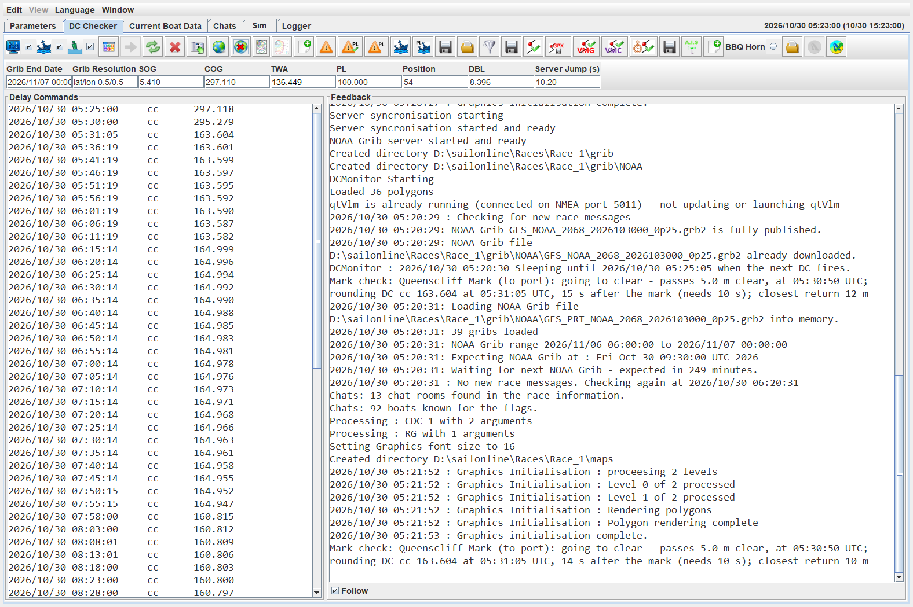

Le funzionalità di questa scheda sono descritte di seguito.

### 5.1.1 Menu di Modifica Contestuali

Sono disponibili due menu utilizzabili per copiare e incollare. Il primo è il menu **Modifica** che mostra questo menu.

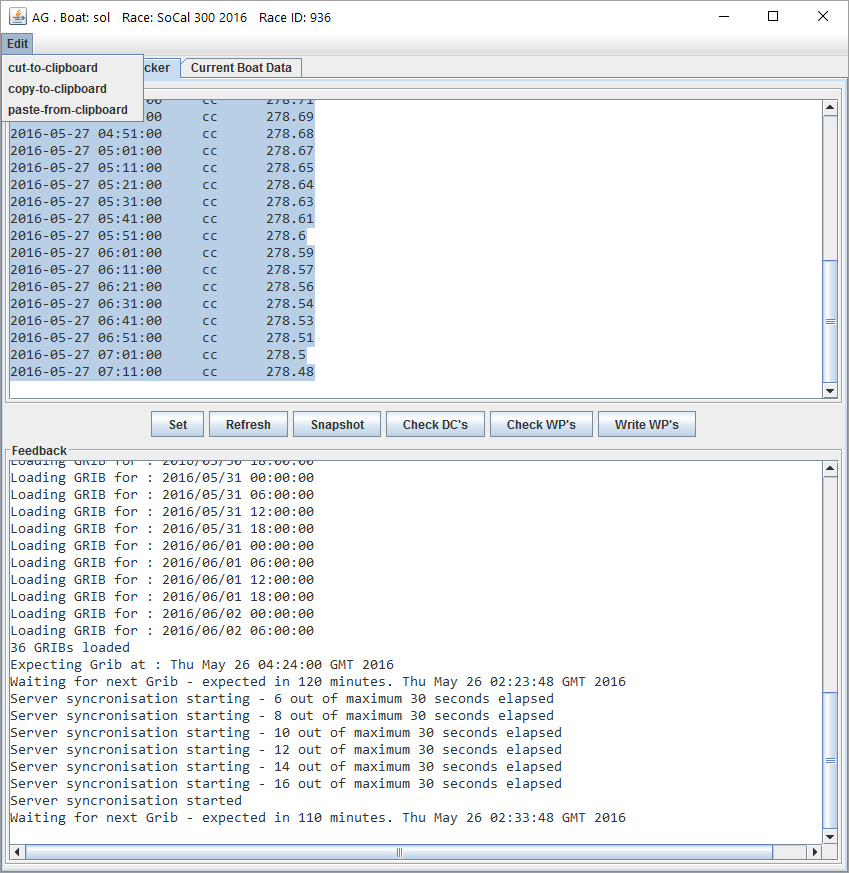

Il secondo è accessibile facendo clic con il tasto destro del mouse nella finestra Comandi ritardati.

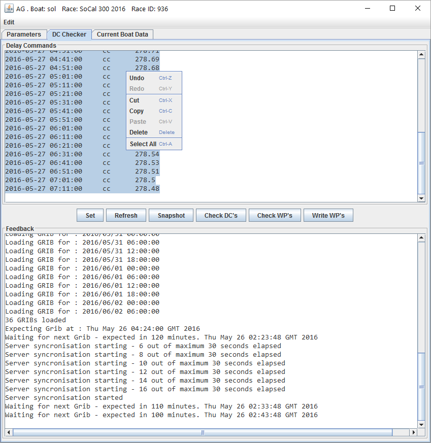

### 5.1.2 Pulsante Set

Questo pulsante viene utilizzato per impostare tutti i DC che sono stati incollati nella finestra. L'operazione di set eseguirà quanto segue:

1.  Verifica che tutti i DC siano validi.

2.  Rimuove eventuali DC duplicati. Cioè, se il comando e il valore del DC successivo sono uguali a quelli del precedente, verrà eliminato.

3.  Verifica che l'orientamento (bearing) tra due DC di tipo **cc** consecutivi sia inferiore a 170 gradi. In caso contrario, verrà visualizzata la seguente finestra di dialogo

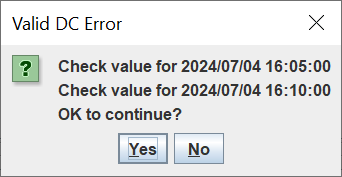

**Sì** ignorerà l'avviso e imposterà i DC, **No** interromperà il processo di impostazione e consentirà la modifica.

Le date dei DC incriminati verranno scritte nell'area Riscontro come mostrato di seguito.

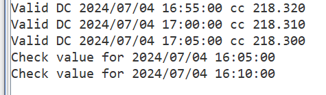

4.  Elimina eventuali DC obsoleti (cioè precedenti al momento attuale).

5.  Elimina eventuali DC sul server che non corrispondono a quelli presenti nell'area DC. Nota che è possibile eliminare un solo DC alla volta, quindi l'operazione potrebbe richiedere tempo a seconda della velocità della connessione internet.

6.  Se la regata non è ancora iniziata, verifica che ci sia un DC prima dell'orario di partenza della regata. In caso contrario, viene chiesto all'utente se il primo DC può essere spostato a 10 minuti prima della partenza della regata.

7.  Aggiorna con l'insieme valido corrente.

**Nota:** Un record DC deve avere questo formato:

2016/05/27 01:51:00 twa 138.45

### 5.1.3 Pulsante Refresh

Il pulsante refresh richiederà l'elenco dei DC correnti al server e li visualizzerà.

### 5.1.4 Pulsante Delete 

Per eliminare tutti i DC, fai clic sul pulsante delete . Per eliminarne un sottoinsieme, evidenzia quelli da eliminare.

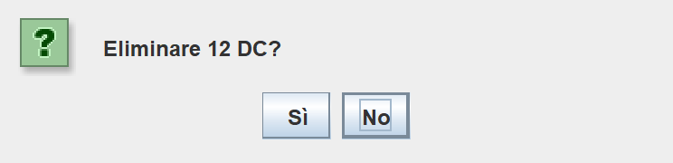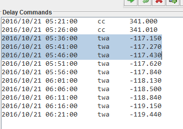

Verrà visualizzato un popup di conferma. Yes eliminerà, No annullerà.

### 5.1.5 Pulsante Snapshot

Utilizzato a scopo di debug. Scrive una copia della finestra di feedback in un file ed è necessario per segnalare eventuali comportamenti anomali.

Il nome del file di snapshot sarà simile a *snapshot_935_2016_05_25_0_28.txt*, composto come “snapshot\_\<Race_ID\>\_\<YYYY_MM_DD_HH_MM\>.txt”.

### 5.1.6 Pulsante Display Graphics

Visualizza la finestra grafica OpenGL.

**Nota:** Ai waypoint del percorso è stato applicato un ridimensionamento nel checker grafico classico. La dimensione della croce è di 10 metri. Il riquadro del mirino OpenGL è di 10 m, come mostrato nella figura successiva.

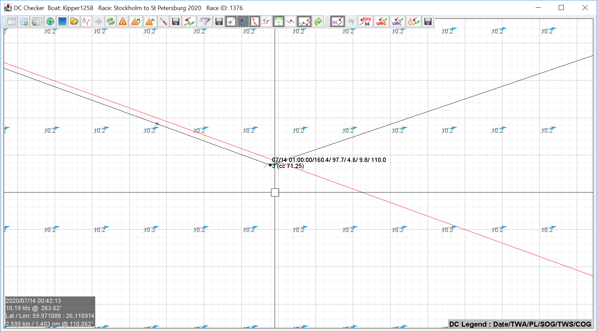

Il pulsante  riavvia la finestra grafica (che può bloccarsi; questo risolve il problema)

### 5.1.7 Selettore Alternate Polar 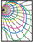

Questo aprirà il selettore del file polare alternativo e configurerà AGL per utilizzare la polare selezionata.

### 5.1.8 Show Polar Diagram 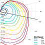

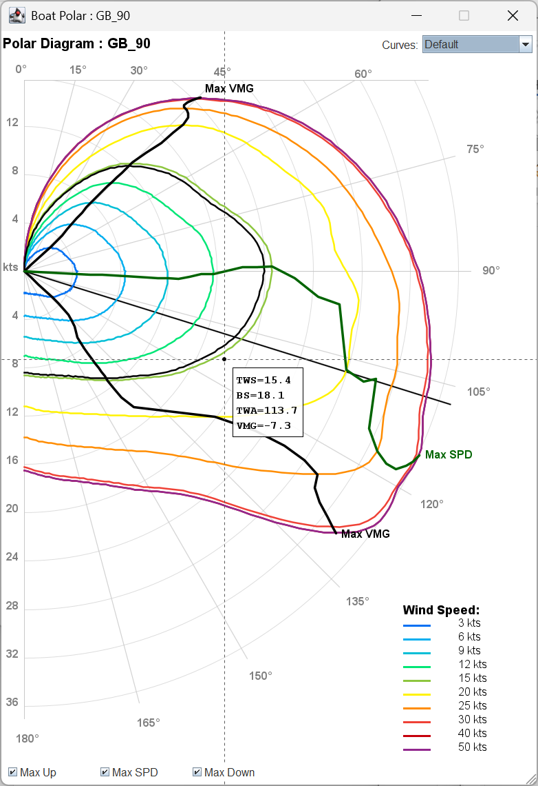

Questo aprirà il diagramma polare della barca. La curva polare nera mostra la curva di velocità attualmente in uso. La linea nera indica il TWA corrente: è una linea separata e non fa parte della curva polare. Il diagramma rimane sempre in primo piano; premi il pulsante di chiusura per nasconderlo.

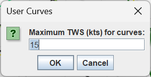

Il menu a tendina presenta tre opzioni: Default, Low Wind (\< 6 kts) e User. Se viene utilizzata l’opzione User, sarà necessario inserire il TWS massimo da utilizzare per le curve.

Il diagramma mostra anche le linee Max VMG sia per la bolina che per la poppa. La linea max SPD mostra il TWA che consente di raggiungere la velocità massima della barca a quell’intensità di vento. Passando il mouse sopra il diagramma verranno mostrati TWS, velocità della barca (BS), TWA e VMG in quel punto.

### 5.1.9 DC Data Table 

Questo avvierà la DC Data Table. Il funzionamento è descritto nella sezione [6 DC Data Table](0600-dc-data-table.md).

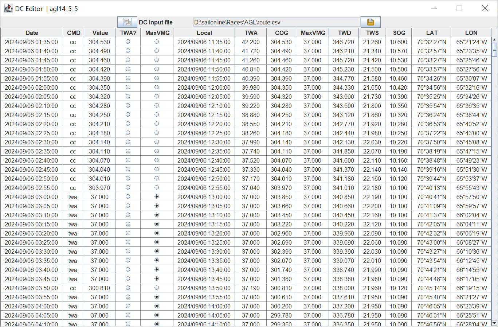

### 5.1.10 Pulsante Check DCs 

Questo pulsante prenderà tutti i DC mostrati nella finestra DC e li convertirà in un grafico come mostrato di seguito.

**Versione OpenGL del DC Checker**

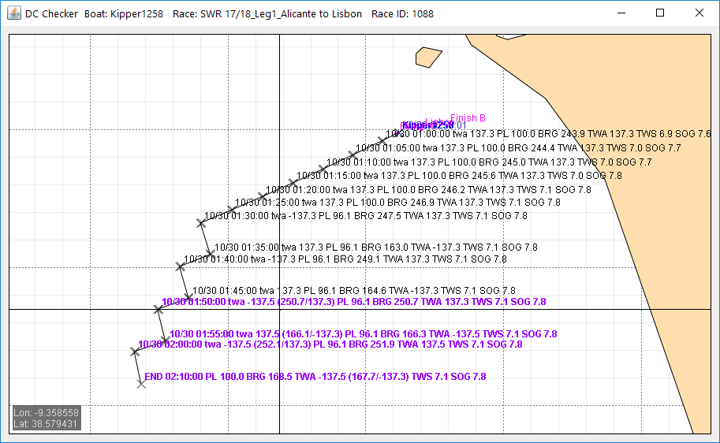

**Nota:** Se l'orario del primo DC ricade nel periodo di haulback (l'ora precedente alla partenza della regata), la traccia viene modificata per riflettere il risultato nella regata reale. Non vengono apportate modifiche ai DC effettivi. Questo funziona nel modo seguente.

Viene eseguita una scansione dei DC e viene determinato l'ultimo DC prima della partenza della regata. Eventuali DC precedenti a quello vengono ignorati (l'ultimo DC che scatta nel periodo di haulback imposta la rotta della barca, gli altri sono ridondanti). L'orario di quel DC viene adattato all'orario di partenza della regata e i DC rimanenti vengono quindi calcolati. Questo evita la deriva nella traccia causata dal fatto che la barca ha velocità, ma non si muove realmente durante il periodo di haulback.

Possiamo ora parlare di cosa fa ciascun parametro e di come funziona.

Se il waypoint è evidenzia**to** in viola, la barca navigherà verso quel waypoint al di fuori dell'intervallo ottimale di TWA. Se il waypoint è evidenziato in arancione, per quel DC è possibile la minimizzazione della performance loss.

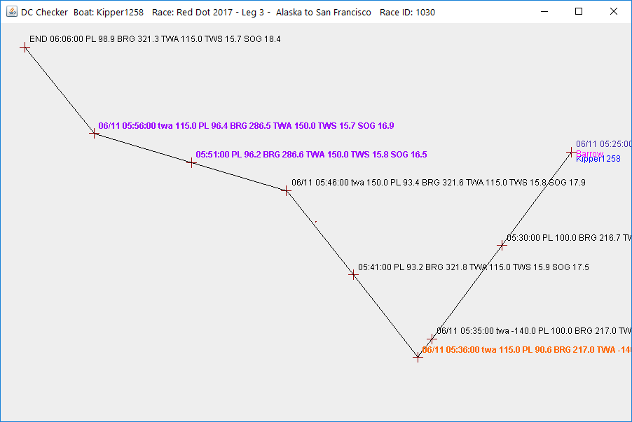

Gli stessi DC condizionati per la performance loss si presentano così. Nota che la performance loss è inferiore del 2% alle 05:41:11 (95,3% contro 93,2%).

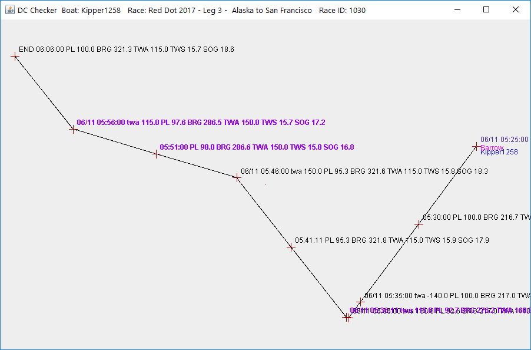

Sono disponibili due icone per il controllo della performance loss.

L'icona calcolerà le manovre di performance loss e le mostrerà senza modificare i DC effettivi. L'icona calcolerà e modificherà/aggiungerà DC per ottenere il risultato di PL.

#### 5.1.10.1 Parametri DC

Troverai tutti questi parametri nella scheda Parametri.

**Frequenza di controllo DC (s):** Questo parametro (in secondi) determina ogni quanto vengono tracciati punti aggiuntivi sullo schermo tra un DC e l'altro. Il waypoint **01:15:00/-172.3(87.4/-172.5)/100.0/4.3/9.6/71.3** mostra**to** di seguito è uno di questi, e si trova a 300 secondi dalla partenza. Il nome del waypoint è l'orario in cui la barca arriverà, e i valori successivi sono TWA, PL, SOG, TWS e COG. Il PL è la performance loss che la barca sperimenterà in quel punto, e il TWA/COG è il TWA/COG con cui la barca navigherà verso quel waypoint. Poiché la barca sta navigando al di fuori dell'intervallo ottimale di TWA, è colorato in viola e il valore ottimale viene aggiunto tra parentesi dopo il TWA. In questo caso, **(87.4/-172.5)**rappresenta il COG o il TWA che deve essere impostato per ottenere il TWA ottimale. La funzione **Condiziona** descritta più avanti farà questo in modo interattivo.

Quando un DC viene raggiunto, viene indicato per esteso. 07/14 01:29:52/-165.0/98.7/4.3/9.5/89.4 è il secondo DC che verrà raggiunto nell'esempio mostrato.

**Nota:** I waypoint mostrati in questo colore vengono navigati al di fuori dell'intervallo ottimale di TWA.

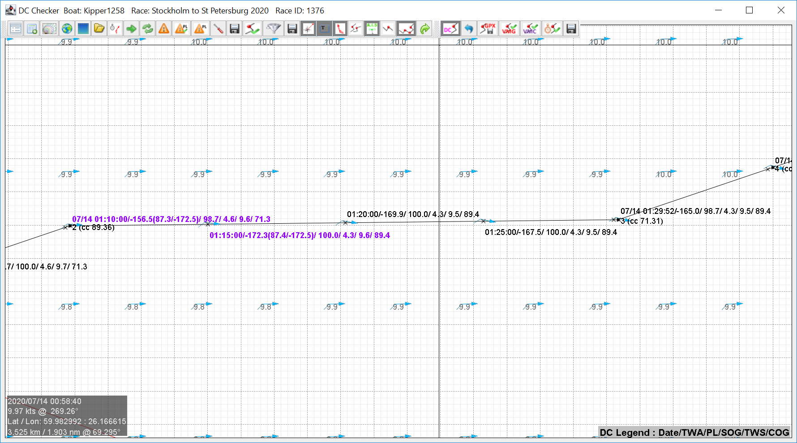

**Durata del calcolo (s):** Questo parametro (in secondi) determina ogni quanto la barca viene fatta avanzare. Concetto simile al jump del server. I punti generati non vengono tracciati, ma vengono utilizzati per determinare le coordinate di ciascun waypoint, campionando TWS e TWD dopo ogni avanzamento e utilizzando poi questi valori per l'avanzamento successivo.

**Usa la partenza della regata:** Consente all'utente di controllare i DC fin dall'inizio. Se selezionato, il checker presumerà che la barca si trovi al waypoint di partenza e che l'orario sia quello di partenza. Eventuali DC successivi a tale orario verranno elaborati nella produzione della rotta. Se deselezionato, l'orario di partenza sarà quello attuale.

**Mostra la posizione della barca:** Utilizzato quando la barca si trova molto lontana dai DC di interesse. Non verrà tracciata né considerata nella produzione della rotta. Più applicabile quando **Use these start coordinates** è selezionato.

**Use these start coordinates:** La rotta verrà calcolata presupponendo che la barca si trovi alle **Start coords (lat, lon)**, e l'orario verrà portato avanti fino all'orario del primo DC.

**Start coords (lat, lon):** Le coordinate di partenza per la rotta. Sono nel formato che può essere incollato direttamente dal client SOL. Per copiare le coordinate dal client SOL, tieni premuto il tasto Alt e fai clic con il pulsante sinistro del mouse. Questo copia le coordinate del mirino negli appunti.

**Nota:** Se la barca ha attualmente TWA 0, significa che non si sta muovendo. L'unica azione possibile è far avanzare l'orologio fino all'orario del primo DC, presupponendo che la barca inizi a muoversi su quella rotta in quel momento. Il punto di partenza sarà quindi la posizione attuale della barca, e l'orario sarà quello del primo DC.

## 5.2 Verifica del Percorso

AGL può controllare il tuo percorso e i tuoi DC prima che arrivino al server, e continuare a controllare mentre fai regata. Cerca tre cose:

- **BBQ:** la barca che finisce contro la terraferma.
- **Boe mancate:** una boa di mare che non verrà girata correttamente.
- **L'arrivo:** un percorso che non attraversa la linea di arrivo lontano dalle sue estremità.

Quando trova un problema, AGL propone una o più soluzioni. Scegli tu quali applicare. Nulla viene modificato finché non premi **Correggi** o **Applica**.

Questi controlli sono per i membri SOL. Perché funzionino in tempo reale serve anche che **In controllo** sia selezionato nella scheda Controllo DC. Lascialo disattivato se non vuoi che i controlli vengano eseguiti, ad esempio nelle regate sprint in cui hai il controllo tu. Puoi anche scegliere quali controlli eseguire: solo BBQ, solo boe (che comprendono la linea di arrivo) oppure entrambi.

### 5.2.1 Attivare i Controlli

Nella scheda Parametri, sotto DC's (oppure con le caselle nella barra degli strumenti della scheda Controllo DC):

- **Controllo BBQ** controlla lungo il percorso e i DC alla ricerca di terraferma, invia i messaggi BBQ e propone soluzioni.
- **Controllo delle boe** avvisa quando la barca sta per mancare una boa.

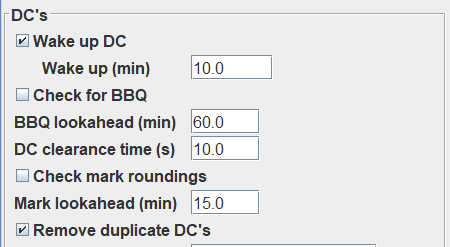

Ogni controllo ha un anticipo (look ahead), in minuti. I messaggi relativi partono quando il controllo trova il problema entro quell'anticipo. I messaggi stessi, e quando vanno al telefono, si impostano nella scheda Chat (vedi [Chat](0800-chats.md)).

Possono essere attivati e disattivati anche nella barra degli strumenti della scheda Controllo DC.

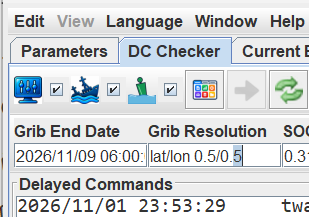


### 5.2.2 Il BBQ Checker

Il BBQ Checker esamina i DC nell'area dei DC alla ricerca di collisioni con la costa e li affronta uno alla volta. Il pulsante **Check**  lo esegue; **Check PL** 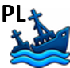 lo esegue tenendo conto della perdita di prestazioni.

Per ogni collisione AGL mostra dove avviene, ad esempio "Potential collision after DC 0", ed elenca le soluzioni che ha trovato. La soluzione suggerita è selezionata. Puoi selezionarne un'altra, o nessuna, poi premere:

- **Correggi** per apportare la modifica nell'area dei DC.
- **Salta** per lasciare questa collisione nei DC e passare alla successiva.
- **Annulla** per interrompere il controllo.

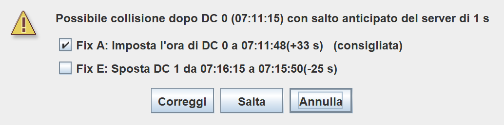

Una soluzione può impostare un DC a un nuovo orario, spostare un DC, aggiungere un DC prima della collisione, oppure dare una nuova rotta. Quando la collisione dipende dal server che attiva un DC un secondo o due in anticipo, il titolo lo dice ("with 1 s early server hop") e le soluzioni ne tengono conto.

Se la rotta attuale della barca finisce contro la terraferma, AGL propone una virata a sinistra o a dritta che la evita, con la rotta e il numero di gradi.

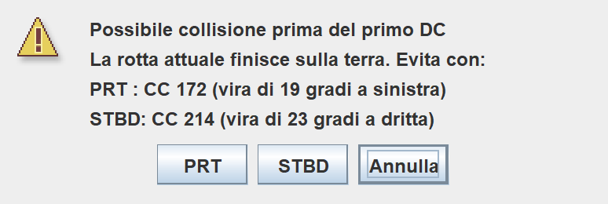

AGL crea anche un png della collisione da inviare a Telegram, e mostra le possibili soluzioni nella finestra grafica. Qui sotto un esempio.

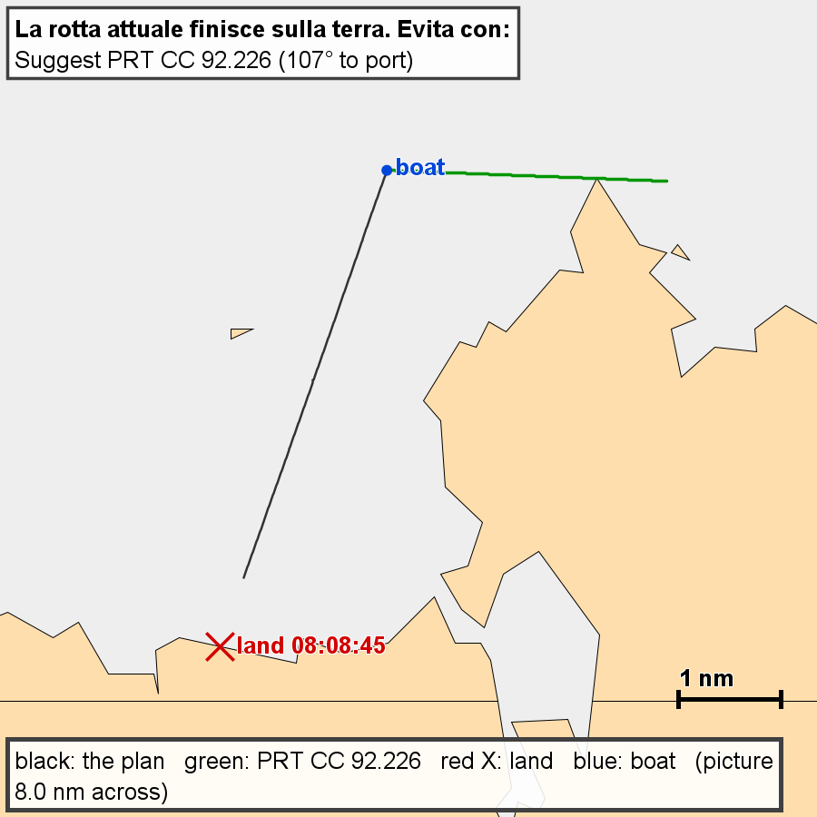

Se AGL non può fare nulla, lo dice, e devi correggere tu i DC.

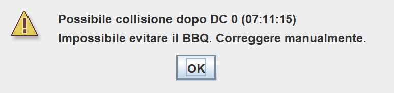

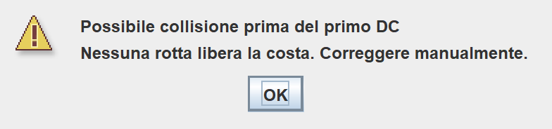

Quando ogni collisione è stata affrontata, AGL riporta quante correzioni sono state fatte e quante collisioni sono state saltate. **Annulla** nella grafica ripercorre all'indietro le correzioni. Se non c'era nulla da correggere, vedi:

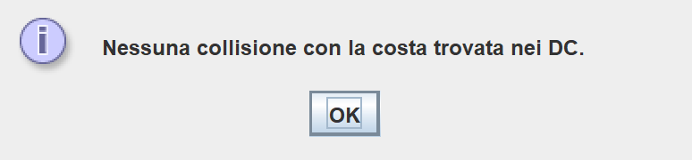

AGL può aver bisogno di un momento prima di poter controllare. Se un DC del server sta per attivarsi e cambierà la rotta, aspetta che lo faccia e poi controlla di nuovo.

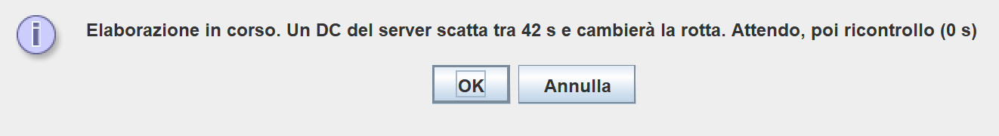

### 5.2.3 Boe Mancate

AGL segue il percorso attraverso i DC e avvisa quando la barca sta per mancare una boa di mare. Le boe a terra vengono ignorate perché se ne occupa il BBQ Checker. Il messaggio indica la boa, l'orario e il motivo. I motivi comprendono:

- un DC si attiva troppo presto,
- un DC gira dalla parte sbagliata intorno alla boa,
- un DC successivo annullerà la girata della boa,
- il percorso passa troppo vicino alla boa, o dalla parte sbagliata,
- nessun DC fa virare la barca dopo la boa.

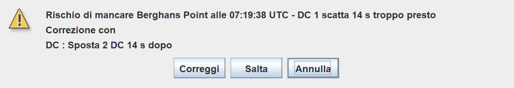

Quando la mancanza può essere rimediata spostando i DC o cambiando rotta, AGL propone la soluzione, indicando dove passerà la barca rispetto alla boa se la applichi.

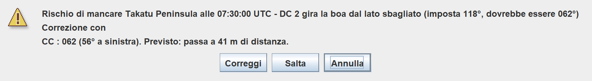

Se non può essere rimediata in questo modo, AGL lo dice.

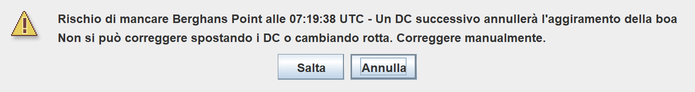

La grafica ingrandisce l'area del problema e mostra le possibili soluzioni. Se Missed Marks è abilitato, vengono creati png e inviati a Telegram.

### 5.2.4 L'Arrivo

Per la linea di arrivo il percorso deve attraversare la linea lontano dalle sue estremità. Un percorso che attraversa oltre l'estremità della linea viene segnalato come una boa mancata. AGL propone una nuova rotta verso la linea, o una rotta con perno verso la boa, quando riesce a trovarne una.

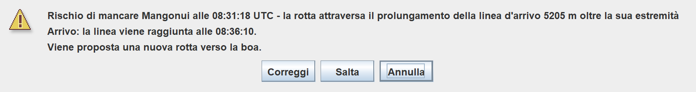

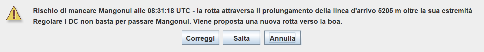

Se la rotta diretta verso la linea è fuori dal maxVMG, AGL può restare sulla mura attuale e virare più tardi, e lo dice.

Anche qui la grafica ingrandisce l'area del problema e crea un png per Telegram.

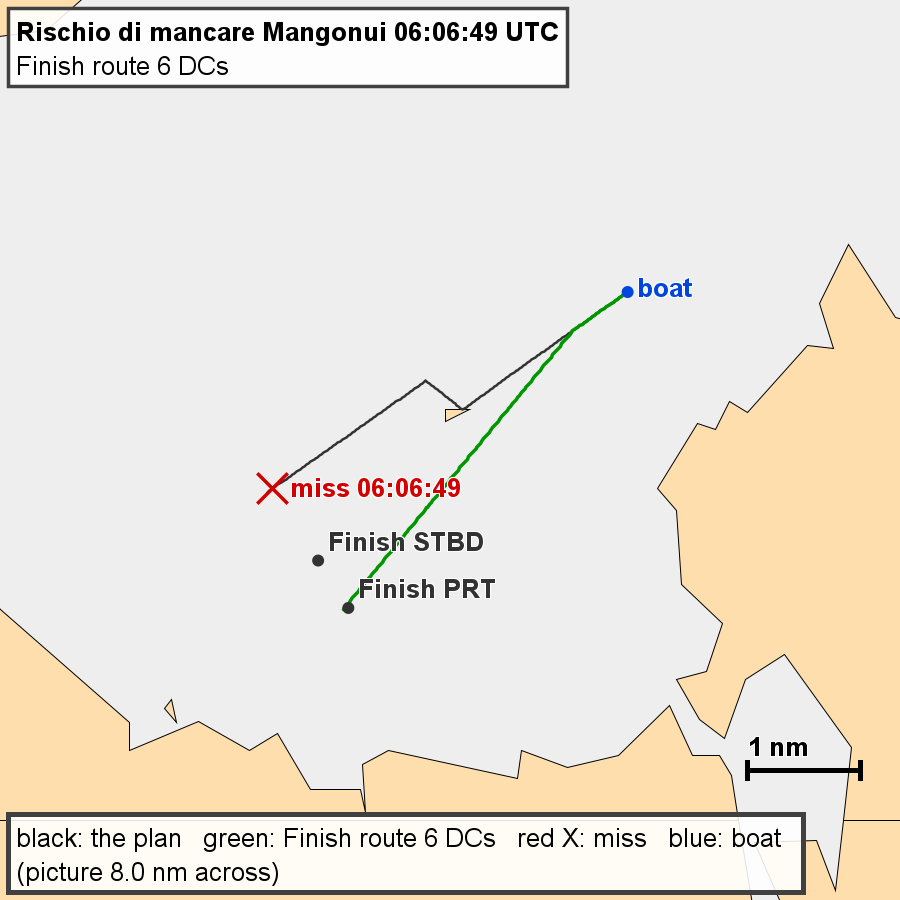

### 5.2.5 Suggerimenti Durante la Regata

Mentre fai regata, AGL esegue da solo i controlli e mostra una finestra di suggerimento quando trova un problema. La finestra ha le stesse soluzioni, con **Applica**, **Applica (PL)** e **Ignora**.

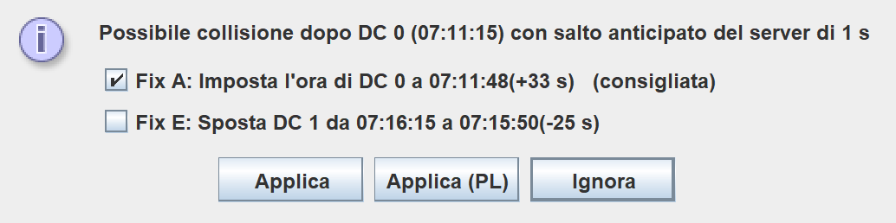

Se non rispondi, il suggerimento può andare anche al telefono, tramite Pushover o Telegram. Con Telegram arriva con i pulsanti **Applica** e **Ignora**, così puoi rispondere dal telefono. Vedi [Chat](0800-chats.md) per come configurarlo.
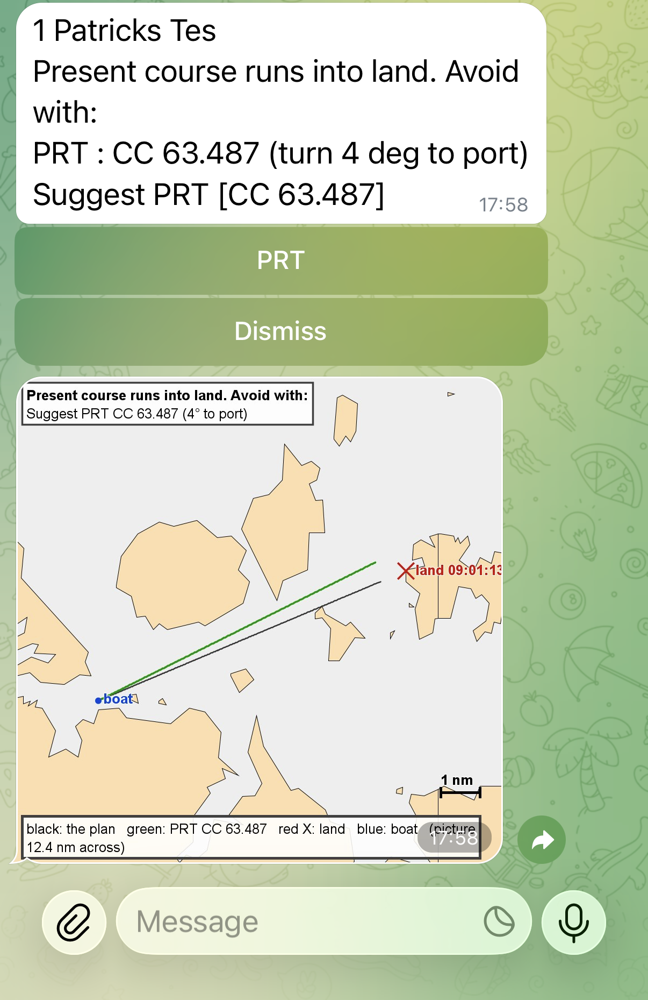 

Se premi **Applica**, il comando viene inviato ad AGL perché lo esegua. AGL aggiornerà poi il messaggio con lo stato della barca dopo l'**Applica**.

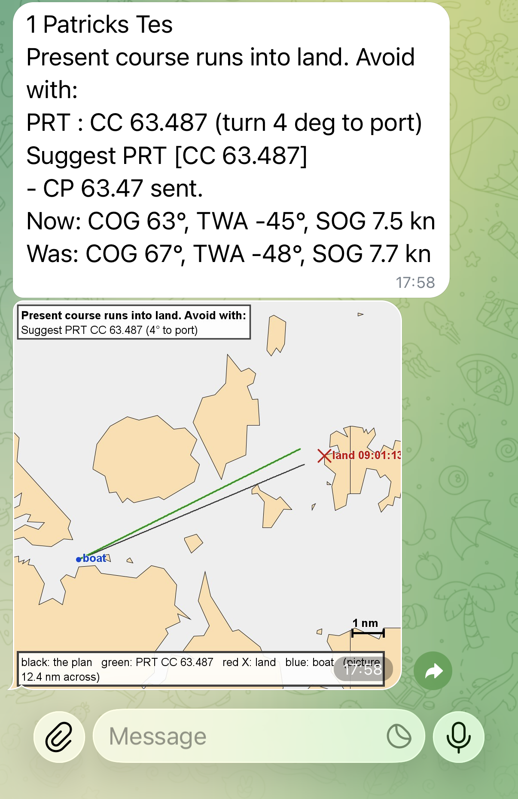

### 5.2.6 DC Non Ancora Impostati

Se nell'area dei DC ci sono DC che non sono sul server, AGL può chiedere se impostarli ora.

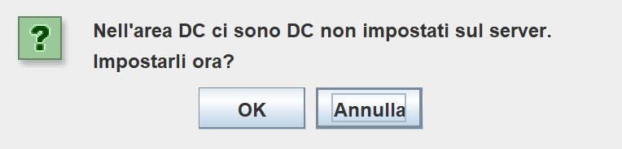

## 5.3 Visualizzazione

Questa sezione tratta di come muoversi nella grafica, copiarne le posizioni e scegliere cosa mostrare.

### 5.3.1 Muoversi nella Grafica

#### 5.3.1.1 Zoom e Pan

La funzione di zoom è disponibile solo utilizzando un mouse con rotellina (sul dorso, non sotto). Scorrendo la rotellina del mouse si esegue lo zoom avanti e indietro. Il pan si ottiene tenendo premuto il pulsante sinistro del mouse e trascinando fino alla posizione desiderata.

#### 5.3.1.2 Clic del Mouse

Un clic del mouse con il tasto sinistro copierà le coordinate correnti del mouse negli appunti nel formato

,CP,\<lat\>,\<lon\>

Ad es. ,*CP,38.681941,-9.201922*

Questo consente un semplice incollaggio in un file di waypoint, dove l'unica cosa necessaria è il nome per ottenere un waypoint valido.

Ad es. *WP01,CP,38.671979,-9.196492*

Un clic del mouse con il tasto destro (grafica standard**)** oppure \<Shift\> sinistro (grafica OpenGL) copierà le coordinate correnti del mouse negli appunti nello stesso formato del client SOL, cioè

*38.605778,-9.485908*

### 5.3.2 Opzioni di vista

Il pulsante  nella barra degli strumenti della grafica apre il modulo View Options. Resta aperto mentre lavori, così puoi attivare e disattivare le cose e vedere la grafica cambiare. **Chiudi** lo chiude.

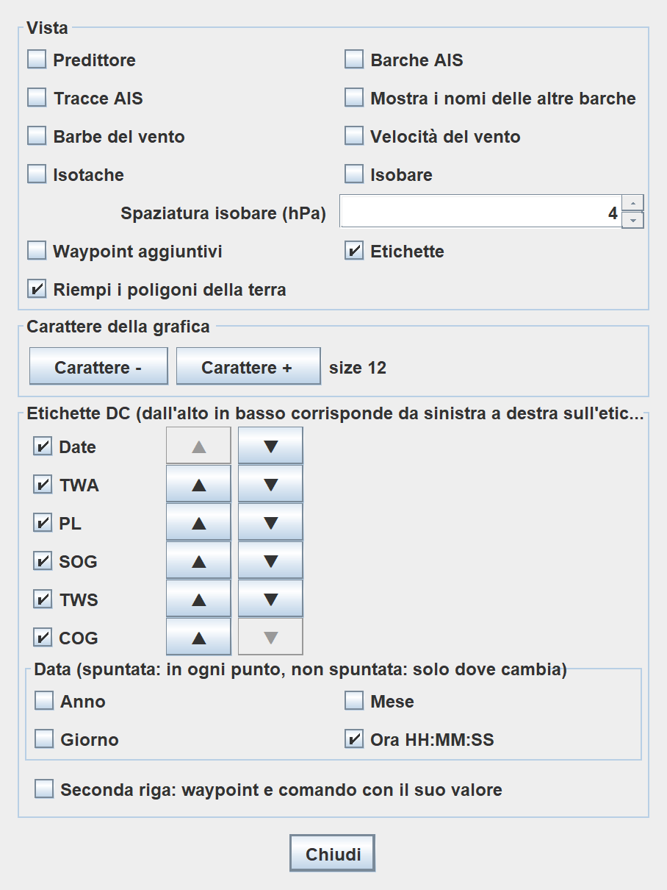

#### 5.3.2.1 Vista

Ogni casella attiva o disattiva una cosa nella grafica.

- **Predittore** mostra la linea del predictor.
- **Barche AIS** mostra le barche dell'elenco AIS.
- **Tracce AIS** mostra le tracce delle barche AIS.
- **Mostra i nomi delle altre barche** mostra i nomi delle barche che non sono nell'elenco AIS. Le barche dell'elenco AIS mostrano sempre il loro nome.
- **Barbe del vento** mostra le barbule del vento.
- **Velocità del vento** mostra i numeri della velocità del vento.
- **Isotache** mostra le linee di uguale velocità del vento.
- **Isobare** mostra le linee di uguale pressione. **Spaziatura isobare (hPa)** imposta la pressione tra le linee, da 1 a 50.
- **Waypoint aggiuntivi** mostra i waypoint aggiuntivi (vedi [5.6 Waypoint Aggiuntivi](0500-using-agl.md#56-waypoint-aggiuntivi)).
- **Etichette** mostra le etichette dei DC, impostate più sotto.
- **Riempi i poligoni della terra** riempie le forme della terraferma.

La visualizzazione seguente mostra le barche AIS e le loro tracce, e la linea di previsione. Il numero sotto ciascuna barca AIS è la sua posizione attuale. I quattro numeri sotto la tua barca sono posizione, TWA, SOG e performance loss.

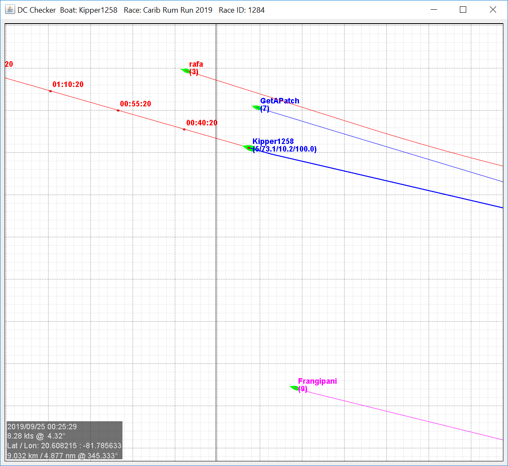

Inoltre, se la tua barca è nell'elenco AIS, verrà mostrata in nero nella posizione in cui si trovava quando tutte le altre barche AIS sono state aggiornate. Questa è la posizione effettiva della tua barca rispetto alle altre mostrate sullo schermo.

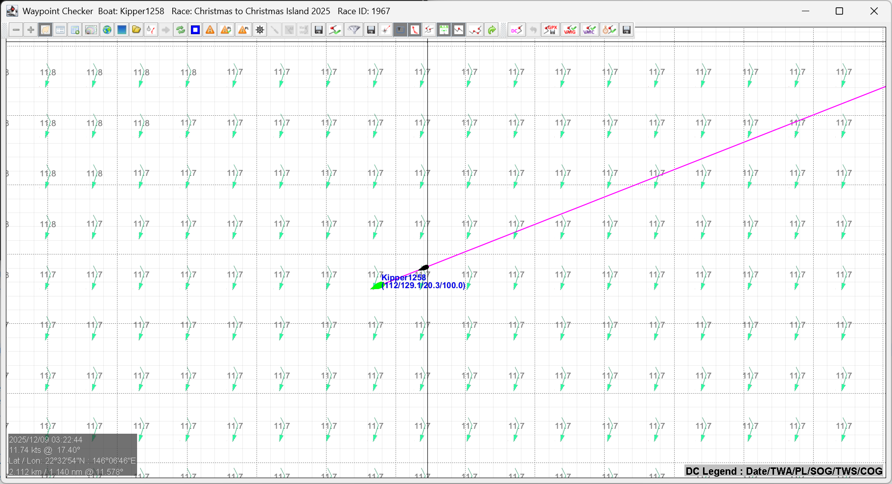

#### 5.3.2.2 Carattere della grafica

**Carattere -** riduce di 1 la dimensione del font della grafica e **Carattere +** la aumenta di 1. La dimensione attuale è mostrata accanto ai pulsanti.

#### 5.3.2.3 Etichette dei DC

Qui si imposta cosa viene scritto su ogni etichetta DC nella grafica.

- Seleziona un campo per mostrarlo: **Date**, **TWA**, **PL**, **SOG**, **TWS** e **COG**.
- Le frecce spostano un campo su o giù. Dall'alto in basso nell'elenco corrisponde da sinistra a destra sull'etichetta.
- Il gruppo **Date** sceglie quali parti della data vengono mostrate. Se una parte è selezionata viene mostrata in ogni punto; se non è selezionata viene mostrata solo dove cambia. Le parti sono **Anno**, **Mese**, **Giorno** e **Ora HH:MM:SS**.
- **Seconda riga: waypoint e comando con il suo valore** aggiunge all'etichetta una seconda riga con il waypoint e il comando con il suo valore.

## 5.4 Comandi Specifici della Grafica OpenGL

Il motore OpenGL dispone di diversi comandi da tastiera specifici solo per il motore OpenGL.

**R** – Aggiorna lo schermo

**F** – Adatta i dati visualizzati allo schermo

**B** – Centra la visualizzazione sulla barca

**W** – Pulisce lo schermo

### 5.4.1 Icone della Toolbar

Il pulsante 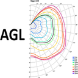 porta la finestra di AGL in primo piano.

Il pulsante  apre la boat data table

Il pulsante  apre il selettore del file polare alternativo

Il pulsante  apre il diagramma polare

Il pulsante  porta la finestra grafica in primo piano.

Il pulsante  crea un sottoinsieme del grib corrente. Il file verrà collocato nella cartella grib con il prefisso SUB\_. Il messaggio seguente appare al termine della creazione del sottoinsieme.

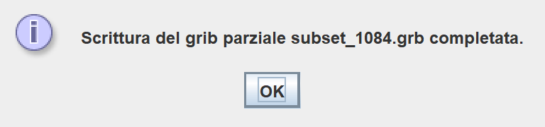

Il pulsante  seleziona il file di waypoint corrente.

Il pulsante applica l'elenco DC corrente. È disattivato (in grigio) se non sono state apportate modifiche.

Il pulsante  scrive i DC correnti in un file di waypoint

Quando  è selezionato e viene caricato un insieme di waypoint, vengono attivati i seguenti comandi da tastiera per la modifica

**D** – Elimina un waypoint

**E** – Modifica i valori di un waypoint

**I** – Inserisce / Aggiunge waypoint

**M** – Sposta un waypoint

Il pulsante  filtra eventuali waypoint ridondanti, utilizzando una tolleranza di filtro

Il pulsante successivo  filtra eventuali waypoint ridondanti, utilizzando una tolleranza di filtro, e li salva in un file

Il pulsante  apre il modulo View Options, dove si impostano la linea del predictor, le barche e le tracce AIS, le barbule del vento, i waypoint aggiuntivi, le etichette DC, il riempimento della terraferma e il font della grafica. Vedi [5.3.2 View Options](0500-using-agl.md#532-opzioni-di-vista).

Il pulsante 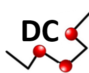 attiva e disattiva la traccia DC grigia. Vedi [6.3.1 Come Funziona](0600-dc-data-table.md#631-come-funziona).

Il pulsante Append  attiva o disattiva l'aggiunta dei tracciati DC. Usa **W** per pulire la visualizzazione.

Il pulsante  ricarica il file dei waypoint aggiuntivi del percorso

Il pulsante  alterna tra il lavoro con i DC e con i waypoint

Il pulsante  annulla le modifiche ai waypoint una alla volta

Il pulsante  scrive i waypoint correnti in un file gpx

Il pulsante  calcola i waypoint e i DC in una rotta utilizzando maxVMG per i waypoint

Il pulsante calcola i waypoint e i DC in una rotta utilizzando maxVMC per i waypoint

Il pulsante  converte waypoint e DC in soli DC, utilizzando maxVMG per i waypoint

Il pulsante  converte i waypoint maxVMG e i DC in un file di waypoint

Le toolbar possono anche essere sganciate e riagganciate facendo clic e tenendo premuto sull'area grigia puntinata della toolbar accanto alla prima icona, come mostrato di seguito.

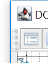

Le toolbar sganciate sono mostrate di seguito

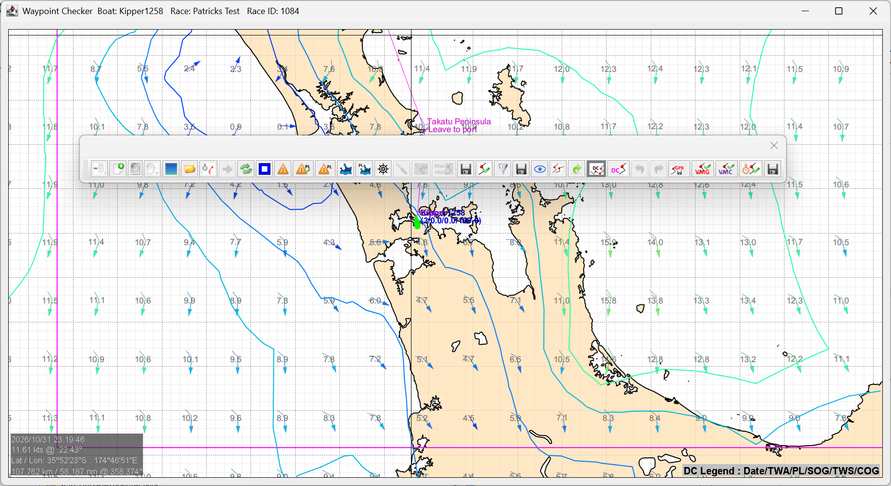

### 5.4.2 Il Menu del Tasto Destro

Un clic destro del mouse nella finestra grafica richiama un menu rapido di opzioni, che cambia a seconda che si lavori sui DC o sui waypoint. Alcuni comandi valgono solo per i waypoint. Quello a sinistra è per i waypoint e quello a destra per i DC.

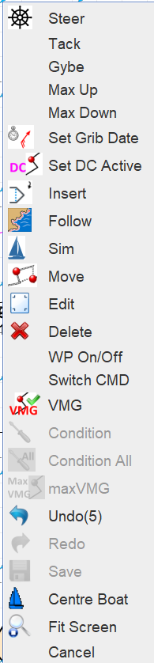 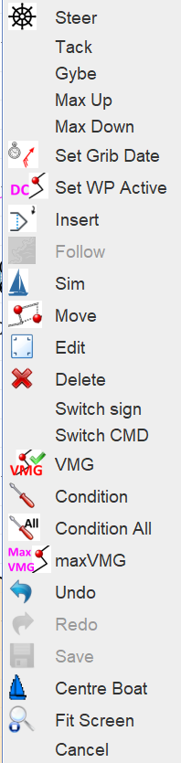

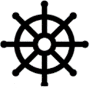 **Steer:** Richiama Impostazione di un Percorso

**Vira:** Porta la barca sulla mura opposta al max VMG. Fa comparire una finestra di conferma che mostra i comandi e comprende la minimizzazione della perdita di prestazioni. Selezionando OK, il comando viene eseguito subito.

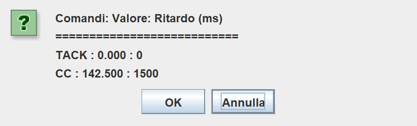

**Abbatti:** Porta la barca sull'altra mura con una abbattuta, al max VMG. Fa comparire una finestra di conferma che mostra i comandi e comprende la minimizzazione della perdita di prestazioni. Selezionando OK, il comando viene eseguito subito.

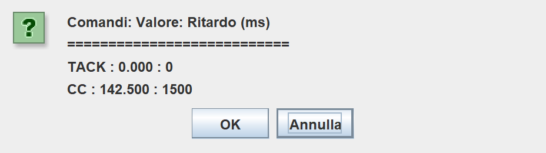

**Max su:** Imposta la barca al max VMG di bolina sulla stessa mura. Fa comparire una finestra di conferma che mostra i comandi e comprende la minimizzazione della perdita di prestazioni. Selezionando OK, il comando viene eseguito subito.

**Max giù:** Imposta la barca al max VMG di poppa sulla stessa mura. Fa comparire una finestra di conferma che mostra i comandi e comprende la minimizzazione della perdita di prestazioni. Selezionando OK, il comando viene eseguito subito.

 **Imposta data grib:** Imposta la barca sul waypoint selezionato e aggiorna isotache e barbule del vento a quell'orario

 **Imposta DC attivo / Imposta WP attivo:** Passa dal lavorare sui DC al lavorare sui waypoint, e viceversa

 **Inserisci:** Inserisce un waypoint / DC. Segui le indicazioni in alto a destra. Se è un waypoint, l'editor farà comparire questo modulo.


Seleziona il tipo di controllo dall'elenco a discesa e modifica gli altri valori se lo desideri.


 **Segui:** Inserisce waypoint che girano intorno alla costa tra due waypoint

1. Scegli **Segui** dal menu del tasto destro. Il messaggio in alto a destra dice **Seleziona il segmento da inserire ( clic destro per annullare)**.

2. Fai clic sulla linea tra i due waypoint che attraversa la terraferma. I waypoint inattivi (quelli con un ! all'inizio del nome) vengono saltati: il segmento è tra i due waypoint attivi ai lati del tuo clic. L'editor dei waypoint compare, come per **Inserisci**. I nuovi waypoint prendono il nome e il comando del primo waypoint del segmento, quindi cambia lì il tipo di controllo se vuoi qualcosa di diverso.

   

3. Il messaggio ora dice **Clicca il lato del segmento da cui passare ( clic destro per annullare)**, e una linea sottile segue il mouse a partire dal segmento. Fai clic sul lato del segmento da cui vuoi passare la prima isola. Quel lato vale solo per la prima isola. Se sul segmento ci sono altre isole, ciascuna prende il lato che dà il percorso più breve.

   

4. AGL trova la costa che il segmento attraversa e inserisce un waypoint a ogni angolo della costa che la rotta deve aggirare (l'inviluppo convesso), tra il punto in cui il segmento entra per la prima volta nella costa e quello in cui la lascia per l'ultima volta. L'area Riscontro dice quanti waypoint sono stati inseriti. Se non c'è nulla da inserire, dice perché, ad esempio **The segment does not enter and leave any coastline**, e puoi fare clic su un altro segmento.

   

5. Il clic destro annulla a entrambi i passaggi. **Annulla** e **Ripeti** nel menu e nella barra degli strumenti tolgono i nuovi waypoint e li rimettono.

Due valori nella scheda **Parametri**, nel riquadro **Percorso e waypoint**, impostano dove vanno i waypoint. **Segui: distanza dalla costa (m)** (10 all'inizio) sposta ogni punto di quei metri verso il largo dalla riva. **Segui: distanza lungo la traccia (m)** (0 all'inizio) sposta poi ogni punto lungo la direzione di marcia. AGL controlla quindi ancora una volta, e aggiunge un punto ovunque la rotta spostata attraverserebbe ancora la costa.

 **Sposta:** Sposta un waypoint / DC. Segui le indicazioni in alto a destra. Nota per i DC:

1.  Se il tipo di DC è TWA, lo spostamento non porterà il twa fuori dall'intervallo maxVMG ottimale

2.  Se il DC viene spostato sulla terraferma, viene rimesso indietro per non causare un BBQ

 **Modifica:** Modifica un waypoint. Segui le indicazioni in alto a destra. L'editor farà comparire questo modulo, in cui si possono modificare la data e il tipo di controllo.


 **Elimina:** Elimina un waypoint o un DC. Segui le indicazioni in alto a destra

**WP On/Off:** Attiva o disattiva i waypoint. Se è disattivato, il waypoint non viene usato. Segui le indicazioni in alto a destra.

**Cambia segno:** Cambia il segno di un DC TWA. Segui le indicazioni in alto a destra

**Cambia CMD:** Solo DC. Passa da CC a TWA e viceversa e aggiorna di conseguenza il valore. Segui le indicazioni in alto a destra.

 **VMG:** Calcola waypoint e DC in una rotta usando il maxVMG per i waypoint, come fa il pulsante della barra degli strumenti.

 **Condiziona:** Condiziona i DC che sono fuori dall'intervallo VMG ottimale al VMG ottimale

 **Condiziona tutti:** Solo DC. Condiziona tutti i DC che sono fuori dall'intervallo VMG ottimale al VMG ottimale.

 **maxVMG:** Solo DC. Imposta il valore del DC selezionato al max VMG.

 **Annulla:** Annulla l'ultima modifica ai waypoint. Il numero di modifiche annullabili è mostrato tra parentesi.

 **Ripeti:** Rimette la modifica che era stata annullata.

 **Salva:** Salva i waypoint attuali.

 **Centra barca:** Centra lo schermo sulla barca

 **Adatta allo schermo:** Adatta lo schermo all'estensione del tracciato attuale di waypoint/DC

 **Simulatore:** Avvia il Simulatore, o lo riavvia se è già in esecuzione. Fai clic sinistro dove si trova la barca per iniziare. Solo per i membri. Vedi [9.1 Avvio e Arresto del Simulatore](0900-simulator.md#91-avvio-e-arresto-del-simulatore).

Quando il Simulatore è in esecuzione, al menu popup viene aggiunta una voce, **Move Mark**. Quello a sinistra è per i waypoint e quello a destra per i DC.

 

 **Move Mark:** Sposta una boa del percorso mentre il Simulatore è in esecuzione, per provare una boa mancata o la linea di arrivo. Le informazioni reali della regata non vengono modificate. Vedi [9.4 Boe e Arrivo](0900-simulator.md#94-boe-e-arrivo).

### 5.4.3 Impostazione di un Percorso

L'impostatore di rotta viene richiamato con la lettera C. Muovi il mouse finché non trovi la rotta desiderata, quindi fai clic con il tasto sinistro del mouse.


Il clic del mouse apre la finestra dell'impostatore.


I pulsanti di opzione alternano tra i comandi TWA e CC. Il valore richiesto può anche essere inserito manualmente.  applica il comando e imposta immediatamente la rotta.  interrompe e annulla il comando.

### 5.4.4 MaxVMG Waypoints

Questa sezione descrive come utilizzare i waypoint maxVMG e gli strumenti associati. I waypoint maxVMG sono guidati da un comando memorizzato insieme al waypoint. Il comando è composto da massimo tre caratteri, ad es. 1P+. I comandi applicabili sono descritti di seguito.

#### 5.4.4.1 Comandi dei Waypoint

I controlli della prima lettera per i comandi a due lettere sono i seguenti

| **Comando** | **Comportamento**                                                                                                                           |
|-------------|---------------------------------------------------------------------------------------------------------------------------------------------|
| **T**       | Guida a twa                                                                                                                                 |
| **C**       | Guida a CC                                                                                                                                  |
| **+**       | Guida a maxVMG, prima a dritta e poi vira/strambata a sinistra. Rispetta il waypoint.                                                       |
| **-**       | Guida a maxVMG, prima a sinistra e poi vira/strambata a dritta. Rispetta il waypoint.                                                       |
| **1**       | Guida solo a maxVMG, in base al TWA attuale della barca, finché non si raggiunge il punto più vicino al waypoint. Non rispetta il waypoint. |
| **2**       | Guida diretta e poi maxVMG se necessario. Non rispetta il waypoint.                                                                         |
| **3**       | Guida solo a maxVMG in stile qtVlm. Virerà/strambata secondo necessità per raggiungere il waypoint. Non rispetta il waypoint.               |

La seconda lettera controlla la performance loss, P oppure N. Ad es., CP guiderà a CC e applicherà la performance loss quando si naviga VERSO quel waypoint. CN guiderà a CC e non applicherà la PL quando si naviga VERSO quel waypoint.

**Attenzione:** Il comportamento della performance loss al waypoint corrente che si sta doppiando è determinato dall'impostazione sul waypoint verso cui si sta navigando.

Ci sono tre comandi che utilizzano tre lettere. Il loro comportamento è documentato di seguito

| **1<sup>°</sup>** | **2<sup>°</sup>** | **3<sup>°</sup>** | **Comportamento**                                                                             |
|-------------------|-------------------|-------------------|-----------------------------------------------------------------------------------------------|
| **1, 2 o 3**      | **P o N**         | **+**             | Stesso comportamento di sopra, ma inizia a dritta. Non rispetta il waypoint. Ad es. **2P+**   |
| **1, 2 o 3**      | **P o N**         | **-**             | Stesso comportamento di sopra, ma inizia a sinistra. Non rispetta il waypoint. Ad es. **3P-** |

Alcuni esempi di questi tipi di waypoint

**-P**


**+P (con data del waypoint)**


**1P- (con data del waypoint)**


**3P+ (con data del waypoint)**


#### 5.4.4.2 Modifica di un Waypoint

Per modificare il nome o il comando del waypoint, usa l'opzione Edit e segui le istruzioni nell'angolo in alto a destra.

**Attenzione:** Assicurati che la modalità di modifica dei waypoint sia attiva. Questa  icona non deve essere selezionata (bordi grigi). Se lo è, fai clic sull'icona per deselezionare la modifica dei DC.

Il waypoint maxVMG supporta anche un orario di partenza basato sul waypoint. La partenza da un waypoint può essere ritardata fino a un orario specifico, e gli eventuali DC esistenti verranno utilizzati per coprire il tempo dal momento in cui è stato raggiunto il waypoint precedente fino all'orario specificato. Il formato è lo stesso di prima, ed è possibile usare il selettore di data.


### 5.4.5 Conversione dei Waypoint in DC

Dopo aver verificato che i waypoint producano il risultato desiderato, si può usare . Il comando genera un insieme di DC che corrisponde al percorso dei waypoint.

**Nota:** se la barca non si muove, i DC saranno un'istantanea di quel momento, e i DC si sposteranno con il passare del tempo. L'unico caso in cui sono validi con una barca ferma è durante l'haulback, quando la barca è ferma.

### 5.4.6 Condizionamento dei DC

Se alcuni DC appaiono in viola, possono essere corretti usando l'opzione **Condiziona** o **Condiziona tutti**.


Seleziona il DC da condizionare e segui le istruzioni nell'angolo in alto a destra. Il DC verrà quindi condizionato.


Continua finché non rimangono più DC in viola.

### 5.4.7 Punto di Pericolo

Il DC Checker è stato migliorato per includere il punto di pericolo, entro il quale l'esecuzione di una doppiata comporta il rischio di fallire. La barca può eseguire la doppiata in qualsiasi momento dal segnale di pericolo fino al DC principale. Il segnale di pericolo è un segnale scalabile (10 m di diametro) mostrato appena prima del DC principale. Questo è mostrato di seguito come la croce disabilitata.


### 5.4.8 Check WPs

L'applicazione ha la possibilità di scrivere una rotta in un insieme di waypoint e poi rileggerli. Il file di waypoint è un semplice file csv nel formato

\<name\>, CP,\<lat\>,\<lon\>

Le due lettere CP devono essere fornite dopo il nome, poiché la libreria viene utilizzata anche per altri scopi.

Di seguito è riportato un esempio di file di waypoint, prodotto dalla routine di scrittura.

07/14 02:20:00/-130.3/ 100.0/ 6.1/ 10.9/ 76.7, CP , 60.005411 , 26.333079

07/14 02:25:00/-129.0/ 100.0/ 6.2/ 11.0/ 76.7, CP , 60.007374 , 26.349729

07/14 02:30:00/-128.0/ 100.0/ 6.3/ 11.2/ 76.8, CP , 60.009362 , 26.366626

07/14 02:35:00/-127.2/ 100.0/ 6.4/ 11.3/ 76.8, CP , 60.011375 , 26.383736

07/14 02:40:00/-126.6/ 100.0/ 6.4/ 11.4/ 76.8, CP , 60.013405 , 26.401028

07/14 02:45:00/-126.1/ 100.0/ 6.5/ 11.5/ 76.8, CP , 60.015451 , 26.418467

07/14 02:50:00/-125.9/ 100.0/ 6.5/ 11.6/ 76.8, CP , 60.017507 , 26.436020

07/14 02:55:00/-125.8/ 100.0/ 6.5/ 11.7/ 76.8, CP , 60.019568 , 26.453650

07/14 03:00:00/-126.0/ 100.0/ 6.5/ 11.7/ 76.8, CP , 60.021631 , 26.471310

07/14 03:05:00/-126.3/ 100.0/ 6.5/ 11.7/ 76.9, CP , 60.023691 , 26.488965

07/14 03:10:00/-126.9/ 100.0/ 6.5/ 11.7/ 76.9, CP , 60.025745 , 26.506597

07/14 03:15:00/-127.9/ 100.0/ 6.4/ 11.6/ 76.9, CP , 60.027784 , 26.524119

07/14 03:20:00/-128.9/ 100.0/ 6.4/ 11.5/ 76.9, CP , 60.029800 , 26.541475

L'applicazione può anche leggere e scrivere file gpx. Un file gpx di waypoint valido avrà il seguente formato

\<gpx xmlns="http://www.topografix.com/GPX/1/1"

xmlns:xsi="http://www.w3.org/2001/XMLSchema-instance"

xsi:schemaLocation="http://www.topografix.com/GPX/1/1 http://www.topografix.com/GPX/1/1/gpx.xsd"

version="1.1"

creator="AutoGribLoader"\>

\<wpt lat="-35.2" lon="-54.0"\>

\<name\>Punta DO \</name\>

\<type\>RTWR 2016 - Leg 2 - Uruguay to New Zealand\</type\>

\</wpt\>

\<wpt lat="-52.3" lon="-68.3"\>

\<name\>Cabo 0\</name\>

\<type\>RTWR 2016 - Leg 2 - Uruguay to New Zealand\</type\>

\</wpt\>

\</gpx\>

Un file gpx viene riconosciuto dall'estensione del file .gpx.

### 5.4.9 Write WPs

Prenderà l'insieme corrente di DC tracciati sullo schermo e li scriverà in un file di waypoint nel formato mostrato sopra. Se l'estensione del file non viene fornita, verrà utilizzata l'estensione predefinita .wpt e il file sarà un csv nel formato

\<name\>, CP,\<lat\>,\<lon\>

Se viene utilizzata l'estensione .gpx, verrà creato un file in formato gpx che conterrà sia i waypoint sia una rotta che li collega.

### 5.4.10 Convert WPs to GPX

Apre il selettore file in cui selezionare il file .wpt richiesto. Questo file viene poi convertito in un file GPX con lo stesso nome e l'estensione .gpx


### 5.4.11 Pulsante AIS

Apre l'AIS Boat Chooser. Seleziona le barche desiderate e fai clic su Add. Quindi fai clic su Apply per aggiornare l'elenco delle barche AIS. L'icona si trova sia nella scheda Parametri che nella scheda Controllo DC.

### 5.4.12 Pulsante Boat Data Table

Apre la Boat Data Table mostrata di seguito, basata sulle barche AIS selezionate. Ogni colonna può essere ordinata facendo clic sul nome della colonna. Queste sono le stesse informazioni utilizzate per creare il feed di dati AIS. La tabella superiore contiene i dati standard. La tabella inferiore mostra le differenze rispetto alla barca selezionata.

La tabella mostrerà ora la polare della barca utilizzata per quella barca. La polare deve esistere nella libreria delle polari, e la libreria delle polari deve essere stata impostata.


### 5.4.13 Pulsante di Opzione Boat Horn

Se selezionato, la sirena della barca suonerà se

1.  La regata è iniziata

2.  La barca non ha terminato la regata

3.  La barca ha lasciato la partenza, e

4.  La barca è a twa 0.

### 5.4.14 Pulsante Additional Course Waypoints

Apre il selettore file di Additional Course Waypoints.

### 5.4.15 qtVlm

Se sei un membro SOL e **qtVlm integration** è abilitato nella scheda Parametri, vedrai due icone aggiuntive sulla toolbar.

Avvia qtVlm. Eseguirà i controlli necessari e configurerà qtVlm come segue:

- Verifica che le tile delle mappe SOL e i collegamenti della regata siano presenti e che l'installazione di qtVlm sia ancora la versione a cui la regata era stata collegata. In caso contrario, chiede prima di scaricare o collegare qualsiasi cosa

- Imposta il grib su current_grib.grb

- Imposta la polare sulla polare della regata corrente

- Imposta il nome della barca in modo che corrisponda al tuo nome utente

- Imposta le mappe sulla risoluzione corrispondente

- Attiva i messaggi NMEA RMB

- Imposta la porta NMEA di qtVlm in modo che corrisponda a quella di AGL (se diversa). Se qtVlm è già connesso su quella porta, viene lasciato com'è e non viene avviato un secondo qtVlm

Riduce a icona o ingrandisce qtVlm, a seconda dello stato attuale di qtVlm. Questo permette all'utente di portare in primo piano la sessione di qtVlm collegata a questa regata, senza doverla cercare nella barra delle applicazioni.

Le finestre **Routing**, **Converting Routing to Route**, **Simplification result** e **Optimization results** di qtVlm possono aprirsi dietro altre finestre. L'AGL Hub le porta in primo piano per te, una alla volta, e mostra una cornice arancione chiara intorno alle finestre di AGL mentre ce n'è una aperta senza il focus. È descritto in [2.3.3.6 Gestione delle Finestre di Dialogo di qtVlm](0200-installing-agl.md#2336-gestione-delle-finestre-di-dialogo-di-qtvlm) e si attiva e disattiva con **Gestire i dialoghi di qtVlm?** nella scheda Launcher dell'hub.

**Nota:** Su Linux, se questo set di icone non è presente sulla toolbar, significa che non è installato il supporto X11. Per verificare se hai una vera sessione X11, digita

```
echo $XDG_SESSION_TYPE; command -v xdotool || echo "xdotool not installed"
```

Se viene restituito ***"xdotool not installed***", non hai X11. Installalo digitando quanto segue in una finestra del Terminale

```
sudo apt install xdotool
```

## 5.5 Formati dei File di Importazione

### 5.5.1 File GPX

L'importazione supporta file gpx esportati nel formato rotta. Il file deve essere simile a quello riportato di seguito.

*\<?xml version="1.0" encoding="UTF-8"?\>*

***\<gpx** version="1.1" **creator="Expedition** - https://www.ExpeditionMarine.com" xmlns:xsi="http://www.w3.org/2001/XMLSchema-instance" xmlns:exp="https://www.expeditionmarine.com/xmlschemas" xsi:schemaLocation="http://www.topografix.com/GPX/1/1 http://www.topografix.com/GPX/1/1/gpx.xsd https://www.expeditionmarine.com/xmlschemas https://www.expeditionmarine.com/xmlschemas/GpxExtensions.xsd" xmlns="http://www.topografix.com/GPX/1/1"\>*

***\<rte\>***

***\<rtept lat="-35.968317" lon="27.760750"\>***

***\<time\>**2025-06-17T10:07:40Z\</time\>*

*\</rtept\>*

*\<rtept lat="-35.922217" lon="27.844973"\>*

*\<time\>2025-06-17T10:32:20Z\</time\>*

*\</rtept\>*

*\</rte\>*

\</gpx\>

Deve contenere i tag **\<gpx, \<rte\>, \<rtept lat =”….” lon =”…”\>** e **\<time\>**. Possono essere presenti altri tag, che verranno ignorati. Ad esempio, il tag **\<rtept\>** completo di Expedition contiene quanto segue. Vengono utilizzati solo lat, lon e time. Il resto viene ignorato.

***\<rtept lat="-35.968317" lon="27.760750"\>***

*\<name\>Opt0\</name\>*

***\<time\>**2025-06-17T10:07:40Z\</time\>*

*\<extensions\>*

*\<exp:twd\>280\</exp:twd\>*

*\<exp:tws\>20.2\</exp:tws\>*

*\<exp:twa\>-136\</exp:twa\>*

*\<exp:targtwa\>172\</exp:targtwa\>*

*\<exp:bsp\>12.0\</exp:bsp\>*

*\<exp:brg\>056\</exp:brg\>*

*\<exp:rng\>4.95\</exp:rng\>*

*\<exp:awa\>-101\</exp:awa\>*

*\<exp:aws\>14.2\</exp:aws\>*

*\<exp:motor\>false\</exp:motor\>*

*\<exp:mslp\>1017.31\</exp:mslp\>*

*\</extensions\>*

*\</rtept\>*

Il tag **\<gpx** deve contenere l'attributo **creator=”….”** e deve contenere la parola **Expedition** oppure **qtVlm** da qualche parte nel valore.

### 5.5.2 File CSV

L'importatore è stato scritto per adattarsi ai formati di file csv di qtVlm, ma potrebbe adattarsi anche ad altri formati di file. Per funzionare, l'importatore richiede una riga di intestazione con i nomi di colonna definiti di seguito.

**Date; TWS ; TWD ; TWA ; SOG ; COG (T) ; AWS ; AWA ; LON BOAT ; LAT BOAT ;**

Il separatore di colonne e dati è impostato su “**;”** e nessun altro separatore funzionerà. Il file può avere colonne aggiuntive e l'ordine delle colonne non è importante. **COG** può essere definita come **COG** oppure **COG(T)** soltanto. Nessun'altra variante funzionerà. I nomi delle colonne non distinguono tra maiuscole e minuscole.

**Nota:** Il segno di **TWA** nel file di input viene ignorato e viene determinato a partire da **AWA** dove un AWA negativo corrisponde a un TWA positivo e viceversa.

Purché il formato del file soddisfi questi requisiti, il caricatore dovrebbe funzionare.

#### 5.5.2.1 Formato Data

La scheda **Parametri** ha un campo denominato DC Import Date Format. Utilizzato per specificare il formato data del file di importazione dei DC. Nell'esportazione della rotta csv da qtVlm, questi saranno tipicamente dd/MM/yyyy HH:mm oppure MM/dd/yyyy HH:mm. Altri formati possono essere definiti come indicato in [SimpleDateFormat (Java SE 25 & JDK 25) (oracle.com)](https://docs.oracle.com/en/java/javase/25/docs/api/java.base/java/text/SimpleDateFormat.html).

## 5.6 Waypoint Aggiuntivi

I waypoint aggiuntivi sono un insieme di waypoint tuoi, tenuti separati dal percorso e dai DC. Vengono mostrati nella finestra grafica per poter confrontare una rotta con i DC, ad esempio la rotta che hai pianificato in un pacchetto di routing.

Vengono caricati dal file dei waypoint aggiuntivi del percorso. Il pulsante del selettore di file sceglie il file, e il pulsante di ricarica lo carica di nuovo dopo che lo hai modificato. **Waypoint aggiuntivi** in **Opzioni di vista** li attiva e disattiva.

La DC Data Table non li modifica. Quando carica un file di DC disegna una propria **traccia DC grigia** (vedi [6.3.1 Come Funziona](0600-dc-data-table.md#631-come-funziona)), così puoi lasciare la tua rotta originale nei waypoint aggiuntivi e vedere quanto i DC se ne discostano.


*Waypoint aggiuntivi nella finestra grafica: la linea rossa è la rotta aggiuntiva, con l'orario di ogni punto. La barca è quella verde.*
