# 6 DC Data Table

La DC Data Table carica i DC da un file di rotta creato dal tuo pacchetto di routing. Questo capitolo spiega come esportare la rotta, come la DC Data Table la legge, come i DC vengono inviati al DC Checker e cosa fanno gli altri pulsanti. Finisce con l'Editor DC, la stessa tabella nella sua seconda modalità, che mostra e modifica i DC presenti nell'area DC.

## 6.1 Esportazione dei Dati di Percorso dal Pacchetto di Routing

### 6.1.1 File GPX di Expedition

Nei risultati dell'ottimizzazione, seleziona la rotta da esportare e fai clic sul pulsante -\> gpx. Salva il file nella cartella della tua regata, assicurandoti che abbia estensione .gpx. Se la rotta non viene selezionata, Expedition esporterà entrambe le rotte e AGL utilizzerà solo l'ultima rotta presente nel file.

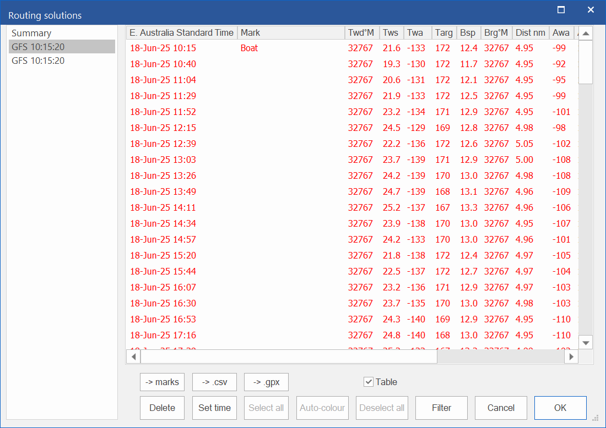

### 6.1.2 File GPX di qtVlm

In qtVlm, seleziona Route \> Export e poi seleziona la rotta da esportare. Verrà visualizzato un selettore file: scegli o crea un file nella cartella della tua regata, assicurandoti che abbia l'estensione .gpx, ad es. gpxroute.gpx.

Selezionando salva, apparirà questo popup. Seleziona **Detail** e assicurati che **As list of WPs** non sia selezionato.

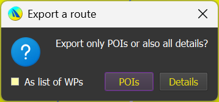

**Importante**: è il modo migliore e più affidabile per trasferire la rotta da qtVlm ad AGL.

### 6.1.3 File CSV di qtVlm

**Importante**: questo metodo è supportato, ma richiede che l'utente inserisca un formato di data corretto e i risultati sono meno precisi per l'arrotondamento dei valori che fa qtVlm. Usa il percorso gpx.

Dalla scheda Route Logbook, seleziona **Export (CSV Format)**, quindi seleziona o crea un file nella cartella della tua regata con estensione .csv, ad es. route.csv. Assicurati che **With raw data** sia disattivato.

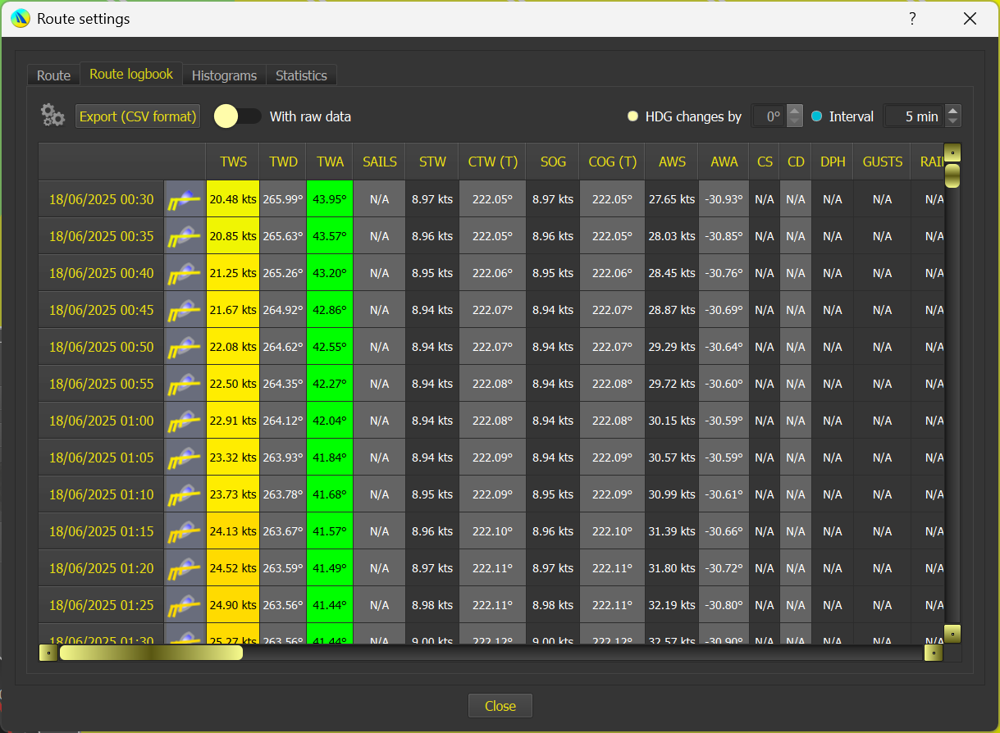

## 6.2 Caricamento del File

Al primo utilizzo, verrà aperto un selettore file come mostrato di seguito.

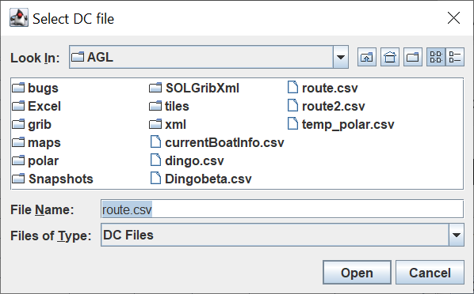

Seleziona il file da importare e fai clic su **Apri**. Se il file è valido, verrà aperta la DC Data Table.

Se il file non è valido, AGL lo dice e la DC Data Table non viene avviata.

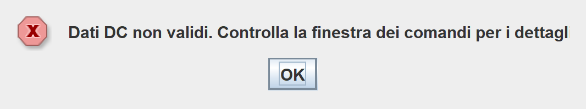

Se il file già impostato non può più essere letto, AGL chiede se selezionarne uno nuovo.

La finestra dei comandi (cmd) dice cosa non va, ad esempio una colonna mancante o la riga con dati errati. Correggi il file, oppure scegline un altro. La tabella si apre poi come mostrato sotto, pronta per l'uso.

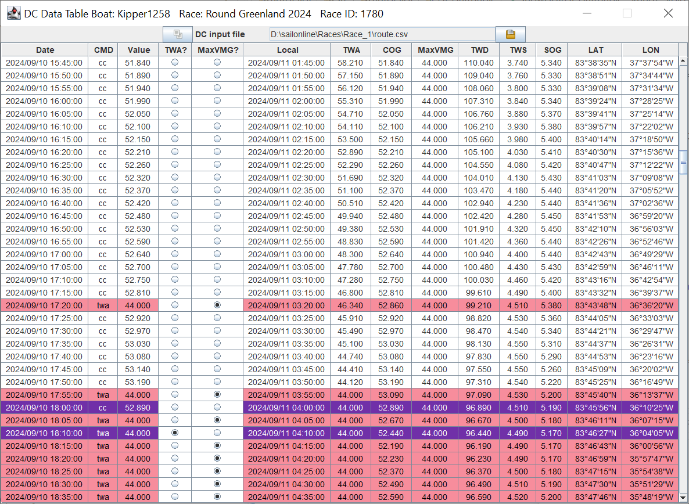

**Nota:** AGL controlla il file dei DC e carica i nuovi dati ogni volta che viene modificato (vedi [6.3 Rilevamento delle Modifiche al File DC](0600-dc-data-table.md#63-rilevamento-delle-modifiche-al-file-dc)). Questo permette all'utente di riutilizzare lo stesso file a ogni importazione dal file csv.

Durante il caricamento, AGL ha verificato se ci sono DC al di fuori dell'intervallo ottimale di VMG e, in tal caso, ha impostato automaticamente il comando su “twa” e il valore su maxVMG. Questo può essere disattivato deselezionando il pulsante di opzione MaxVMG, nel qual caso il valore e il comando verranno impostati su COG/cc.

### 6.2.1 Il Pannello di Controllo

Nella parte alta della DC Data Table c'è il pannello di controllo.

- **Ore di DC da inviare** è usato da **Invia ore** (vedi [6.4.2 Invia ore (Send Hr)](0600-dc-data-table.md#642-invia-ore-send-hr)). Il pulsante  accanto invia i DC selezionati, come fa **Invia**.
- **File dei DC** mostra il file caricato. Il pulsante  apre il selettore file (vedi [6.5.3 Pulsante Select File](0600-dc-data-table.md#653-pulsante-select-file)).
- **Filtra percorso (m)** ripulisce una rotta GPX mentre viene caricata (vedi [6.2.2 Filtro della Rotta](0600-dc-data-table.md#622-filtro-della-rotta)).
- **Colonne** mostra o nasconde le colonne (vedi [6.2.4 Colonne](0600-dc-data-table.md#624-colonne)).

La barra del titolo della finestra dice **Tabella DC | <barca> | aggiornata <ora>**. Dopo il caricamento di una rotta GPX può finire anche con **| Il filtro ha rimosso N punti** e **| N punti sospetti esclusi**.

### 6.2.2 Filtro della Rotta

Una rotta GPX di qtVlm può contenere punti che non aggiungono nulla, come un punto pochi secondi dopo quello precedente. Se lasciati, diventano DC quasi duplicati o falsi blocchi di perdita di prestazioni. Quando viene caricata una rotta GPX, AGL toglie:

- ogni punto che si trova entro la tolleranza dalla retta tra i punti vicini, e
- il primo di due punti che distano nel tempo meno del tempo di recupero.

Il primo punto (la barca) resta sempre. Spunta la casella per attivare il filtro e inserisci la tolleranza in metri nella casella accanto (il valore predefinito è 2). Il file viene ricaricato quando cambi la tolleranza, e la spunta ha effetto al caricamento successivo (**Ricarica**). Il file GPX in sé non viene modificato e i file CSV non vengono filtrati. Il Riscontro mostra una riga quando sono stati tolti dei punti, ad esempio "Route filter: 766 points to 205".

### 6.2.3 Punti Sospetti e la Colonna Escludi?

Mentre onora un waypoint, qtVlm a volte mette in una rotta GPX un tratto molto breve con un brusco cambio di rotta. Quando una rotta viene caricata, AGL spunta nell'ultima colonna, **Escludi?**, il primo punto di un tratto del genere. Un punto è sospetto quando il suo tratto dura meno della metà del tempo mediano dei tratti, il tratto che segue non è breve e la rotta gira bruscamente entrando nel tratto e poi torna indietro nell'altro verso. Una virata o un'abbattuta gira in un verso e resta girata, quindi non viene segnalata. Il primo punto non viene mai segnalato.

Una riga spuntata è magenta e non mostra valori propri. I punti esclusi non vengono inviati (Invia, Invia fino a, Invia ore, Aggiungi e Copia), non vengono disegnati sulla traccia grigia dei DC e vengono lasciati fuori quando si calcolano i tratti delle altre righe. Puoi spuntare qualsiasi altro punto, o togliere la spunta a uno sospetto, e la tabella viene ricalcolata subito. Il file non viene modificato e ricaricarlo riparte dalla scelta di AGL. AGL scrive ogni rilevamento e ogni spunta o tolta di spunta in `logs/route_suspects_<race id>.csv`, così le regole potranno essere messe a punto in seguito.

### 6.2.4 Colonne

Il pulsante **Colonne** apre la finestra Mostra o nascondi colonne, con una casella per ogni colonna. Date, CMD, Value ed Escludi? non possono essere nascoste (sono in grigio e spuntate). Le colonne DC e PL non sono usate nella tabella del file, quindi non sono elencate. La scelta viene conservata per la regata e applicata di nuovo a ogni caricamento. All'inizio non è nascosto nulla. L'Editor DC ha una scelta propria.

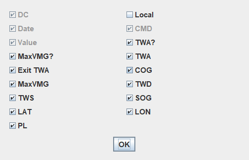

## 6.3 Rilevamento delle Modifiche al File DC

AGL controlla il file DC caricato nella DC Data Table, quindi non devi ricaricarlo a mano.

### 6.3.1 Come Funziona

- Quando AGL si avvia, se il file di input dei DC mostrato nella DC Data Table esiste già, AGL inizia subito a controllarlo. La DC Data Table resta nascosta finché non serve. Se il file non esiste ancora, nulla viene controllato finché non apri la DC Data Table per la prima volta.
- Quando il file dei DC cambia (ad esempio dopo che esporti una nuova rotta da qtVlm), AGL attende un momento per assicurarsi che il file sia stato scritto per intero, poi lo ricarica. La DC Data Table viene portata in primo piano e, se la finestra principale di AGL era ridotta a icona, viene prima ripristinata.
- Ogni volta che la DC Data Table si carica, i DC vengono anche tracciati nella finestra grafica come una traccia grigia: un punto grigio per ogni DC, uniti da una linea, con un'etichetta (giorno e ora) ogni quattro DC. Il pulsante  nella barra degli strumenti della grafica attiva e disattiva la traccia. La traccia compare dopo che la DC Data Table è stata mostrata. La DC Data Table invia la traccia direttamente alla grafica. Non scrive un file. I punti esclusi (vedi [6.2.3 Punti Sospetti e la Colonna Escludi?](0600-dc-data-table.md#623-punti-sospetti-e-la-colonna-escludi)) vengono lasciati fuori. Qui sotto un esempio della traccia grigia.

  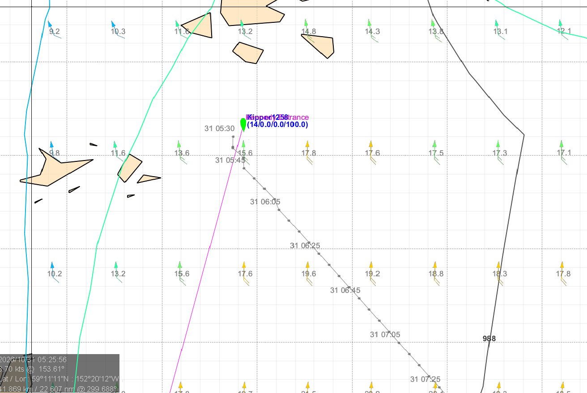

### 6.3.2 Modifiche a un File Diverso

qtVlm può salvare le sue esportazioni in una cartella diversa da quella che AGL sta controllando. Per evitarlo, quando qtVlm mostra la conferma di Save As dopo che esporti una rotta o un roadbook, AGL controlla per 30 secondi se ci sono modifiche ai file dello stesso tipo nella cartella della regata, nella cartella di qtVlm e nella cartella dei grib. Se trova un file modificato che non è quello in uso, chiede:

“È stata rilevata una modifica in &lt;file&gt; che non è il file in uso (&lt;file attuale&gt;). Usare invece quel file?”

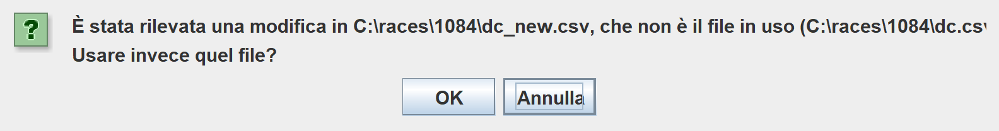

- **OK** carica il file modificato, che diventa il file di input dei DC.

- **Annulla** mantiene il file attuale.

Ti viene chiesto una volta per ogni modifica a un file, qualunque sia la tua risposta.

**Nota:** se il file dei DC non può essere letto all'avvio di AGL, AGL non dice nulla. Te lo verrà chiesto quando aprirai la DC Data Table.

## 6.4 Impostazione dei DC

I DC devono prima essere trasferiti nell'area Delay Commands nella scheda Controllo DC della finestra principale di AGL. Sono disponibili quattro opzioni.

**Invia fino a**, **Invia ore**, **Invia** e **Aggiungi** fanno tre cose in un solo passaggio: mettono i DC nell'area DC, li controllano e aprono l'Editor DC (vedi [6.6 L'Editor DC](0600-dc-data-table.md#66-leditor-dc)) al posto della DC Data Table, che viene nascosta. La grafica si adatta alla nuova traccia. Le righe spuntate **Escludi?** non vengono inviate. **Copia** copia soltanto i DC negli appunti. Se non è selezionato nulla, nessuna di queste operazioni cancella l'area DC.

### 6.4.1 Invia fino a (Send To)

I DC possono essere inviati al **Controllo DC** utilizzando l'opzione **Invia fino a** . Tutti i DC dalla prima riga della tabella fino al DC selezionato incluso verranno inviati al **Controllo DC**. Nell'esempio seguente, tutti i DC fino a e incluso **2024/09/18 12:25:00** verranno inviati al **DC Checker.**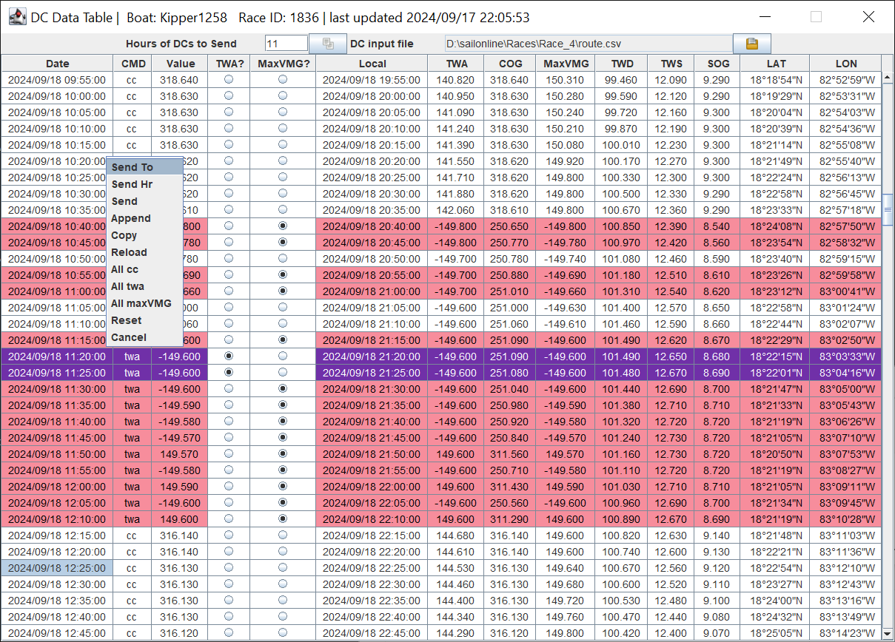

### 6.4.2 Invia ore (Send Hr)

Questa opzione invierà tutti i DC precedenti al numero di ore specificato in **Ore di DC da inviare** nella barra dei parametri in cima alla tabella. Il numero di ore (11) viene aggiunto all'orario del primo DC (2024/09/17 23:55:00) e tutti i DC fino a 11 ore dopo (2024/09/18 10:55:00) vengono trasferiti al **Controllo DC**. I DC inviati vengono anche evidenziati come mostrato di seguito.

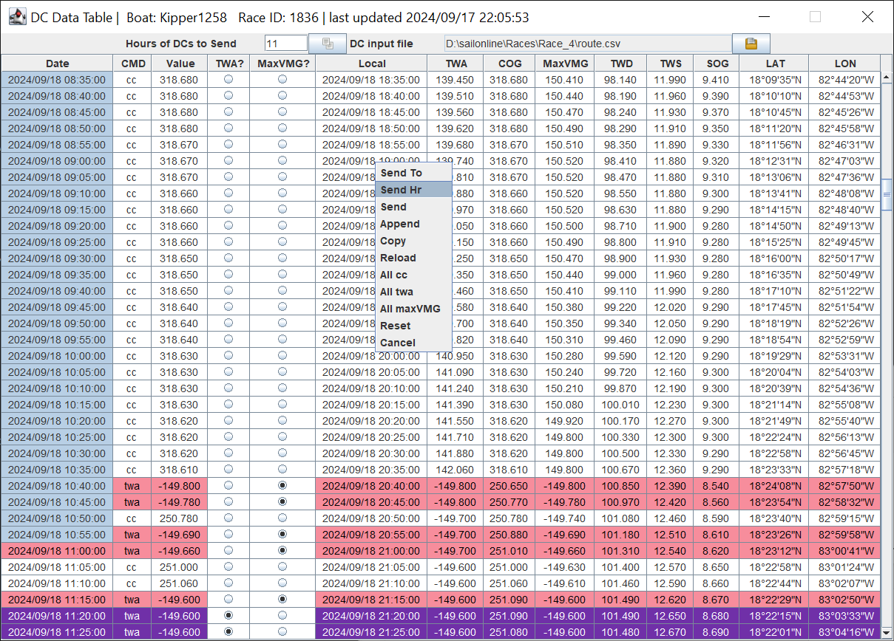

### 6.4.3 Invia (Send)

I seguenti passaggi permettono di farlo.

1.  Seleziona i DC desiderati nella DC Data Table facendo clic nella prima cella e tenendo premuto il pulsante sinistro del mouse per coprire le righe di interesse. Le righe non devono essere contigue.

    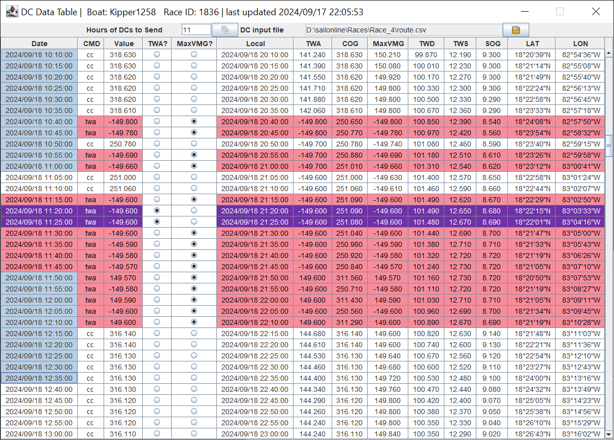

2.  Il trasferimento può avvenire in uno dei tre modi seguenti

    - Utilizzando il pulsante  in cima alla tabella.

    - Utilizzando l'opzione **Invia** del clic con il tasto destro del mouse

      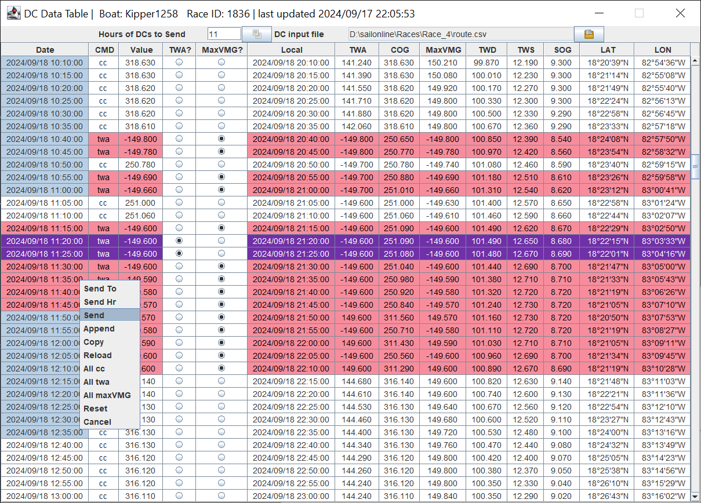

3.  Utilizzando Ctrl C / Ctrl V oppure il clic con il tasto destro **Copia** e Ctrl V nell'area **Delay Command** della scheda **Controllo DC**. (Questo mette soltanto i DC lì. Controllali tu.)

I DC verranno ora trasferiti e saranno pronti per essere controllati e impostati nel modo consueto.

### 6.4.4 Aggiungi (Append)

Tutti i trasferimenti di DC precedenti hanno cancellato l'area **Comandi ritardati** sostituendola con un insieme completamente nuovo. È possibile aggiungere i DC selezionati a quelli già inviati al **DC Checker.** Per aggiungerli, seleziona i DC desiderati (devono essere selezionati come mostrato di seguito) e usa l'opzione **Aggiungi** .

I DC selezionati vengono aggiunti alla fine di quelli esistenti come mostrato di seguito, e possono essere elaborati nel modo consueto. Aggiunte fuori sequenza e duplicati non sono un problema: ci penserà il **Controllo DC**.

## 6.5 Altri Pulsanti

### 6.5.1 Menu del Tasto Destro

Il menu del tasto destro presenta le seguenti opzioni, come mostrato di seguito.

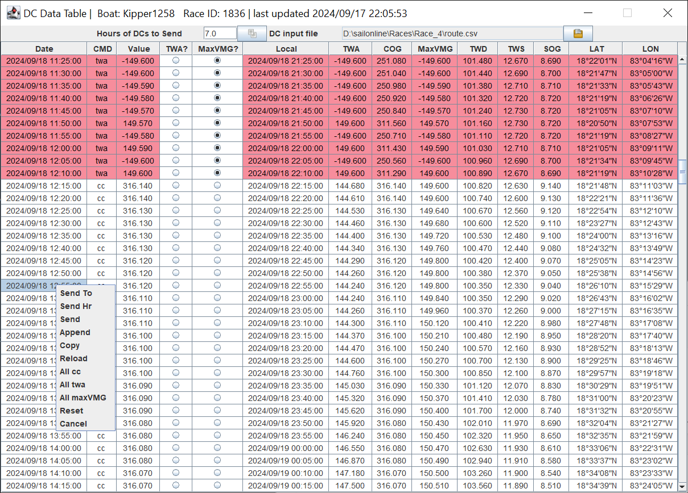

**Invia fino a:** Invia al DC Checker tutti i DC dalla prima riga fino alla riga selezionata.

**Invia ore:** Invia al DC Checker il numero di ore di DC specificato.

**Invia**: Invia al DC Checker i DC selezionati.

**Aggiungi:** Aggiunge i DC selezionati a quelli già presenti nel DC Checker.

**Copia:** Copia i DC selezionati negli appunti.

**Ricarica:** Ricarica il file di input DC attualmente selezionato. Utile se si utilizza lo stesso nome file per ogni aggiornamento dei DC.

**Reimposta:** Carica di nuovo il file e riporta la tabella in cima.

**All cc:** Imposta i valori dei DC selezionati sui valori COG e il comando su **cc**.

**All twa:** Imposta i valori dei DC selezionati sui valori **TWA** e il comando su **twa**.

**All maxVMG:** Imposta i valori dei DC selezionati su **MaxVMG** e il comando su **twa**.

**Annulla:** Chiude il menu a comparsa senza eseguire alcuna azione.

### 6.5.2 Pulsante Send DC 

Stessa funzione di **Invia** sopra. Il suggerimento dice "Transfers selected DCs to DC area and checks them".

### 6.5.3 Pulsante Select File 

Apre il selettore file.

**Apri** aprirà il file selezionato e aggiornerà la tabella. **Annulla** non farà nulla.

## 6.6 L'Editor DC

L'Editor DC è la stessa tabella, che mostra i DC presenti nell'area DC invece dei DC di un file. Usalo per vedere i DC su cui ha lavorato il controllo e per cambiarne l'ora, il comando o il valore prima di impostarli. Nulla di ciò che fai qui arriva al server finché non imposti i DC.

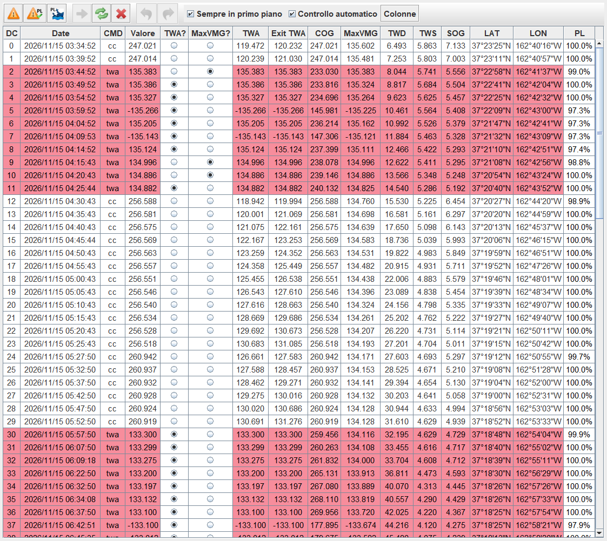

### 6.6.1 Aprire l'Editor DC

L'Editor DC si apre quando usi **Invia**, **Invia fino a**, **Invia ore** o **Aggiungi** nella DC Data Table, e quando fai clic sul pulsante Editor DC  nella barra degli strumenti della Gui o della grafica. La finestra conserva dimensione e posizione per ogni regata.

### 6.6.2 La Barra degli Strumenti

Da sinistra, i pulsanti fanno ciò che fanno gli stessi pulsanti nella barra degli strumenti della Gui:

-  **Check** controlla i DC. Con **Usa la perdita di prestazione** spuntato compare anche  **Check PL**, che li controlla con la perdita di prestazioni (vedi [5.1.10 Pulsante Check DCs](0500-using-agl.md#5110-pulsante-check-dcs)).
-  il BBQ Checker ( con la perdita di prestazioni), vedi [5.2.2 Il BBQ Checker](0500-using-agl.md#522-il-bbq-checker).
-  applica i DC al server. È in grigio se non è cambiato nulla.
-  ricarica i DC dal server. Se hai cambiato i DC, AGL chiede prima.

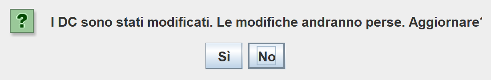

-  **Elimina** toglie i DC selezionati (vedi [6.6.6 Eliminare i DC](0600-dc-data-table.md#666-eliminare-i-dc)).
-  e la stessa icona rovesciata annullano e ripetono l'ultima modifica. Sono le stesse della barra degli strumenti della grafica, quindi una modifica fatta sulla grafica si può annullare qui.

Le due caselle sono **Sempre in primo piano**, che tiene la finestra sopra le altre, e **Controllo automatico**, che all'inizio è spuntata. Con **Controllo automatico** attivo, ogni modifica è seguita da un controllo, quindi i valori nella tabella e la traccia nella grafica sono aggiornati. La grafica mantiene lo zoom. **Colonne** apre la finestra Mostra o nascondi colonne.

### 6.6.3 Le Colonne

| **Colonna** | **Cosa mostra** |
|---|---|
| DC | Il numero del DC, contando da 0. È il numero che la grafica mostra per quel DC, così un DC scelto sulla grafica si trova qui. I DC PL non hanno numero. Sempre visibile. |
| Local | L'ora nel tuo fuso orario. All'inizio nascosta. |
| Date | L'ora in cui il DC si attiva, in UTC. |
| CMD | Il comando, **cc** o **twa**. |
| Value | Il valore del comando, in gradi. |
| TWA? e MaxVMG? | Scelgono cosa segue il DC: il proprio TWA oppure il limite maxVMG. |
| TWA | L'angolo del vento reale della barca dopo il DC. |
| Exit TWA | L'angolo del vento reale alla fine del tratto. |
| COG | La rotta sul fondo. |
| MaxVMG | Il miglior angolo rispetto al vento, di bolina o di poppa, per il vento a quel DC. |
| TWD, TWS, SOG | Direzione del vento, velocità del vento e velocità della barca. |
| LAT, LON | La posizione, in gradi e minuti. |
| PL | La perdita di prestazioni al DC in percentuale. 100% significa nessuna perdita. Un valore sotto il 93% è mostrato in arancione grassetto. |

I valori vengono dall'ultimo controllo. Il pulsante **Colonne** mostra o nasconde tutte tranne DC, Date, CMD e Value, e la scelta viene conservata per la regata.

### 6.6.4 Modificare i DC

- Fai clic su una cella **Date**, **CMD** o **Value** e cambiala. Basta un clic. La data si cambia una parte alla volta (giorno, ora, minuto, secondo).
- Per scegliere una riga senza modificarla, fai clic sul suo numero nella colonna DC. Ctrl + clic aggiunge o toglie una riga, Maiusc + clic o un trascinamento sui numeri sceglie un intervallo. Premi Esc, o fai clic sulla parte vuota della tabella sotto le righe, per cancellare la selezione.
- Fai clic sulla scelta **MaxVMG?** e il valore del DC segue il limite maxVMG. Il limite si sposta un poco a ogni controllo, quindi il valore lo segue. AGL lo fa fino a cinque volte dopo una modifica. Una scelta **TWA?** mantiene il DC a quell'angolo.
- Una riga è evidenziata quando il suo TWA è fuori dai limiti maxVMG. AGL imposta una riga così su maxVMG per te, come se avessi spuntato la sua scelta **MaxVMG?**, quindi l'area DC risulta modificata e, con **Controllo automatico** attivo, i DC vengono controllati di nuovo.
- Il menu del tasto destro contiene **Copia**, **All cc**, **All twa**, **All maxVMG** e **Rimuovi**, che agiscono sulle righe selezionate.

### 6.6.5 Blocchi di Perdita di Prestazioni

Un blocco di perdita di prestazioni (PL) è il gruppo di DC che eseguono una virata o un'abbattuta. Il blocco compare come un solo DC nella colonna **DC**: il suo primo DC (il DC di entrata) porta il numero. I DC PL hanno lo sfondo verde chiaro e il testo grigio e non si possono modificare. L'ultimo DC del blocco (il DC di uscita) si può modificare per CMD e Value, ma non per Date.

Per spostare il blocco, cambia la **Date** del DC di entrata. Tutto il blocco si sposta con lui. Per togliere un blocco, elimina il suo DC di entrata. I DC PL se ne vanno con lui.

### 6.6.6 Eliminare i DC

**Elimina**  toglie i DC selezionati dall'area DC. Il server non viene toccato finché non imposti i DC. Se non è selezionato nulla, AGL chiede se eliminarli tutti.

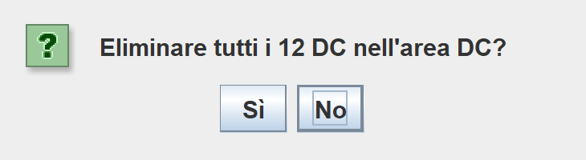
