# 6 DC Data Table

La DC Data Table carica i DC da un file di rotta creato dal tuo pacchetto di routing. Questo capitolo spiega come esportare la rotta, come la DC Data Table la legge, come i DC vengono inviati al DC Checker e cosa fanno gli altri pulsanti.

## 6.1 Esportazione dei Dati di Percorso dal Pacchetto di Routing

### 6.1.1 File GPX di Expedition

Nei risultati dell'ottimizzazione, seleziona la rotta da esportare e fai clic sul pulsante -\> gpx. Salva il file nella cartella della tua regata, assicurandoti che abbia estensione .gpx. Se la rotta non viene selezionata, Expedition esporterà entrambe le rotte e AGL utilizzerà solo l'ultima rotta presente nel file.

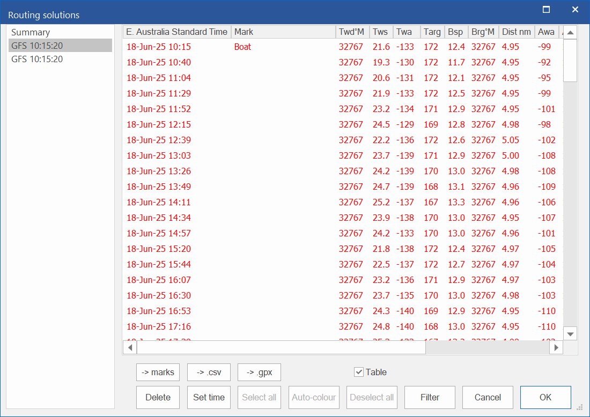

### 6.1.2 File GPX di qtVlm

In qtVlm, seleziona Route \> Export e poi seleziona la rotta da esportare. Verrà visualizzato un selettore file: scegli o crea un file nella cartella della tua regata, assicurandoti che abbia l'estensione .gpx, ad es. gpxroute.gpx.

Selezionando salva, apparirà questo popup. Seleziona **Detail** e assicurati che **As list of WPs** non sia selezionato.

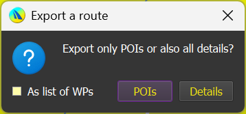

### 6.1.3 File CSV di qtVlm

Dalla scheda Route Logbook, seleziona **Export (CSV Format)**, quindi seleziona o crea un file nella cartella della tua regata con estensione .csv, ad es. route.csv. Assicurati che **With raw data** sia disattivato.

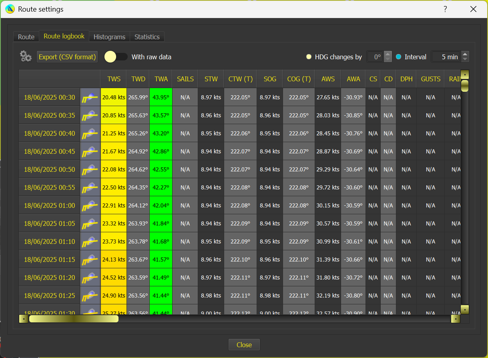

## 6.2 Caricamento del File

Al primo utilizzo, verrà aperto un selettore file come mostrato di seguito.

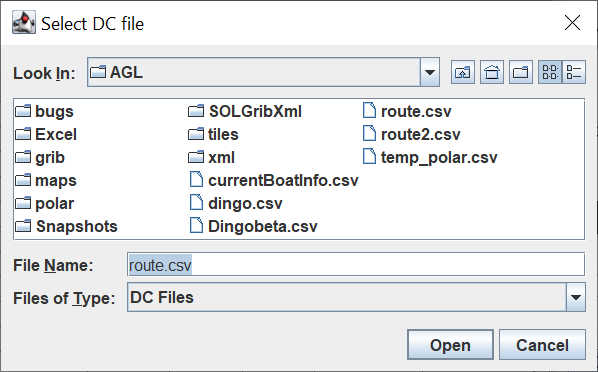

Seleziona il file da importare e fai clic su **Apri**. Se il file è valido, verrà aperta la DC Data Table.

Se il file non è valido, AGL lo dice e la DC Data Table non viene avviata.

La finestra dei comandi (cmd) dice cosa non va, ad esempio una colonna mancante o la riga con dati errati. Correggi il file, oppure scegline un altro. La tabella si apre poi come mostrato sotto, pronta per l'uso.

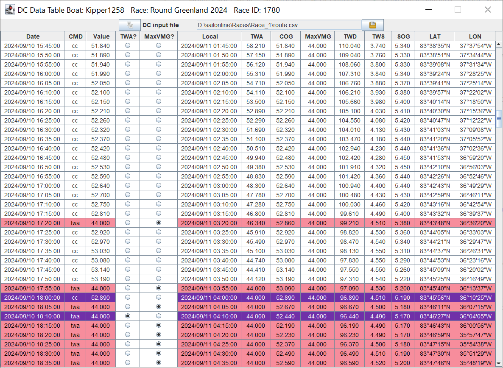

**Nota:** AGL controlla il file dei DC e carica i nuovi dati ogni volta che viene modificato (vedi **Rilevamento delle Modifiche al File DC** più avanti). Questo permette all'utente di riutilizzare lo stesso file a ogni importazione dal file csv.

Durante il caricamento, AGL ha verificato se ci sono DC al di fuori dell'intervallo ottimale di VMG e, in tal caso, ha impostato automaticamente il comando su “twa” e il valore su maxVMG. Questo può essere disattivato deselezionando il pulsante di opzione MaxVMG, nel qual caso il valore e il comando verranno impostati su COG/cc.

## 6.3 Rilevamento delle Modifiche al File DC

AGL controlla il file DC caricato nella DC Data Table, quindi non devi ricaricarlo a mano.

### 6.3.1 Come Funziona

- Quando AGL si avvia, se il file di input dei DC mostrato nella DC Data Table esiste già, AGL inizia subito a controllarlo. La DC Data Table resta nascosta finché non serve. Se il file non esiste ancora, nulla viene controllato finché non apri la DC Data Table per la prima volta.
- Quando il file dei DC cambia (ad esempio dopo che esporti una nuova rotta da qtVlm), AGL attende un momento per assicurarsi che il file sia stato scritto per intero, poi lo ricarica. La DC Data Table viene portata in primo piano e, se la finestra principale di AGL era ridotta a icona, viene prima ripristinata.
- Ogni volta che la DC Data Table si carica, i DC vengono anche tracciati nella finestra grafica come una traccia grigia: un punto grigio per ogni DC, uniti da una linea, con un'etichetta (giorno e ora) ogni quattro DC. Il pulsante  nella barra degli strumenti della grafica attiva e disattiva la traccia. La traccia compare dopo che la DC Data Table è stata mostrata. La DC Data Table invia la traccia direttamente alla grafica. Non scrive un file e non tocca i waypoint aggiuntivi (vedi [5.6 Waypoint Aggiuntivi](0500-using-agl.md#56-waypoint-aggiuntivi)). Qui sotto un esempio della traccia grigia.

  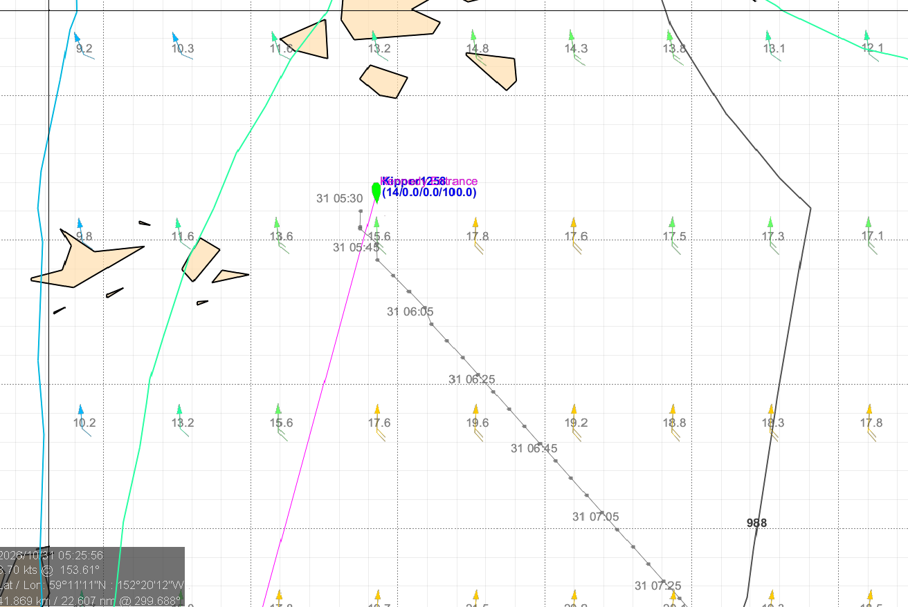

### 6.3.2 Modifiche a un File Diverso

qtVlm può salvare le sue esportazioni in una cartella diversa da quella che AGL sta controllando. Per evitarlo, quando qtVlm mostra la conferma di Save As dopo che esporti una rotta o un roadbook, AGL controlla per 30 secondi se ci sono modifiche ai file dello stesso tipo nella cartella della regata, nella cartella di qtVlm e nella cartella dei grib. Se trova un file modificato che non è quello in uso, chiede:

“È stata rilevata una modifica in &lt;file&gt; che non è il file in uso (&lt;file attuale&gt;). Usare invece quel file?”

- **OK** carica il file modificato, che diventa il file di input dei DC.

- **Annulla** mantiene il file attuale.

Ti viene chiesto una volta per ogni modifica a un file, qualunque sia la tua risposta.

**Nota:** se il file dei DC non può essere letto all'avvio di AGL, AGL non dice nulla. Te lo verrà chiesto quando aprirai la DC Data Table.

## 6.4 Impostazione dei DC

I DC devono prima essere trasferiti nell'area Delay Commands nella scheda Controllo DC della finestra principale di AGL. Sono disponibili quattro opzioni.

### 6.4.1 Invia fino a (Send To)

I DC possono essere inviati al **Controllo DC** utilizzando l'opzione **Invia fino a** . Tutti i DC dalla prima riga della tabella fino al DC selezionato incluso verranno inviati al **Controllo DC**. Nell'esempio seguente, tutti i DC fino a e incluso **2024/09/18 12:25:00** verranno inviati al **DC Checker.**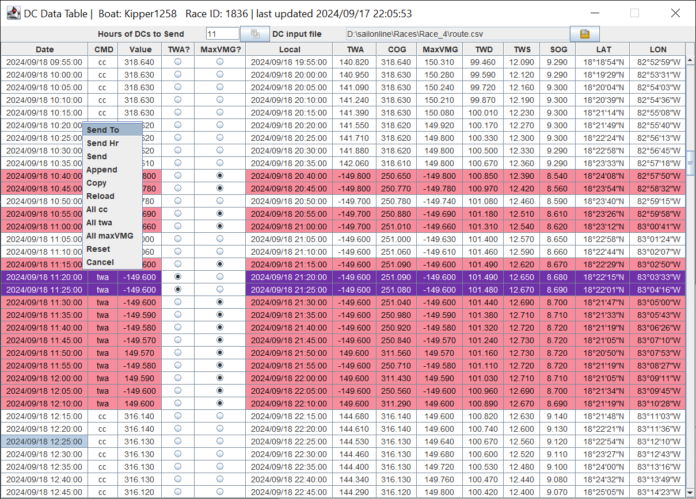

### 6.4.2 Invia ore (Send Hr)

Questa opzione invierà tutti i DC precedenti al numero di ore specificato in **Ore di DC da inviare** nella barra dei parametri in cima alla tabella. Il numero di ore (11) viene aggiunto all'orario del primo DC (2024/09/17 23:55:00) e tutti i DC fino a 11 ore dopo (2024/09/18 10:55:00) vengono trasferiti al **Controllo DC**. I DC inviati vengono anche evidenziati come mostrato di seguito.

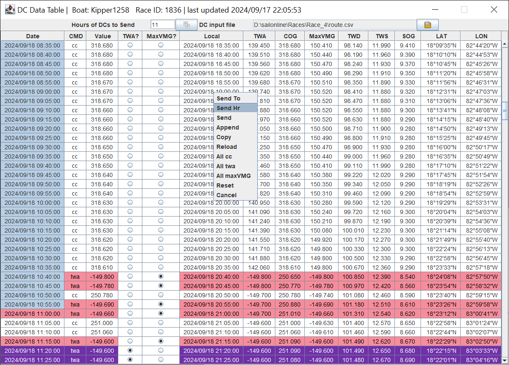

### 6.4.3 Invia (Send)

I seguenti passaggi permettono di farlo.

1.  Seleziona i DC desiderati nella DC Data Table facendo clic nella prima cella e tenendo premuto il pulsante sinistro del mouse per coprire le righe di interesse. Le righe non devono essere contigue.

    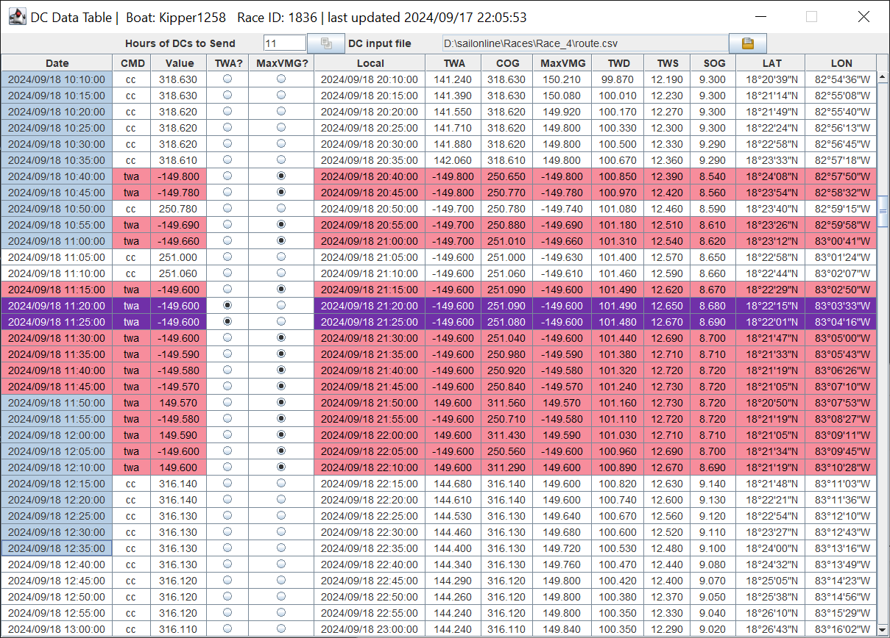

2.  Il trasferimento può avvenire in uno dei tre modi seguenti

    - Utilizzando il pulsante  in cima alla tabella.

    - Utilizzando l'opzione **Invia** del clic con il tasto destro del mouse

      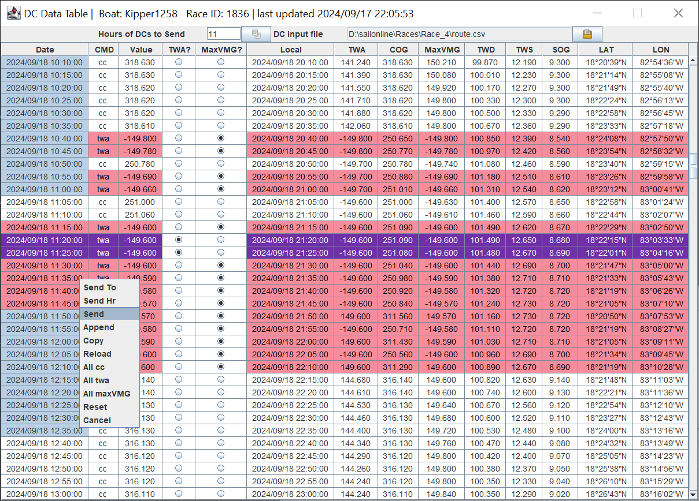

3.  Utilizzando Ctrl C / Ctrl V oppure il clic con il tasto destro **Copia** e Ctrl V nell'area **Delay Command** della scheda **Controllo DC**.

I DC verranno ora trasferiti e saranno pronti per essere controllati e impostati nel modo consueto.

### 6.4.4 Aggiungi (Append)

Tutti i trasferimenti di DC precedenti hanno cancellato l'area **Comandi ritardati** sostituendola con un insieme completamente nuovo. È possibile aggiungere i DC selezionati a quelli già inviati al **DC Checker.** Per aggiungerli, seleziona i DC desiderati (devono essere selezionati come mostrato di seguito) e usa l'opzione **Aggiungi** .

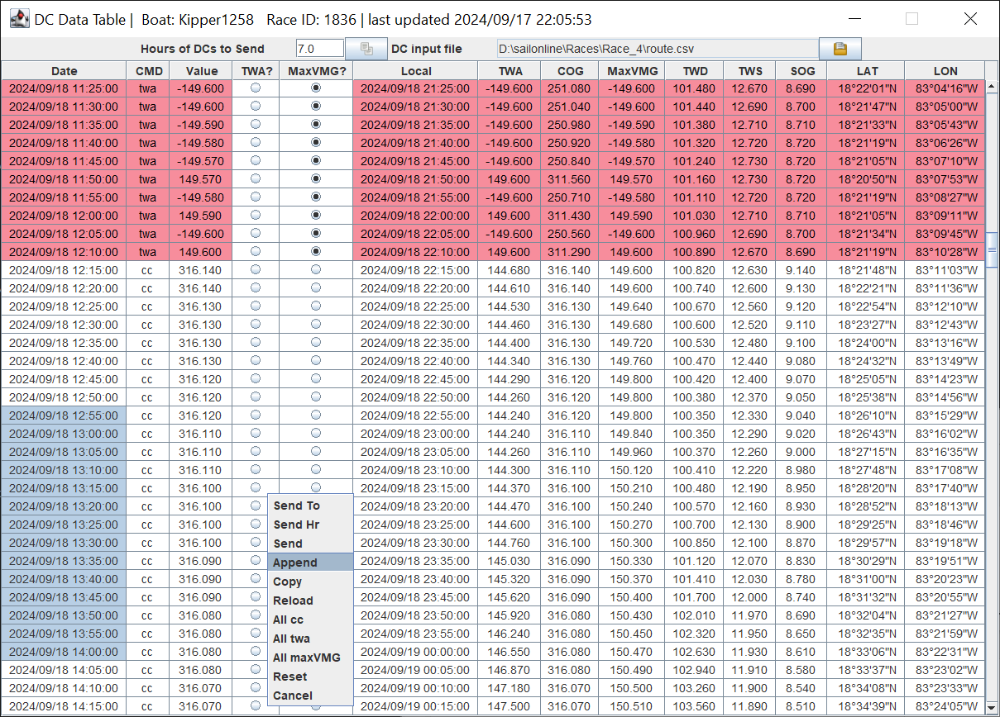

I DC selezionati vengono aggiunti alla fine di quelli esistenti come mostrato di seguito, e possono essere elaborati nel modo consueto. Aggiunte fuori sequenza e duplicati non sono un problema: ci penserà il **Controllo DC**.

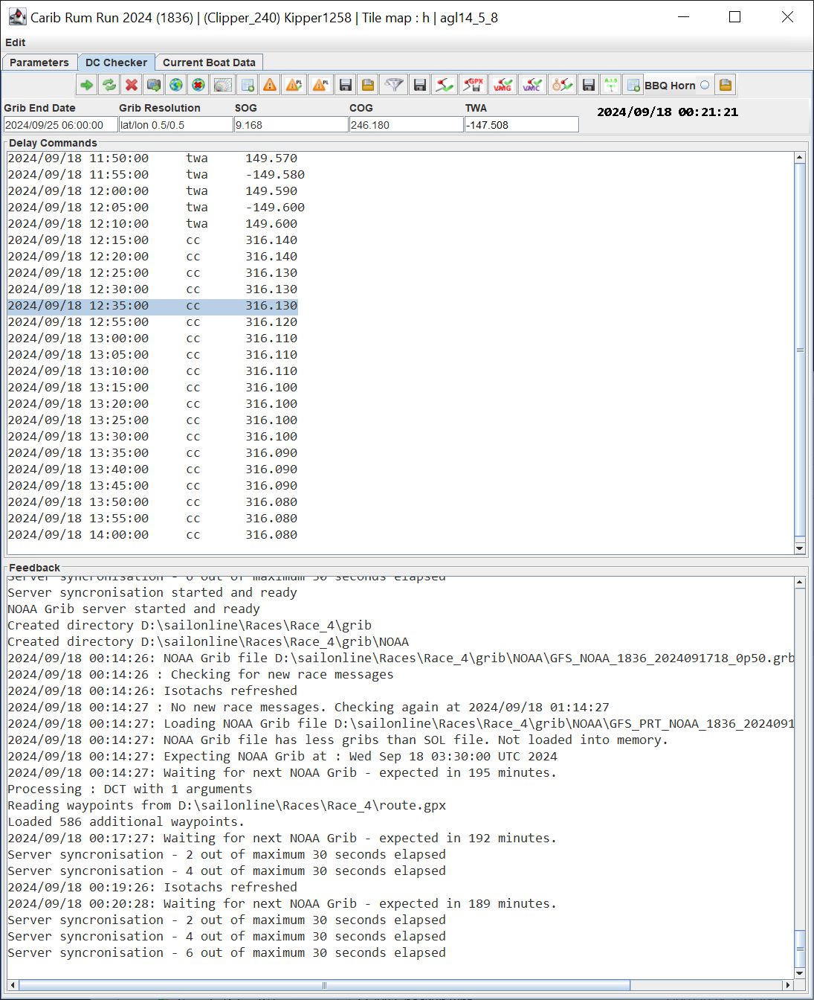

## 6.5 Altri Pulsanti

### 6.5.1 Menu del Tasto Destro

Il menu del tasto destro presenta le seguenti opzioni, come mostrato di seguito.

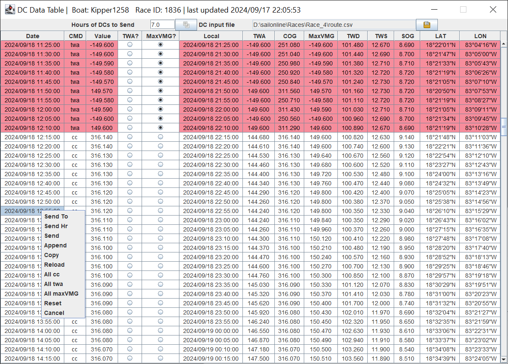

**Invia fino a:** Invia al DC Checker tutti i DC dalla prima riga fino alla riga selezionata.

**Invia ore:** Invia al DC Checker il numero di ore di DC specificato.

**Invia**: Invia al DC Checker i DC selezionati.

**Aggiungi:** Aggiunge i DC selezionati a quelli già presenti nel DC Checker.

**Copia:** Copia i DC selezionati negli appunti.

**Ricarica:** Ricarica il file di input DC attualmente selezionato. Utile se si utilizza lo stesso nome file per ogni aggiornamento dei DC.

**All cc:** Imposta i valori dei DC selezionati sui valori COG e il comando su **cc**.

**All twa:** Imposta i valori dei DC selezionati sui valori **TWA** e il comando su **twa**.

**All maxVMG:** Imposta i valori dei DC selezionati su **MaxVMG** e il comando su **twa**.

**Annulla:** Chiude il menu a comparsa senza eseguire alcuna azione.

### 6.5.2 Pulsante Send DC 

Stessa funzione di **Invia** sopra.

### 6.5.3 Pulsante Select File 

Apre il selettore file.

**Apri** aprirà il file selezionato e aggiornerà la tabella. **Annulla** non farà nulla.
