# 8 Chat

La scheda Chat di AGL replica le chat di SOL. Inoltre ha stanze Pushover e Telegram che ti inviano messaggi sugli eventi principali come BBQ, boe mancate e arrivo del Wx, e Telegram ti permette di rispondere dal telefono. Quando AGL avvia le chat per la prima volta, si apre con le stanze Pushover e inglese impostate.

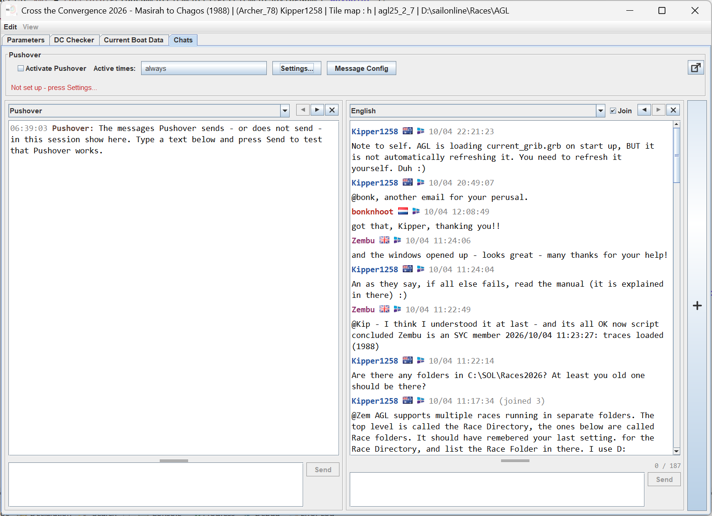

## 8.1 Gestione delle Chat

Per aggiungere un'altra stanza, fai clic sulla barra **+** e si aprirà una nuova stanza. Seleziona la stanza desiderata dall'elenco a discesa.

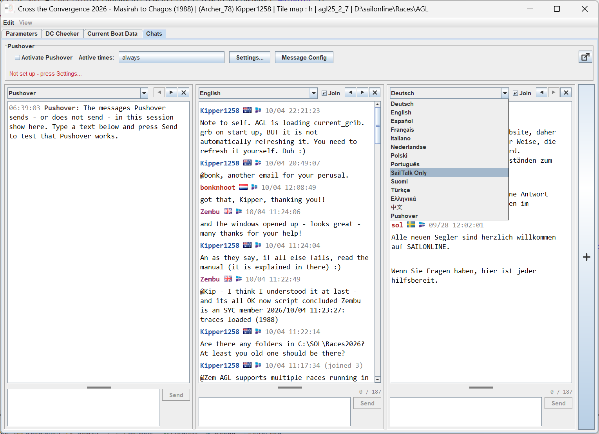

Puoi aggiungere fino a 4 chat. Le frecce ◀ ▶ in alto nella chat spostano il riquadro a sinistra o a destra. La **X** chiude la stanza.

### 8.1.1 Rispondere ai Messaggi

Un doppio clic su un utente aggiunge alla casella del messaggio **@&lt;utente&gt;@HH:MM**, pronto per continuare a scrivere il messaggio, ad es. **@Zembu@11:22**.

La casella del messaggio mostra quanti caratteri sono stati usati e divide automaticamente il messaggio entro il limite SOL di 187 caratteri. Dispone il messaggio in ordine inverso, in modo che si legga nell'ordine corretto nella pagina di chat di SOL. Le parti del messaggio hanno un suffisso e un prefisso `[p<n>]`, dove `<n>` è il numero della parte.

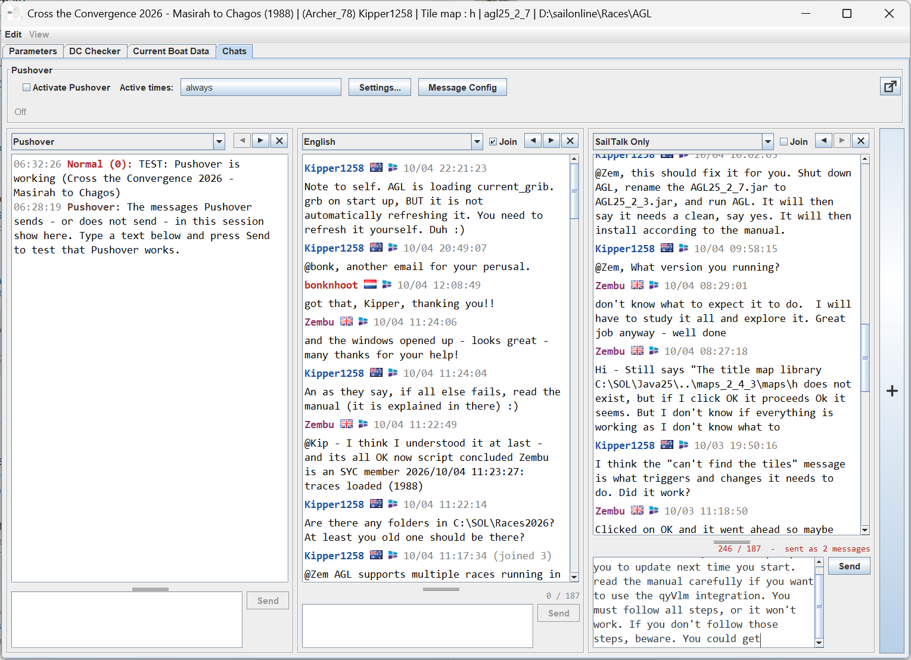

AGL cerca di riunire i messaggi in più parti in un unico messaggio se la casella **Unisci** è selezionata. I due screenshot mostrano la differenza tra il testo grezzo (a destra) e **Unisci** (a sinistra).

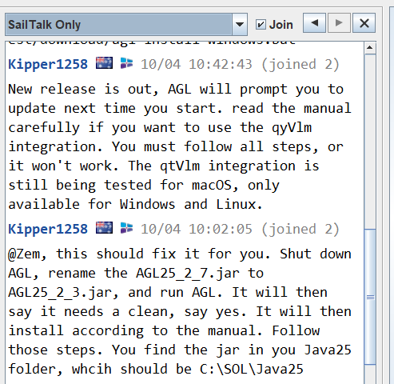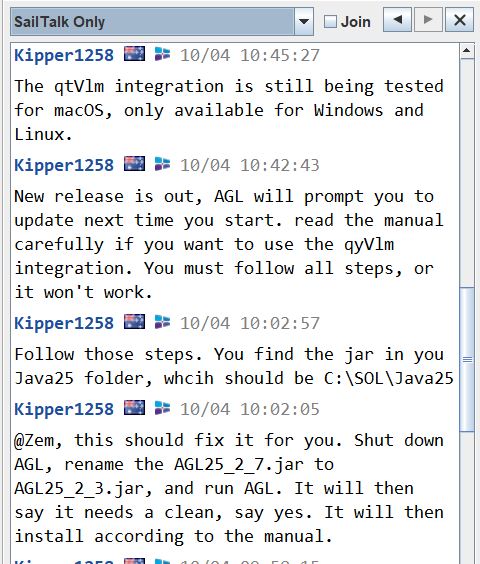

Le caselle dei messaggi possono essere ridimensionate trascinando la barra sopra la casella del messaggio. Il suggerimento qui sotto compare quando il mouse è sulla barra di ridimensionamento.

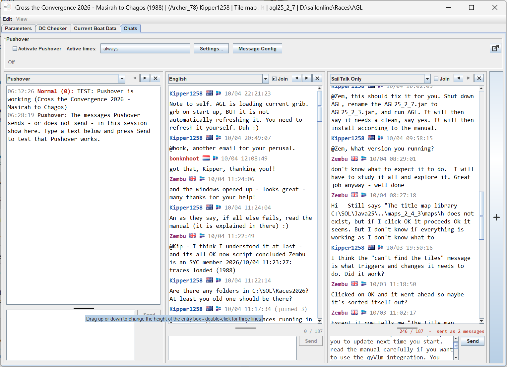

AGL mostra come emoji le emoticon di testo nelle stanze di chat SOL, quindi un messaggio digitato come `:)` si legge 🙂. Vengono modificati solo i messaggi in arrivo che leggi; ciò che invii viene inviato esattamente come lo hai digitato, e l'elenco di Pushover non viene modificato.

Un'emoticon viene modificata solo quando sta da sola: all'inizio del messaggio o dopo uno spazio o una parentesi aperta, e seguita da uno spazio, dalla fine del messaggio o da punteggiatura. Quindi "8) " in un elenco numerato, o "Re:Dave", restano com'è. Un carattere di chiusura ripetuto conta come uno, quindi `:)))` è un solo sorriso. Gli indirizzi web non vengono mai modificati; vengono mostrati come link e un clic li apre. Il naso (il `-`) è facoltativo in quelle che lo prevedono.

| Digitato | Mostrato | Digitato | Mostrato | Digitato | Mostrato |
|---|---|---|---|---|---|
| :) :-) (: | 🙂 | :P :p :-P :-p | 😛 | &gt;:( &gt;:-( | 😠 |
| :( :-( | 🙁 | :O :o :-O :-o | 😮 | O:) O:-) | 😇 |
| :'( | 😢 | :/ :-/ | 😕 | 8-) B-) | 😎 |
| :D :-D | 😀 | :\| :-\| | 😐 | &lt;3 | ❤ |
| XD | 😆 | :\* :-\* | 😘 | (y) (Y) | 👍 |
| ;) ;-) | 😉 | :S :s :-S :-s | 😖 | (n) (N) | 👎 |

### 8.1.2 Configurazione di Pushover

1. Su **pushover.net**, crea un account e un'applicazione per AGL. Carica un'icona per l'applicazione nella stessa pagina, così i messaggi di AGL la portano sul telefono: usa `agl.png` dalla cartella di installazione Java25 (è 150 x 150 e può essere caricata così com'è). L'icona si imposta sul sito di Pushover, non in AGL. L'applicazione ti dà un **API token**. La tua **user key** è nella pagina iniziale di Pushover. Entrambi sono composti da 30 lettere e cifre.

   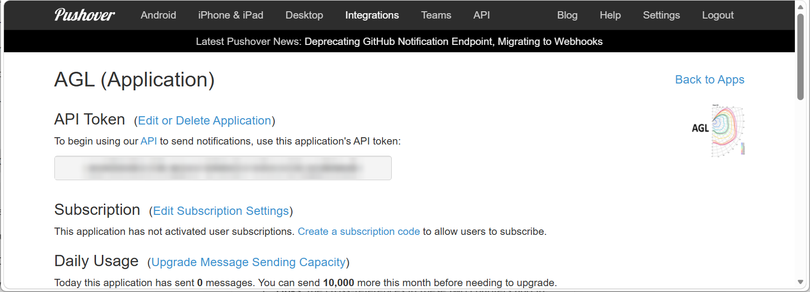

   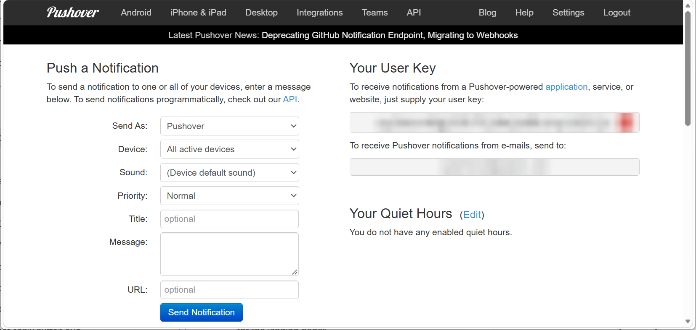

2. Nell'hub, apri il menu **Pushover** e scegli **Impostazioni...**.

   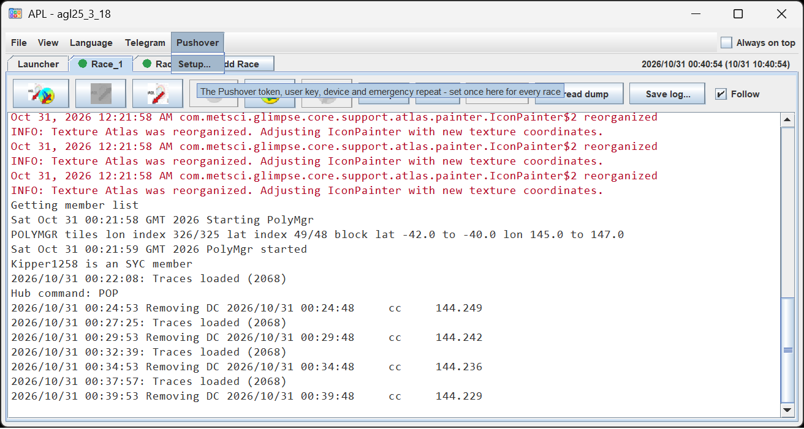

3. Inserisci l'**Token API dell’applicazione** e la tua **User key**. Se la chiave è una chiave di gruppo di consegna, seleziona **Gruppo**: AGL allora mette il nome della barca davanti a ogni messaggio, così le persone del gruppo sanno di chi è. Seleziona **Mostra il token e la chiave** se vuoi controllare ciò che hai digitato.

   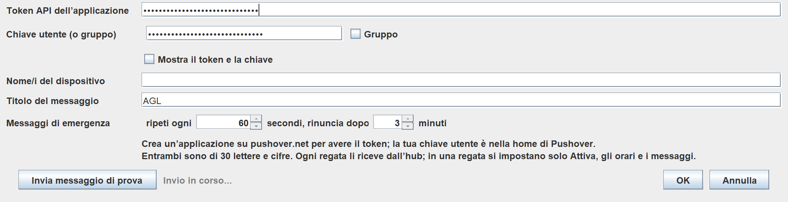

4. Lascia vuoto **Nome/i del dispositivo** per inviare a tutti i tuoi dispositivi, oppure inserisci uno o più nomi separati da virgole. Non viene usato con una chiave di gruppo.

5. **Titolo del messaggio** è il titolo sopra ogni messaggio sul telefono.

6. I **Messaggi di emergenza** si ripetono ogni numero di secondi che imposti, e rinunciano dopo il numero di minuti che imposti.

7. Premi **Invia messaggio di prova**. Il telefono dovrebbe mostrare "TEST: Pushover is working". Poi **OK**.

   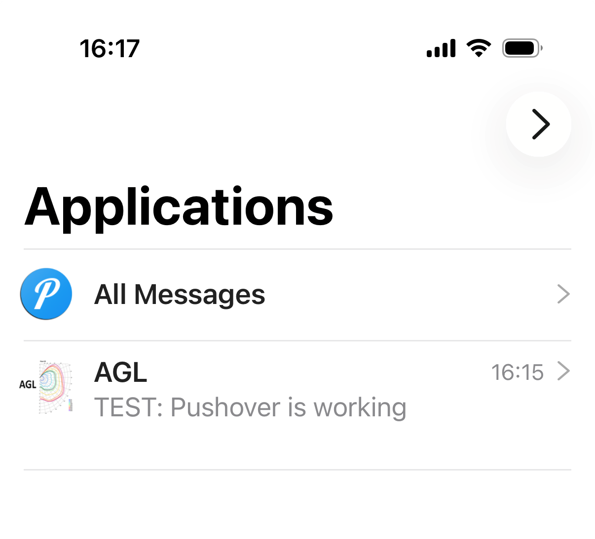

### 8.1.3 Configurazione di Telegram

Ti serve un bot Telegram tuo. Ci vogliono pochi minuti.

1. Scarica l'app Telegram per il tuo dispositivo mobile. [Telegram Messenger](https://telegram.org/) mostra quali dispositivi sono supportati e come ottenere la loro app.

2. In Telegram, cerca **@BotFather** e apri la chat. Controlla che abbia la spunta blu, che indica che è il bot ufficiale. Premi **Avvia** se te lo chiede.

   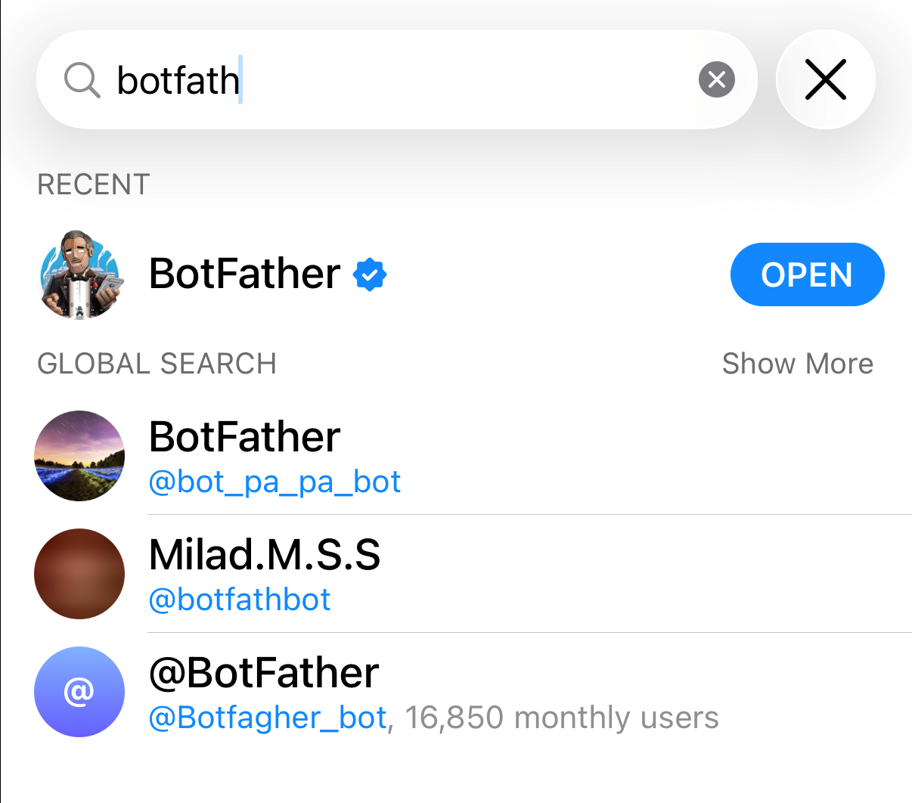

3. Invia `/newbot`. BotFather chiede un nome per il tuo bot. Digita un nome, ad esempio **AGL**. È solo il nome mostrato nella chat.

   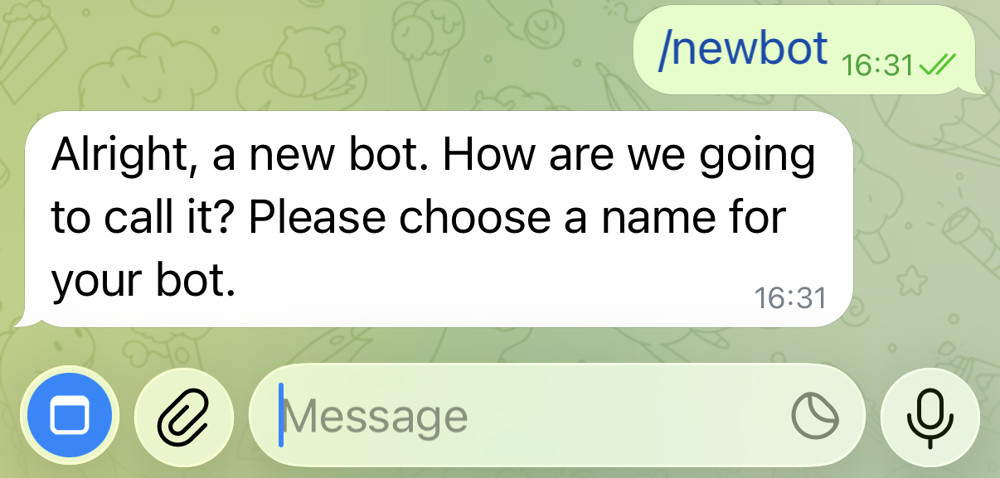

4. BotFather ora chiede uno username. Uno username deve finire con "bot". Usa il tuo **&lt;nome barca&gt;bot**, ad es. **Kipper1258bot** per la barca **Kipper1258**. Deve essere unico su tutto Telegram, quindi BotFather lo richiede se il nome è già preso.

   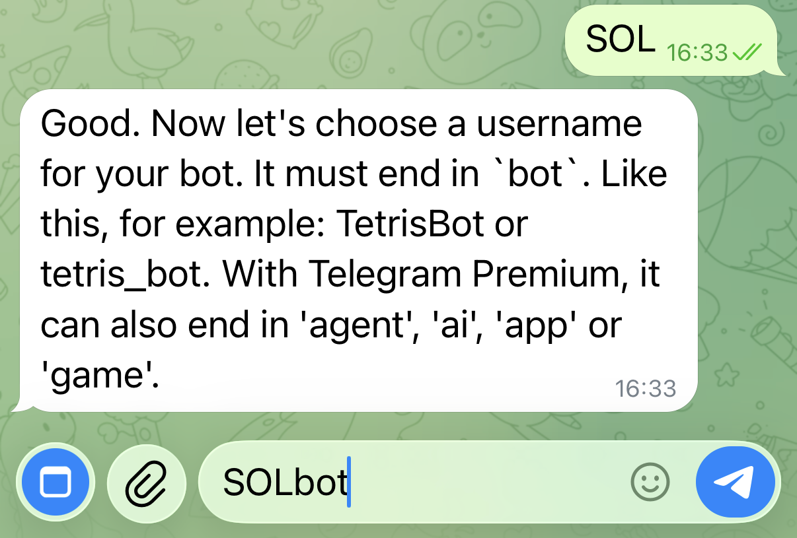

5. BotFather risponde con un **token**. Copialo. Il modo più semplice per portare il token sul tuo PC è aprire [Telegram Web](https://web.telegram.org/k/) in un browser, accedere inquadrando il codice QR con l'app Telegram sul telefono (**Settings > Devices > Link Desktop Device**), aprire lì la chat di BotFather e copiare il token.

   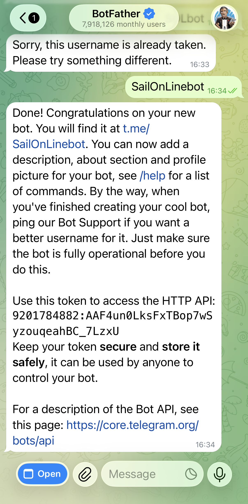

6. Nell'hub, apri il menu **Telegram** e scegli **Impostazioni...**.

   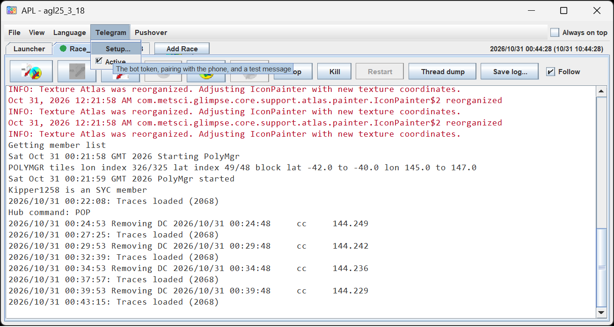
   
7. Incolla il token in **Token del bot** e seleziona **Attiva Telegram**. L'hub legge il bot solo finché questa casella è selezionata. Lo stato dovrebbe passare a **running**.

8. In Telegram, apri il tuo nuovo bot e premi **Avvia**.

9. Nell'hub, premi **Abbina**. Mostra un codice. In Telegram, invia al tuo bot `/pair` e il codice. **Paired chat** mostra poi la tua chat. Da quel momento l'hub obbedisce solo a quella chat.

10. Premi **Invia prova**. Il telefono dovrebbe mostrare il messaggio di prova.

   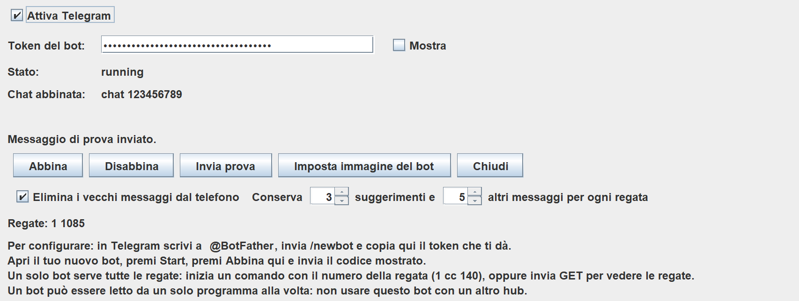

11. Quando la prova ha successo, puoi impostare l'immagine del bot su `agl.png` facendo clic su **Imposta immagine del bot**. I messaggi di AGL porteranno l'icona di AGL.

Su questo modulo ci sono anche:

- **Elimina i vecchi messaggi dal telefono** mantiene breve la conversazione Telegram. I messaggi più vecchi, e i tuoi comandi, vengono eliminati (Telegram lo permette solo per 48 ore).
- **Keep** *n* **suggerimenti e** *n* **altri messaggi per ogni regata**: i suggerimenti con pulsanti che vengono conservati, e i messaggi di ogni altro tipo (avvisi, risposte e i tuoi comandi). Un nuovo suggerimento sostituisce sempre quello ancora aperto.
- **Disabbina** fa sì che AGL smetta di obbedire alla chat abbinata.

Cose da sapere:

- **Un solo bot serve tutte le regate.** Fai iniziare un comando con il numero della regata (ad esempio `1 cc 140`), oppure invia `GET` per vedere le regate. Puoi anche impostare prima la regata con `SET`.
- **Solo un programma alla volta può leggere un bot.** Non usare lo stesso bot con un altro hub.
- Nell'hub, il menu Telegram elenca le regate, con una casella **Attivo** per ciascuna. Telegram viene usato solo per le regate selezionate.

### 8.1.4 In Ogni Regata

Nella scheda Chat, seleziona **Attiva Pushover** per attivare Pushover per la regata. **Orari attivi** imposta quando Pushover può inviare; una fascia che termina prima di iniziare attraversa la mezzanotte, ad esempio dalle 22:00 alle 06:00.
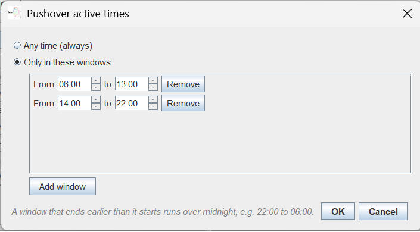 

**Configurazione messaggi** mostra i messaggi. Per ognuno puoi:

- selezionare **Pushover** e **Telegram** per scegliere dove va,
- cambiare il **testo**. Lascialo vuoto per il testo standard. `<time left>` e `<time>` vengono riempiti con il tempo che manca all'evento e con l'ora, e `<mark name>` con la boa,
- impostare la **priorità**: Lowest non invia nessun avviso sul telefono, Low è silenziosa, Normal, High ignora le ore di silenzio del telefono ed Emergency si ripete finché non confermi,
- impostare gli **orari attivi**: seguire gli orari generali, a qualsiasi ora, oppure solo nelle fasce che scegli,
- impostare l'**anticipo (lead)**, in minuti, per i messaggi che ne hanno uno,
- premere il pulsante di prova per inviare subito il messaggio, come prova.

Le stanze Pushover e Telegram nella scheda Chat mostrano cosa è stato inviato, e cosa non è stato inviato e perché. Digita un testo sotto la stanza e premi **Invia** per provare che funzioni.

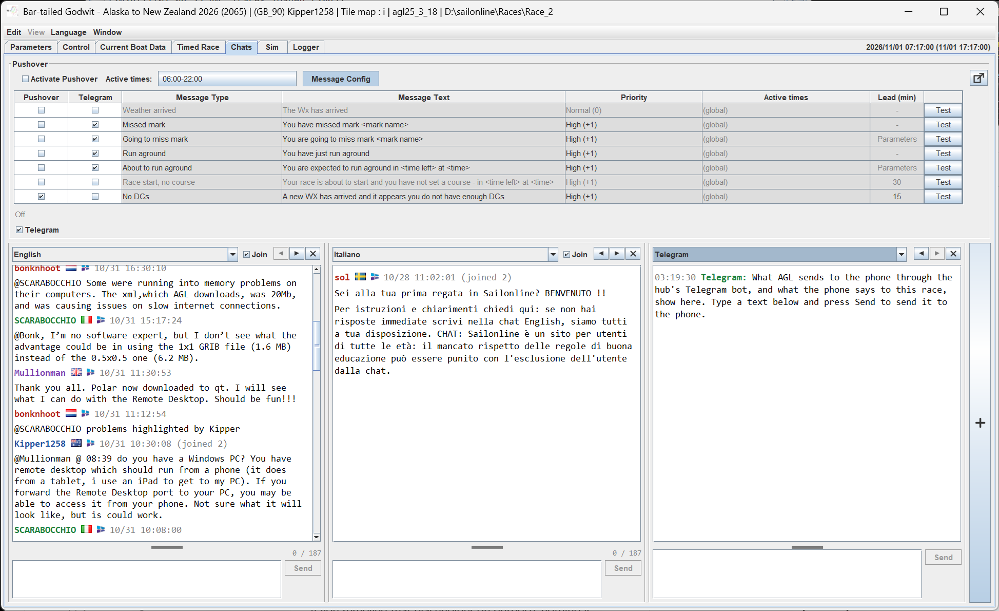

### 8.1.5 Rispondere dal Telefono

I suggerimenti di Telegram arrivano con i pulsanti **Applica** e **Ignora**. Un suggerimento compare prima sullo schermo. Se non rispondi, va anche al telefono.

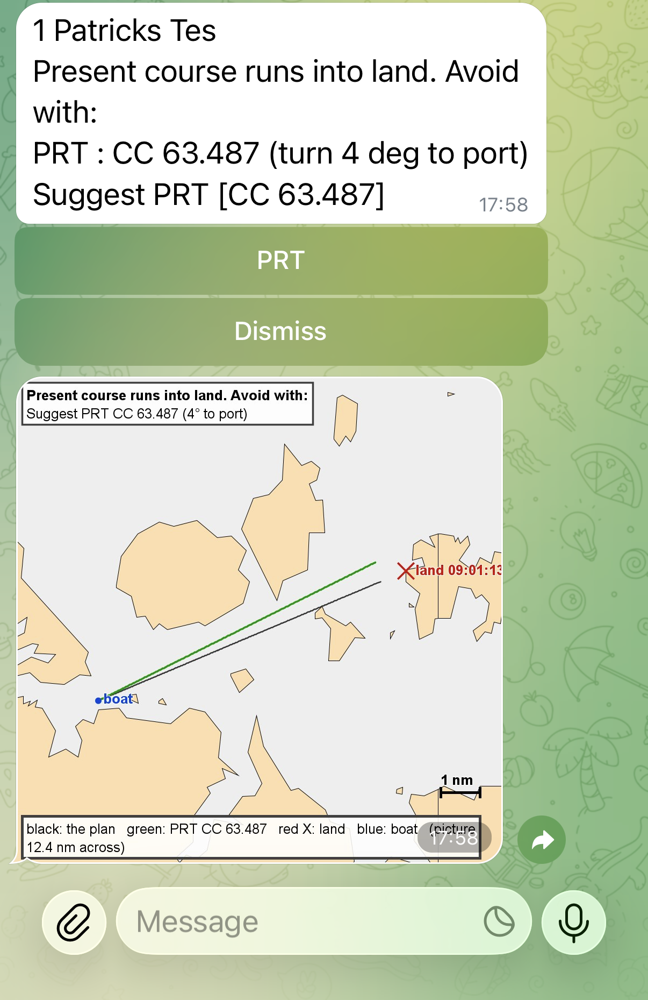

Premendo **Applica**, la correzione viene applicata e il messaggio viene aggiornato con le nuove informazioni sulla barca.

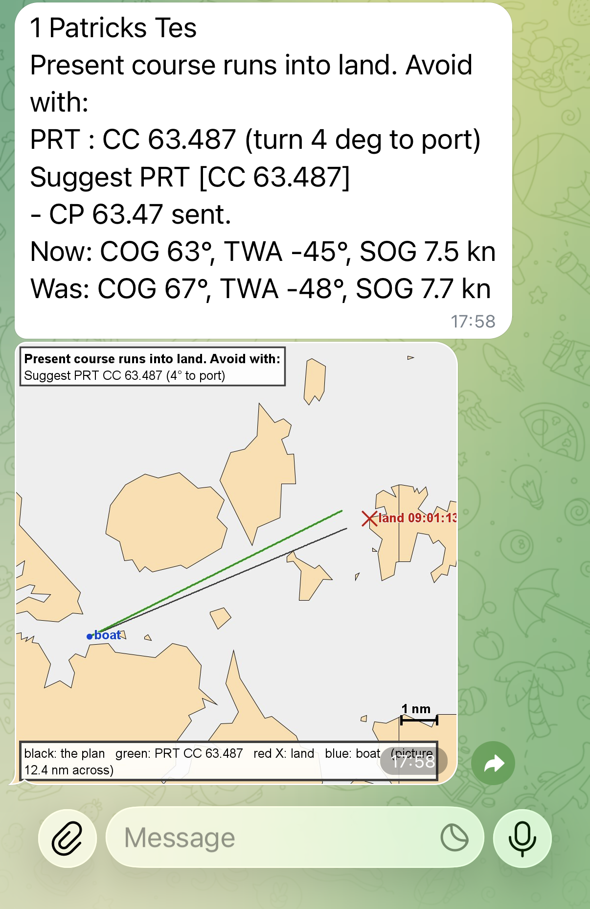

Puoi anche inviare comandi ad AGL per controllare la tua barca. I comandi iniziano con il numero della regata, oppure puoi impostare prima la regata con `SET`. Sono solo per i membri. `HELP` li elenca; i principali sono:

| Comando | Cosa fa |
|---|---|
| `APPLY` *lettera* | Risponde all'ultimo suggerimento, ad esempio `APPLY E` |
| `CFG` | Mostra le impostazioni; `MSG` elenca i messaggi, numerati |
| `BBQ`, `MARK` con `ON`, `OFF`, `LEAD n` o `WARN n` | Attiva o disattiva un controllo, oppure imposta quanto in anticipo guarda e quanto preavviso dà |
| `FIX`, `PIC`, `TG`, `DRY`, `IC` con `ON` oppure `OFF` | Suggerimenti di correzione, immagini con un suggerimento, Telegram, prova a vuoto, In Control |
| `EARLY n`, `HOLD n` | Attivazione anticipata da ignorare; minuti per cui un suggerimento attende sullo schermo prima di andare al telefono |
| `MUTE n`, `UNMUTE` | Ferma gli avvisi al telefono per *n* minuti |
| `CC` *gradi* | Imposta una rotta |
| `TT` *gradi* | Imposta un TWA |
| `CP` / `TP` *gradi* | Come `CC` e `TT`, con perdita di prestazioni |
| `PS` | Ferma l'AP |
| `STATUS` | La barca adesso |
| `HELP` | L'elenco dei comandi |

Per governare dal telefono serve che **In controllo** sia selezionato in AGL.

### 8.1.6 Prove di Telegram

Prima di attivare i messaggi in diretta, è consigliabile usare il [Simulatore](0900-simulator.md) per provare cosa succederà con ogni evento, sia nella console sia con Telegram. Ti suggeriamo di fare le prove seguenti su una regata già finita o non ancora partita.

#### 8.1.6.1 Controllo BBQ

1. [Avvia il Sim](0900-simulator.md#91-avvio-e-arresto-del-simulatore) nella grafica usando l'opzione Sim  del tasto destro, vicino a una costa.
2. Abilita **BBQ Checking** e imposta un anticipo più lungo del tempo che serve per arrivare alla costa.
3. Avvia la barca su una rotta di collisione che colpisce la costa, qualcosa di simile a ciò che accadrebbe in una regata reale.
4. Controlla cosa succede e rispondi.
5. Fai clic sulla scheda Simulatore in AGL e inserisci [**sim last**](0900-simulator.md#95-i-comandi) nella casella **Comando** per fermare la barca e riportarla alla tua posizione di partenza.
6. Digita [**tg idle on**](0900-simulator.md#96-prove-di-telegram-e-pushover). Questo simula che tu sia lontano dal computer.
7. Assicurati che **Stai per incagliarti** sia selezionato in **Configurazione messaggi**.
8. Ripeti i passaggi 3 e 4 e rispondi ai messaggi dal telefono. I dialoghi compariranno anche nella console: ignorali per ora.
9. Ferma la barca come al passaggio 5.
10. Ora crea dei DC che attraversano una costa. Imposta la barca su una rotta che non colpisce la costa. Crea dei waypoint e poi usa l'icona Waypoint to DCs  nella grafica.
11. Usa il BBQ Checker  per assicurarti di avere una collisione. Ignora le correzioni.
12. Ora imposta i tuoi DC. Ti avviserà che ci sono collisioni: usa **Imposta comunque**
13. Se la collisione rientra nel tempo **Anticipo BBQ** impostato nella scheda **Parametri**, dovresti ricevere un avviso e una correzione sia sul telefono sia sulla console. Usa l'uno o l'altra.

Al termine, digita [**sim off**](0900-simulator.md#95-i-comandi) nella casella **Comando**, e la barca risponderà di nuovo al server.

#### 8.1.6.2 Boe di Mare Mancate

Con il sim avviato puoi [spostare le boe del percorso](0900-simulator.md#94-boe-e-arrivo). Se la regata ha solo boe a terra, spostane una in mare con **Move Mark**  dal menu del tasto destro. Poi posiziona la barca con **Simulatore**  vicino alla boa, controllando che la barca si diriga verso la boa che hai spostato. In caso contrario, digita [**leg &lt;n&gt;**](0900-simulator.md#94-boe-e-arrivo), dove &lt;n&gt; è il numero del tratto che va a quella boa. Poi:

1. Abilita **Controllo delle boe** e imposta un anticipo più lungo del tempo che serve per arrivare alla boa.
2. Avvia la barca su una rotta che manca la boa, qualcosa di simile a ciò che accadrebbe in una regata reale.
3. Controlla cosa succede e rispondi.
4. Fai clic sulla scheda Simulatore in AGL e inserisci [**sim last**](0900-simulator.md#95-i-comandi) nella casella **Comando** per fermare la barca e riportarla alla tua posizione di partenza.
5. Digita [**tg idle on**](0900-simulator.md#96-prove-di-telegram-e-pushover). Questo simula che tu sia lontano dal computer.
6. Assicurati che **Stai per mancare la boa** sia selezionato in **Configurazione messaggi**.
7. Ripeti i passaggi 2 e 3 e rispondi ai messaggi dal telefono. I dialoghi compariranno anche nella console: ignorali per ora.
8. Ferma la barca come al passaggio 4.
9. Ora crea dei DC che mancano la boa. Imposta la barca su una rotta che non manca la boa. Crea dei waypoint e poi usa l'icona Waypoint to DCs  nella grafica.
10. Usa il BBQ Checker  per assicurarti di avere una boa mancata. Ignora le correzioni.
11. Ora imposta i tuoi DC. Ti avviserà che stai per mancare la boa: usa **Imposta comunque**
12. Se la mancanza rientra nel tempo **Anticipo boa** impostato nella scheda **Parametri**, dovresti ricevere un avviso e una correzione sia sul telefono sia sulla console. Usa l'uno o l'altra.

Al termine, digita [**sim off**](0900-simulator.md#95-i-comandi) nella casella **Comando**, e la barca risponderà di nuovo al server.

#### 8.1.6.3 Linea di Arrivo Mancata

La prova della linea di arrivo è simile a quella delle boe di mare mancate. Imposta la barca sul tratto che porta all'arrivo e ripeti le prove delle boe di mare mancate. Puoi anche spostare l'arrivo per adattarlo alle tue condizioni di vento.
