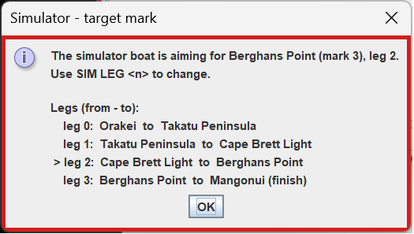
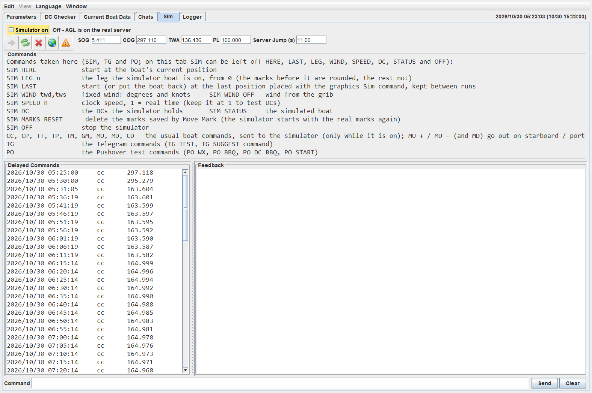
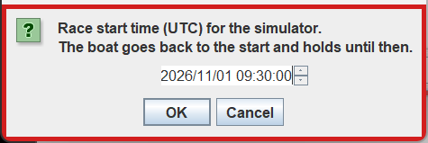

# 9 Simulatore

Il Simulatore sostituisce il server SailOnline. Ti permette di provare AGL, e ciò che vedrai sul telefono, senza toccare la tua barca reale: posizioni una barca ovunque sulla carta, le dai comandi e DC, e osservi cosa fa AGL. È solo per i membri.

Il Simulatore serve solo la barca e i DC. Tutto il resto che AGL chiede al server (le informazioni sulla regata, il grib e così via) continua a venire dal server reale, quindi il vento e le boe sono quelli reali, a meno che tu non li cambi come descritto più avanti.

## 9.1 Avvio e Arresto del Simulatore

Ci sono quattro modi per avviarlo. I comandi non distinguono tra maiuscole e minuscole e si possono digitare in minuscolo:

- **Tasto destro > Simulatore**  sulla carta della grafica. Fai clic sinistro dove la barca deve partire. Se il Simulatore è già in esecuzione, viene fermato e riavviato lì. La posizione viene ricordata per **SIM LAST**.
- **Simulatore attivo**, nella scheda **Simulatore**. La barca parte dalla posizione in cui si trova ora.
- **SIM HERE**, digitato nella casella **Comando** della scheda **Simulatore**. Uguale a **Simulatore attivo**.
- **SIM LAST**, digitato nella casella **Comando**. La barca riparte dall'ultima posizione che hai indicato con il Sim del tasto destro, anche di una sessione precedente. Se il Simulatore è già in esecuzione, rimette anche la barca lì.

Puoi anche digitare una posizione come `SIM lat,lon`, oppure incollare `SIM ,CP,lat,lon` come la copia la grafica. **SIM START** (vedi [9.3](#93-comportamento-della-barca)) avvia anch'esso il Simulatore, nella posizione della barca, se non è in esecuzione.

Una barca posizionata in questo modo è ferma (TWA 0) con prestazioni al 100%, e il vento è quello di quel punto. AGL ti indica poi quale tratto è attivo (vedi [9.4](#94-boe-e-arrivo)).

Per fermarlo, deseleziona **Simulatore attivo** oppure digita **SIM OFF**. AGL torna al server reale, e le boe che hai spostato e l'orario di partenza che hai impostato vengono rimessi com'erano.

Mentre il Simulatore è in esecuzione, la scheda **Simulatore** diventa rossa e dice **SIMULATION MODE**: la barca e i DC vanno al Simulatore, e la barca reale non viene toccata.

## 9.2 La Scheda Simulatore

- **Simulatore attivo** lo avvia e lo ferma, e la riga accanto dice su quale server si trova AGL. I bordi di tutte le finestre di AGL diventano rossi quando il simulatore è in esecuzione.
- La barra degli strumenti ha gli stessi pulsanti della scheda Controllo DC, nello stesso ordine: imposta i DC, aggiorna i DC, elimina i DC, mostra la grafica e controlla i DC. I valori della barca accanto (SOG, COG, TWA, PL e il salto del server) sono quelli della barca simulata mentre il Simulatore è attivo.
- **Comandi** elenca cosa puoi digitare.
- **Comandi ritardati** mostra i DC che il Simulatore tiene. Sono gli stessi DC della scheda Controllo DC.
- **Riscontro** è quello proprio del Simulatore, e **Clear** lo svuota.
- **Comando** è dove digiti. Qui vengono accettati solo SIM, TG, PO e i comandi della barca. In questa scheda puoi omettere la parola SIM davanti a HERE, LAST, LEG, WIND, SPEED, DC, STATUS, START e OFF.

## 9.3 Comportamento della Barca

Il Simulatore muove la barca come fa il server SOL: velocità della polare per le prestazioni, con la perdita di prestazioni per ogni virata e il recupero successivo.

- **Il salto (hop).** Come il server reale, muove la barca una volta ogni 10 secondi. Una richiesta della barca attende la fine del salto, poi viene inviata la nuova posizione. Un DC in scadenza viene applicato all'inizio del salto in cui cade.

- **Comandi e DC.** CC, CP, TT, TP, TM, GM, MU, MD e CD sono descritti in [9.5 I Comandi](#95-i-comandi) e vanno al Simulatore. I DC vengono impostati, elencati, eliminati e attivati dal Simulatore, come fa il server. Nulla va a SOL mentre il simulatore è in esecuzione.

- **Perdita di prestazioni.** Una barca che fermi tu (TWA 0) subisce la normale perdita dal TWA 0 al suo nuovo TWA. Una barca fermata dalla costa riparte con l'80% di prestazioni.

- **La costa.** Una barca che raggiunge la costa si ferma dove si trova, con TWA 0. Il comando successivo che la muove la fa ripartire con l'80% di prestazioni.

- **Vento.** Il vento viene dal grib. **SIM WIND** *twd,tws* imposta un vento fisso in gradi e nodi, e **SIM WIND OFF** torna al grib.

- **Velocità dell'orologio.** **SIM SPEED** *n* imposta la velocità dell'orologio, dove 1 è il tempo reale. Tienila a 1 quando provi i DC.

- **Partenza della regata.** **SIM START** imposta un orario di partenza per il Simulatore, così puoi provare una partenza con haulback: la barca torna alla prima boa senza nessuna boa girata e resta lì fino alla partenza. Mentre resta lì mantiene la prua e la velocità ma non si muove, non perde prestazioni e conserva i DC che ha. Dopo la partenza naviga normalmente. **SIM START** da solo chiede l'orario in un piccolo modulo (UTC, un selettore di data: le frecce si spostano tra i campi e su e giù li cambiano).

  

  

  **SIM START** *n* imposta la partenza *n* minuti da adesso senza modulo (un numero negativo è una partenza nel passato). Se il Simulatore non è in esecuzione, parte prima nella posizione della barca, come fa **SIM HERE**. **SIM START CLEAR** rimette la partenza reale, e la barca torna dove l'avevi posizionata. Le informazioni reali della regata non vengono modificate. L'orario di partenza viene conservato nella copia delle informazioni di regata del Simulatore, quindi la successiva esecuzione del Simulatore lo usa di nuovo (un messaggio lo dice), finché **SIM START CLEAR** o **SIM RESET** non lo rimuovono. **SIM OFF** restituisce ad AGL l'orario di partenza reale.

## 9.4 Boe e Arrivo

Quando posizioni la barca, AGL sceglie la boa più vicina come quella a cui la barca sta andando, e un messaggio la nomina, con il tratto di partenza e di arrivo. Se non è quella giusta, digita **SIM LEG** *n*, dove *n* è il numero del tratto che va alla boa che vuoi, contando da 0. Le boe prima di quel tratto contano come girate, le altre come non girate. **SIM HERE** mantiene il tratto della barca reale.

Una boa conta come girata quando la barca attraversa la metà esterna della linea che divide l'angolo alla boa, nel verso in cui si gira la boa. Se la barca attraversa di nuovo all'indietro, la boa torna non girata. Ogni attraversamento viene contato, quindi una boa mancata va rimediata tornando indietro e girando correttamente la boa.

Quando la barca attraversa la linea di arrivo, il Simulatore la ferma e la segna come arrivata, e ignora altri DC.

**Move Mark**  nel menu del tasto destro sposta una boa mentre il Simulatore è in esecuzione. È il modo per provare una boa mancata, o la linea di arrivo, ovunque tu sia. Le boe spostate vengono conservate in una copia delle informazioni di regata usata solo dal Simulatore, quindi le informazioni reali della regata non vengono modificate. **SIM OFF** rimette le boe reali. **SIM MARKS RESET** elimina la copia salvata, così il Simulatore successivo parte con le boe reali.

## 9.5 I Comandi

| Comando | Cosa fa |
|---|---|
| `SIM HERE` | Parte dalla posizione attuale della barca |
| `SIM LAST` | Parte, o rimette la barca, nell'ultima posizione indicata con il Sim della grafica |
| `SIM lat,lon` | Parte da quella posizione |
| `SIM LEG` *n* | Il tratto in cui si trova la barca, da 0. Le boe prima di esso sono girate, le altre no |
| `SIM WIND` *twd,tws* | Un vento fisso, in gradi e nodi. `SIM WIND OFF` torna al grib |
| `SIM SPEED` *n* | La velocità dell'orologio. 1 è il tempo reale |
| `SIM DC` | Elenca i DC che il Simulatore tiene |
| `SIM STATUS` | Mostra la barca simulata |
| `SIM START` | Chiede in una finestra di dialogo un orario di partenza della regata (UTC) e lo imposta. La regata ora si comporta come il server, con la partenza haulback un'ora prima della partenza della regata. Avvia il Simulatore con la barca nella posizione attuale. |
| `SIM START` *n* | La partenza della regata *n* minuti da adesso, senza finestra di dialogo. Si comporta allo stesso modo. |
| `SIM START CLEAR` | Rimuove l'orario di partenza del Simulatore. La partenza reale torna, e la barca torna dove era stata posizionata |
| `SIM RESET` | Ripristina le informazioni originali della regata. Tutte le modifiche del Simulatore vengono rimosse. |
| `SIM OFF` | Ferma il Simulatore |
| `CC` *gradi* | Imposta una rotta |
| `CP` *gradi* | Come `CC`, con perdita di prestazioni per la virata |
| `TT` *gradi* | Imposta un TWA |
| `TP` *gradi* | Come `TT`, con perdita di prestazioni per la virata |
| `TM` | Vira al miglior angolo di bolina (MaxVMG) sull'altra mura |
| `GM` | Abbatte al miglior angolo di poppa (MaxVMG) sull'altra mura |
| `MU` [*+* \| *-*] | Governa al miglior angolo di bolina (MaxVMG). `+` è dritta, `-` è sinistra. Se lo ometti AGL usa la mura su cui si trova la barca |
| `MD` [*+* \| *-*] | Come `MU`, per il miglior angolo di poppa |
| `CD` | Imposta subito il primo DC dell'elenco, senza attendere il suo orario |

I comandi della barca qui sopra sono quelli che digiteresti nella casella dei comandi di una regata. Vengono inviati al Simulatore solo mentre è attivo, e `TM`, `GM`, `MU` e `MD` chiedono conferma prima di partire. I comandi di prova `TG` e `PO` sono in [9.6](#96-prove-di-telegram-e-pushover). Qualsiasi altro comando in questa scheda viene rifiutato.

## 9.6 Prove di Telegram e Pushover

Il Simulatore è il modo sicuro per vedere come appaiono i messaggi sul telefono e come rispondervi, perché fa accadere gli eventi senza una barca reale. I comandi di prova qui sotto si possono digitare nella scheda **Simulatore**. Le prove passo passo sono in [8.1.6 Prove di Telegram](0800-chats.md#816-prove-di-telegram).

Telegram, con `TG` davanti:

| Comando | Cosa fa |
|---|---|
| `TG TEST` | Invia un messaggio di prova al telefono. `TG TEST` *n* invia un suggerimento di prova con *n* pulsanti **Applica** (da 1 a 24) |
| `TG SUGGEST` *comando* | Invia un suggerimento di prova con **Applica** e **Ignora**, ad esempio `TG SUGGEST CC 140` |
| `TG A` [*n*] | Applica l'ultimo suggerimento (l'opzione suggerita, oppure l'opzione *n*), come farebbe il pulsante **Applica** |
| `TG D` | Ignora l'ultimo suggerimento |
| `TG IDLE` [ON\|OFF\|AUTO] | Prova la logica "alla console". ON finge che tu sia lontano dal computer, quindi il telefono riceve il suggerimento, OFF finge che tu sia al computer, e AUTO usa il tuo tempo di inattività reale. `TG IDLE` da solo mostra lo stato |
| `TG LANG` [*n*] [en\|it] | Mostra un dialogo numerato e ne invia il testo al telefono, nella lingua della regata o in quella indicata. `TG LANG` li elenca |

Pushover, con `PO` davanti. Ciascuno viene inviato con gli stessi controlli del messaggio reale; aggiungi `FORCE` per saltare i controlli.

| Comando | Messaggio |
|---|---|
| `PO WX` | Wx arrivato |
| `PO BBQ` (o `PO BBQ NOW`) | In secca |
| `PO DC BBQ` (o `PO BBQ SOON`) | Sta per andare in secca |
| `PO START` | Partenza della regata, nessun percorso |
| `PO NODC` | No DCs. Esegue subito il controllo, come se il ritardo dopo un Wx fosse trascorso |

Il risultato di un messaggio di prova compare nelle stanze Pushover e Telegram della scheda Chat.
