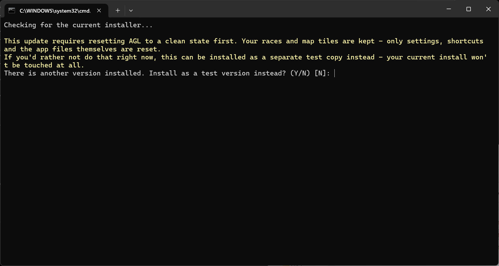

# AGL 25 Note di Rilascio

AGL 25.5.X è un'altra serie di release importante, con molte nuove funzionalità. L'obiettivo è stato spostare i file di waypoint (ora percorsi) e i DC in un database SQLite per conservare i dati storici e permettere di confrontare nella grafica i dati attuali con quelli passati. Le modifiche sono molte, con un numero significativo di icone dei pulsanti cambiate e di pulsanti rimossi. Leggi le note di rilascio per sapere quali sono, e il Manuale Utente per sapere come usarle.

**Importante**: L'accesso ora è gestito dall'hub. All'aggiornamento devi inserire le tue credenziali nell'hub e convalidarle prima di avviare qualsiasi regata. Vedi [2.3.3.9 L'Accesso SOL](manual/0200-installing-agl.md#2339-laccesso-sol) e [3.1 Accesso e regata](manual/0300-configuration.md#31-accesso-e-regata).

## Versione 25.5.1

### Miglioramenti

#### Modificare e controllare i DC

1. Un nuovo Editor DC mostra i DC dell'area DC come una tabella che puoi modificare direttamente. Vedi [6.6 L'Editor DC](manual/0600-dc-data-table.md#66-leditor-dc).

    a. Fai clic su una cella per modificarla. Gli orari usano un selettore di data limitato agli orari dei DC vicini, e la grafica si aggiorna automaticamente.

    b. I blocchi di perdita di prestazione (PL) vengono mostrati e spostati come un unico blocco.

    c. Una colonna PL mostra la perdita di prestazione a ogni DC, e i DC fuori dal maxVMG vengono portati al maxVMG per te.

    d. Annulla e Ripeti sono condivisi con la grafica.

2. Con Usa la perdita di prestazione selezionato ci sono due pulsanti di controllo: Check PL , che aggiunge i DC PL all'area DC, e un semplice Check  che mostra i DC esattamente come li tiene l'Editor DC. Un pulsante Editor DC  si trova accanto a loro nella barra degli strumenti della grafica. Vedi [5.1.10 Pulsante Check DCs](manual/0500-using-agl.md#5110-pulsante-check-dcs).

3. Le etichette PL nella grafica mostrano la PL con cui la barca arriva e, tra parentesi, la PL dopo la virata. Vedi [5.3.2.3 Etichette dei DC](manual/0500-using-agl.md#5323-etichette-dei-dc).

4. Un nuovo messaggio, **DC modificati, non impostati**, ti avvisa tramite Pushover, Telegram o sullo schermo quando hai modificato i DC e non li hai impostati per un tempo stabilito, e ti permette di Imposta ora, Aggiorna o Lascia, sullo schermo e su Telegram. Vedi [5.2.6 DC Non Ancora Impostati](manual/0500-using-agl.md#526-dc-non-ancora-impostati).

5. L'impostazione dei DC ora si occupa dei blocchi PL, e invia di nuovo un DC che la latenza ha reso in ritardo. Vedi [5.1.2 Pulsante Set](manual/0500-using-agl.md#512-pulsante-set).

#### La DC Data Table

1. I percorsi caricati da file GPX di qtVlm vengono ripuliti dai punti ridondanti. La tolleranza, 2 m all'inizio, si imposta nella casella **Filtra percorso (m)**. Vedi [6.2.2 Filtro della Rotta](manual/0600-dc-data-table.md#622-filtro-della-rotta).

2. Un punto in cui la rotta gira bruscamente verso l'interno e subito all'indietro, su un breve tratto, viene considerato un punto sospetto. Viene spuntato nella colonna **Escludi?**, mostrato in magenta, e non viene inviato né disegnato. Vedi [6.2.3 Punti Sospetti e la Colonna Escludi?](manual/0600-dc-data-table.md#623-punti-sospetti-e-la-colonna-escludi).

3. Send, Send To, Send Hr e Append ora controllano i DC e aprono l'Editor DC, nascondendo la DC Data Table. Vedi [6.4 Impostazione dei DC](manual/0600-dc-data-table.md#64-impostazione-dei-dc).

#### Tracce multiple e registri della regata

1. L'opzione delle tracce multiple nella grafica è stata migliorata. Vedi [5.3.3.1 Il Modulo Tracce](manual/0500-using-agl.md#5331-il-modulo-tracce).

    a. Ogni traccia parte dalla posizione della barca quando è stata creata, segnata con l'icona di una barca.

    b. Ogni nuova traccia creata nella grafica (Condiziona, Sposta, Cambia segno, ecc.) viene conservata e può essere richiamata come sovrapposizione.

2. Un nuovo modulo Set salvati elenca ogni Set conservato per la regata, così puoi mostrarli come tracce, esportarli come percorsi GPX o eliminarli. Vedi [5.3.3.2 Set Salvati](manual/0500-using-agl.md#5332-set-salvati).

3. La Traccia DC della regata conserva ogni DC scattato, con ciò che si sapeva quando è stato impostato, e li mostra sulla carta, insieme a quelli degli anni precedenti della stessa regata. Vedi [5.3.3.3 Traccia DC della Regata](manual/0500-using-agl.md#5333-traccia-dc-della-regata).

4. Una nuova voce **Info**  nel menu del tasto destro della grafica mostra i dettagli di qualsiasi DC su cui fai clic, attuale o passato. Vedi [5.4.2 Il Menu del Tasto Destro](manual/0500-using-agl.md#542-il-menu-del-tasto-destro).

5. Le tracce delle barche vengono conservate per tutta la regata, anche dopo il riavvio di AGL, con le lacune riempite quando arrivano le tracce del server. Vedi [5.3.3.4 Tracce delle Barche](manual/0500-using-agl.md#5334-tracce-delle-barche).

6. Una traccia si può esportare come percorso GPX dal modulo Tracce, e l'esportazione GPX dei Set salvati riporta l'id che il server ha dato a ogni DC. Vedi [5.3.3.1 Il Modulo Tracce](manual/0500-using-agl.md#5331-il-modulo-tracce).

#### Percorsi e waypoint

1. I percorsi e i waypoint sono ora conservati in un database SQLite, gestito dall'hub, per tutte le tue regate, e AGL non legge né scrive più file di waypoint. Vedi [5.5.1 Il Modulo Percorsi e Waypoint](manual/0500-using-agl.md#551-il-modulo-percorsi-e-waypoint).

    a. Un menu Percorsi e un pulsante nella grafica aprono il modulo Percorsi, per importare ed esportare percorsi e per crearli, copiarli ed eliminarli.

    b. Ogni percorso può essere mostrato nel proprio colore, e un percorso è il percorso attivo.

    c. Sono elencati solo i percorsi dentro l'area di regata. I percorsi eliminati si possono ripristinare.

2. I waypoint si possono modificare nella grafica, con nuovi comandi del tasto destro, e le modifiche vengono conservate man mano che le fai (non c'è Salva). Vedi [5.5.3 Modifica dei Waypoint nella Grafica](manual/0500-using-agl.md#553-modifica-dei-waypoint-nella-grafica).

3. La casella WP Route nella scheda Parametri sceglie il percorso da un elenco, e lo stesso fa il pulsante Apri  nella barra degli strumenti della grafica. Vedi [3.2 Waypoint](manual/0300-configuration.md#32-waypoint) e [5.5.2 Il Percorso Attivo](manual/0500-using-agl.md#552-il-percorso-attivo).

4. Una finestra Waypoint e percorsi nell'hub mostra i percorsi e i waypoint di ogni regata. I vecchi percorsi di qualsiasi regata si possono gestire lì. Vedi [5.5.7 Waypoint e Percorsi nell'Hub](manual/0500-using-agl.md#557-waypoint-e-percorsi-nellhub).

5. I waypoint aggiuntivi del percorso sono stati rimossi e sostituiti da Importa percorso e Mostra percorso. Vedi [3.2 Waypoint](manual/0300-configuration.md#32-waypoint).

6. Un percorso si può costruire e cambiare nel modulo Percorsi: Modifica, Aggiungi, Rimuovi, Su e Giù agiscono sui waypoint del percorso. Vedi [5.5.1.2 Modifica dei Waypoint di un Percorso](manual/0500-using-agl.md#5512-modifica-dei-waypoint-di-un-percorso).

7. Quando più di un waypoint si trova nel punto su cui fai clic per Modifica, Aggiungi, Rimuovi o Elimina, una piccola finestra di dialogo ti lascia scegliere quale. Vedi [5.5.3 Modifica dei Waypoint nella Grafica](manual/0500-using-agl.md#553-modifica-dei-waypoint-nella-grafica).

#### Finestra grafica

1. Quattro nuovi pulsanti di zoom: ingrandisci, riduci, zoom sulla traccia attuale e zoom sull'area di regata. Vedi [5.4.1 Icone della Toolbar](manual/0500-using-agl.md#541-icone-della-toolbar).

2. I comandi non reimpostano più il tuo zoom. La vista viene adattata alla nuova traccia solo quando usi Send dalla DC Data Table.

3. Le altre barche sono più facili da leggere. Vedi [5.3.2.1 Vista](manual/0500-using-agl.md#5321-vista).

    a. Una barca arrivata è mostrata come un punto grigio senza nome.

    b. Ogni barca con nome mostra la sua classifica.

    c. Passa il mouse su una barca per mostrare le sue statistiche e la sua traccia.

4. Il menu del tasto destro della grafica ora mostra solo le voci che valgono per ciò che c'è sulla carta. Vedi [5.4.2 Il Menu del Tasto Destro](manual/0500-using-agl.md#542-il-menu-del-tasto-destro).

5. Una nuova voce **Pulisci** nel menu del tasto destro, e il tasto W, tolgono dalla carta le tracce, i punti DC e i percorsi non attivi. Vedi [5.4.2 Il Menu del Tasto Destro](manual/0500-using-agl.md#542-il-menu-del-tasto-destro).

6. Opzioni di vista ha un nuovo riquadro Barbe del vento per impostare dimensione e spaziatura delle barbe. Vedi [5.3.2 Opzioni di vista](manual/0500-using-agl.md#532-opzioni-di-vista).

#### Messaggi e Chat

Le voci da 1 a 3 sono solo per i membri.

1. Pushover, Telegram e i messaggi si configurano ora una volta in un nuovo modulo **Messaggi** dell'hub, che sostituisce i menu Pushover e Telegram dell'hub. Vedi [8.1.2 Configurazione di Pushover](manual/0800-chats.md#812-configurazione-di-pushover).

    a. Il modulo contiene le impostazioni di Pushover, il bot Telegram e la tabella dei messaggi. Le modifiche arrivano a ogni regata in esecuzione man mano che le fai.

    b. Ogni regata ha una casella **Usa Hub**, per seguire le impostazioni dell'hub o tenere le proprie.

2. Gli orari attivi per Pushover e Telegram si impostano una volta nell'hub; una regata può seguirli o tenere i propri. Vedi [8.1.4 In Ogni Regata](manual/0800-chats.md#814-in-ogni-regata).

3. La scheda Chat mostra i dati della barca (SOG, COG, TWA, PL, Posizione, DBL e Salto server (s)) in una riga in alto, così si possono leggere mentre si chatta. Vedi [8 Chat](manual/0800-chats.md#8-chat).

4. Ogni casella di testo ora ha il menu del tasto destro (Annulla, Taglia, Copia, Incolla, Seleziona tutto). Vedi [8.1.1 Rispondere ai Messaggi](manual/0800-chats.md#811-rispondere-ai-messaggi).

#### Il grib NOAA

1. Quando apri Routing settings in qtVlm, AGL ti avvisa se il grib caricato da qtVlm è più vecchio di quello che sta usando AGL. Vedi [7.3.1 current_grib.grb](manual/0700-noaa-server.md#731-current_gribgrb).

2. AGL ti avvisa prima del download NOAA se non ha memoria sufficiente per il grib, e di nuovo se esaurisce la memoria mentre lo carica. Vedi [7.4 Memoria](manual/0700-noaa-server.md#74-memoria).

#### L'hub

1. L'hub ora gestisce l'accesso a SailOnline per tutte le regate. Inserisci nome utente e password una volta in SOL > Accesso, e ogni regata li usa. Una regata può comunque regatare come un altro utente, e puoi cambiare utente in una regata in esecuzione senza chiuderla. Selezionare o deselezionare Usa SOL in una regata in esecuzione ne cambia subito l'accesso.

2. Una nuova scheda Regate nell'hub elenca ogni regata SailOnline con il suo stato di iscrizione e l'ora di partenza. Spunta Iscrivere? per iscriverti e Ignorare? per mettere da parte una regata, poi fai clic su Applica. Puoi aprire una regata per guardarla prima che si aprano le iscrizioni (con l'accesso come sol), e l'hub ti iscrive automaticamente quando si aprono. Le regate a tempo vengono iscritte alla partenza e di nuovo dopo l'arrivo. La scheda trova da sola le regate a cui sei iscritto, comprese quelle a cui ti sei iscritto sul sito. Vedi [2.3.3.10 La Scheda Regate](manual/0200-installing-agl.md#23310-la-scheda-regate).

3. Chiudere l'hub ora chiude le sue regate, che tornano nell'elenco di riavvio. Vedi [2.3.3.8 Chiusura dell'Hub](manual/0200-installing-agl.md#2338-chiusura-dellhub).

4. Le cornici delle finestre mostrano lo stato di una regata: rosso per il Simulatore, arancione mentre qtVlm è in attesa, e viola quando Usa SOL è selezionato. Vedi [2.3.3.11 Colori della Cornice delle Finestre](manual/0200-installing-agl.md#23311-colori-della-cornice-delle-finestre).

5. Quando fai un Set in una regata, l'hub passa alla scheda di quella regata (si può disattivare nella scheda Launcher). Vedi [2.3.3.3 La Scheda Launcher](manual/0200-installing-agl.md#2333-la-scheda-launcher).

6. Un hub di produzione, uno beta e uno di sviluppo possono girare sullo stesso computer senza sovrascrivere le proprie impostazioni. Vedi [2.3.3.1 La Finestra dell'Hub](manual/0200-installing-agl.md#2331-la-finestra-dellhub).

7. Un nuovo pulsante Riponi tutto accanto ad Aggiungi regata mette via con un clic le finestre AGL e qtVlm di ogni regata. Vedi [2.3.3.1 La Finestra dell'Hub](manual/0200-installing-agl.md#2331-la-finestra-dellhub).

#### Registrazione

1. La scheda Registro ora contiene l'essenziale, e **Vista > Registro dettagliato** aggiunge il dettaglio di lavoro di controlli e percorsi. Il registro è molto più piccolo. Vedi [2.3.4.2 Il Menu Vista](manual/0200-installing-agl.md#2342-il-menu-vista) e [2.3.4.3 Il Menu Aiuto](manual/0200-installing-agl.md#2343-il-menu-aiuto).

### Correzioni di bug – 25.5.1

1. I waypoint +P / -P e FP+ / FP- non vanno più diretti quando la barca ha già navigato il perno. Vedi [5.2 Verifica del Percorso](manual/0500-using-agl.md#52-verifica-del-percorso).

2. Gli avvisi di BBQ e di boe sono stati corretti. L'avviso BBQ sul telefono ora concorda con la traccia del predittore, quindi non ci sono falsi avvisi di incaglio, e gli avvisi vengono inviati ogni volta che In controllo è selezionato. Vedi [5.2.1 Attivare i Controlli](manual/0500-using-agl.md#521-attivare-i-controlli).

3. L'elenco Tracce non si riempie più dei controlli che AGL fa da solo.

4. Nella DC Table, Delete, Send e Copy senza nulla su cui agire non svuotano più l'intera area DC.

5. L'hub, la finestra di regata, la finestra Waypoint e percorsi, l'Editor DC e la finestra Chat non si ingrandiscono più un poco a ogni riavvio di AGL. Ridimensiona ciascuna una volta dopo l'aggiornamento.

6. Aggiungi regata viene trattenuto mentre l'hub sta ancora riavviando le tue regate.

7. Il controllo VMC per i waypoint non dà più tempi di percorrenza troppo ottimistici. Vedi [5.4.1 Icone della Toolbar](manual/0500-using-agl.md#541-icone-della-toolbar).

8. Il BBQ Checker non fallisce più nel correggere una collisione perché un esportatore di percorsi ha messo accanto al DC che sposta un DC con quasi la stessa rotta. Tali DC ora vengono ignorati dai controlli. Vedi [5.2.2 Il BBQ Checker](manual/0500-using-agl.md#522-il-bbq-checker).

9. Una linea di arrivo mancata subito dopo l'ultimo DC ora viene trovata, e il BBQ Checker lo dice nel Logger quando il percorso non raggiunge l'arrivo. Vedi [5.2.4 L'Arrivo](manual/0500-using-agl.md#524-larrivo).

10. La grafica poteva smettere di ridisegnarsi quando i puntini rossi BBQ erano sullo schermo e la traccia attuale era nascosta. Ogni traccia ora conserva i suoi puntini. Vedi [5.3.3.1 Il Modulo Tracce](manual/0500-using-agl.md#5331-il-modulo-tracce).

11. Le note di rilascio ora si aprono nel browser anche dopo un aggiornamento Beta (la pagina beta per un'installazione Beta).

## Versione 25.4.3

### Correzioni di bug – 25.4.3

1. Una gara riavviata da una cartella che contiene già un file della DC Data Table non si blocca più su "Waiting for the NOAA grib to load". Succedeva quando alcuni DC del file hanno una data oltre il meteo SOL (più di circa 7 giorni avanti), dove ci sono solo i dati meteo NOAA. Il file della DC Data Table ora viene letto senza attese e il download NOAA parte normalmente.

2. I blocchi PL non si allontanano più dal PL obiettivo, evitando che i DC PL non vengano riconosciuti come tali.

3. Il Controllo BBQ gestisce correttamente i blocchi PL quando propone una correzione. Ora propone la correzione e sposta con sé l'intero blocco, invece di segnalare "Unable to prevent BBQ". Vedi [5.2 Verifica del Percorso](manual/0500-using-agl.md#52-verifica-del-percorso).
4. Una gara che si blocca ora lascia un thread dump, e Kill nell'hub comprime i log in uno zip e apre un'email all'autore.

5. Il numero di build viene mostrato all'avvio di AGL e nella finestra della patch.

## Versione 25.4.1

**IMPORTANTE – aggiornamento alla 25.4.1 su Linux:** su alcuni desktop Linux (osservato su Linux Mint) l'aggiornamento non parte se AGL viene avviato dall'icona sul desktop: scegli **Aggiorna ora**, non si apre nulla e al successivo avvio di AGL compare il messaggio che un aggiornamento è in corso. Il problema è risolto nella 25.4.1, ma le versioni precedenti lo hanno, quindi per arrivare alla 25.4.1:

1. Apri una finestra del Terminale e avvia AGL da lì, poi scegli **Aggiorna ora** come al solito. Si apre la finestra di aggiornamento. Per un'installazione Production digita

    ```
    sh -c "'$HOME/SOL/Java25/AGL_start.sh'"
    ```

    (usa la cartella in cui è installato AGL se non è ~/SOL/Java25; per un'installazione Beta usa `Java25Beta` e aggiungi `--channel=beta` dopo le virgolette di chiusura del percorso). Oppure esegui tu stesso l'installer, come descritto nella sezione [2.1.3 Linux](manual/0200-installing-agl.md#213-linux) del Manuale Utente.

2. Se AGL dice che un aggiornamento è in corso e non c'è nessuna finestra di aggiornamento aperta, elimina il file di blocco dell'aggiornamento e avvia di nuovo AGL:

    ```
    find ~ -maxdepth 3 -path '*sessions*' -name update.lock -delete
    ```

### Miglioramenti

#### Controllare la rotta prima che vada al server

1. AGL ora può pre-verificare i DC per BBQ, boe di mare mancate e linea di arrivo, proponendoti soluzioni prima che i DC vengano impostati. Non viene modificato nulla finché non accetti un suggerimento. Il Controllo DC segna inoltre con puntini rossi i BBQ che trova, e per evitare la terraferma è disponibile Tack/Gybe later. Vedi [5.2 Verifica del Percorso](manual/0500-using-agl.md#52-verifica-del-percorso).

2. Quando un DC cade fuori dal maxVMG, AGL ora condiziona l'intera lista dei DC, con Condiziona tutti e Imposta comunque. Vedi [5.4.4 Condizionamento dei DC](manual/0500-using-agl.md#544-condizionamento-dei-dc).

3. Un nuovo comando Segui nel menu popup della grafica aggiunge waypoint lungo una costa tra due waypoint. Vedi [5.4.2 Il Menu del Tasto Destro](manual/0500-using-agl.md#542-il-menu-del-tasto-destro).

#### Messaggi sul telefono

1. AGL ora può inviare messaggi in tempo reale al tuo telefono tramite Pushover e Telegram: arrivo del Wx, rischio di incaglio o incaglio avvenuto, boa che sta per essere mancata o mancata, regata che parte senza rotta, e DC del server che finiscono prima del prossimo Wx (No DCs). I messaggi di emergenza si ripetono finché non li confermi sul telefono. Vedi [8 Chat](manual/0800-chats.md#8-chat).

2. Pushover si configura una sola volta nell'hub, per tutte le regate. Vedi [8 Chat](manual/0800-chats.md#8-chat).

3. Telegram funziona con un solo bot nell'hub, con canali per ciascuna regata. AGL può proporti una variazione di rotta sul telefono, e viene applicata solo quando la confermi da lì. Un insieme di comandi permette di controllare lo stato e inviare variazioni di rotta dal telefono. Vedi [8 Chat](manual/0800-chats.md#8-chat).

4. Replica delle chat room del client SOL in una scheda chat staccabile. Vedi [8 Chat](manual/0800-chats.md#8-chat).

5. I messaggi inviati da AGL più lunghi di 187 caratteri vengono divisi in parti e trasmessi insieme, e AGL cerca di riunire i messaggi divisi in un unico messaggio. Vedi [8 Chat](manual/0800-chats.md#8-chat).

#### Finestra grafica

1. Un modulo Opzioni di vista nella finestra grafica sostituisce diverse icone della barra degli strumenti e aggiunge i campi delle etichette DC, una legenda, Riempi i poligoni della terra e Carattere -/+ per la grafica. Vedi [5.3.2 Opzioni di vista](manual/0500-using-agl.md#532-opzioni-di-vista).

2. Traccia DC grigia nella finestra grafica, alimentata direttamente dalla DC Data Table, con un pulsante on/off; i waypoint aggiuntivi non vengono più sovrascritti dai DC. Vedi [6 DC Data Table](manual/0600-dc-data-table.md#6-dc-data-table).

3. Le barche AIS ora vengono tracciate anche dopo la fine di una regata.

#### qtVlm, grib e DC

1. AGL ti avvisa quando apri Routing settings in qtVlm e il grib non è stato aggiornato dopo l'ultimo download del Wx.

2. Il qtVlm collegato può essere configurato in modalità Production, oppure in modalità Test per provare una nuova release di qtVlm prima di aggiornare. AGL propone di collegarlo di nuovo se la sua configurazione è danneggiata, e verifica che le sue tile delle mappe siano il set che corrisponde alle mappe SOL. Vedi [3.7 qtVlm](manual/0300-configuration.md#37-qtvlm).

3. AGL traccia le isobare dalla pressione presente nel grib (SOL e NOAA), e le conserva quando parte un nuovo download NOAA. Vedi [5.3.2.1 Vista](manual/0500-using-agl.md#5321-vista).

4. AGL verifica di avere memoria sufficiente per il grib NOAA. Se la memoria finisce, resta in uso il grib già caricato.

5. La DC Data Table ora inizia a controllare il file dei DC all'avvio di AGL, lo ricarica quando cambia, e chiede se passare al nuovo file quando qtVlm salva un file modificato in una cartella diversa. Vedi [6.3 Rilevamento delle Modifiche al File DC](manual/0600-dc-data-table.md#63-rilevamento-delle-modifiche-al-file-dc).

6. Gestione delle finestre di dialogo di qtVlm: le finestre di qtVlm Routing, Converting Routing to Route, Simplification result e Optimization results vengono portate in primo piano, una alla volta, quando sono nascoste dietro altre finestre. Vedi [2.3.3.6 Gestione delle Finestre di Dialogo di qtVlm](manual/0200-installing-agl.md#2336-gestione-delle-finestre-di-dialogo-di-qtvlm).

7. Sono gestite le regate che partono con un haulback: AGL sa che la barca non si muove fino alla partenza, quindi la conversione dei waypoint e i comandi di rotta attendono la partenza.

8. I download dal server SailOnline (informazioni sulla regata, grib, DC e barche) sono compressi dove il server lo consente, ripetuti se falliscono, e il login viene rinnovato se scade.

#### L'AGL Hub e l'avvio di AGL

1. L'AGL Hub: un'unica finestra nella barra delle applicazioni con una scheda per ogni regata, che mostra la console della regata e i suoi comandi (Mostra, Riponi, qtVlm Mostra, qtVlm Riponi, Ferma, Termina, Riavvia, Dump dei thread, Salva il registro). Sostituisce una finestra nella barra delle applicazioni per ciascuna regata. Vedi [2.3.3 L'AGL Hub](manual/0200-installing-agl.md#233-lagl-hub).

2. Aggiungi regata può avviare più cartelle di regata insieme. Apri avvia AGL in ciascuna; Avvia preme anche Applica al posto tuo. Le cartelle in cui AGL è già in esecuzione sono in grigio e vengono saltate. Vedi [2.3.3.5 Aggiungere una Regata](manual/0200-installing-agl.md#2335-aggiungere-una-regata).

3. Chiudendo l'hub si possono lasciare le regate in esecuzione (Chiudi / Lascia / Annulla). L'hub successivo riprende in carico le regate in esecuzione. Vedi [2.3.3.8 Chiusura dell'Hub](manual/0200-installing-agl.md#2338-chiusura-dellhub).

4. Riavvio delle regate dopo uno spegnimento: l'hub riavvia le regate dopo il riavvio per un aggiornamento di Windows, un crash o un'interruzione di corrente. Vedi [2.3.3.7 Riavvio delle Regate dopo uno Spegnimento](manual/0200-installing-agl.md#2337-riavvio-delle-regate-dopo-uno-spegnimento).

5. AGL_autostart.bat configura l'avvio di AGL all'accesso a Windows, l'accesso automatico a Windows e il blocco dello schermo dopo tale accesso. Vedi [2.3.3.7 Riavvio delle Regate dopo uno Spegnimento](manual/0200-installing-agl.md#2337-riavvio-delle-regate-dopo-uno-spegnimento).

6. L'hub ha una propria dimensione del testo (Vista > Dimensione testo), una casella Sempre in primo piano, un orologio UTC con l'ora del computer tra parentesi, e un'icona dell'hub su ogni finestra di regata che porta l'hub in primo piano. Vedi [2.3.3.1 La Finestra dell'Hub](manual/0200-installing-agl.md#2331-la-finestra-dellhub).

7. AGL si avvia nell'hub e non avvia mai una regata né chiede da solo una cartella di regata. Avviando di nuovo AGL mentre l'hub è aperto, l'hub viene portato in primo piano. Vedi [2.3.1 Avvio di AGL Launcher](manual/0200-installing-agl.md#231-avvio-di-agl-launcher).

#### Guida, documentazione e Simulatore

1. Un menu Aiuto nell'hub e in ogni finestra di regata: Documentazione, Manuale, Note di rilascio e Invia i log.... Invia i log... raccoglie i log necessari per individuare un problema, ne rimuove password e token, e apre un'email all'autore con lo zip pronto da allegare. Non viene inviato nulla finché non premi Invia. Vedi [2.3.4.3 Il Menu Aiuto](manual/0200-installing-agl.md#2343-il-menu-aiuto).

2. Il Manuale Utente e le Note di Rilascio sono ora pagine web. Vengono installati con AGL e si aprono dal menu Aiuto senza internet, e sono anche online su https://alov1258.github.io/AGL-Release/. Le versioni PDF e i relativi collegamenti sul desktop non vengono più installati, e l'installer rimuove quelli vecchi quando aggiorni.

3. Il Simulatore (solo per i membri) sostituisce il server SailOnline, così puoi provare AGL, e ciò che vedrai sul telefono, senza toccare la tua barca reale. Ha una propria scheda Simulatore. Fai riferimento a [9 Simulatore](manual/0900-simulator.md#9-simulatore).

#### Finestre, Parametri e log

1. Dimensione testo e Dimensione icone nella scheda Parametri: Carattere -/+ e Icone -/+ con un'anteprima della dimensione delle icone, applicate con Applica carattere. Il font è sempre Dialog, quindi la scelta del font non c'è più. Vedi [3.10 Grafica](manual/0300-configuration.md#310-grafica).

2. I parametri vengono salvati nel file ini man mano che vengono modificati, quindi i pulsanti Save e Refresh non ci sono più. Un valore non valido non viene salvato, e Riscontro lo segnala. Vedi [3 Configurazione](manual/0300-configuration.md#3-configurazione).

3. AGL ricorda le posizioni delle finestre dell'hub e di AGL e le ripristina all'avvio. Una finestra la cui dimensione risulta sbagliata dopo lo spostamento tra schermi con scala diversa viene riparata.

4. La barra degli strumenti del Timed Race va a capo nelle finestre strette.

5. Riscontro ora mostra solo le informazioni principali. Una nuova scheda Registro contiene l'output di debug. I log sono conservati in `logger_<race>_current.txt` e ruotati, e i tempi di attivazione dei DC possono essere registrati in un file.

### Correzioni di bug – 25.4.1

1. Correzioni generali di affidabilità e stabilità

2. L'implementazione del DC di risveglio (wake up) non funzionava

3. Errore di proiezione nel determinare le intersezioni con le coste, che portava a intersezioni false

4. Corretto un blocco se i DC venivano controllati esattamente quando iniziava il download del Wx.

5. Su Linux, la finestra di aggiornamento non si apriva quando AGL veniva avviato da un'icona del desktop che esegue in un terminale. Ora si apre.

## Versione 25.3.1

### Miglioramenti

1. Viene creato un nuovo file grib chiamato current_grib.grb, replica esatta dei grib caricati nella memoria di AGL. Questo file grib viene aggiornato ogni volta che un nuovo grib o frame grib sostituisce quello presente in memoria. Può essere caricato una sola volta nel tuo pacchetto di routing e poi semplicemente aggiornato per ottenere l'ultima versione.

2. I frame grib NOAA gfs vengono caricati in memoria man mano che arrivano, in modo che AGL sia allineato al server nel momento in cui arriverà il Wx SOL. Disponibile solo per i membri SOL.

3. L'aggiornamento da versioni precedenti alla 25.2.7 seguirà il percorso di aggiornamento della 25.2.7.

4. Tutte le finestre di dialogo popup ora si aprono in corrispondenza del mouse.

5. AGL rileva le sessioni esistenti e impedisce l'avvio di più sessioni dallo stesso progetto.

Solo Windows e Linux. macOS seguirà non appena funzionante e verrà abilitato tramite il launcher dopo i test.

6. AGL può ora creare un'istanza separata di qtVlm collegata alla regata corrente. AGL può avviare qtVlm con la polare corretta per la regata e con current_grib.grb nello slot 1.

> **Nota:** Questa funzione è disponibile solo per i membri SOL. È una prova e potrebbe richiedere il pagamento di un abbonamento a qtVlm per l'uso continuativo.

7. Aggiunte alla barra degli strumenti le icone per ingrandire e ridurre a icona la finestra di qtVlm collegata alla regata.

8. Verifica la porta all'avvio per assicurare che non vi siano discrepanze di porta nei progetti esistenti

9. Configura qtVlm per SOL e imposta il set di tile corrispondente (High o Intermediate)

10. Imposta la polare di qtVlm sulla polare della regata

11. Aggiorna il nome della tua barca in modo che corrisponda al nome della tua barca in SOL

### Correzioni di bug – 25.3.1

1. Il test per verificare se un file esiste su disco ora restituisce la risposta corretta.

2. Miglioramenti generali di robustezza e di gestione degli errori

3. Corretto il blocco che si verificava quando l'elenco delle barche è vuoto o non viene restituito dal server

4. Corretti gli errori di connessione non intercettati da alcune classi.

## Versione 25.2.7

**IMPORTANTE:**

AGL 25.2.7 è un aggiornamento importante basato sulla 25.1.5. Il Manuale Utente descrive la procedura di installazione nella sezione [2.1 Installazione e Aggiornamento di AGL 25](manual/0200-installing-agl.md#21-installazione-e-aggiornamento-di-agl-25) per ciascuna delle piattaforme supportate. Per l'aggiornamento dalla 25.1.5, AGL deve eseguire una riorganizzazione importante oltre ad aggiornare l'ambiente runtime. Questo significa che AGL non può più funzionare dalla cartella Java25 attuale, e deve rimuovere completamente tutti i file in quella cartella associati alle release precedenti. Vedrai il seguente messaggio quando proverai per la prima volta ad aggiornare. Digitando **Y** verrà effettuata un'installazione di prova pulita della nuova versione, senza toccare la tua installazione attuale. Puoi usarla se vuoi dare un'occhiata alla nuova versione, continuando comunque a utilizzare quella vecchia.



Una volta pronto per aggiornare, esegui di nuovo l'installer e premi semplicemente **Enter**. L'installer aggiornerà il tuo sistema alla nuova versione, e poi ripulirà l'ambiente di prova.

Una volta aggiornato alla 25.2.7, il launcher di AGL gestirà gli aggiornamenti come descritto nella documentazione.

**NOTA:** Se decidi di seguire il percorso dell'installazione di prova, usala solo per prendere confidenza con il funzionamento di AGL, e poi passa al sistema di produzione il prima possibile.

### Miglioramenti

1. Usabilità della scheda Parameters migliorata. Il tasto Tab ora si sposta solo tra i campi modificabili e ne seleziona il contenuto, pronto per essere sovrascritto.

2. Usabilità del selettore data (date spinner) migliorata. Il selettore data ora si sposta tra i componenti con Tab, Shift-Tab e con un clic del mouse.

3. Le release ora provengono da GitHub e l'installer è stato riscritto. Si avvia da un link nel Manuale Utente, funziona allo stesso modo su Windows, Linux e macOS (solo aarch64) e non richiede più variabili d'ambiente. Fai riferimento alla sezione [2.1 Installazione e Aggiornamento di AGL 25](manual/0200-installing-agl.md#21-installazione-e-aggiornamento-di-agl-25) del Manuale Utente.

4. L'installer è suddiviso in componenti (applicazione, runtime Java, librerie, launcher, tile delle mappe e documenti) e scarica solo ciò che gli serve. Un file già presente nella cartella Downloads viene riutilizzato solo se è la versione corrente. Le installazioni pulite e l'applicazione delle patch sono ora lo stesso processo.

5. Uno script cleaner rimuove le impostazioni, i collegamenti e i file di programma di AGL, in modo che il computer appaia come se AGL non fosse mai stato installato. Le cartelle delle regate e le tile delle mappe non vengono mai rimosse. Fai riferimento alla sezione [2.2 Rimozione Completa di AGL](manual/0200-installing-agl.md#22-rimozione-completa-di-agl) del Manuale Utente.

6. I documenti non hanno più la versione nel nome. L'installer aggiunge il Manuale Utente e le Note di Rilascio correnti alla cartella di installazione (in italiano se il tuo computer è impostato sull'italiano) e inserisce sul desktop un collegamento a ciascuno. Il titolo di ciascun documento indica la release a cui si riferisce, e la versione della release è controllata dalla release su GitHub.

7. AGL controlla la disponibilità di una versione più recente a ogni avvio e, dopo la tua conferma, si chiude ed esegue l'installer. Se sono in esecuzione altre sessioni di AGL, chiede di chiuderle al posto tuo; ciascuna si chiude come se avessi fatto clic sul suo pulsante di chiusura, quindi le sue impostazioni vengono salvate. AGL non può essere avviato mentre è in corso un aggiornamento. Fai riferimento alla sezione [2.4 Aggiornamento di AGL](manual/0200-installing-agl.md#24-aggiornamento-di-agl) del Manuale Utente.

8. Una release può richiedere che AGL venga ripulito prima dell'installazione, ad esempio quando si aggiorna da una versione vecchia. AGL lo fa dopo la tua conferma, conservando le cartelle delle regate e le tile delle mappe.

9. Il runtime Java è stato aggiornato all'ultima versione.

### Correzioni di bug – 25.2.7

1. Potenziali blocchi e altri problemi di affidabilità sono stati analizzati e corretti.

## Versione 25.2.1

### Miglioramenti

1. Scheda Parameters riorganizzata per una migliore leggibilità. All'utente vengono offerte opzioni per il numero di colonne e per la spaziatura delle righe. Aggiunto il menu View per controllare il comportamento.

2. La password viene cifrata nel file .ini ed è stata aggiunta una casella di controllo Show.

3. Il download NOAA ora verifica se si trova nella finestra di download e se il grib precedente è già stato scaricato. In caso contrario, scarica prima quello e poi avvia il nuovo download. Evita di dover attendere il termine dei download per il primo grib.

4. Nuovi script di installazione e di patch per Windows, Linux e macOS. L'installer scarica la versione, ti permette di scegliere dove installarla, scarica le tile delle mappe se mancano, configura l'ambiente di AGL e propone di creare l'icona sul desktop. Lo script di patch applica un aggiornamento a un'installazione esistente e ripristina i file originali se qualcosa va storto. Vengono installati solo i file per il tuo sistema operativo. Fai riferimento alle sezioni 2.1 e 2.2 del Manuale Utente.

### Correzioni di bug – 25.2.1

1. Condition All DCs non si blocca più

2. La conversione dei waypoint in DC non richiede più un ulteriore DC Check

## Versione 25.1.5

### Miglioramenti

1. Aggiornamento a Java 25

2. Aggiornamento a JOGL 2.6.0

3. Supporto per Linux (testato su Mint)

4. Diversi miglioramenti al diagramma polare della barca.

### Correzioni di bug – 25.1.5

1. Le icone sono di nuovo visibili

2. Corretta la codifica utilizzata per l'esportazione csv di qtVlm, che ora viene caricata correttamente nella DC Data Table

## Versione 24.2.3

### Miglioramenti

1. Metodo di installazione e aggiornamento semplificato. Crea un'icona sul desktop da cui avviare AGL

2. È stato scritto un launcher che

    1. Verifica eventuali cambi di versione e si aggiorna alla nuova versione previa conferma

    2. Apre un selettore file per selezionare o creare e selezionare una cartella principale della regata, quindi selezionare o creare e selezionare una cartella della regata. Una volta creata la cartella principale, il selettore si apre utilizzando quella cartella come cartella di lavoro.

    3. Avvia AGL nella cartella selezionata.

3. Supporto per MacOS

### Correzioni di bug – 24.2.3

1. Non si verifica più lo sfarfallio (flickering) del riempimento dei poligoni. Il riempimento dei poligoni può essere attivato

2. La velocità attuale della barca nel Polar Diagram è ora espressa in nodi (kts), non in m/s

## Versione 24.2.0

### Miglioramenti

1. Aggiunto il diagramma polare della barca. Si apre con l'icona .

2. Rilasciate le mappe versione 2.4.7 in preparazione dell'aggiornamento del server.

### Correzioni di bug – 24.2.0

1. Aumentato il timeout per l'ottenimento del token dal server. Causava il fallimento degli accessi.

2. Migliorata l'elaborazione delle mappe per gestire i poligoni di mappa non validi.

## Versione 24.1.8

### Miglioramenti

1. Se la tua barca è nell'elenco AIS, verrà mostrata in nero mentre segue la tua barca. Questa è la posizione effettiva della tua barca rispetto a tutte le altre barche.

2. Modificato il comportamento del selettore data (date spinner) sia in Parameters che nella DC Data Table. Fai riferimento a pagina 6 del Manuale Utente

3. Aggiunti menu a tendina per tutti i comandi dei waypoint.

### Correzioni di bug – 24.1.8

1. La DC Data Table non gestiva correttamente le latitudini -180/+180 quando si utilizzava l'importazione gpx.

## Versione 24.1.1

### Miglioramenti

1. La DC Data Table ora supporta l'importazione dei file gpx di qtVlm ed Expedition in formato rotta. Leggi la Sezione [6 DC Data Table](manual/0600-dc-data-table.md#6-dc-data-table) del manuale utente prima di utilizzare la DC Data Table.

2. Il selettore file ora utilizza la directory del file corrente come cartella predefinita.

### Correzioni di bug – 24.1.1

1. I parametri modificati vengono ora salvati quando viene cambiata la dimensione del carattere.

## Versione 24.1.0

### Miglioramenti

1. Aggiornato per funzionare sotto Java 24.

**Importante:** Questa versione deve essere installata come una nuova installazione completa, come descritto nel manuale alla sezione 2.1 Installazione di AGL 23 per la Prima Volta

### Correzioni di bug – 24.1.0

1. Corretta un'eccezione nella creazione della mappa quando l'area di regata attraversa 180E/O.

## Versione 23.1.21

### Miglioramenti

1. La condivisione dei grib è ora configurabile dall'utente. Non è più necessario rimuovere la cartella di condivisione per interrompere la condivisione.

2. Aggiunto un blocco di condivisione dei grib (share grib lock) per evitare collisioni nel caso in cui due persone decidano di condividere nella stessa posizione. Il blocco di condivisione utilizza il nome del computer e crea un file di blocco chiamato\<nome computer>.share

### Correzioni di bug – 23.1.21

1. Corretta la routine di riduzione dei grib per gestire i casi in cui il grib attraversa la longitudine 180E/O ma l'area di regata no.

## Versione 23.1.16

### Miglioramenti

1. La riduzione del file grib ai limiti della regata è ora configurabile dall'utente.

2. La directory di lavoro corrente è stata aggiunta al titolo della finestra di AGL

3. La classifica attuale della barca è stata aggiunta al file currentBoatInfo.csv come POSN.

4. AGL non attende più l'aggiornamento di sincronizzazione del server durante l'inizializzazione.

### Correzioni di bug – 23.1.16

1. Corretta la routine di riduzione dei grib.

## Versione 23.1.8

### Miglioramenti

1. Rimossi i limiti di zoom dalla grafica OpenGL del DC Checker.

2. I file grib e le mappe sono ora limitati all'area di regata, riducendo la quantità di dati ridondanti caricati.

3. L'attivazione e la disattivazione delle tracce delle barche, dei waypoint aggiuntivi del percorso, delle barbe del vento, dei contorni e del testo dei DC vengono ora salvate e ricordate al riavvio di AGL.

### Correzioni di bug – 23.1.8

1. Corretto il rendering delle barbe del vento che non si estendeva a tutto lo schermo.

2. Corretto un errore nella generazione della mappa quando era presente un solo poligono a un determinato livello.

### Correzioni di bug – 23.1.5

1. La posizione della cartella delle mappe utilizzava la configurazione di AGL14 anziché quella di AGL23. Pertanto, se AGL14 non esisteva, la cartella delle mappe non veniva trovata.

## Versione 23.1.3

### Miglioramenti

1. Aggiunta una soluzione alternativa per i problemi di rendering dei poligoni OpenGL. È stata aggiunta una nuova icona () alla finestra grafica, che attiva/disattiva il riempimento dei poligoni.

## Versione 23.1.0

### Miglioramenti

1. Aggiornamento a Java 23

### Correzioni di bug – 23.1.0

1. Il checker dei waypoint VMG non si blocca più se esaurisce i frame grib

2. La selezione del carattere grafico ora mantiene il carattere selezionato, se non è stato selezionato Arial
