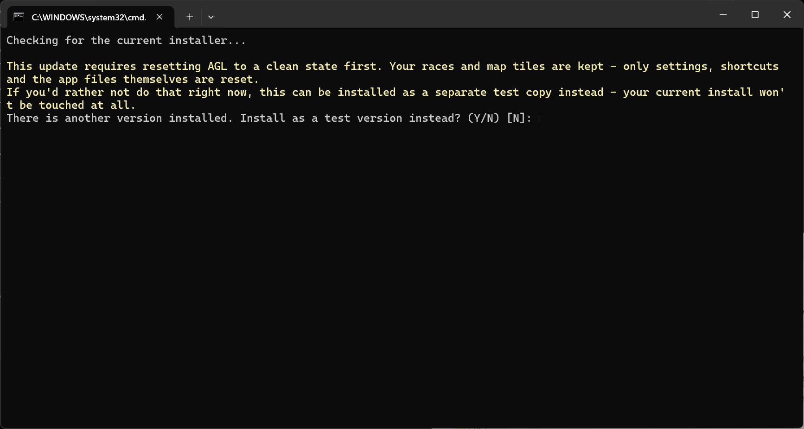

# AGL 25 Note di Rilascio 25.4.1

AGL 25.4.1 è una release importante con molte nuove funzionalità. L'obiettivo di questa release è fornire strumenti che riducano gli errori banali, ti tirino fuori dai guai prima che si verifichino e rendano più efficiente l'uso di qtVlm e di AGL. Le modifiche sono molte: leggi le note di rilascio per sapere quali sono, e il Manuale Utente per sapere come usarle.

## Versione 25.4.1

**IMPORTANTE – aggiornamento alla 25.4.1 su Linux:** su alcuni desktop Linux (osservato su Linux Mint) l'aggiornamento non parte se AGL viene avviato dall'icona sul desktop: scegli **Aggiorna ora**, non si apre nulla e al successivo avvio di AGL compare il messaggio che un aggiornamento è in corso. Il problema è risolto nella 25.4.1, ma le versioni precedenti lo hanno, quindi per arrivare alla 25.4.1:

1. Apri una finestra del Terminale e avvia AGL da lì, poi scegli **Aggiorna ora** come al solito. Si apre la finestra di aggiornamento. Per un'installazione Production digita

    ```
    sh -c "'$HOME/SOL/Java25/AGL_start.sh'"
    ```

    (usa la cartella in cui è installato AGL se non è ~/SOL/Java25; per un'installazione Beta usa `Java25Beta` e aggiungi `--channel=beta` dopo le virgolette di chiusura del percorso). Oppure esegui tu stesso l'installer, come descritto nella sezione 2.1.3 del Manuale Utente.

2. Se AGL dice che un aggiornamento è in corso e non c'è nessuna finestra di aggiornamento aperta, elimina il file di blocco dell'aggiornamento e avvia di nuovo AGL:

    ```
    find ~ -maxdepth 3 -path '*sessions*' -name update.lock -delete
    ```

### Miglioramenti

#### Controllare la rotta prima che vada al server

1. AGL ora può pre-verificare i DC per BBQ, boe di mare mancate e linea di arrivo, proponendoti soluzioni prima che i DC vengano impostati. Non viene modificato nulla finché non accetti un suggerimento. Il Controllo DC segna inoltre con puntini rossi i BBQ che trova, e per evitare la terraferma è disponibile Tack/Gybe later.

2. Quando un DC cade fuori dal maxVMG, AGL ora condiziona l'intera lista dei DC, con Condiziona tutti e Imposta comunque.

3. Un nuovo comando Segui nel menu popup della grafica aggiunge waypoint lungo una costa tra due waypoint.

#### Messaggi sul telefono

1. AGL ora può inviare messaggi in tempo reale al tuo telefono tramite Pushover e Telegram: arrivo del Wx, rischio di incaglio o incaglio avvenuto, boa che sta per essere mancata o mancata, regata che parte senza rotta, e DC del server che finiscono prima del prossimo Wx (No DCs). I messaggi di emergenza si ripetono finché non li confermi sul telefono.

2. Pushover si configura una sola volta nell'hub, per tutte le regate.

3. Telegram funziona con un solo bot nell'hub, con canali per ciascuna regata. AGL può proporti una variazione di rotta sul telefono, e viene applicata solo quando la confermi da lì. Un insieme di comandi permette di controllare lo stato e inviare variazioni di rotta dal telefono.

4. Replica delle chat room del client SOL in una scheda chat staccabile.

5. I messaggi inviati da AGL più lunghi di 187 caratteri vengono divisi in parti e trasmessi insieme, e AGL cerca di riunire i messaggi divisi in un unico messaggio.

#### Finestra grafica

1. Un modulo Opzioni di vista nella finestra grafica sostituisce diverse icone della barra degli strumenti e aggiunge i campi delle etichette DC, una legenda, Riempi i poligoni della terra e Carattere -/+ per la grafica.

2. Traccia DC grigia nella finestra grafica, alimentata direttamente dalla DC Data Table, con un pulsante on/off; i waypoint aggiuntivi non vengono più sovrascritti dai DC.

3. Le barche AIS ora vengono tracciate anche dopo la fine di una regata.

#### qtVlm, grib e DC

1. AGL ti avvisa quando apri Routing settings in qtVlm e il grib non è stato aggiornato dopo l'ultimo download del Wx.

2. Il qtVlm collegato può essere configurato in modalità Production, oppure in modalità Test per provare una nuova release di qtVlm prima di aggiornare. AGL propone di collegarlo di nuovo se la sua configurazione è danneggiata, e verifica che le sue tile delle mappe siano il set che corrisponde alle mappe SOL.

3. AGL traccia le isobare dalla pressione presente nel grib (SOL e NOAA), e le conserva quando parte un nuovo download NOAA.

4. AGL verifica di avere memoria sufficiente per il grib NOAA. Se la memoria finisce, resta in uso il grib già caricato.

5. La DC Data Table ora inizia a controllare il file dei DC all'avvio di AGL, lo ricarica quando cambia, e chiede se passare al nuovo file quando qtVlm salva un file modificato in una cartella diversa.

6. Gestione delle finestre di dialogo di qtVlm: le finestre di qtVlm Routing, Converting Routing to Route, Simplification result e Optimization results vengono portate in primo piano, una alla volta, quando sono nascoste dietro altre finestre.

7. Sono gestite le regate che partono con un haulback: AGL sa che la barca non si muove fino alla partenza, quindi la conversione dei waypoint e i comandi di rotta attendono la partenza.

8. I download dal server SailOnline (informazioni sulla regata, grib, DC e barche) sono compressi dove il server lo consente, ripetuti se falliscono, e il login viene rinnovato se scade.

#### L'AGL Hub e l'avvio di AGL

1. L'AGL Hub: un'unica finestra nella barra delle applicazioni con una scheda per ogni regata, che mostra la console della regata e i suoi comandi (Mostra, Riponi, qtVlm Mostra, qtVlm Riponi, Ferma, Termina, Riavvia, Dump dei thread, Salva il registro). Sostituisce una finestra nella barra delle applicazioni per ciascuna regata.

2. Aggiungi regata può avviare più cartelle di regata insieme. Apri avvia AGL in ciascuna; Avvia preme anche Applica al posto tuo. Le cartelle in cui AGL è già in esecuzione sono in grigio e vengono saltate.

3. Chiudendo l'hub si possono lasciare le regate in esecuzione (Chiudi / Lascia / Annulla). L'hub successivo riprende in carico le regate in esecuzione.

4. Riavvio delle regate dopo uno spegnimento: l'hub riavvia le regate dopo il riavvio per un aggiornamento di Windows, un crash o un'interruzione di corrente.

5. AGL_autostart.bat configura l'avvio di AGL all'accesso a Windows, l'accesso automatico a Windows e il blocco dello schermo dopo tale accesso.

6. L'hub ha una propria dimensione del testo (Vista > Dimensione testo), una casella Sempre in primo piano, un orologio UTC con l'ora del computer tra parentesi, e un'icona dell'hub su ogni finestra di regata che porta l'hub in primo piano.

7. AGL si avvia nell'hub e non avvia mai una regata né chiede da solo una cartella di regata. Avviando di nuovo AGL mentre l'hub è aperto, l'hub viene portato in primo piano.

#### Guida, documentazione e Simulatore

1. Un menu Aiuto nell'hub e in ogni finestra di regata: Documentazione, Manuale, Note di rilascio e Invia i log.... Invia i log... raccoglie i log necessari per individuare un problema, ne rimuove password e token, e apre un'email all'autore con lo zip pronto da allegare. Non viene inviato nulla finché non premi Invia.

2. Il Manuale Utente e le Note di Rilascio sono ora pagine web. Vengono installati con AGL e si aprono dal menu Aiuto senza internet, e sono anche online su https://alov1258.github.io/AGL-Release/. Le versioni PDF e i relativi collegamenti sul desktop non vengono più installati, e l'installer rimuove quelli vecchi quando aggiorni.

3. Il Simulatore (solo per i membri) sostituisce il server SailOnline, così puoi provare AGL, e ciò che vedrai sul telefono, senza toccare la tua barca reale. Ha una propria scheda Simulatore. Fai riferimento alla sezione 9 del Manuale Utente.

#### Finestre, Parametri e log

1. Dimensione testo e Dimensione icone nella scheda Parametri: Carattere -/+ e Icone -/+ con un'anteprima della dimensione delle icone, applicate con Applica carattere. Il font è sempre Dialog, quindi la scelta del font non c'è più.

2. I parametri vengono salvati nel file ini man mano che vengono modificati, quindi i pulsanti Save e Refresh non ci sono più. Un valore non valido non viene salvato, e Riscontro lo segnala.

3. AGL ricorda le posizioni delle finestre dell'hub e di AGL e le ripristina all'avvio. Una finestra la cui dimensione risulta sbagliata dopo lo spostamento tra schermi con scala diversa viene riparata.

4. La barra degli strumenti del Timed Race va a capo nelle finestre strette.

5. Riscontro ora mostra solo le informazioni principali. Una nuova scheda Registro contiene l'output di debug. I log sono conservati in `logger_<race>_current.txt` e ruotati, e i tempi di attivazione dei DC possono essere registrati in un file.

### Correzioni di bug – 25.4.1

1. Correzioni generali di affidabilità e stabilità

2. L'implementazione del DC di risveglio (wake up) non funzionava

3. Errore di proiezione nel determinare le intersezioni con le coste, che portava a intersezioni false

4. Corretto un blocco se i DC venivano controllati esattamente quando iniziava il download del Wx.

5. Su Linux, la finestra di aggiornamento non si apriva quando AGL veniva avviato da un'icona del desktop che esegue in un terminale. Ora si apre.

## Versione 25.3.1

### Miglioramenti

1. Viene creato un nuovo file grib chiamato current_grib.grb, replica esatta dei grib caricati nella memoria di AGL. Questo file grib viene aggiornato ogni volta che un nuovo grib o frame grib sostituisce quello presente in memoria. Può essere caricato una sola volta nel tuo pacchetto di routing e poi semplicemente aggiornato per ottenere l'ultima versione.

2. I frame grib NOAA gfs vengono caricati in memoria man mano che arrivano, in modo che AGL sia allineato al server nel momento in cui arriverà il Wx SOL. Disponibile solo per i membri SOL.

3. L'aggiornamento da versioni precedenti alla 25.2.7 seguirà il percorso di aggiornamento della 25.2.7.

4. Tutte le finestre di dialogo popup ora si aprono in corrispondenza del mouse.

5. AGL rileva le sessioni esistenti e impedisce l'avvio di più sessioni dallo stesso progetto.

Solo Windows e Linux. macOS seguirà non appena funzionante e verrà abilitato tramite il launcher dopo i test.

6. AGL può ora creare un'istanza separata di qtVlm collegata alla regata corrente. AGL può avviare qtVlm con la polare corretta per la regata e con current_grib.grb nello slot 1.

> **Nota:** Questa funzione è disponibile solo per i membri SOL. È una prova e potrebbe richiedere il pagamento di un abbonamento a qtVlm per l'uso continuativo.

7. Aggiunte alla barra degli strumenti le icone per ingrandire e ridurre a icona la finestra di qtVlm collegata alla regata.

8. Verifica la porta all'avvio per assicurare che non vi siano discrepanze di porta nei progetti esistenti

9. Configura qtVlm per SOL e imposta il set di tile corrispondente (High o Intermediate)

10. Imposta la polare di qtVlm sulla polare della regata

11. Aggiorna il nome della tua barca in modo che corrisponda al nome della tua barca in SOL

### Correzioni di bug – 25.3.1

1. Il test per verificare se un file esiste su disco ora restituisce la risposta corretta.

2. Miglioramenti generali di robustezza e di gestione degli errori

3. Corretto il blocco che si verificava quando l'elenco delle barche è vuoto o non viene restituito dal server

4. Corretti gli errori di connessione non intercettati da alcune classi.

## Versione 25.2.7

**IMPORTANTE:**

AGL 25.2.7 è un aggiornamento importante basato sulla 25.1.5. Il Manuale Utente descrive la procedura di installazione nella sezione 2.1 per ciascuna delle piattaforme supportate. Per l'aggiornamento dalla 25.1.5, AGL deve eseguire una riorganizzazione importante oltre ad aggiornare l'ambiente runtime. Questo significa che AGL non può più funzionare dalla cartella Java25 attuale, e deve rimuovere completamente tutti i file in quella cartella associati alle release precedenti. Vedrai il seguente messaggio quando proverai per la prima volta ad aggiornare. Digitando **Y** verrà effettuata un'installazione di prova pulita della nuova versione, senza toccare la tua installazione attuale. Puoi usarla se vuoi dare un'occhiata alla nuova versione, continuando comunque a utilizzare quella vecchia.



Una volta pronto per aggiornare, esegui di nuovo l'installer e premi semplicemente **Enter**. L'installer aggiornerà il tuo sistema alla nuova versione, e poi ripulirà l'ambiente di prova.

Una volta aggiornato alla 25.2.7, il launcher di AGL gestirà gli aggiornamenti come descritto nella documentazione.

**NOTA:** Se decidi di seguire il percorso dell'installazione di prova, usala solo per prendere confidenza con il funzionamento di AGL, e poi passa al sistema di produzione il prima possibile.

### Miglioramenti

1. Usabilità della scheda Parameters migliorata. Il tasto Tab ora si sposta solo tra i campi modificabili e ne seleziona il contenuto, pronto per essere sovrascritto.

2. Usabilità del selettore data (date spinner) migliorata. Il selettore data ora si sposta tra i componenti con Tab, Shift-Tab e con un clic del mouse.

3. Le release ora provengono da GitHub e l'installer è stato riscritto. Si avvia da un link nel Manuale Utente, funziona allo stesso modo su Windows, Linux e macOS (solo aarch64) e non richiede più variabili d'ambiente. Fai riferimento alla sezione 2.1 del Manuale Utente.

4. L'installer è suddiviso in componenti (applicazione, runtime Java, librerie, launcher, tile delle mappe e documenti) e scarica solo ciò che gli serve. Un file già presente nella cartella Downloads viene riutilizzato solo se è la versione corrente. Le installazioni pulite e l'applicazione delle patch sono ora lo stesso processo.

5. Uno script cleaner rimuove le impostazioni, i collegamenti e i file di programma di AGL, in modo che il computer appaia come se AGL non fosse mai stato installato. Le cartelle delle regate e le tile delle mappe non vengono mai rimosse. Fai riferimento alla sezione 2.2 del Manuale Utente.

6. I documenti non hanno più la versione nel nome. L'installer aggiunge il Manuale Utente e le Note di Rilascio correnti alla cartella di installazione (in italiano se il tuo computer è impostato sull'italiano) e inserisce sul desktop un collegamento a ciascuno. Il titolo di ciascun documento indica la release a cui si riferisce, e la versione della release è controllata dalla release su GitHub.

7. AGL controlla la disponibilità di una versione più recente a ogni avvio e, dopo la tua conferma, si chiude ed esegue l'installer. Se sono in esecuzione altre sessioni di AGL, chiede di chiuderle al posto tuo; ciascuna si chiude come se avessi fatto clic sul suo pulsante di chiusura, quindi le sue impostazioni vengono salvate. AGL non può essere avviato mentre è in corso un aggiornamento. Fai riferimento alla sezione 2.4 del Manuale Utente.

8. Una release può richiedere che AGL venga ripulito prima dell'installazione, ad esempio quando si aggiorna da una versione vecchia. AGL lo fa dopo la tua conferma, conservando le cartelle delle regate e le tile delle mappe.

9. Il runtime Java è stato aggiornato all'ultima versione.

### Correzioni di bug – 25.2.7

1. Potenziali blocchi e altri problemi di affidabilità sono stati analizzati e corretti.

## Versione 25.2.1

### Miglioramenti

1. Scheda Parameters riorganizzata per una migliore leggibilità. All'utente vengono offerte opzioni per il numero di colonne e per la spaziatura delle righe. Aggiunto il menu View per controllare il comportamento.

2. La password viene cifrata nel file .ini ed è stata aggiunta una casella di controllo Show.

3. Il download NOAA ora verifica se si trova nella finestra di download e se il grib precedente è già stato scaricato. In caso contrario, scarica prima quello e poi avvia il nuovo download. Evita di dover attendere il termine dei download per il primo grib.

4. Nuovi script di installazione e di patch per Windows, Linux e macOS. L'installer scarica la versione, ti permette di scegliere dove installarla, scarica le tile delle mappe se mancano, configura l'ambiente di AGL e propone di creare l'icona sul desktop. Lo script di patch applica un aggiornamento a un'installazione esistente e ripristina i file originali se qualcosa va storto. Vengono installati solo i file per il tuo sistema operativo. Fai riferimento alle sezioni 2.1 e 2.2 del Manuale Utente.

### Correzioni di bug – 25.2.1

1. Condition All DCs non si blocca più

2. La conversione dei waypoint in DC non richiede più un ulteriore DC Check

## Versione 25.1.5

### Miglioramenti

1. Aggiornamento a Java 25

2. Aggiornamento a JOGL 2.6.0

3. Supporto per Linux (testato su Mint)

4. Diversi miglioramenti al diagramma polare della barca.

### Correzioni di bug – 25.1.5

1. Le icone sono di nuovo visibili

2. Corretta la codifica utilizzata per l'esportazione csv di qtVlm, che ora viene caricata correttamente nella DC Data Table

## Versione 24.2.3

### Miglioramenti

1. Metodo di installazione e aggiornamento semplificato. Crea un'icona sul desktop da cui avviare AGL

2. È stato scritto un launcher che

    1. Verifica eventuali cambi di versione e si aggiorna alla nuova versione previa conferma

    2. Apre un selettore file per selezionare o creare e selezionare una cartella principale della regata, quindi selezionare o creare e selezionare una cartella della regata. Una volta creata la cartella principale, il selettore si apre utilizzando quella cartella come cartella di lavoro.

    3. Avvia AGL nella cartella selezionata.

3. Supporto per MacOS

### Correzioni di bug – 24.2.3

1. Non si verifica più lo sfarfallio (flickering) del riempimento dei poligoni. Il riempimento dei poligoni può essere attivato

2. La velocità attuale della barca nel Polar Diagram è ora espressa in nodi (kts), non in m/s

## Versione 24.2.0

### Miglioramenti

1. Aggiunto il diagramma polare della barca. Si apre con l'icona .

2. Rilasciate le mappe versione 2.4.7 in preparazione dell'aggiornamento del server.

### Correzioni di bug – 24.2.0

1. Aumentato il timeout per l'ottenimento del token dal server. Causava il fallimento degli accessi.

2. Migliorata l'elaborazione delle mappe per gestire i poligoni di mappa non validi.

## Versione 24.1.8

### Miglioramenti

1. Se la tua barca è nell'elenco AIS, verrà mostrata in nero mentre segue la tua barca. Questa è la posizione effettiva della tua barca rispetto a tutte le altre barche.

2. Modificato il comportamento del selettore data (date spinner) sia in Parameters che nella DC Data Table. Fai riferimento a pagina 6 del Manuale Utente

3. Aggiunti menu a tendina per tutti i comandi dei waypoint.

### Correzioni di bug – 24.1.8

1. La DC Data Table non gestiva correttamente le latitudini -180/+180 quando si utilizzava l'importazione gpx.

## Versione 24.1.1

### Miglioramenti

1. La DC Data Table ora supporta l'importazione dei file gpx di qtVlm ed Expedition in formato rotta. Leggi la Sezione 6 del manuale utente prima di utilizzare la DC Data Table.

2. Il selettore file ora utilizza la directory del file corrente come cartella predefinita.

### Correzioni di bug – 24.1.1

1. I parametri modificati vengono ora salvati quando viene cambiata la dimensione del carattere.

## Versione 24.1.0

### Miglioramenti

1. Aggiornato per funzionare sotto Java 24.

**Importante:** Questa versione deve essere installata come una nuova installazione completa, come descritto nel manuale alla sezione 2.1 Installazione di AGL 23 per la Prima Volta

### Correzioni di bug – 24.1.0

1. Corretta un'eccezione nella creazione della mappa quando l'area di regata attraversa 180E/O.

## Versione 23.1.21

### Miglioramenti

1. La condivisione dei grib è ora configurabile dall'utente. Non è più necessario rimuovere la cartella di condivisione per interrompere la condivisione.

2. Aggiunto un blocco di condivisione dei grib (share grib lock) per evitare collisioni nel caso in cui due persone decidano di condividere nella stessa posizione. Il blocco di condivisione utilizza il nome del computer e crea un file di blocco chiamato\<nome computer>.share

### Correzioni di bug – 23.1.21

1. Corretta la routine di riduzione dei grib per gestire i casi in cui il grib attraversa la longitudine 180E/O ma l'area di regata no.

## Versione 23.1.16

### Miglioramenti

1. La riduzione del file grib ai limiti della regata è ora configurabile dall'utente.

2. La directory di lavoro corrente è stata aggiunta al titolo della finestra di AGL

3. La classifica attuale della barca è stata aggiunta al file currentBoatInfo.csv come POSN.

4. AGL non attende più l'aggiornamento di sincronizzazione del server durante l'inizializzazione.

### Correzioni di bug – 23.1.16

1. Corretta la routine di riduzione dei grib.

## Versione 23.1.8

### Miglioramenti

1. Rimossi i limiti di zoom dalla grafica OpenGL del DC Checker.

2. I file grib e le mappe sono ora limitati all'area di regata, riducendo la quantità di dati ridondanti caricati.

3. L'attivazione e la disattivazione delle tracce delle barche, dei waypoint aggiuntivi del percorso, delle barbe del vento, dei contorni e del testo dei DC vengono ora salvate e ricordate al riavvio di AGL.

### Correzioni di bug – 23.1.8

1. Corretto il rendering delle barbe del vento che non si estendeva a tutto lo schermo.

2. Corretto un errore nella generazione della mappa quando era presente un solo poligono a un determinato livello.

### Correzioni di bug – 23.1.5

1. La posizione della cartella delle mappe utilizzava la configurazione di AGL14 anziché quella di AGL23. Pertanto, se AGL14 non esisteva, la cartella delle mappe non veniva trovata.

## Versione 23.1.3

### Miglioramenti

1. Aggiunta una soluzione alternativa per i problemi di rendering dei poligoni OpenGL. È stata aggiunta una nuova icona () alla finestra grafica, che attiva/disattiva il riempimento dei poligoni.

## Versione 23.1.0

### Miglioramenti

1. Aggiornamento a Java 23

### Correzioni di bug – 23.1.0

1. Il checker dei waypoint VMG non si blocca più se esaurisce i frame grib

2. La selezione del carattere grafico ora mantiene il carattere selezionato, se non è stato selezionato Arial
