# 2 Installing AGL

This chapter covers getting AGL onto your computer, starting it, updating it and removing it.

## 2.1 Installing and Upgrading AGL 25

### 2.1.1 Windows

#### 2.1.1.1 Production

The following steps are required to install or upgrade AGL. If AGL 25 is already installed, the installer finds it and asks *Update it? (Y/N) \[Y\]* instead of showing the folder chooser: press **Enter** to accept. Only the files that have changed are downloaded.

1.  Click the [AGL Installer](https://github.com/alov1258/AGL-Release/releases/latest/download/agl-install-windows.bat) (agl-install-windows.bat) link. If you get this error, click **Keep**.

    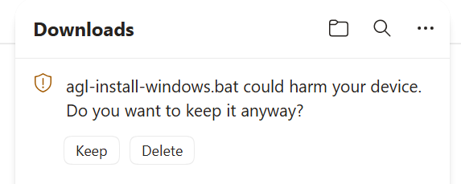

2.  Click **Open File**

    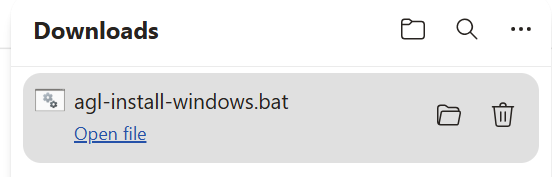

3.  If you get this warning, click **Run**

    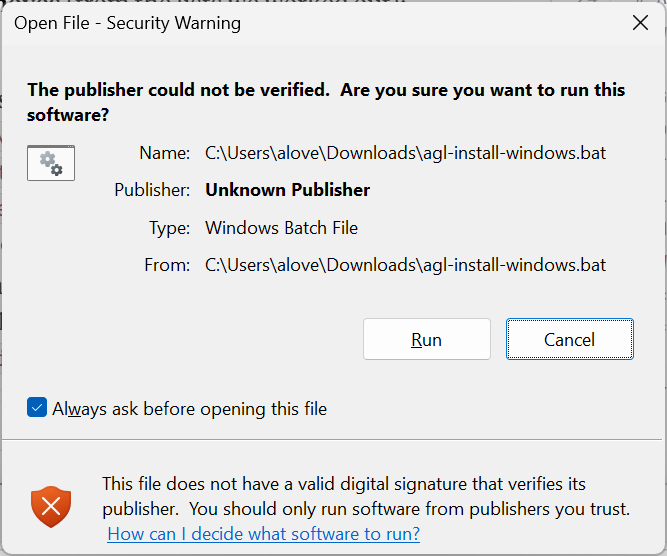

4.  A folder chooser will pop up with **C:\SOL** highlighted. You may have to scroll down to see it. Click OK or navigate to the desired parent location. AGL is installed in a Java25 folder created inside the folder you choose.

    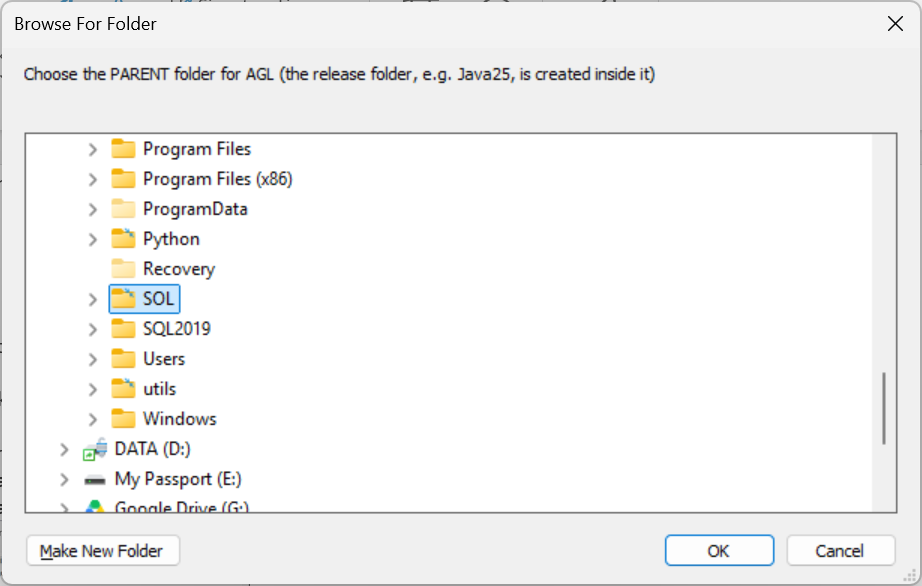

5.  The installer will now proceed to download and install the files it needs. The screen can look frozen for a while during downloads and unpacking; this is normal, so please be patient. The map tiles are a large, separate download. Files already in your Downloads folder are re-used if they are the current versions.

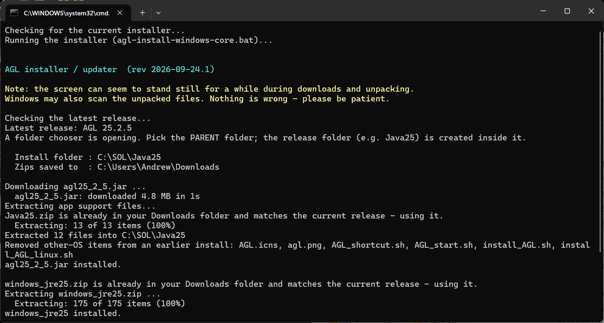

If the installer finds that AGL is in an unexpected location (like Downloads or temp), you will be prompted to select a new location as shown below.

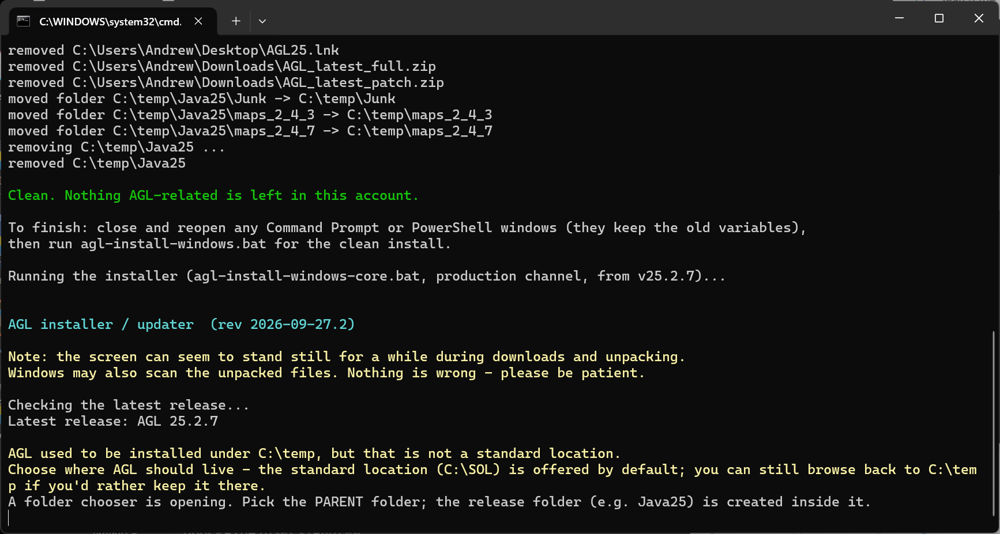

Please select a folder that conforms to the expected AGL path.

6.  There will be prompts along the way. Accept the defaults unless you specifically need to change something. The final feedback will be

*Install complete.*

*AGL is in C:\SOL\Java25*

*Press Enter to close:*

Press Enter to close the window.

7.  If the installer fails for any reason and you lose the desktop icon, simply repeat step 2.

8.  An icon like the below should be created on the desktop.

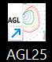

Double click on it to launch AGL and proceed with configuration as described in 2.3 Launching AGL. The installer also downloads the User Manual and Release Notes (in Italian if your computer is set to Italian) and puts a link to each on the desktop.

#### 2.1.1.2 Beta

A beta release of AGL is typically available. Beta builds are pre-release and may contain bugs. As with Production, you choose the parent folder (C:\SOL is the default) and the beta is installed in its own Java25Beta folder inside it, separate from your Production install, so you can keep both. It creates its own set of AGL25Beta icons. The steps to install the beta version are like Production, except there is no option to make a Test version as that is what beta is for. If a beta is already installed, the installer simply updates it. Click on [AGL Beta Installer](https://github.com/alov1258/AGL-Release/releases/download/beta/agl-install-windows-beta.bat) (agl-install-windows-beta.bat) to download the installer. Start the beta from its AGL25Beta icon rather than the AGL25 icon.

### 2.1.2 macOS

#### 2.1.2.1 Production

The following steps are required to install or upgrade AGL.

***Note*:** The screenshots in this section were taken on Linux; macOS looks very similar. On macOS the folder chooser is the standard macOS folder dialog.

1.  Open a Terminal window.

2.  Type

**find ~/Downloads -maxdepth 1 -type f -name "\*.sh"**

If the command reports

*/&lt;your home location&gt;/Downloads/agl-install-macos.sh*

you already have the installer downloaded, so skip the next step. (If it turns out to be an old version, the installer will detect this, refuse to run, and tell you to download a fresh copy.)

3.  If the previous step does not show this file, click the [AGL Installer](https://github.com/alov1258/AGL-Release/releases/latest/download/agl-install-macos.sh) (agl-install-macos.sh) link. If you get a similar error (this is the Windows one), click **Keep**.

    

4.  In the Terminal window, type **cd ~/Downloads** (or where your download folder is)

5.  Type **ls \*.sh**. and you should see **agl-install-macos.sh** in there. Type

    **chmod +x agl-install-macos.sh**

6.  Now type

    > **./agl-install-macos.sh** (or bash agl-install-macos.sh if you prefer not to change the file’s permissions)

7.  A folder chooser will appear looking something like this, with ~/SOL selected as the default install area for AGL. If AGL 25 is already installed, the installer finds it and asks *Update it? (Y/N) \[Y\]* in the Terminal window instead of showing the folder chooser: press **Enter** to accept. Only the files that have changed are downloaded. If a change is required, navigate to that folder and then click OK. If the default is acceptable, simply click OK.

    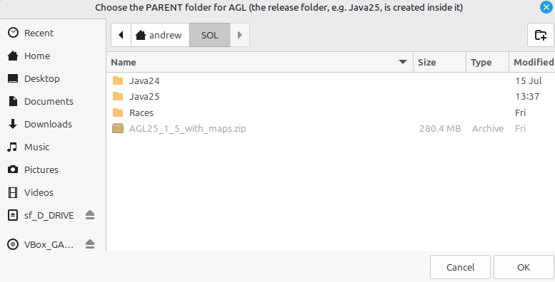

8.  The installer will now proceed to download and install the files it needs. The screen can look frozen for a while during downloads and unpacking; this is normal, so please be patient. The map tiles are a large, separate download.

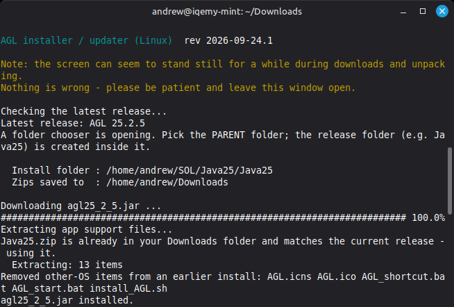

If the installer finds that AGL is in an unexpected location (like Downloads or temp), you will be prompted to select a new location as shown below.

Please select a folder that conforms to the expected AGL path.

9.  There will be prompts along the way. Accept the defaults unless you specifically need to change something. The final feedback will be

*Install complete.*

*AGL is in /Users/&lt;your name&gt;/SOL/Java25*

*Press Enter to close*

Press Enter to close the window.

10. If the installer fails for any reason and you lose the desktop icon, simply repeat step 6.

11. The installer will have made a launcher icon that will look similar to this.

Double-click the AGL25 icon on the Desktop (a link to AGL_Launcher.app in the Java25 folder) to launch AGL and proceed with configuration as described in 2.3 Launching AGL. The installer also downloads the User Manual and Release Notes (in Italian if your computer is set to Italian) and puts a link to each on the desktop.

#### 2.1.2.2 Beta

A beta release of AGL is typically available. Beta builds are pre-release and may contain bugs. As with Production, you choose the parent folder (~/SOL is the default) and the beta is installed in its own Java25Beta folder inside it, separate from your Production install, so you can keep both. It creates its own set of AGL25Beta icons. The steps to install the beta version are like Production, except there is no option to make a Test version as that is what beta is for. If a beta is already installed, the installer simply updates it. Click on [AGL Beta Installer](https://github.com/alov1258/AGL-Release/releases/download/beta/agl-install-macos-beta.sh) (agl-install-macos-beta.sh) to download the installer. In the Production steps above, use agl-install-macos-beta.sh wherever agl-install-macos.sh is shown. Start the beta from its AGL25Beta icon rather than the AGL25 icon.

### 2.1.3 Linux

#### 2.1.3.1 Production

The following steps are required to install or upgrade AGL.

***Note*:** Linux needs the unzip, curl and python3 packages. If the installer reports that one is missing, install it with **sudo apt install unzip curl python3**.

1.  Open a Terminal window.

2.  Type

**find "$(xdg-user-dir DOWNLOAD)" -maxdepth 1 -type f -name "\*.sh"**

If the command reports

*/&lt;your home location&gt;/Downloads/agl-install-linux.sh*

you already have the installer downloaded, so skip the next step. (If it turns out to be an old version, the installer will detect this, refuse to run, and tell you to download a fresh copy.)

3.  If the previous step does not show this file, click the [AGL Installer](https://github.com/alov1258/AGL-Release/releases/latest/download/agl-install-linux.sh) (agl-install-linux.sh) link. If you get a similar error (this is the Windows one), click **Keep**.

    

4.  In the Terminal window, type **cd ~/Downloads** (or where your download folder is)

5.  Type **ls \*.sh**. and you should see **agl-install-linux.sh** in there. Type

    **chmod +x agl-install-linux.sh**

6.  Now type

    > **./agl-install-linux.sh**

7.  A folder chooser will appear looking something like this, with ~/SOL selected as the default install area for AGL. If AGL 25 is already installed, the installer finds it and asks *Update it? (Y/N) \[Y\]* in the Terminal window instead of showing the folder chooser: press **Enter** to accept. Only the files that have changed are downloaded. If a change is required, navigate to that folder and then click OK. If the default is acceptable, simply click OK.

    

8.  The installer will now proceed to download and install the files it needs. The screen can look frozen for a while during downloads and unpacking; this is normal, so please be patient. The map tiles are a large, separate download.

If the installer finds that AGL is in an unexpected location (like Downloads or temp), you will be prompted to select a new location as shown below.

Please select a folder that conforms to the expected AGL path.

9.  There will be prompts along the way. Accept the defaults unless you specifically need to change something. The final feedback will be

*Install complete.*

*AGL is in /home/&lt;your name&gt;/SOL/Java25*

*Press Enter to close*

Press Enter to close the window.

10. If the installer fails for any reason and you lose the desktop icon, simply repeat step 6.

11. An icon like the below should be created on the desktop.

Double click on it to launch AGL and proceed with configuration as described in 2.3 Launching AGL. The installer also downloads the User Manual and Release Notes (in Italian if your computer is set to Italian) and puts a link to each on the desktop.

***Note*:** The installer runs install_AGL_linux.sh for you (it sets the permissions on the bundled Java), so there is nothing more to run. Some Linux desktops may ask you to trust the launcher the first time you double-click it (Linux Mint does not). If asked, choose the option to trust or allow launching it.

#### 2.1.3.2 Beta

A beta release of AGL is typically available. Beta builds are pre-release and may contain bugs. As with Production, you choose the parent folder (~/SOL is the default) and the beta is installed in its own Java25Beta folder inside it, separate from your Production install, so you can keep both. It creates its own set of AGL25Beta icons. The steps to install the beta version are like Production, except there is no option to make a Test version as that is what beta is for. If a beta is already installed, the installer simply updates it. Click on [AGL Beta Installer](https://github.com/alov1258/AGL-Release/releases/download/beta/agl-install-linux-beta.sh) (agl-install-linux-beta.sh) to download the installer. In the Production steps above, use agl-install-linux-beta.sh wherever agl-install-linux.sh is shown. Start the beta from its AGL25Beta icon rather than the AGL25 icon.

## 2.2 Completely Removing AGL

### 2.2.1 Windows

If you want to completely remove AGL and reset your computer to a state that AGL has never been installed, complete the following steps. Note that it won’t remove the maps due to their size and the time it takes to reinstall them. Your race folders are never touched.

***Note*:** Close all AGL windows before you start. The cleaner will not remove an install that is still running.

1.  Click the [AGL Cleaner](https://github.com/alov1258/AGL-Release/releases/latest/download/agl-clean-windows.bat) (agl-clean-windows.bat) link. If you get this error, click **Keep**.

    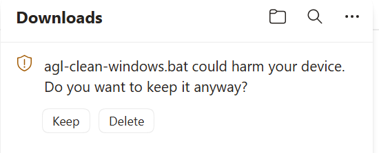

2.  Click **Open File**

    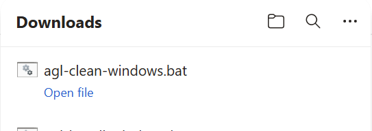

3.  If you get this warning, click **Run**

    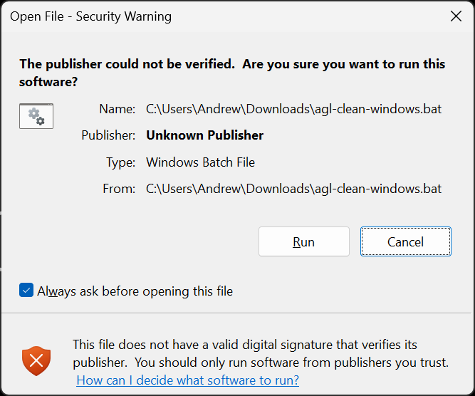

4.  A cmd window will be displayed as follows, showing what is going to be removed. Press **Enter** to continue, or type in another AGL installation folder e.g. AGL24

    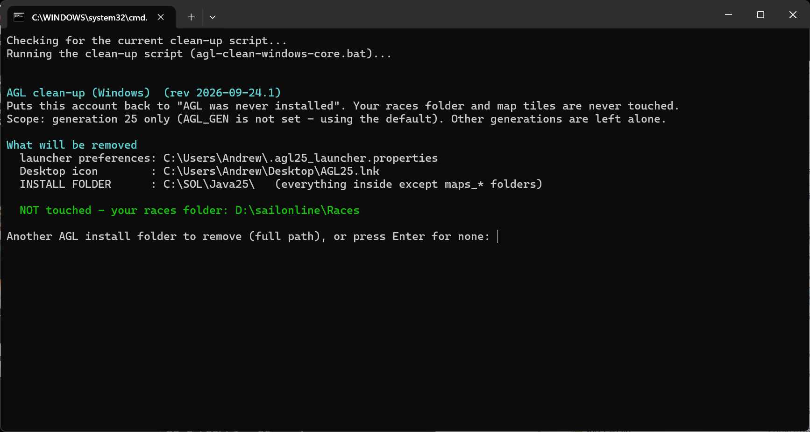

5.  You will now be asked to type **YES** to continue.

6.  Once complete, press **Enter to close the window** and continue with [2.1 Installing and Upgrading AGL 25](#21-installing-and-upgrading-agl-25). The last line of the window tells you to run agl-install-windows.bat: that is the installer described in 2.1.

To remove a Beta installation, follow the same steps, but click the [AGL Beta Cleaner](https://github.com/alov1258/AGL-Release/releases/download/beta/agl-clean-windows-beta.bat) (agl-clean-windows-beta.bat) link instead.

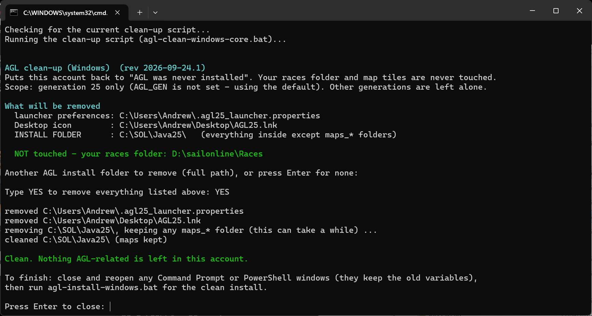

### 2.2.2 macOS

If you want to completely remove AGL and reset your computer to a state that AGL has never been installed, complete the following steps. Note that it won’t remove the maps due to their size and the time it takes to reinstall them. Your race folders are never touched.

***Note*:** Close all AGL windows before you start. The cleaner will not remove an install that is still running.

***Note*:** The screenshots in this section were taken on Linux; macOS looks very similar.

1.  Open a Terminal window.

2.  Type

**find ~/Downloads -maxdepth 1 -type f -name "\*.sh"**

If the command reports

*/&lt;your home location&gt;/Downloads/agl-clean-macos.sh*

you already have the cleaner downloaded, so skip the next step. (If it turns out to be an old version, the cleaner will detect this, refuse to run, and tell you to download a fresh copy.)

3.  Click the [AGL Cleaner](https://github.com/alov1258/AGL-Release/releases/latest/download/agl-clean-macos.sh) (agl-clean-macos.sh) link. If you get a similar error (this is the Windows one), click **Keep**.

    

4.  In the Terminal window, type **cd ~/Downloads** (or where your download folder is)

5.  Type **ls \*.sh**. and you should see **agl-clean-macos.sh** in there. Type

    **chmod +x agl-clean-macos.sh**

6.  Now type

    > **./agl-clean-macos.sh**

7.  The following will be displayed (macOS equivalent), showing what is going to be removed. Press **Enter** to continue, or type in another AGL installation folder e.g. AGL24

    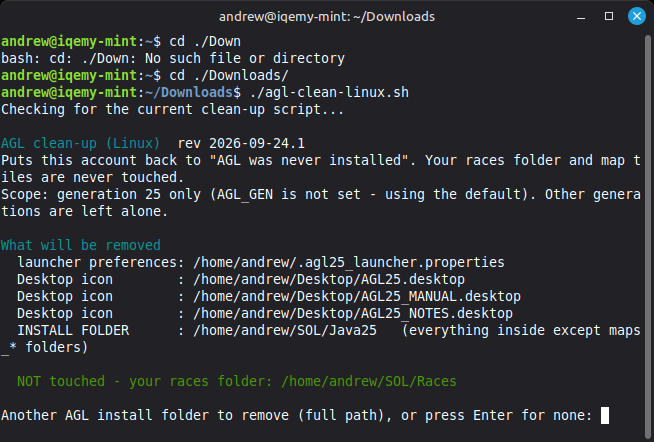

8.  You will now be asked to type **YES** to continue.

9.  Once complete, press **Enter** and continue with [2.1 Installing and Upgrading AGL 25](#21-installing-and-upgrading-agl-25). If agl-install-macos.sh is already downloaded, you can run that script now.

To remove a Beta installation, follow the same steps, but click the [AGL Beta Cleaner](https://github.com/alov1258/AGL-Release/releases/download/beta/agl-clean-macos-beta.sh) (agl-clean-macos-beta.sh) link and use agl-clean-macos-beta.sh wherever agl-clean-macos.sh is shown.

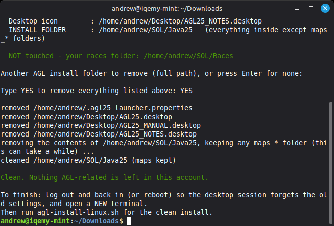

### 2.2.3 Linux

If you want to completely remove AGL and reset your computer to a state that AGL has never been installed, complete the following steps. Note that it won’t remove the maps due to their size and the time it takes to reinstall them. Your race folders are never touched.

***Note*:** Linux needs the unzip, curl and python3 packages. If the installer reports that one is missing, install it with **sudo apt install unzip curl python3**.

***Note*:** Close all AGL windows before you start. The cleaner will not remove an install that is still running.

1.  Open a Terminal window.

2.  Type

**find "$(xdg-user-dir DOWNLOAD)" -maxdepth 1 -type f -name "\*.sh"**

If the command reports

*/&lt;your home location&gt;/Downloads/agl-clean-linux.sh*

you already have the cleaner downloaded, so skip the next step. (If it turns out to be an old version, the cleaner will detect this, refuse to run, and tell you to download a fresh copy.)

3.  Click the [AGL Cleaner](https://github.com/alov1258/AGL-Release/releases/latest/download/agl-clean-linux.sh) (agl-clean-linux.sh) link. If you get a similar error (this is the Windows one), click **Keep**.

    

4.  In the Terminal window, type **cd ~/Downloads** (or where your download folder is)

5.  Type **ls \*.sh**. and you should see **agl-clean-linux.sh** in there. Type

    **chmod +x agl-clean-linux.sh**

6.  Now type

    > **./agl-clean-linux.sh**

7.  The following will be displayed, showing what is going to be removed. Press **Enter** to continue, or type in another AGL installation folder e.g. AGL24

    

8.  You will now be asked to type **YES** to continue.

9.  Once complete, press **Enter** and continue with [2.1 Installing and Upgrading AGL 25](#21-installing-and-upgrading-agl-25). If agl-install-linux.sh is already downloaded, you can run that script now.

To remove a Beta installation, follow the same steps, but click the [AGL Beta Cleaner](https://github.com/alov1258/AGL-Release/releases/download/beta/agl-clean-linux-beta.sh) (agl-clean-linux-beta.sh) link and use agl-clean-linux-beta.sh wherever agl-clean-linux.sh is shown.

## 2.3 Launching AGL

### 2.3.1 Starting AGL Launcher

**Windows:** Double click on the AGL25 icon  on the desktop, or choose **AGL25** in the Start menu. The installer puts an icon in both places. To start AGL from the taskbar, right-click either icon and choose **Pin to taskbar**. A command window may show for a moment, then it closes by itself: the hub is the AGL window that stays.

**Linux:** Double click on the AGL25 icon on the desktop.

**macOS:** Double click on “AGL_Launcher.app” (or the AGL25 icon on the Desktop, which is a link to it). The first time you open it, macOS may warn “cannot be opened because Apple cannot check it for malicious software”. If so, right-click (or Control-click) the app, choose “Open”, then confirm “Open” in the dialog that appears. You only need to do this once. After that, double-clicking works normally.

To keep it on the Dock: drag “AGL_Launcher.app” onto the Dock, or right-click its icon while it’s running and choose “Options &gt; Keep in Dock”. You can leave it right where it is in the Java25 folder - you don’t need to move it to Applications.

Starting AGL opens the **AGL Hub**: the one AGL window on the taskbar, with a tab for each race. If the hub is already open, starting AGL again simply brings it to the front. The first time AGL is started it asks for a few things first (see Starting AGL for the First Time), and then the hub opens (see The AGL Hub).

### 2.3.2 Starting AGL for the First Time

If a newer version of AGL is available, the update dialog described in 2.4 Updating AGL is shown first. Some or all of the following steps will occur:

Some or all of the following will occur the first time:

1. If the **races directory** has not been set, AGL asks for it. This only happens once. The races directory is the folder that holds all of your race folders, for example D:\sailonline\Races.

   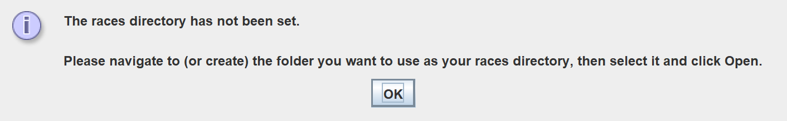

2. Click **OK**. A folder chooser opens at the folder above the AGL install folder. Navigate to your races folder, or create it: type a name in the **New folder name** box and click **Create Folder**. Select the folder and click **Open**.

   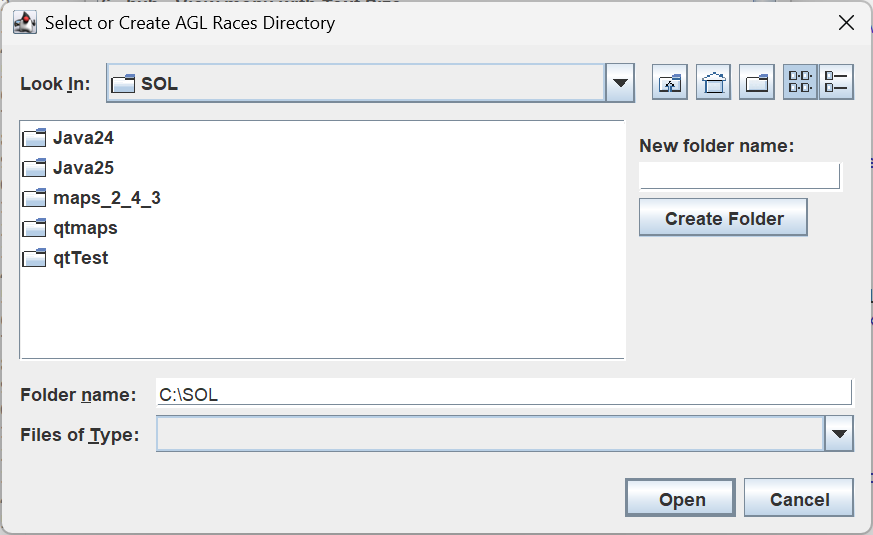

   **Do not** use the Java25 folder as your races folder as this is where AGL is installed. You run the risk of an install of AGL deleting that folder and all your races.

3. AGL confirms the folder it has set.

   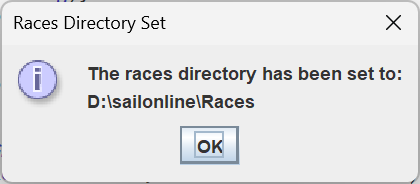

4. If you are upgrading from an earlier generation of AGL that already had a races directory, AGL uses it and tells you so, instead of asking.

   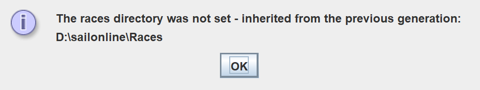

5. The **AGL Hub** opens with its **Launcher** tab. No race has been started: AGL never starts a race, or asks for a race folder, by itself. Click **Add Race** to start your first race (see Adding a Race).

6. 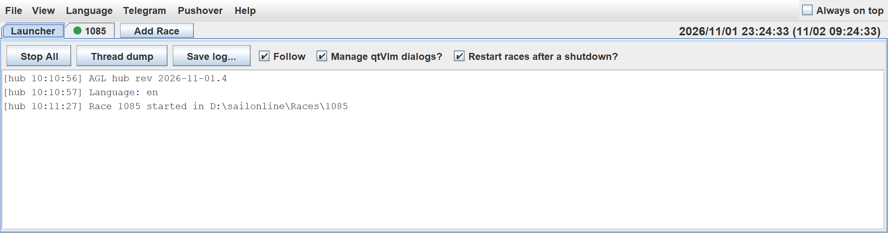

The Launcher tab shows what AGL did to get here: the launcher revision, the install folder, the version and channel, the update check and the races directory.

***Note*:** You **must** have a good internet connection for this to work.

### 2.3.3 The AGL Hub

The hub is the one AGL window on the taskbar. Each race still runs as a program of its own, in its own race folder, so a race that hangs can be ended without touching the others, and the races carry on if the hub is closed.

#### 2.3.3.1 The Hub Window

The hub opens at the top left of the main screen. Its title shows the AGL version.

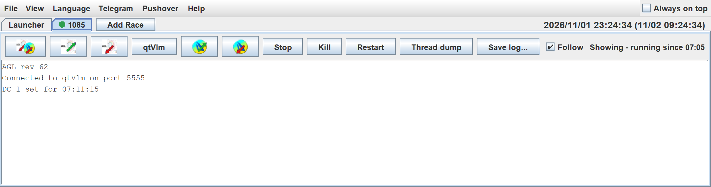T

- The tab strip has the **Launcher** tab, then a tab for each race, named after its race folder. Hold the mouse over a race tab to see the race name and number.

- The **Add Race** button is after the last tab.

- At the right end of the tab strip is a clock. It shows UTC first, then the computer's own time in brackets.

- Tick **Always on top** (top right) to keep the hub above other windows. AGL remembers it.

- The hub icon beside the In Control icon  on the AGL DC Checker tab brings the hub to the front.

The hub never closes by itself. It stays open until you close it (see Closing the Hub).

#### 2.3.3.2 The Hub Menus

- **File &gt; Add Race...** (Ctrl+N) chooses race folders and starts AGL in them (see Adding a Race).

- **File &gt; Stop All Races** closes every running race as its own Quit does.

- **File &gt; Exit Hub, Leave Races Running** ends the hub only (see Closing the Hub).

- **File &gt; Quit** closes the hub, and asks what to do about the races that are running.

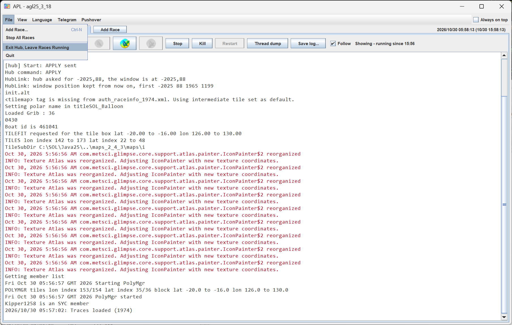

- **View &gt; Text Size** sets the size of the text in the hub: choose a size from the list, or use **Larger** (Ctrl and +), **Smaller** (Ctrl and -) or **Reset** (Ctrl and 0). The size is the hub's own, and is remembered. The consoles use a larger monospaced font.

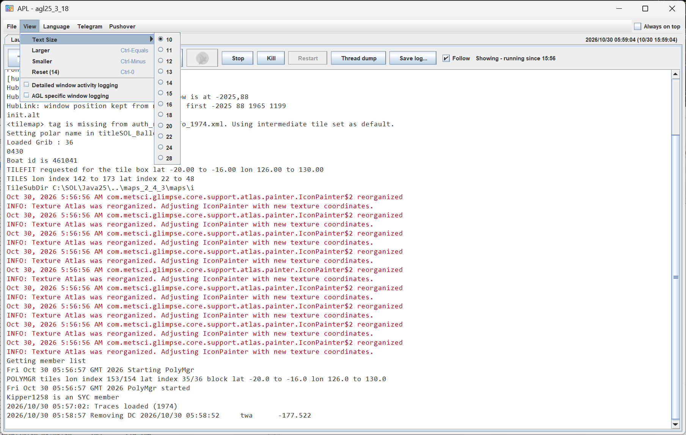

- **View &gt; Detailed window activity logging** and **View &gt; AGL specific window logging** are both off to start with. They add lines about qtVlm's windows and the focus to the Launcher console, for finding out why a qtVlm window was or was not brought to the front. Leave them off unless asked to turn them on.

- The **Language** menu chooses the language of AGL (English or Italian). The hub changes at once, the races that are running are told, and races you start later use it too. AGL remembers the choice. A race window has its own **Language** menu, which changes that window and its dialogs for the session only: the hub's setting is not changed.

- The **Telegram** menu sets up the Telegram bot. It is described in its own section.

- The **Pushover** menu has **Setup...**, where you enter the Pushover application token, your user key and the other settings once for every race. It is described under Setting Up Pushover.

- The **Help** menu opens the documentation and mails your logs. It is described in The Help Menu, below.

#### 2.3.3.3 The Launcher Tab

The console on this tab shows what AGL does as it starts, a line as each race is started, and messages from the hub itself, which start with \[hub\]. They include which qtVlm belongs to each race, whether the race is a member, and what the qtVlm dialog manager does (see Managing qtVlm Dialogs).

- **Stop All** closes every running race as its Quit does.

- **Thread dump** prints, in this console, what every thread of the hub is doing. You only need it if asked for it.

- **Save log...** saves the text of this console to a file.

- **Follow** scrolls to the newest line as it arrives. Untick it to read earlier lines.

- **Manage qtVlm dialogs?** (see Managing qtVlm Dialogs).

- **Restart races after a shutdown?** (see Restarting Races After a Shutdown).

#### 2.3.3.4 Race Tabs

Each race has its own tab. Its console shows everything the race writes while it runs: the working folder, the font size, the grib and tiles it loads, the traces, and so on. Error output is shown in red. Some Java messages are in red even though nothing is wrong. The same text is saved in agl_console.log in the race folder, and replaced each time the race starts.

The dot on a race's tab shows how it is: **green** for running, **amber** if the race has written error output since you last looked at its tab, and **red** if it ended with an error. The status line at the right of the buttons says what the race is doing, for example "Showing - running since 22:22".

The buttons on a race's tab are:

- **Pop** shows this race's AGL window. It is grey while the window is shown, but it still works, because the window may be behind others. Double-clicking the race's tab does the same.

- **Stow** puts all of this race's windows away. It is grey when they are already away.

- **qtVlm** starts qtVlm for this race. It appears when the race has qtVlm set up.

- **qtVlm Pop** brings this race's qtVlm to the front, restoring it first if it is minimised. **qtVlm Stow** minimises it. They work once the race has told the hub which qtVlm is its own, and follow the real state of the window if you move it yourself. They are not shown on macOS.

- **Stop** closes the race as its Quit does, and saves first. If it has not closed after 10 seconds the status says "Not stopping - use Kill".

- **Kill** ends the race at once and saves nothing, so use it only for a race that hangs. AGL asks you to confirm. On a race that has already ended, Kill closes its tab.

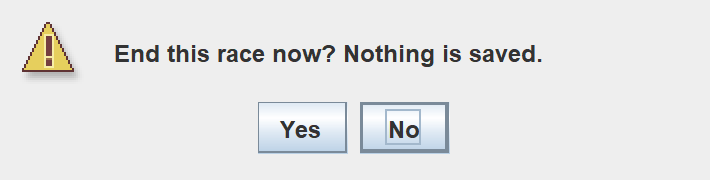

- **Restart** starts a race that has ended again, in the same folder.

- **Thread dump** prints, in the race's console, what every thread of the race is doing. You only need it if asked for it.

- **Save log...** saves the text of this race's console to a file.

- **Follow** scrolls to the newest line as it arrives. Untick it to read earlier lines.

If a dialog is open in a race, the status says "A dialog is open in the race - answer it first".

When a race ends because you closed it (its own Quit, or Stop), its tab goes. If it ends any other way, its tab stays with a red dot and the status "Ended with exit code ... - the console says why", and the hub comes to the front. Read the console, then click **Restart**, or **Kill** to close the tab.

#### 2.3.3.5 Adding a Race

Click **Add Race** (or **File &gt; Add Race...**) and the race folder chooser opens at your races directory. This is the only way to start a race from the hub: it never opens the chooser by itself.

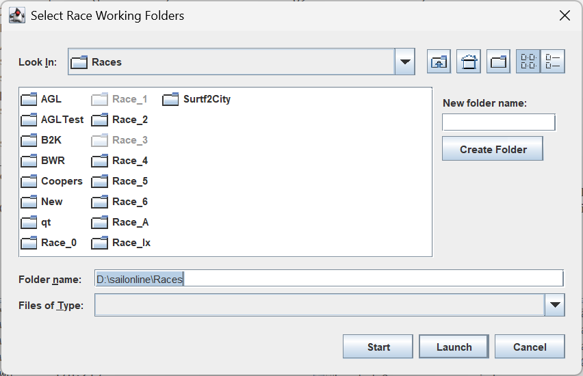

- Select one or more race folders (hold Ctrl or Shift to select several). To make a new race folder, type its name in the **New folder name** box and click **Create Folder**.

- A folder that already has an AGL running in it is grey. You cannot start a second AGL in it: if you choose it, AGL says so and you choose again. If you choose several and some are already running, those are left out and AGL tells you which.

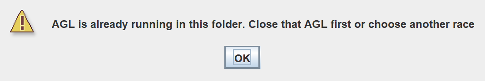 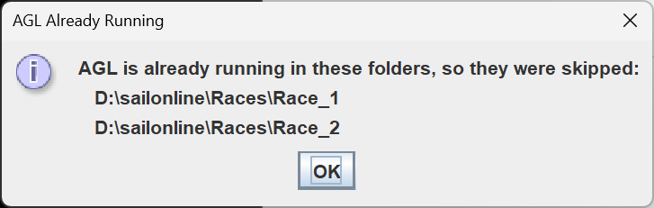

- **Open** starts AGL in each folder you selected. On each race's Parameters tab the **Apply** button is then available for you to press when you are ready.

- **Start** starts AGL in each folder and presses Apply for you, as soon as the race's window has appeared. Use it for races that are already set up.

- The races start one after another. Each new race window is placed 40 pixels down and to the right of the one before, so they are not all on top of each other.

If you choose a folder that is not in your races directory, AGL asks what it is. Choosing **This is a Race Folder** starts a race in it and makes the folder it is in your races directory. Choosing **This is my Races Directory** makes it your races directory and shows the chooser again, so you can choose a race folder inside it. When you choose several folders that are all in another folder, AGL asks whether they are race folders.

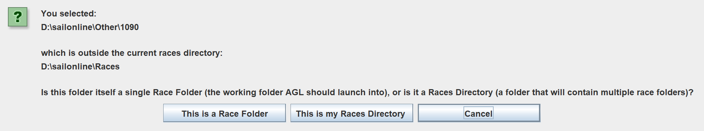 

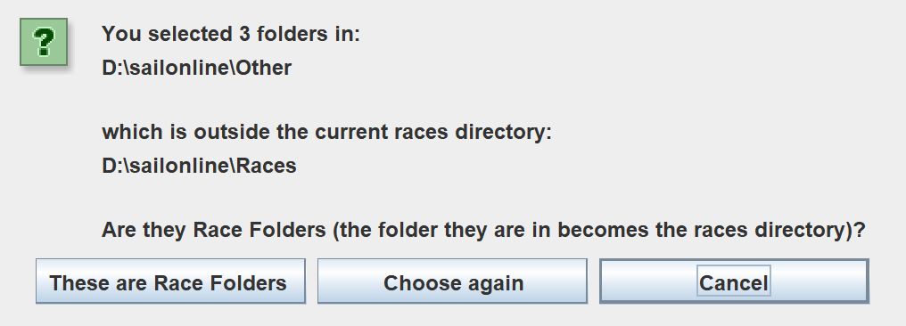

Starting AGL again from its icon while the hub is open does not start a race: it just brings the hub to the front.

#### 2.3.3.6 Managing qtVlm Dialogs

**SOL members area**. This section is only available to SailOnline paid up members.

qtVlm's results windows can open behind other windows. With **Manage qtVlm dialogs?** ticked, which it is to start with, the hub brings these qtVlm windows to the front when they are hidden behind other windows: **Routing**, **Converting Routing to Route**, **Simplification result** and **Optimization results**.

- If several come at once, they are shown one at a time. The next one comes when you close the one on show.

- A window waits while the focus is in an AGL window, for as long as it is there. It also waits while you are working in another qtVlm: a dialog or menu is open in it, the mouse is moving over it, or you are typing or clicking in it. Otherwise it is brought to the front. The focus in any other program does not make it wait.

- While a qtVlm dialog is open and does not have the focus, a light orange frame shows round the hub and the race windows, wherever the focus is. It goes when the dialog has the focus or is closed.

- AGL does not put the window that was in front back afterwards. When you have finished with the dialog, go back to the window you want.

- It is done only for races that AGL has recognised the user to be a SOL member. The Launcher console says "&lt;boat&gt; is a member" when it has.

- Each window the manager looks at is written to the Launcher console: "already in front - left alone", or what it did, and "closed" when you close it.

Untick the box to turn the manager off. It applies at once, to all the races.

#### 2.3.3.7 Restarting Races After a Shutdown

When Windows restarts for an update, or the PC crashes or loses power, the races stop and nothing protects your boats until somebody starts AGL again. **Restart races after a shutdown?** is off to start with. When it is ticked:

- The hub keeps a list of the races that should be running.

- When a hub starts, it starts those races again, one every 4 seconds, as **Start** does, so Apply is pressed too. The Launcher console says "Restarting ... - it was running when the hub was last ended".

- A race comes off the list when you end it on purpose: **Stop**, **Stop All**, **Kill**, **File &gt; Quit** with **Close**, or the race's own Quit. Windows ending the session, a crash, a power cut, or an update that asks AGL to close leaves it on the list.

With the box not ticked, a hub that starts only takes up the races it finds still running.

This only helps if AGL starts when the PC starts, and for that Windows has to sign in by itself, otherwise nothing runs until somebody signs in. On Windows, when you tick the box and this has not been set up, AGL asks:

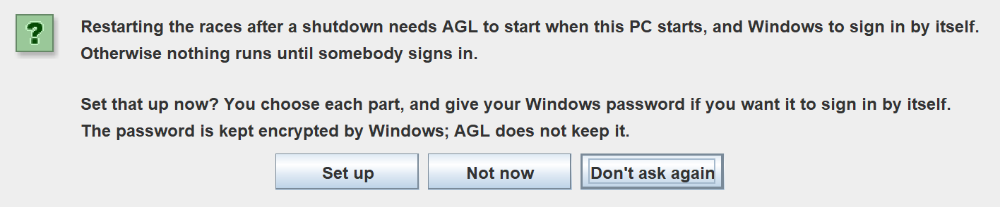

- **Set up** opens the set-up window (AGL_autostart.bat in the AGL install folder), described below.

- **Not now** leaves it for now. You are asked again the next time AGL starts with the box ticked.

- **Don't ask again** stops the question. You can still run the set-up from the AGL install folder at any time.

The set-up window first asks Windows for permission (UAC). It then shows what is set up now, and asks **S** to set up, **R** to remove what it made, or **Q** to quit. Nothing is changed until you answer. If you choose S, you choose each of three parts:

1.  **Start AGL when you sign in.** This puts a shortcut called "AGL25 start with Windows" in your Startup folder. It waits 20 seconds for the network, then starts AGL, and AGL restarts your races. It also ticks **Restart races after a shutdown?** in the hub. (An AGL Beta or Test install has Beta or Test in the name.)

2.  **Sign in to Windows by itself after a restart.** This needs your Windows password. The set-up checks it, and Windows keeps it encrypted; AGL does not keep it. An administrator of the PC can still read it, so use this only on a PC you trust. If you sign in to Windows with a Microsoft account and a PIN, this switches on password sign-in for the PC.

3.  **Lock the screen right after that sign-in.** This is only offered if you chose 2. It puts a shortcut called "AGL lock screen after sign-in" in your Startup folder. AGL and the races keep running, and nobody can use the PC without the password.

To undo any of it, run the set-up again and choose **R**. It removes the shortcuts, turns off the automatic sign-in and deletes the saved password.

*Note: Restart races after a shutdown is for Windows only.*

#### 2.3.3.8 Closing the Hub

Click the X of the hub, or choose **File &gt; Quit**. If races are running, AGL asks:

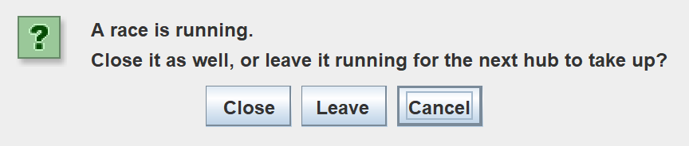

- **Close** closes the races as well, and the hub. They are not restarted afterwards.

- **Leave** closes the hub only. The races keep running, and the next hub takes them up again when you start AGL.

- **Cancel** keeps the hub open.

**File &gt; Exit Hub, Leave Races Running** does the same as Leave, after asking you to confirm.

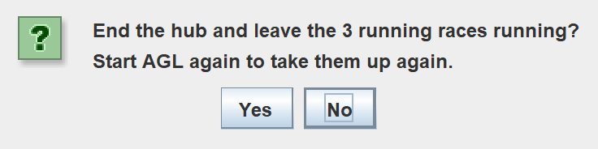

A race that is taken up again by a new hub shows its console from that point on. What it wrote before is in agl_console.log in the race folder.

### 2.3.4 The AGL Race Window

When a race is started from the hub, its AGL window opens, ready for configuration (this is the two column layout). The race window has its own text size and layout controls, below.

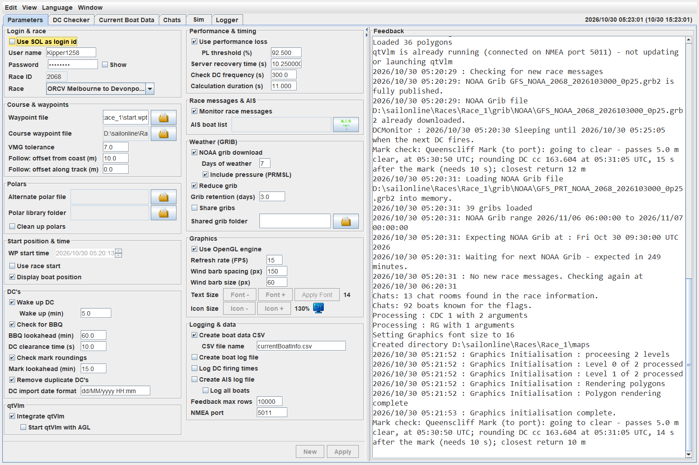

#### 2.3.4.1 Changing Scaling (Graphics Box)

If the text is too small or large, you can adjust the font size and font for the text and buttons **before** you press **Save** or **Apply**.

- **Font +** will increase the font size by 1

- **Font -** will decrease the font size by 1

- The Font drop-down will allow you to choose the font to use.

Press **Apply Font** to apply those changes.

#### 2.3.4.2 The View Menu

You are also able to change the line spacing and number of columns to use. The **View** menu has four options as shown below

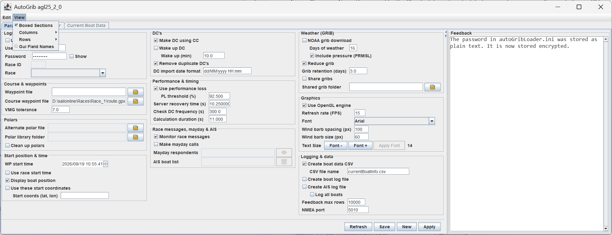

The **Boxed Sections** changes how the title boxes are shown. The **Columns** allows the user to choose how many columns to use to display the parameters. The **Rows** item adjusts how the row spacing is displayed. **Gui Field Names** displays the .ini file field names.

#### 2.3.4.3 The Help Menu

The hub and every race window have a **Help** menu.

- **Documentation** opens the front page of this documentation.

- **Manual** opens the first page of the User Manual.

- **Release notes** opens the release notes.

- **Mail logs...** gathers the logs needed to find a problem and starts an email to the author (see Mailing Your Logs below).

The pages open in your web browser. They are installed with AGL, in the **docs** folder of the Java25 folder, and are shown from your own computer, so they work without the internet and always match the AGL you are running. If that folder is not there, AGL opens the same pages on the web instead. The pages are in the language of the window, if there is a translation, and in English if there is not.

A race window asks the hub to open the page, so there is only ever one of each. If the page is already open in your browser, AGL tells you so instead of opening it again, and you find it among your browser tabs. Any page of the manual counts as the Manual: if you have browsed on to another chapter, **Manual** does not open it again.

##### Mailing Your Logs

If you have a problem and the author asks for your logs, choose **Help > Mail logs...**. AGL:

1.  Makes a zip file of the logs. From a race window these are the race's current log, the newest earlier log, and its console output. From the hub they are the hub's own log and the same files for each race in the hub. Only the last part of each file is included (up to 1.5 MB), because a problem is nearly always near the end.

2.  Removes anything secret from them before they are zipped: the SOL token, your Pushover token and user key, your Telegram bot token, and anything written after the words *token*, *password*, *secret* or *key*. Boat names and race numbers stay, as they are needed to follow what happened. The zip also has a short **about.txt** with the AGL revisions, and your Java and system versions.

3.  Opens a new email addressed to the author, with the subject and a few lines already filled in. Please add what you were doing and what went wrong.

4.  Opens the folder that holds the zip, with the zip file selected. Drag the file from there into the email, then send it.

AGL does not send anything itself: nothing leaves your computer until you press **Send** in your email program. The zip is **agl_logs_**&lt;date and time&gt;**.zip** in the **AGL-Logs** folder in your home folder; each time you use **Mail logs...** the earlier zips there are deleted. You can open the zip first to see exactly what is in it.

If AGL cannot open a mail program, it says so and gives the name of the zip file. Open the **AGL-Logs** folder yourself and attach the zip to an email to the address the message gives.

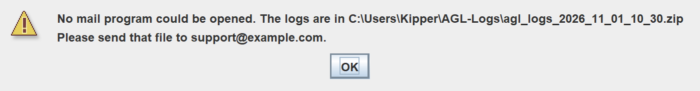

If AGL cannot open an email program (for example, none is set up), or cannot open the folder, it shows a message with the place of the zip file and the address, so you can attach and send it yourself.

Once happy with the layout, you are now ready for configuration.

## 2.4 Updating AGL

Each time AGL starts it checks whether a newer version has been released. If it cannot reach the internet, the check is skipped and AGL starts as normal. If there is a newer version, the update works as follows. Only the files that have changed are downloaded, and your race folders and map tiles are kept.

1.  If a newer version is available, AGL shows this dialog before it does anything else.

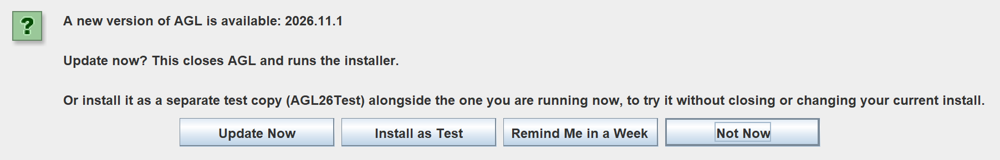

- **Update Now** starts the update. It will also remove any Test install at the same time.

- **Install as Test** will install AGL as a new install in a folder called Java25Test, and create a set of AGL25Test icons.

- **Remind Me in a Week** closes the dialog and does not ask again for seven days.

- **Not Now** closes the dialog and asks again the next time AGL starts.

***Note:*** If you are running a Beta, the same update dialog appears. **Update Now** then updates the Beta only and does not touch any Production or Test install. Likewise, updating Production does not touch a Beta install.

Occasionally a release needs AGL to be reset to a clean state before it is installed; the Release Notes say when. The dialog then adds *this release also resets AGL to a clean state first*, and you are asked to confirm after you click **Update Now**. Your race folders and map tiles are kept, but AGL may ask for your Races folder again the first time it starts afterwards (see 2.3). Choose the same folder as before.

2.  If other AGL sessions are running, AGL lists them by race folder and asks to close them, because they all use the same files. If there are none, this step is skipped.

    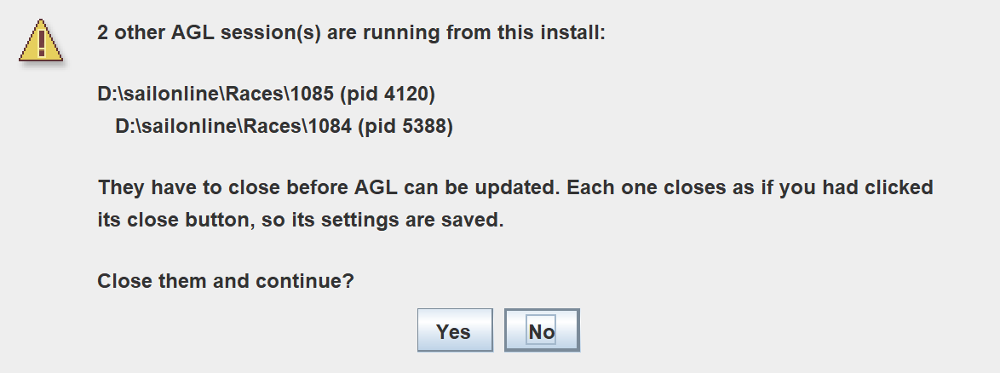

    Click **Yes**. Each session closes as if you had clicked its close button, so its settings are saved. This normally takes a few seconds, but a busy session (for example one that is downloading data) can take up to 30 seconds. If one still has not closed, AGL offers to force it to close, which does not save that session’s settings. Click **No** to cancel the update: nothing is changed and AGL starts as normal.

3.  AGL now closes and an **AGL Update** window opens. It waits for AGL to finish closing and then runs the installer described in 2.1. If a clean is needed you will first see **Step 1 of 2** while AGL is reset, followed by **Step 2 of 2**. For a normal update the installer finds your existing installation and asks *Update it? (Y/N) \[Y\]*: press **Enter** to accept.

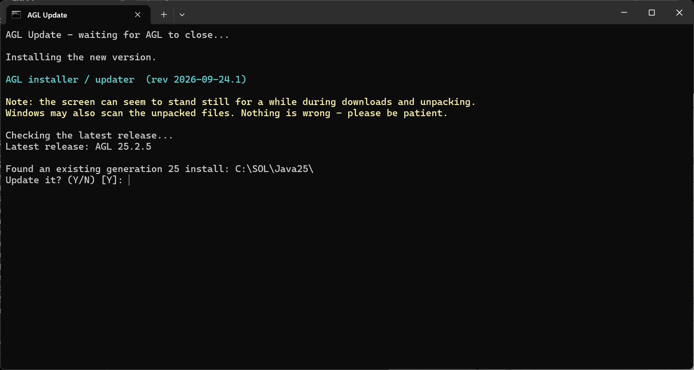

The installer downloads the files that have changed and updates the User Manual and Release Notes. It finishes with *Update complete.* Press **Enter** to close the window, then start AGL from its desktop icon.

***Note*:** Do not start AGL while the update window is open. If you do, AGL tells you an update is in progress and asks you to wait. On Linux and macOS the update window is a terminal window and works the same way.
