# 3 Configuration

You are now ready to configure and fill out the fields as follows:

## 3.1 Login & Race

**Use SOL as login id:** Check this if you want to log on as SOL.

***Note*:** If your **User name** is not **sol** and this is checked, you will automatically be logged out as **sol** and logged in under your **User name** once the race has started.

**User name:** Your SOL username (boat name)

**Password:** Your SOL password

**Race:** Using the Race drop-down combo list, select the current Race. This will automatically populate the race ID.

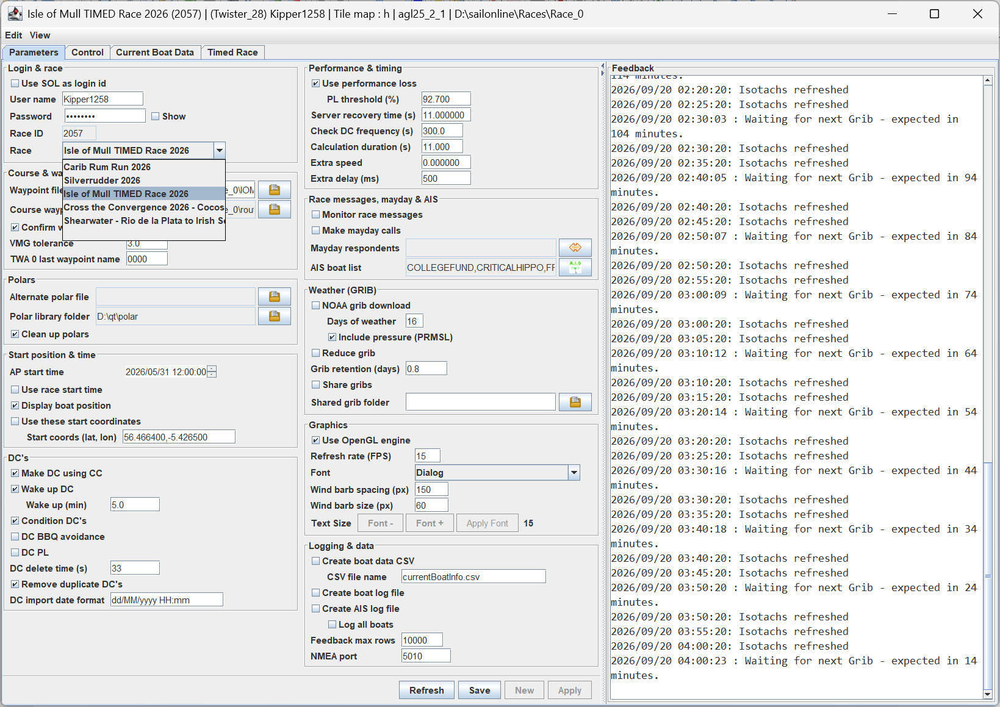

***Note*:** If there are no races in the list, you most likely have an internet connection error. Check your internet, close the app and restart.

## 3.2 Course & Waypoints

**Waypoint file:** Name of the waypoint file to use; can be a gpx file.

**Course waypoint file:** Allows a waypoint or gpx format file to be loaded as additional course waypoints. Select the  which will launch the file chooser.

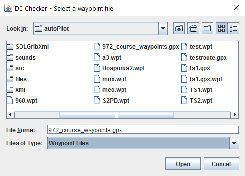

Select the file to use and **Open**. Selecting **Cancel** will clear the currently selected file. This file will now be automatically used each time DC Checker is used.

**VMG tolerance:** Used by the Waypoint to DC routine to determine how closely it needs to honour a waypoint when tacking or gybing to a waypoint. This is an iterative process, and the finer the tolerance, the longer it will take (and may fail).

**Follow: offset from coast (m):** How far out from the coast, in metres, the Follow command puts its waypoints. The default is 10.

**Follow: offset along track (m):** How far, in metres, the Follow waypoints are then moved along the direction of travel. The default is 0.

## 3.3 Polars

**Alternate polar file:** Allows an alternative polar file to be used, which overrides the default polar specified in the race info file for all operations. Select the  which will launch the file chooser, using the Polar library folder setting as the default directory.

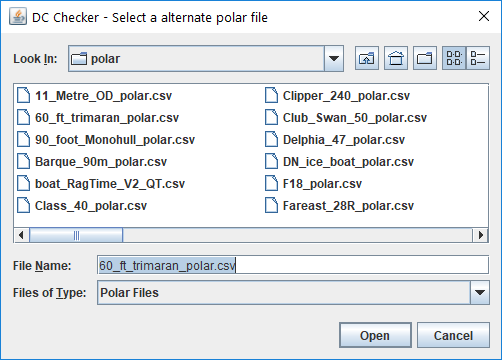

Select the file to use and **Open**. Selecting **Cancel** will clear the currently selected file and default back to the race polar.

The polars will not change until either **New** or **Apply** is pressed.

**Polar library folder:** Specifies where to store and look for alternative boat polars. Select the  which will launch the file chooser.

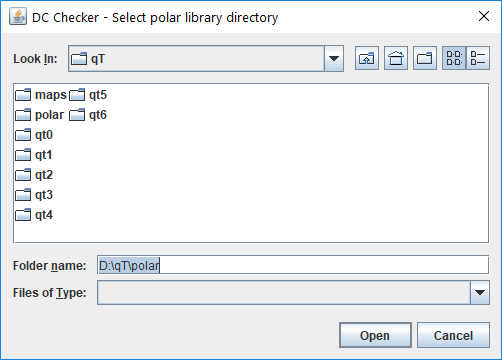

Select the file to use and **Open**. Selecting **Cancel** will clear the currently selected folder and default back to the AGL polar folder.

**Clean up polars:** If selected, all polar and other race data not applicable to the current race will be deleted from the polar folder. This will not affect the polar library.

## 3.4 Start Position & Time

**WP start time:** Used by the Waypoint to DC converter as to when to start using the waypoints. Existing DCs will be inserted and used before this time. The format is the same as the DC format of YYYY/MM/DD HH:MM:SS using UTC and a 24 hour clock. The field has a tooltip that describes how the field works.

On selection, the year will be highlighted. Use the left and right arrows, or Tab and shift-Tab to move between date and time components. You can also click on each component with the mouse. When the component is highlighted, the up and down arrows will increment and decrement that value respectively. The same applies to the arrows at the end of the field.

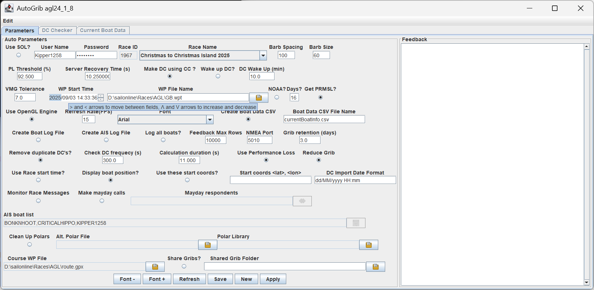

**Use race start time:** This allows the user to check DCs from the start. If checked, the checker will assume that the boat is at the start waypoint, and the time is the start time. Any DCs after that time will be processed in producing the route. If left unchecked, the start time will be now.

**Display boat position:** This is used when the boat is a long way away from the DCs of interest. It will not be plotted or considered in producing the route. Most applicable when **Use these start coordinates** is checked.

**Use these start coordinates:** The route will be calculated assuming the boat is at the **Start coords (lat, lon)**, and the time will be wound forward to the time of the first DC.

**Start coords (lat, lon):** The start coordinates for the route. It is in the format that can be pasted directly from the SOL client. To pick up coordinates from the SOL client, hold the Alt key down, and then click the left mouse button. This copies the coordinates of the crosshairs into the copy/paste buffer.

## 3.5 DCs

**Make DC using CC:** Used by the waypoint to DC converter to determine how to drive to the next waypoint. Should be left checked.

**Wake up DC:** If checked, additional DCs will be inserted at the defined time before the next DC is due to fire. If no DCs are executed for a while, the server jump drifts out to 30 seconds. This can be a problem in rounds as there are now 30 seconds of uncertainty as to when the DC will fire. This is used to wake the server up on roundings so that DCs are fired at 10 second intervals.

**Wake up (min):** The time in minutes to insert an additional DC before the next one fires. 5 minutes is a good duration.

**Mark clearance (m):** How far clear of a course mark, in metres, the boat must pass it to count as having rounded it, and how far past the mark the DC that turns the boat must fire. The default is 5.

**Check for BBQ:** If checked, AGL looks along the boat's course and your DCs for land, sends the BBQ messages and offers fixes. It also needs In Control to be on.

**BBQ lookahead (min):** How far ahead, in minutes, Check for BBQ looks along the course or the DCs. The default is 60.

**Check mark roundings:** If checked, AGL warns you when the boat is going to miss the next mark it has to round. It also needs In Control to be on.

**Mark lookahead (min):** How far ahead, in minutes, the mark check looks for the mark. The default is 15.

**Remove duplicate DCs:** Any subsequent DCs that have the same command and value are removed from the DC list.

**DC import date format:** This is used to specify the date format of the DC import file. From qtVlm, route export, these will typically be either dd/MM/yyyy HH:mm or MM/dd/yyyy HH:mm. Other formats can be defined as per [SimpleDateFormat (Java SE 25 & JDK 25) (oracle.com)](https://docs.oracle.com/en/java/javase/25/docs/api/java.base/java/text/SimpleDateFormat.html).

The DC Data Table is explained in section [6 DC Data Table](0600-dc-data-table.md).

**Caution:** An invalid date format will cause a date parsing exception and may crash the DC Table Editor defined later. A better method is to export the route as a gpx and let AGL recalculate the DCs using the current grib.

## 3.6 Performance & Timing

**Use performance loss:** Performance loss and recovery is included if checked and should match the performance loss setting of the race. Occasionally, such as ice boat races, performance loss is turned off, and this should then be unchecked.

**PL threshold (%):** Performance Loss (PL) minimisation will attempt to achieve this number before making the major loss-making manoeuvre. 92.5% is a good number so that recovery does not take one over the 93% threshold.

**Server recovery time (s):** This is used by the PL calculations to calculate how much recovery will occur between DCs. 11 seconds is a good number, and should not be less than the SOL server jump of 10.25 sec.

**Check DC frequency (s):** A point will be created at this frequency when driving from one DC to the next.

**Calculation duration (s):** When computing the boat path from DCs or waypoints, the boat is advanced in steps according to this duration. For high accuracy, it should match the server jump of about 10–11 seconds.

## 3.7 qtVlm

AGL supports the creation and launching of a race-specific qtVlm instance for **SailOnline members only**. To use this feature safely, you need to have two master instances of qtVlm installed. One as a Test instance, and the second as the Production instance. The reason for this is that a qtVlm upgrade into the same install location will instantaneously update every race that was linked to that install. If you update the Production install, every race set up with Production is updated. If there are any issues with the Production upgrade, every Production race will have the same issues. This is why you should have a Test install. If it goes wrong, you can still keep racing while you work out the problems.

The first instance is typically installed in C:\Program Files\qtVlm for Windows and ~/qtVlm for the other platforms. Use this as your Production copy. Install the second instance in your C:\SOL (~/SOL for Linux/macOS) folder and call it qtTest.

**Note:** Linux needs X11 support. To check if you have a real X11 session, enter

> ***echo $XDG_SESSION_TYPE command -v xdotool \|\| echo "xdotool not installed"***

If ***"xdotool not installed*** “ is returned, you do not have X11. Install by entering the following in a Terminal window

***sudo apt install xdotool***

### 3.7.1 Integration Steps – Test Environment

To install the test copy, do the following:

1.  Close all qtVlm instances. qtVlm will not install if instances are open.

2.  Make a directory C:\SOL\qtTest (~/qtTest for Linux/macOS) and start the installer as per the qtVlm User Manual.

3.  For Windows, when it gets to the install location, change it to C:\SOL\qtTest. **Do not** make desktop shortcuts, as these will replace your existing production ones.

4.  Once the installer completes, there will be a folder under there called qtVlm. This is where your test instance lives. Launch qtVlm from there, and make sure it opens correctly. Download any maps it requires, then close qtVlm.

You are now ready to make a new AGL test race folder by doing the following.

1.  Start AGL and create a new project folder called AGLTest

2.  Configure AGL with your login and a race that you are currently in. In the Logging & Data box, set the NMEA port to a number you are not using. 5020 is a good number for the test project.

3.  Select **Integrate qtVlm** only at this stage.

    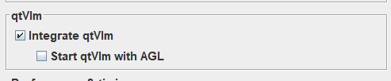

4.  Select Apply. If you are not a SOL member, you will get this message twice. Click OK. For non-SOL members, you cannot proceed past this point in setting up the qtVlm Integration.

    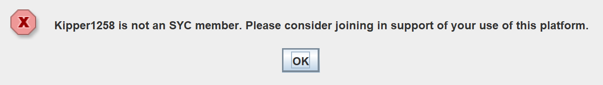

5.  AGL will go through its full startup procedure before integrating qtVlm. Once that is finished you will be asked what integration to set up. Select **Test**

    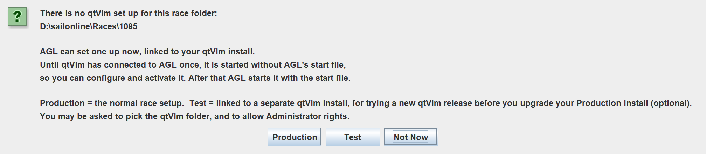

6.  If the qtVlm maps that AGL uses have not been downloaded already, this will be displayed.

    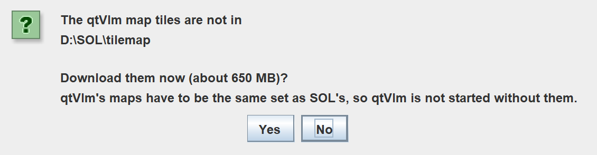Select **Yes** to continue. **No** will cancel the integration setup. qtVlm's maps have to be the same set as SOL's, so qtVlm is not started without them. On Windows, you will be asked to allow changes to be made to this computer. Select **Yes** to continue.

7.  You will now be asked for the location of the Test instance. Navigate down to the C:\SOL\qtTest\qtVlm folder (or ~/qtTest\qtVlm for Linux/macOS in their folder chooser). This folder must contain qtVlm.exe (or qtVlm for Linux/macOS).

    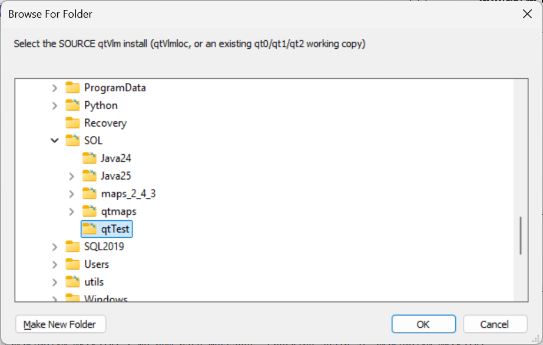

    If you choose an invalid install folder, this will be displayed. Select **OK** to continue the integration. The folder chooser will be displayed again. Select a valid qtVlm installation.

    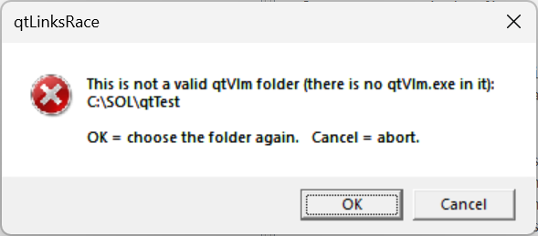

8.  On Windows, the Administrator window will appear, and then close when complete.

    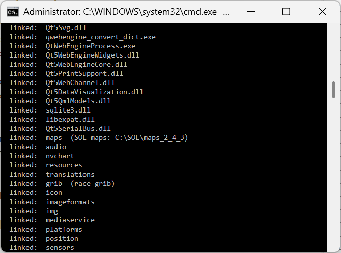

9.  The qtVlm icon on the toolbar will now be enabled. Click on it.

    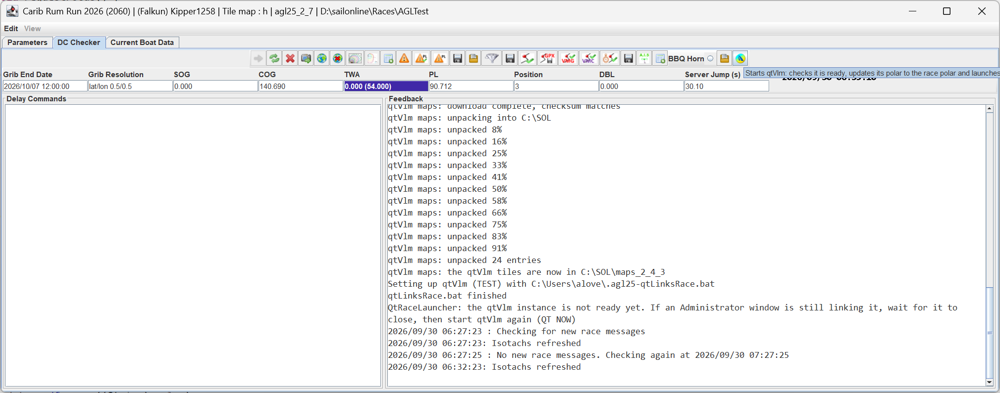

10. The qtVlm startup page for a new install will now be displayed.

    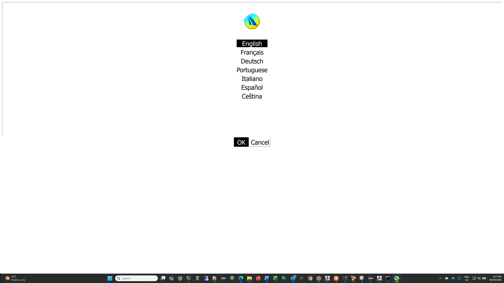

11. You may see this error. Just click **OK**.

    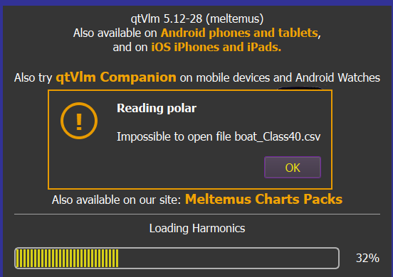

12. Through the **QtVlm** menu, select **Configuration** to open the **qtVlm Configuration** form. Click on the **NMEA Connections** tab, and select the **Network Sources** tab. Configure TCP Server 1 as shown, assuming you chose 5020 as your port number in AGL.

    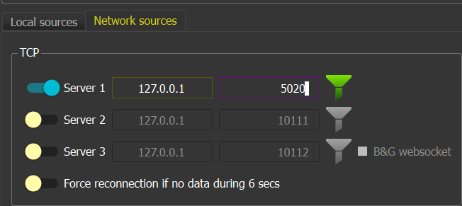

13. Now click **OK.** Then click the NMEA graphic to start the NMEA connection. It should turn green if the port number in AGL and qtVlm match.

14. Close qtVlm.

15. The qtVlm icon in AGL should now be enabled. Click on it again and qtVlm will now launch with current_grib.grb loaded and the polar set to the race polar.

16. You can now select Start qtVlm with AGL, and qtVlm will launch once AGL has completed its initialisation (or connect if qtVlm is already running).

AGL has now made a new instance of qtVlm in the race folder in a folder called qtvlm. Two batch files called qt_race.bat and qt_race_setup.bat have been created (.sh for Linux/macOS) that AGL uses to launch qtVlm depending on its installation progress. The shorelines in qtVlm have been set to match the AGL tile version. The interpolation method has been set to SOL and the NMEA RMB message flag set correctly, and the NMEA TCP port set to AGL's port. AGL keeps these in step each time it starts qtVlm.

AGL now makes a grib called current_grib.grb, which is an exact replica of what is in AGL’s memory at the time. This grib is always loaded into Grib slot 1 on every launch of qtVlm. There is no need to open a new grib; just refresh slot 1.

A file called .agl25-qtvlm-link.properties has been made in your home folder and stores the location of the Test and Production environments. It contains two lines pointing to your Production and Test folders.

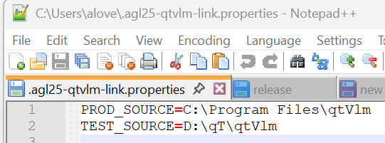

It is unlikely that these will change, but if they do, simply delete the TEST_SOURCE or PROD_SOURCE entries and save the file. This will cause the folder chooser to launch the next time the integration steps for that path are undertaken.

To force the integration to run again, simply delete the file (it’s actually a symbolic link) **qtVlm.exe** (qtVlm for Linux and macOS) in the race’s qtvlm folder. AGL will then say that the race's qtVlm set-up is broken and offer to link it again (choose Production or Test as before). Its settings are kept.

### 3.7.2 Integration Steps – Production Environment

Integrating the production races is essentially the same process. After you have confirmed that the Test instance works, you can start AGL in an existing race folder, or create a new one. Then follow the steps for the Test environment and select **Production** instead of **Test**.

When the folder chooser is launched, navigate to the Production qtVlm install and then follow the steps as described in 3.7.1 Integration Steps – Test Environment.

### 3.7.3 Updating qtVlm

**Caution:** Whenever qtVlm mentions there is an update, you are **strongly advised** to update the Test environment initially, and confirm that the test qtVlm launches and works correctly. Updating the parent qtVlm install will instantly update every race instance made using it. If there is an issue with the new version and you update your Production install, every race folder instance will have the same issue. This is why you must test before you update.

#### 3.7.3.1 Windows - Test

The first step is to ensure that the test environment is working through the following steps

1.  Close qtVlm and install the new version into the qtVlm folder that your Test race uses.

2.  Start AGL for the Test race folder and start qtVlm from AGL (it starts by itself if Start qtVlm with AGL is selected, otherwise click the qtVlm icon). AGL will then detect a new version is installed and ask

    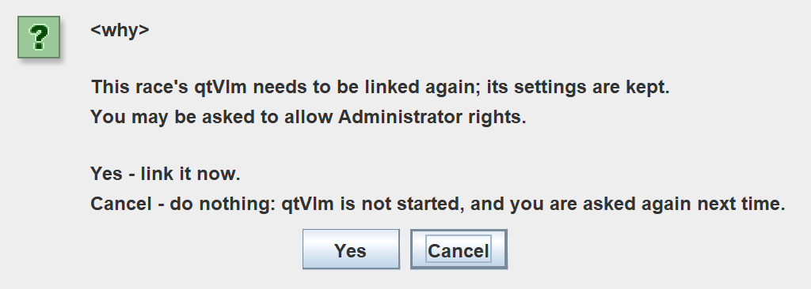

    **Cancel** will do nothing, and qtVlm will not be started. **Yes** will initiate the linking, and you may be asked to give the program permission, click Yes

3.  Once the linking is finished, AGL will try and launch qtVlm automatically. On Windows the linking is done in the Administrator window. If it is still working when AGL looks, the Feedback pane says the qtVlm instance is not ready yet: wait for the Administrator window to close, then click the qtVlm icon.

4.  You may see this dialog if the maps are missing, or the qtVlm set does not match SOL.

**Cancel** will do nothing. **Yes** will initiate the linking, and you may be asked to give the program permission, click Yes.

If the required maps have not been downloaded, you will be asked

Click **Yes**. If the tiles you already have are another version's, AGL asks to move them aside and download the right set: answer Yes. If any qtVlm sessions are running, you will see

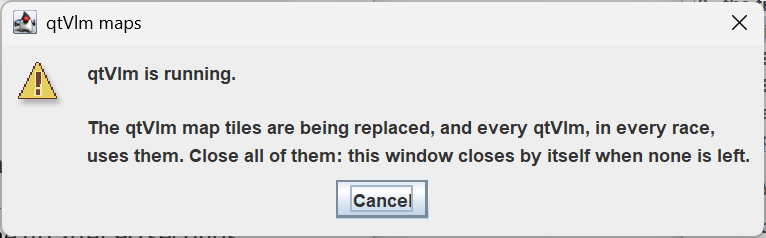

Close any open qtVlm sessions. The dialog will disappear once all sessions are closed, and it will proceed with the download.

If you click No, this will be shown. If the maps can't be downloaded (for example there is a connection issue to the repository), the first line says so instead, and qtVlm is not started.

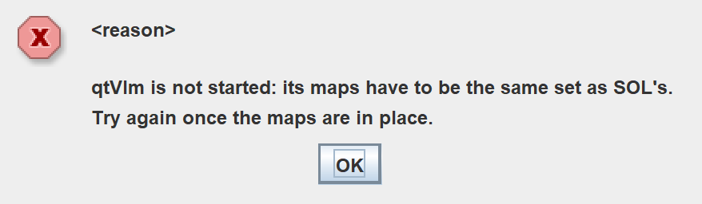

Check your internet for errors and wait until those clear. Otherwise, wait a few minutes and try launching qtVlm from the icon again.

There may be other prompts regarding the maps. If asked to download, answer **Yes**.

5.  If qtVlm doesn't start after 90 seconds (for example because qtVlm shows an error about missing files or maps and stops), a window opens saying qtVlm has not started. One solution is to remove all links and relink.

    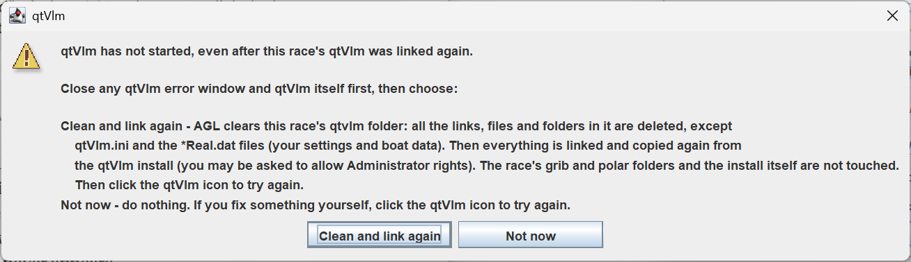

6.  Select **Clean and link again** which should fix the problem. If not, you need to investigate outside AGL what is wrong with the qtVlm install.

#### 3.7.3.2 Windows – Production

Once you have updated test environment and happy that it is working, you can safely update your Production environment. You do not need to do the Test first, but you run the risk of breaking your Production environment. The steps are the same as the Test environment.

### 3.7.4 Solving NMEA Connection Problems

The NMEA port can lock up occasionally on the qtVlm side, which will cause AGL to launch another qtVlm session. If that happens, close the new and previous qtVlm sessions in that order. Whenever you disconnect NMEA in qtVlm, you will see this message in the AGL feedback window, with the port number matching yours.

2026/09/30 22:36:40 NMEA connection 0 on port 5012 closed

If you do not see that message when you stop the NMEA in qtVlm, the port has locked up. Close qtVlm and launch it again from the qtVlm button in AGL. Once again, you should see a connection message of

2026/09/30 22:37:10 NMEA connection 1 on port 5012 established

provided that you have correctly configured qtVlm and it has been working in the past. If that does not occur, close both AGL and qtVlm, restart AGL, then launch qtVlm from AGL once again. If they still do not connect, you now need to reboot your computer to reset the ports at a system level.

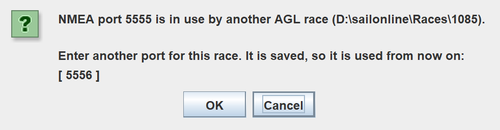If the NMEA port set in AGL is already in use when AGL starts by another AGL race or by another program, AGL will alert you and ask for a new port number. It will use the next available port as a suggestion.

Enter the port you want this race to use. AGL checks it and, if it is free, saves it and starts the NMEA connection on it, so the next session starts cleanly. If the port you enter is in use as well, you are asked again. Each race needs its own unique port.

If you click **Cancel**, AGL keeps the original port and waits for it to become free. The next time AGL starts qtVlm, it sets qtVlm's TCP port to match AGL's. If qtVlm is already running, close it and start it again from AGL so that it connects on the new port.

## 3.8 Race Messages, Mayday & AIS

**Monitor race messages:** This will monitor the race message feed, and if any new race message arrives, the race information is updated.

**Make mayday calls:** If checked, the BBQ rescue feature will be enabled. The feature is discussed in detail later.

**Mayday respondents:** Who can respond to your mayday calls. Discussed later.

**AIS boat list:** The list of boats whose AIS information will be sent in the NMEA feed. If blank, all boats are sent. Selecting the icon opens the AIS Boat Chooser. Select the desired boats and click Add. Then click Apply to update the AIS boat list. The icon is on both the Parameters and DC Checker tabs.

***Note:***

1.  This same list is used to populate the Boat Data Table. You should add your own boat to the list.

2.  The boat chooser will not be active until initialisation is complete, as a valid login into the server is required to retrieve the active boats.

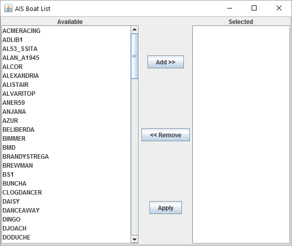

## 3.9 Weather (GRIB)

**NOAA grib download:** Downloads weather files directly from NOAA as they become available when checked.

**Days of weather:** The number of days of NOAA data to download.

**Include pressure (PRMSL):** Get the pressure at mean sea level as well as the wind data?

**Note:** The NOAA server behaviour is explained later in **NOAA Server**.

**Reduce grib:** When selected, the SOL and NOAA gribs will be reduced to be just larger than the race area. The Map will be created to be just larger than the race area as well. Selecting this will reduce download traffic for NOAA and speed up AGL operation.

**Grib retention (days):** Any weather files in the *grib* and *SOLGribXml* directories that are older than this will be checked and deleted when the Wx download starts.

**Share gribs:** Toggles grib sharing on and off.

**Shared grib folder:** If the field is not blank, a copy of the SOL and NOAA (if selected) gribs will be written to this location into a folder whose name is the same as the race ID. If the field is blank, no copies will be created. This feature is designed to allow grib sharing through the cloud, such as OneDrive, iCloud or Google Drive.

Select the  which will launch the file chooser.

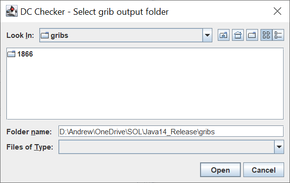

Select the folder to use and **Open**. Selecting **Cancel** will clear the currently selected folder. Copies of gribs will now be written to this location each time they become available.

AGL now makes a grib called current_grib.grb which is an exact replica of what is in AGL’s memory at the time. This grib can be loaded once into your weather routing software and then simply refreshed each time you want to use it.

## 3.10 Graphics

**Use OpenGL engine:** This will use the new OpenGL engine. It will take a few seconds to initialise on start up.

***Caution:*** Using the OpenGL Engine will cause all the race tiles for the race area to be used. If the tile library has not been set up, no maps will be loaded.

**Refresh rate (FPS):** Defines the number of times per second the graphics window data will be refreshed. This can be adjusted to suit the processing power of the computer.

**Wind barb spacing (px):** The spacing in pixels that the wind barbs will be drawn.

**Wind barb size (px):** The size in pixels that the wind barbs will be drawn.

**Text Size:** The size of the text and buttons in AGL's windows. Font - and Font + change the size by 1, and show the new size beside the one in use. Apply Font applies it. The font is always Dialog, so there is no font to choose.

**Icon Size:** The size of the icons, as a percentage of their normal size (50 to 300, normally 100). Icon - and Icon + change it by 10, and the In Control icon is shown at the new size as a preview. Apply Font applies it.

## 3.11 Logging & Data

**Create boat data CSV:** If checked, this will create a csv file of all the boat data every time there is a server jump. It will be written to the file specified in **CSV file name.** The CSV data file contains two lines as shown below.

TimeStamp, TWS, TWA, SOG, LAT, LON, COG, PL, TWD, POSN

2025/04/10 03:21:44,5.73,-3.03,8.37,-20.27,49.972,3.15,1.0,0.125,000026

This is simply the data from your SOL client dashboard. However, note that TWS is returned in m/s and angles are in radians.

***Caution:*** If the CSV file is opened in Excel and some other editors, it is locked and cannot be updated. You may end up with stale data in the file. Make sure the file is not locked when reading. For example, create a data connection in Excel to read the CSV and refresh that, or use an editor like Notepad++.

**Create boat log file:** If checked, the application will automatically create a log file of all the boat data at every server jump. This ranges from 10 to 30 seconds. The **Log File** name will be similar to boat_log_935_2016_05_25_0_28.txt, i.e. it is made up as “boat_log\_&lt;Race_ID&gt;\_&lt;YYYY_MM_DD_HH_MM&gt;.txt”.

It is the same format as **Create boat data CSV** but with many more lines and the following extra fields:

Dist Lost: Not used

CMD: Current DC command, cc or twa

DTG: Distance to go in nm

POSN: Current position

DBL: Distance behind leader in nm

VMG+: TWA for maximum VMG to windward in decimal degrees

VMG-: TWA for maximum VMG downwind in decimal degrees

Max TWA: TWA at which maximum boat speed occurs

Max Speed: The maximum speed in knots

**Note:** The log file can be loaded into the graphical checker.

**Create AIS log file:** If checked, the application will automatically create a log file of all the AIS boats data at every server jump. This ranges from 10 to 30 seconds.

The AIS **Log File** name will be similar to AIS_log_935_2016_05_25_0_28.txt, i.e. it is made up as “AIS_log\_&lt;Race_ID&gt;\_&lt;YYYY_MM_DD_HH_MM&gt;.txt”.

The CSV file has the following fields:

TimeStamp: The time the data was written and calculated

BoatName: Boat name

POSN: Current position

DTG: Distance to go in nm

DBL: Distance behind leader in nm

SOG: Speed over ground in knots

COG: Course over ground in decimal degrees

TWS: True wind strength in knots

TWA: True wind angle in decimal degrees

TWD: True wind direction in decimal degrees

VMG: Velocity made good in knots

VMC: Velocity made to course in knots (to the next course mark)

Target: Target mark name

DTT: Distance to target in nm

DTG: Distance to go to the centre of the finish line (reported by the server)

LAT: Current latitude in decimal degrees

LON: Current longitude in decimal degrees

VMG+: TWA for maximum VMG to windward in decimal degrees

VMG-: TWA for maximum VMG downwind in decimal degrees

Max TWA: TWA at which maximum boat speed occurs

Max Speed: The maximum speed in knots

**Log all boats:** If checked, all boats in the race will be logged. If unchecked, only boats in the current AIS boat list will be reported.

**Caution:** The log file could grow very large very quickly if all boats are checked. Growth rate will be about 20–30 MB per hour.

**Feedback max rows:** The data in the Feedback window is stored in memory and the application memory can grow very large if this is not limited. The 10000 default is fine for most computers.

**NMEA port:** The application will start listening for a connection on the NMEA Port, and when a connection occurs, will start transmitting NMEA sentences. Supported sentences are:

- GGA - Global positioning system fix data

- HDT - True heading

- MWD - Wind direction and speed

- RMB - Recommended minimum navigation information

- RMC - Recommended minimum specific GNSS data

- VHW - Water speed and heading

- VWR - Relative wind speed and angle

- VWT - True wind speed and angle

- WPL - Waypoint location

It will also send the course waypoints, including the finish line.

Data from other boats on SailOnline is also sent as AIS class A messages:

- Message 1 - Position report

- Message 5 - Ship static and voyage related data

If the client disconnects, the application will stop transmitting, and then wait for a new connection. The application allows multiple NMEA connections.

***Note:*** It can take up to 30 seconds for the data feed to start. The waypoints will be sent immediately, but the data feed waits for the next server jump to start.

To start the application, select **Apply**. This will apply the settings and start the selected components.

The parameters are written to an .ini file, which by default, is called **autoGribLoader.ini**. The application supports different .ini files in two ways. By default, the AGL_run.bat file specifies the .ini file as a command line argument at the end of the .bat file, thus:

*"!INSTALL_DIR!\windows_jre%AGL_GEN%\bin\java.exe" ^*

*-Dsun.java2d.uiScale.enabled=false ^*

*-Dfile.encoding=UTF8 ^*

*--enable-native-access=ALL-UNNAMED ^*

*--add-opens=java.base/sun.nio.ch=ALL-UNNAMED ^*

*--add-opens=java.base/jdk.internal.ref=ALL-UNNAMED ^*

*--add-exports=java.base/java.lang=ALL-UNNAMED ^*

*--add-exports=java.desktop/sun.awt=ALL-UNNAMED ^*

*--add-exports=java.desktop/sun.java2d=ALL-UNNAMED ^*

*-classpath "!INSTALL_DIR!\\VERSION!.jar;!INSTALL_DIR!\agl%AGL_GEN%\_lib\\;" ^*

*main.AGMain ^*

***autoGribLoader.ini***

You can edit the .bat file using a text editor and specify a different .ini file, or none. If no .ini file is specified, as shown below,

*"!INSTALL_DIR!\windows_jre%AGL_GEN%\bin\java.exe" ^*

*-Dsun.java2d.uiScale.enabled=false ^*

*-Dfile.encoding=UTF8 ^*

*--enable-native-access=ALL-UNNAMED ^*

*--add-opens=java.base/sun.nio.ch=ALL-UNNAMED ^*

*--add-opens=java.base/jdk.internal.ref=ALL-UNNAMED ^*

*--add-exports=java.base/java.lang=ALL-UNNAMED ^*

*--add-exports=java.desktop/sun.awt=ALL-UNNAMED ^*

*--add-exports=java.desktop/sun.java2d=ALL-UNNAMED ^*

*-classpath "!INSTALL_DIR!\\VERSION!.jar;!INSTALL_DIR!\agl%AGL_GEN%\_lib\\;" ^*

*main.AGMain*

a file chooser will appear when you execute the .bat file and the ini file can be selected as shown below.

For Linux and macOS, the AGL_run.sh scripts contain a similar command at the end of the file, and can be adjusted in the same way.

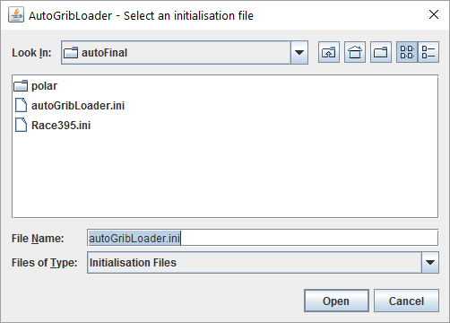

Select the file or Cancel to exit completely.

Changes to the parameters are saved to the ini file as you make them: a text box is saved when you press Enter or Tab, or click in another field. If a value is not valid it is not saved: the box goes back to its last good value and a message in Feedback says so.

**New** will force a re-download of race information and grib files. Should be used when there is a race information change or Wx format change.

To **exit** the application, simply click on the X at the top right-hand corner of the screen.
