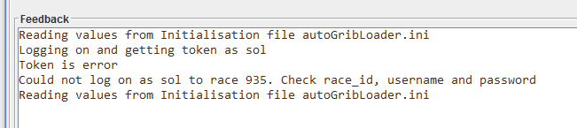
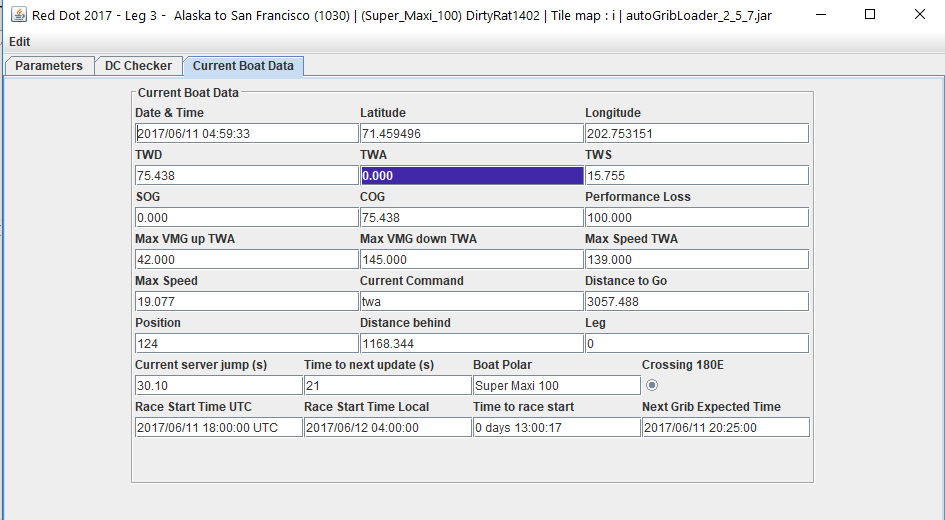

# 4 Initialisation

On applying the parameters, and provided you have given the correct username, password and race (you must be registered in that race), the application will go through an initialisation process that could take up to 30 seconds to complete. If you do not see the following in the feedback window, check the race, username and password, and try again. Note that the same result can happen if there is no internet connection.

**Note:** Downloading the race information (which includes the boat polar) and the weather information can hang. After about two minutes, the application should time out these downloads and try again. If that does not happen, close the application and start again.

After a successful login, you will be taken to the DC Checker Tab. Buttons and tabs will remain inactive until they are configured and ready for use. Also, if the servers required for that functionality have not been started, they will not be enabled. At this stage, the weather grib file and boat polar will have been created, and logging started if requested.

**Note:** The application window title will update to show the boat, race name and race ID. This can be used to check which race this instance applies to. Multiple instances of the application can be run on the same computer, but they should each be run in their own folder.

## 4.1 QtVLM and Expedition Boat Polars

Part of the initialisation process is to create detailed QtVLM and Expedition-style boat polar files, if they do not already exist. The application creates a directory called ***polar*** and places the file in that folder. It is named &lt;Boat Type&gt;\_polar.csv, for example *Twister_28_polar.csv.* This file can be copied to the polar folder in Qt and used. For Expedition, it is named &lt;Boat Type&gt;\_expd_polar.csv, for example *Twister_28_expd_polar.csv.*

## 4.2 Course Waypoints GPX

The application will create a gpx file of the course waypoints, and a route linking those waypoints together in the order they should be sailed. This data can then be loaded into routing packages such as Expedition and Qt. The file is created in the ***polar*** directory and is called &lt;Race ID&gt;\_course_waypoints.gpx. For example, for race id 565, the gpx file will be *565_course_waypoints.gpx*.

The application also adds in the finish line ends, but does not include these in the route.

## 4.3 Current Boat Data Tab

Once initialisation is complete, the application will start to report the current boat data on this tab. The data looks like this. All data is in decimal degrees, nautical miles and knots.

Also calculated is the current server jump duration (ranges from ~10 to 30 seconds) and how long until the next update is due. The date and time of the data is accurate to about one second.

Note that TWA has been highlighted as it is outside the range 42.0 to 145.0.

## 4.4 Parameters Tab

Click on this tab to take you back to the parameters. These can be changed at any time, and the application will respond accordingly. For example, changing the race will cause a complete re-initialisation.
