# 5 Using AGL

This chapter describes how AGL is used from day to day: checking your DCs and course, working in the graphics, and importing routes.

## 5.1 DC Checker Tab

Once initialisation is complete, the DC Checker Tab buttons become enabled. Additionally, any current DCs will be downloaded into the Delay Commands window. The tab should look like this once fully configured.

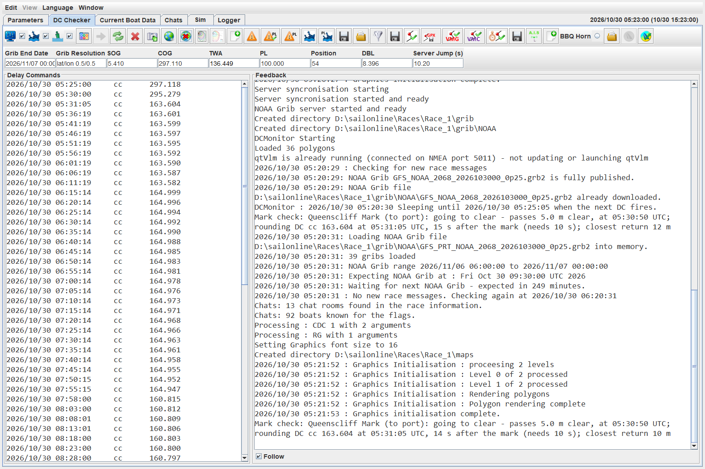

The features of this tab are described below.

### 5.1.1 Context Sensitive Editing Menus

There are two menus that can be used for copy and paste. The first is **Edit** which shows this menu.

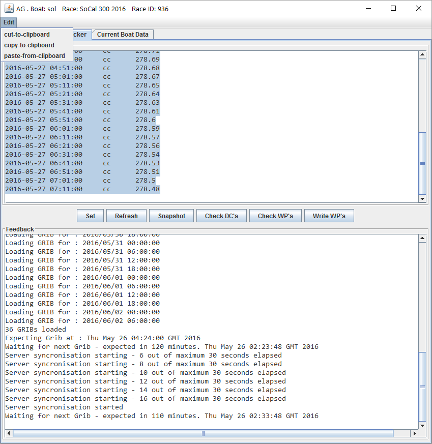

The second can be accessed by right mouse click in the Delay Commands window.

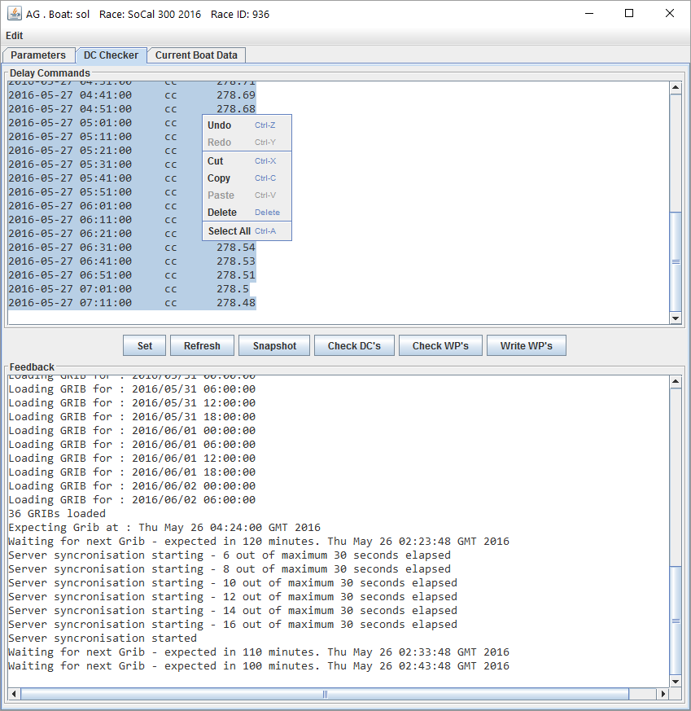

### 5.1.2 Set Button

This button is used to set any DCs that have been pasted into the window. The set operation will

1.  Check that all DCs are valid.

2.  Remove any duplicate DCs. That is, if the next DC command and value is the same as the previous, it will be deleted.

3.  Check that the bearing between two subsequent **cc** type DCs is less than 170 degrees. If not, the following dialog will appear

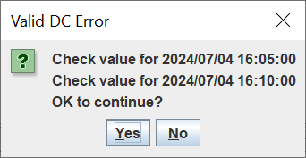

**Yes** will ignore and set the DCs, **No** will abort the setting process and allow editing.

The offending DC dates will be written back to the Feedback area as shown below.

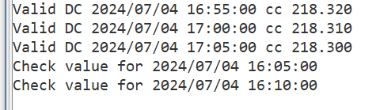

4.  Delete any DCs that are stale (that is, older than now).

5.  Delete any DCs on the server that do not match those in the DC area. Note that only one DC at a time can be deleted, so this may take a while depending on internet speed.

6.  If the race has not started, check that there is a DC before the race start time. If not, the user is asked if the first DC can be changed to 10 minutes before the race start.

7.  Update with the current valid set.

**Note**: A DC record must be in this format:

2016/05/27 01:51:00 twa 138.45

### 5.1.3 Refresh Button

The refresh button will request the list of current DCs from the server and display them.

### 5.1.4 Delete Button 

To delete all DCs, click the delete button . To delete a subset, highlight those to be deleted.

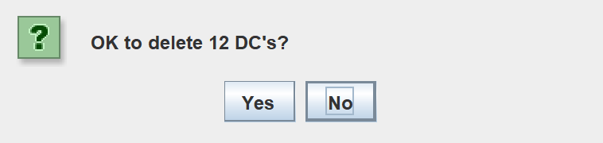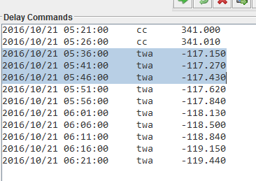

A confirmation popup will be displayed. Yes will delete and No will cancel.

### 5.1.5 Snapshot Button

This is used for debugging purposes. It writes a copy of the feedback window to a file and is needed to report any strange behaviour.

The snapshot file name will be similar to *snapshot_935_2016_05_25_0_28.txt* being made up of “snapshot\_&lt;Race_ID&gt;\_&lt;YYYY_MM_DD_HH_MM&gt;.txt”.

### 5.1.6 Display Graphics Button

Will display the OpenGL Graphics window.

**Note:** Scaling has been applied to the course waypoints in the classic graphical checker. The cross size is 10 metres across. The OpenGL crosshairs box is 10 m across as shown in the next figure.

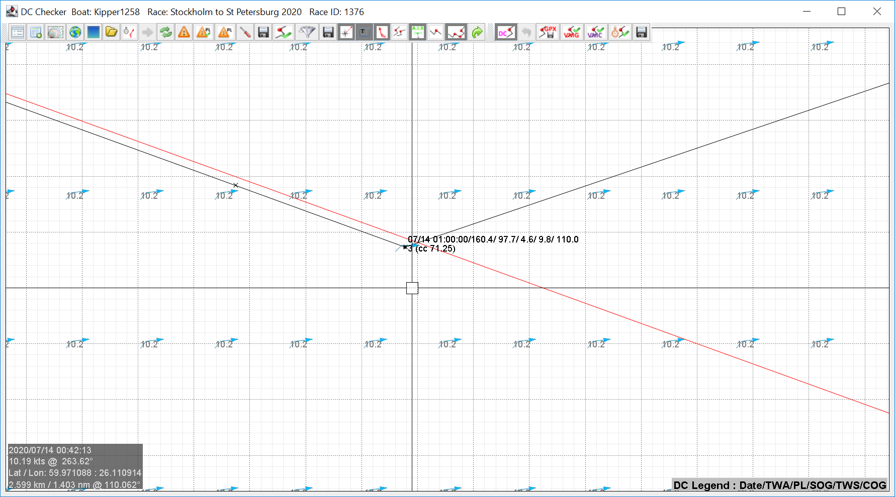

The  button restarts the graphics window (it can lock up and hang; this fixes the issue)

### 5.1.7 Alternate Polar Chooser 

This will open the alternate polar file chooser and set up AGL to use the selected polar.

### 5.1.8 Show Polar Diagram 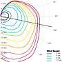

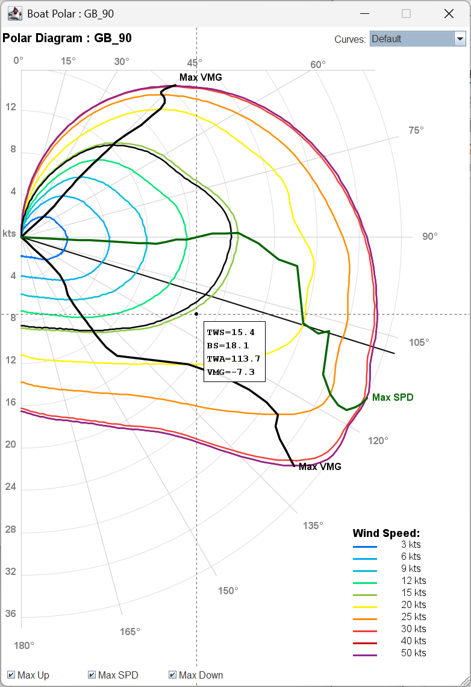This will open the boat polar diagram. The black polar curve shows the current speed curve being used. The black line is the current TWA; it is a separate line and is not part of the polar curve. The diagram is always on top, hit the close button to hide the diagram.

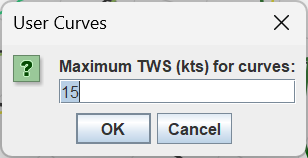The drop-down menu has three options, Default, Low Wind (&lt; 6 kts), and User. If user is used, the user will be required to enter the upper TWS to use for the curves.

The diagram also shows the Max VMG lines for both beating and running. The max SPD line shows the TWA that will achieve the maximum boat speed at that wind strength. Hovering the mouse over the diagram will show the TWS, Boat Speed (BS), TWA and VMG at that point.

### 5.1.9 DC Data Table 

This will launch the DC Data Table. Operation is described in section [6 DC Data Table](0600-dc-data-table.md).

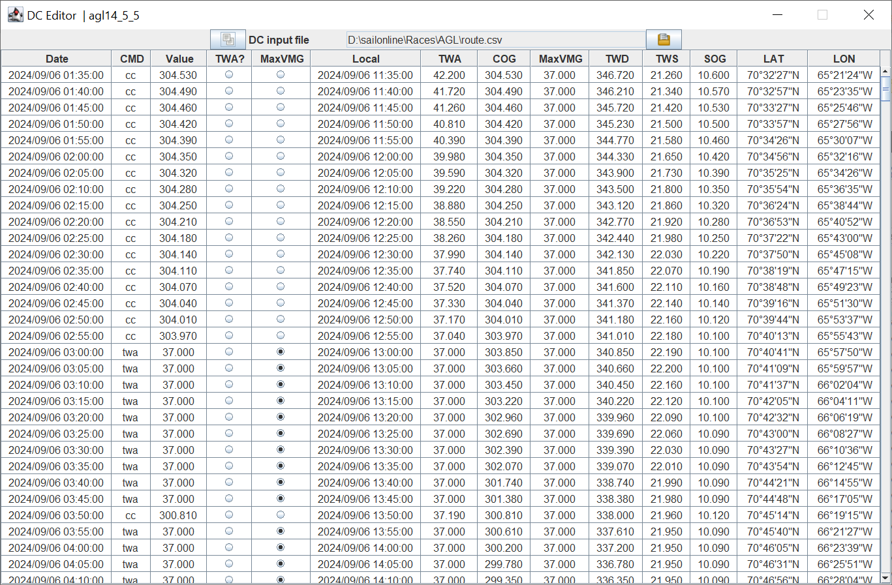

### 5.1.10 Check DCs Button 

This button will take whatever DCs are shown in the DC window and convert them into a plot as shown below.

**OpenGL Version of The DC Checker**

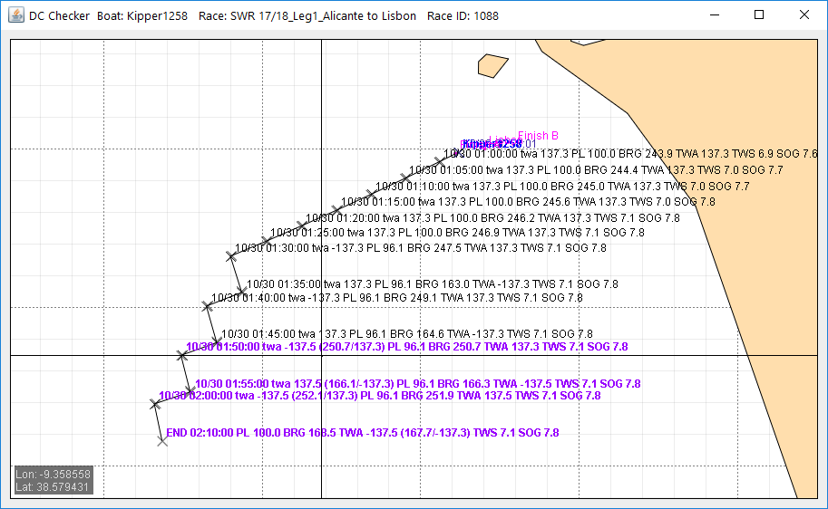

**Note:** If the first DC time falls inside the haulback period (one hour before the race start), the trace is modified to reflect the result in the real race. No changes are made to the actual DCs. This works in the following way.

A scan of the DCs is made and the last DC before the race start is determined. Any DCs earlier than that one are ignored ( the last DC to fire in the haulback period sets the boat’s course, the others are redundant). The time of that DC is adjusted to the race start time and the remaining DCs are then computed. This prevents the drift in the trace caused by the boat having velocity, but not actually moving in the haulback period.

We can now talk about what each of the parameters does, and how it works.

If the waypoint is highlighted in purple, the boat will be sailing **to** that waypoint outside the optimal TWA range. If the waypoint is highlighted orange, performance loss minimisation is possible for that DC.

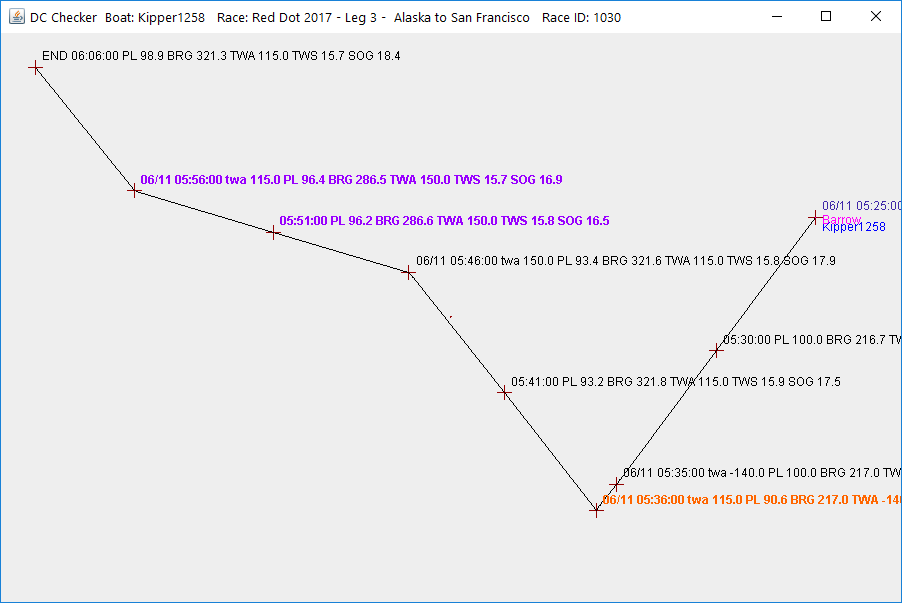

The same DCs conditioned for performance loss look like this. Notice that the performance loss is 2% less at 05:41:11 (95.3% vs 93.2%).

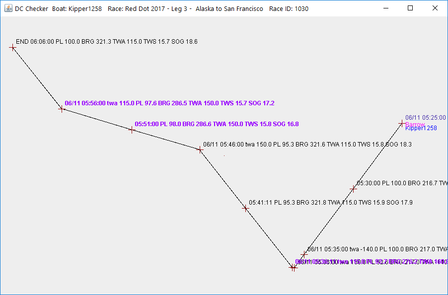

There are two icons for checking performance loss.

The will compute the performance loss manoeuvres and show them without changing the actual DCs. The will compute and modify/add DCs to achieve the PL result.

#### 5.1.10.1 DC Parameters

You will find all of these on the Parameters tab.

**Check DC frequency (s):** This parameter (in seconds) decides how often additional points are plotted on the screen between each of the DCs. Waypoint **01:15:00/-172.3(87.4/-172.5)/100.0/4.3/9.6/71.3** shown below is one of these, and is 300 seconds away from the start. The waypoint name is the time that the boat will arrive, and the next values are TWA, PL, SOG, TWS and COG. The PL is the performance loss that the boat will be experiencing at that point, and TWA/COG is the TWA/COG that the boat will sail under **to** that waypoint. As the boat is sailing outside the optimal TWA range, it is coloured purple and the optimal value is added in brackets behind the TWA. In this case the **(87.4/-172.5)** represent the COG or TWA that must be set to achieve optimal TWA. The **Condition** function described later will do this interactively.

When a DC is reached, it is named in full. 07/14 01:29:52/-165.0/98.7/4.3/9.5/89.4 is the second DC that will be reached in the example shown.

**Note:** Waypoints shown in this colour are being sailed outside the optimal TWA range.

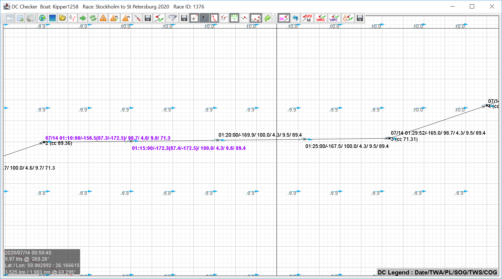

**Calculation duration (s):** This parameter (in seconds) determines how often the boat is advanced. Similar concept to the server jump. The points generated are not plotted, but are used to determine the coordinates of each waypoint, by sampling TWS and TWD after each advance and then using those numbers for the next advance.

**Use race start time:** This allows the user to check DCs from the start. If checked, the checker will assume that the boat is at the start waypoint, and the time is the start time. Any DCs after that time will be processed in producing the route. If left unchecked, the start time will be now.

**Display boat position:** This is used when the boat is a long way away from the DCs of interest. It will not be plotted or considered in producing the route. Most applicable when **Use these start coordinates** is checked.

**Use these start coordinates:** The route will be calculated assuming the boat is at the **Start coords (lat, lon)**, and the time will be wound forward to the time of the first DC.

**Start coords (lat, lon):** The start coordinates for the route. It is in the format that can be pasted directly from the SOL client. To pick up coordinates from the SOL client, hold the Alt key down, and then click the left mouse button. This copies the coordinates of the crosshairs into the copy/paste buffer.

**Note:** If the boat is currently TWA 0, it means it is not moving. The only action that can be taken is to advance the clock to the first DC time, and assume that the boat will start moving on that course at that time. The start point will therefore be the current boat position, and the time of the first DC.

## 5.2 Checking the Course

AGL can check your course and your DCs before they reach the server, and keep checking while you race. It looks for three things:

- **BBQs:** the boat running into land.
- **Missed marks:** a sea mark that will not be rounded properly.
- **The finish:** a path that does not cross the finish line clear of its end.

When it finds a problem, AGL offers one or more fixes. You choose which to apply. Nothing is changed until you press **Fix** or **Apply**.

These checks are for SOL members. They also need **In Control** to be ticked on the DC Checker tab for any the checks to work in real time. Leave it off if do not want the checks to happen, like in sprint races when you in control. You can also control what checks are made, just BBQ, marks (which includes the finish line) or both. 

### 5.2.1 Switching the Checks On

On the Parameters tab, under DC's (or the check boxes on the DC Checker toolbar):

- **Check for BBQ** looks along the course and the DCs for land, sends the BBQ messages and offers fixes.
- **Check mark roundings** warns when the boat is going to miss a mark.

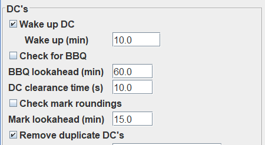

Each check has a look ahead, in minutes. The messages for it go out when the check finds the problem within that look ahead. The messages themselves, and when they go to your phone, are set on the Chats tab (see [Chats](0800-chats.md)).

These can also be enabled and disabled on the DC Checker toolbar.

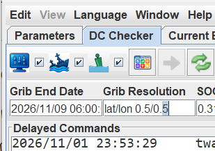


### 5.2.2 The BBQ Checker

The BBQ Checker looks at the DCs in the DC area for coastal collisions and deals with them one at a time. The **Check**  button runs it; **Check PL** 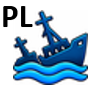 runs it with performance loss.

For each collision AGL shows where it happens, for example "Potential collision after DC 0", and lists the fixes it has found. The suggested fix is ticked. You can tick another, or none, then press:

- **Fix** to make the change in the DC area.
- **Skip** to leave this collision in the DCs and go on to the next.
- **Cancel** to stop checking.

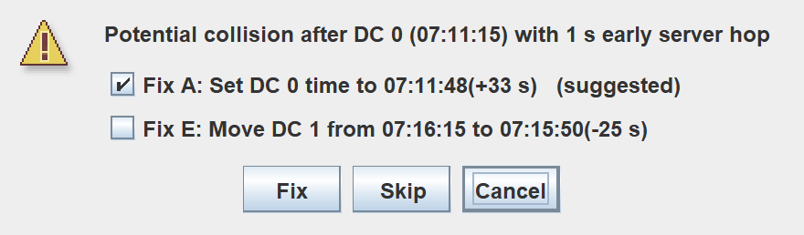

A fix can set a DC to a new time, move a DC, add a DC before the collision, or give a new course. Where the collision depends on the server firing a DC a second or two early, the heading says so ("with 1 s early server hop") and the fixes allow for it.

If the boat's present course runs into land, AGL offers a turn to port or to starboard that clears it, with the course and the number of degrees.

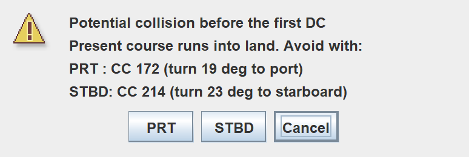

AGL also makes a png of the collision to send to Telegram, and will show the potential solutions in the graphics window. An example is shown below.

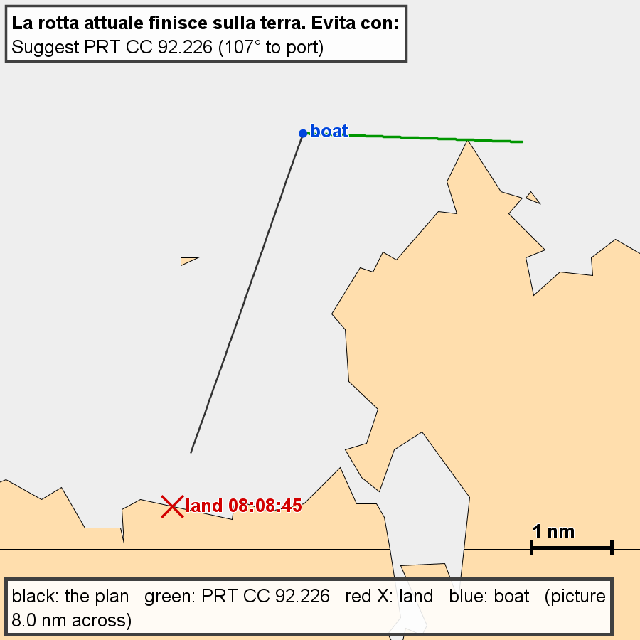

If there is nothing AGL can do, it says so, and you must correct the DCs yourself.

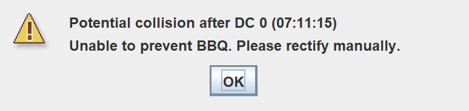

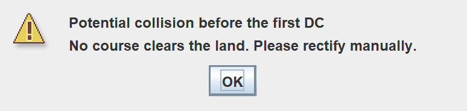

When every collision has been dealt with, AGL reports how many fixes were made and how many collisions were skipped. **Undo** in the graphics steps back through the fixes. If there was nothing to fix, you see:

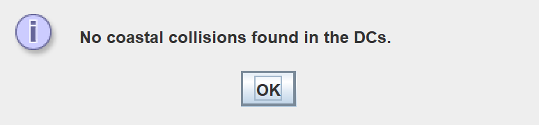

AGL may need a moment before it can check. If a server DC is about to fire and will change the course, it waits for it and then checks again.

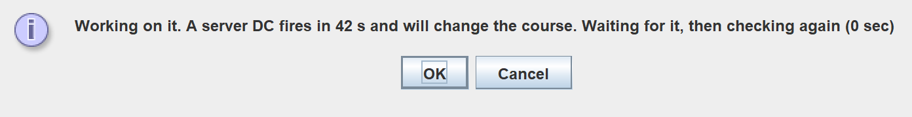

### 5.2.3 Missed Marks

AGL follows the course through the DCs and warns when the boat is going to miss a sea mark. Land marks are ignored as the BBQ checker handles them. The message names the mark, the time, and the reason. The reasons include:

- a DC is firing too early,
- a DC turns the wrong way round the mark,
- a later DC will unround the mark,
- the path passes too close to the mark, or on the wrong side,
- no DC turns the boat after the mark.

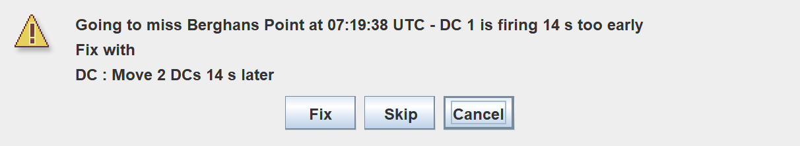

Where the miss can be mended by moving DCs or by changing course, AGL offers the fix, with where the boat will pass the mark if you apply it.

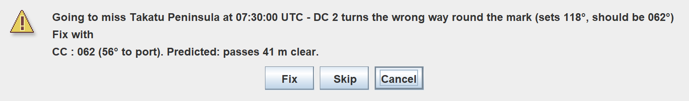

If it cannot be mended that way, AGL says so.

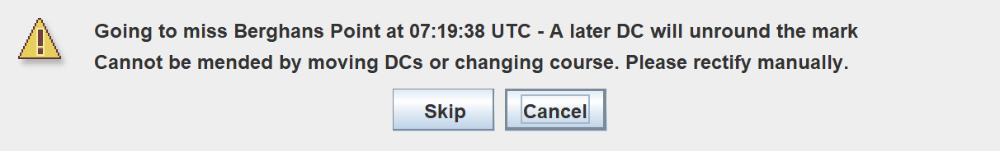

The graphics zooms to the problem area and shows the potential solutions. png images are made and sent to Telegram if Missed Marks is enabled.

### 5.2.4 The Finish

For the finish line the path has to cross the line clear of its end. A path that crosses beyond the end of the line is reported in the same way as a missed mark. AGL offers a new route to the line, or a pivot route to the mark, when it can find one.

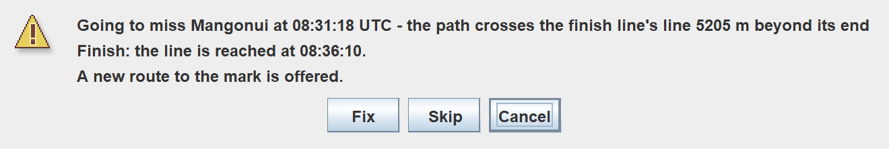

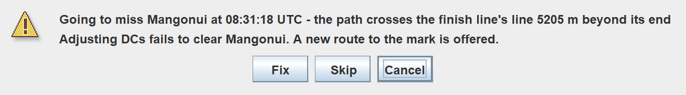

If the direct course to the line is outside maxVMG, AGL may stay on the present tack and turn later, and say so.

Once again, the graphics zooms to the problem area and creates a png for Telegram.

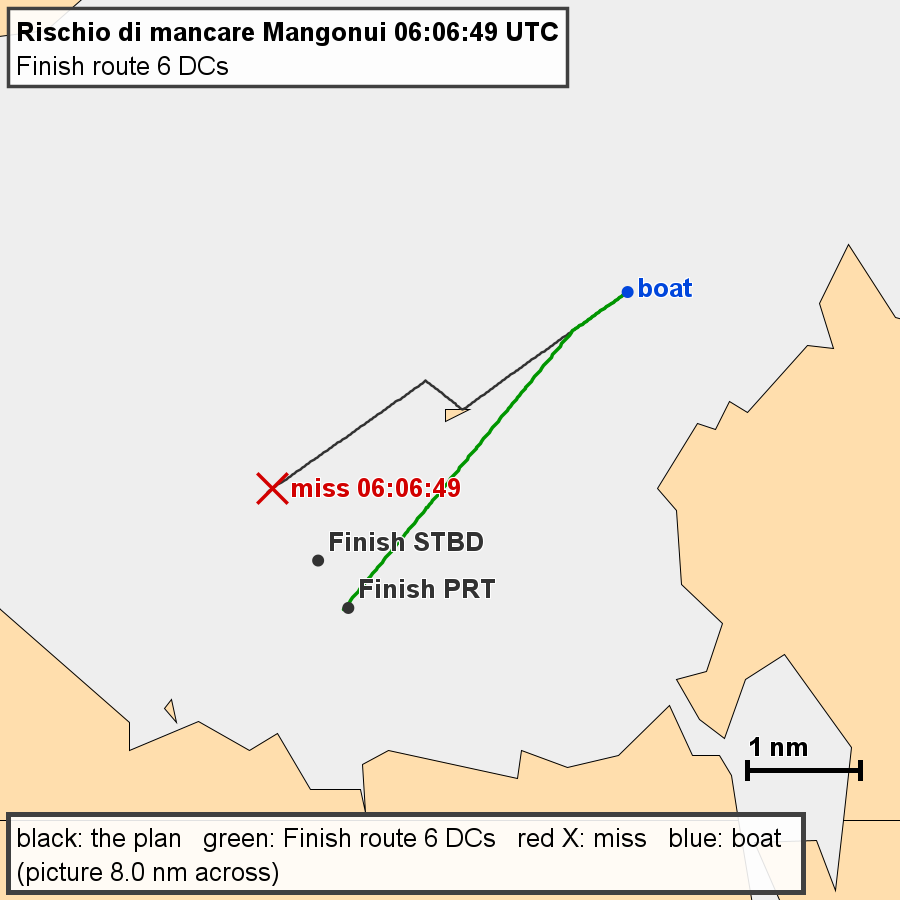

### 5.2.5 Suggestions While You Race

While you race, AGL runs the checks itself and shows a suggestion window when it finds a problem. The window has the same fixes, with **Apply**, **Apply (PL)** and **Dismiss**.

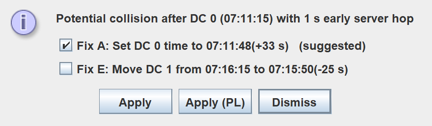

If you do not answer, the suggestion can go to your phone as well, by Pushover or Telegram. With Telegram it arrives with **Apply** and **Dismiss** buttons, so you can answer from the phone. See [Chats](0800-chats.md) for how to set that up.
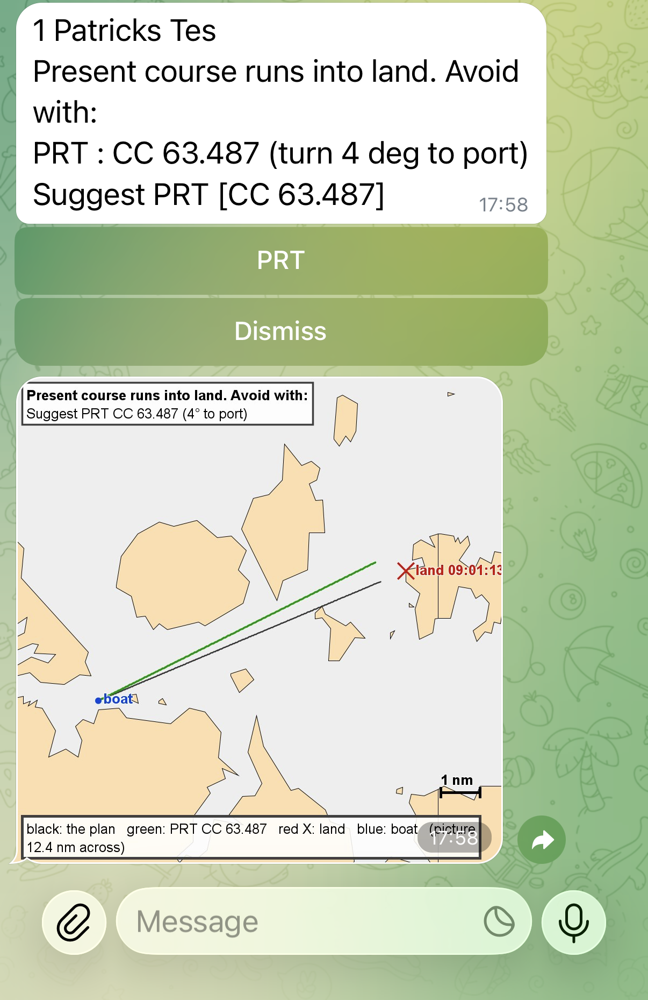 

If you hit **Apply**, the command is sent to AGL to execute. AGL will then update the message with the status of the boat after the **Apply**.

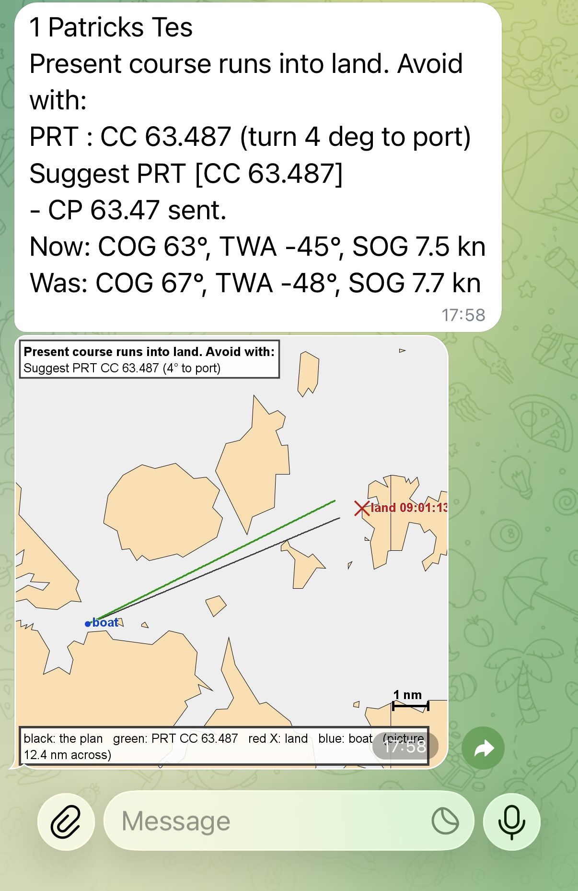

### 5.2.6 DCs Not Yet Set

If there are DCs in the DC area that are not on the server, AGL can ask whether to set them now.

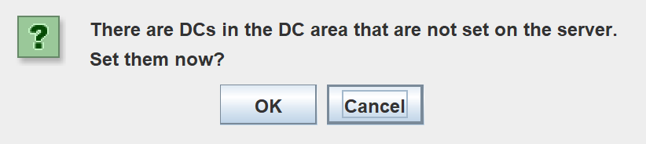

## 5.3 View

This section covers moving around the graphics, copying positions from them, and choosing what they show.

### 5.3.1 Moving Around the Graphics

#### 5.3.1.1 Zoom and Pan

The zoom function is only enabled by the use of a mouse with a wheel (on its back, not underneath). Scrolling the mouse wheel zooms in and out. Pan is achieved by holding the left mouse button down, and dragging to the desired location.

#### 5.3.1.2 Mouse Click

A **left** mouse click will copy the current mouse coordinates to the paste buffer in the format

,CP,&lt;lat&gt;,&lt;lon&gt;

e.g. ,*CP,38.681941,-9.201922*

This allows a simple paste into a waypoint file where all is required is the name to make a valid waypoint.

e.g. *WP01,CP,38.671979,-9.196492*

A **right (**standard graphics**)** or **&lt;Shift&gt; left** (OpenGL graphics) mouse click will copy the current mouse coordinates to the paste buffer in the same format as the SOL client, that is

*38.605778,-9.485908*

### 5.3.2 View Options

The  button on the graphics toolbar opens the View Options form. It stays open while you work, so you can switch things on and off and watch the graphics change. **Close** closes it.

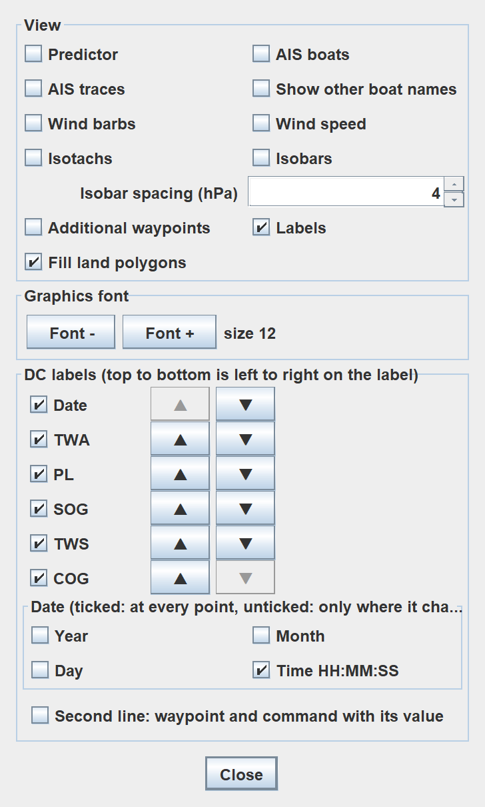

#### 5.3.2.1 View

Each check box switches one thing on or off in the graphics.

- **Predictor** shows the predictor line.
- **AIS boats** shows the boats in the AIS list.
- **AIS traces** shows the traces of the AIS boats.
- **Show other boat names** shows the names of the boats that are not in the AIS list. The boats in the AIS list always show their names.
- **Wind barbs** shows the wind barbs.
- **Wind speed** shows the wind speed numbers.
- **Isotachs** shows lines of equal wind speed.
- **Isobars** shows lines of equal pressure. **Isobar spacing (hPa)** sets the pressure between the lines, from 1 to 50.
- **Additional waypoints** shows the additional waypoints (see [5.6 Additional Waypoints](0500-using-agl.md#56-additional-waypoints)).
- **Labels** shows the DC labels, set up below.
- **Fill land polygons** fills the land shapes.

The display below shows AIS boats and their traces, and the predictor line. The number beneath each AIS boat is their current position. The four numbers below your own boat are position, TWA, SOG and performance loss.

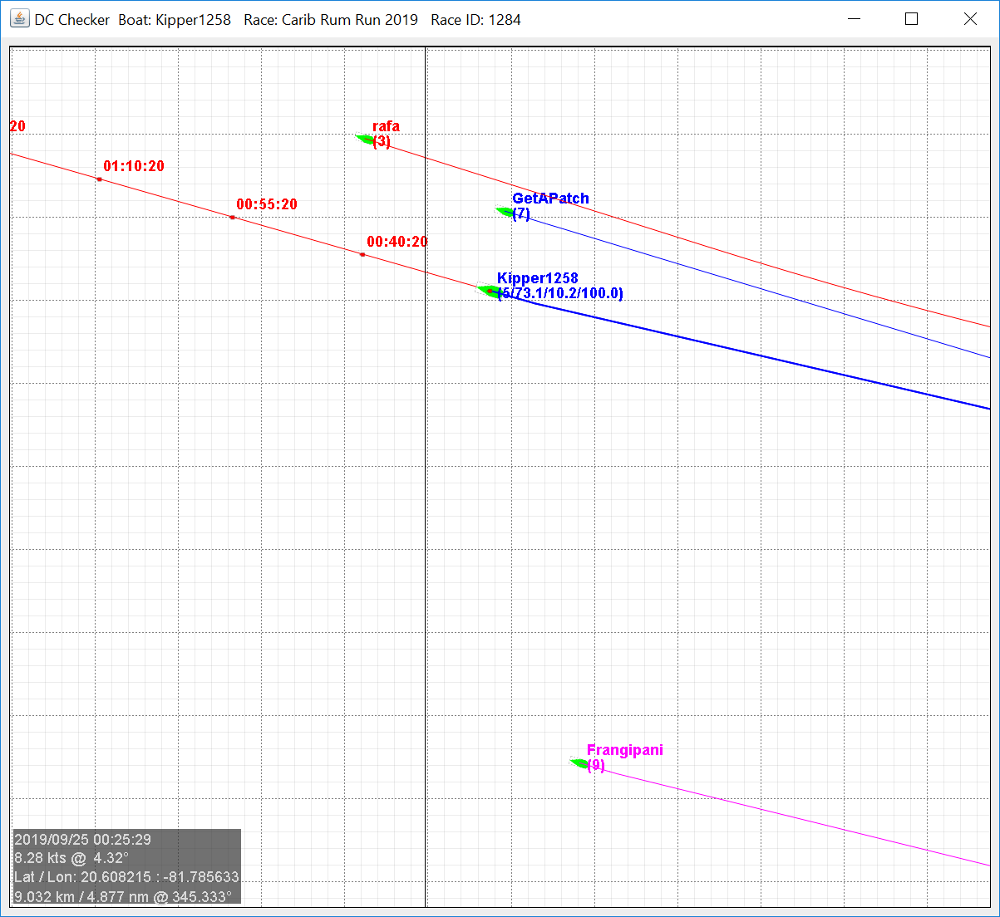

Also, if your boat is in the AIS list, it will be shown in black in the position that it was when all the other AIS boats were updated. This is the actual position of your boat relative to the others shown on the screen.

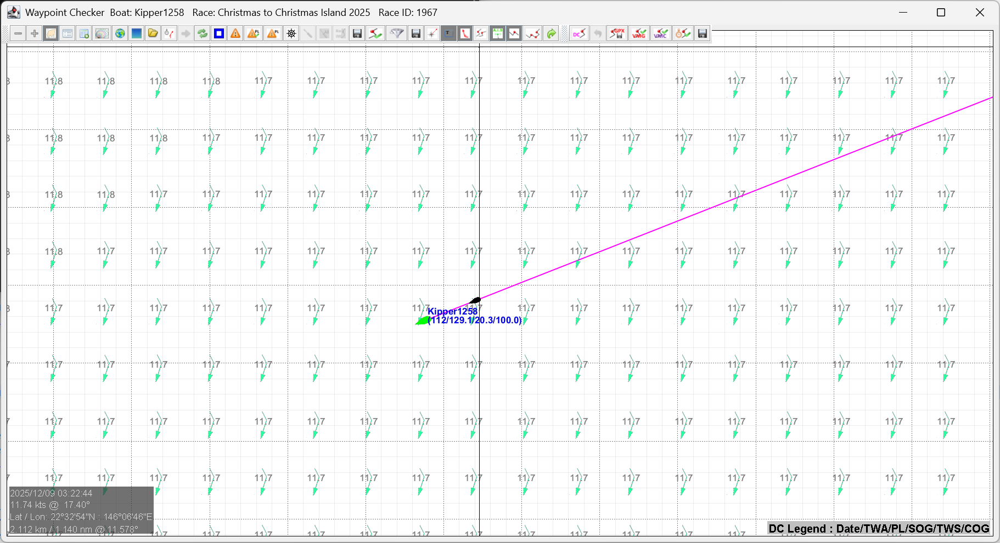

#### 5.3.2.2 Graphics Font

**Font -** decreases the graphics font size by 1 and **Font +** increases it by 1. The current size is shown beside the buttons.

#### 5.3.2.3 DC Labels

This sets what is written on each DC label in the graphics.

- Tick a field to show it: **Date**, **TWA**, **PL**, **SOG**, **TWS** and **COG**.
- The arrows move a field up or down. From top to bottom in the list is left to right on the label.
- The **Date** group chooses which parts of the date are shown. If a part is ticked it is shown at every point; if it is not ticked it is shown only where it changes. The parts are **Year**, **Month**, **Day** and **Time HH:MM:SS**.
- **Second line: waypoint and command with its value** adds a second line to the label with the waypoint and the command and its value.

## 5.4 OpenGL Graphics Specific Commands

The OpenGL Engine has several keyboard commands that are specific to the OpenGL Engine only.

**R** – Refreshes the screen

**F** – Fits the displayed data to the screen

**B** – Centres the display on the boat

**W** – Wipes the screen

### 5.4.1 Toolbar Icons

The 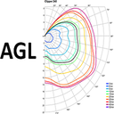 button pops the AGL window to the top.

The  pops the boat data table.

The  launches the alternative polar file chooser.

The  opens the polar diagram.

The  button pops the graphics window to the top.

The  creates a subset of the current grib. The file will be placed in the grib folder with the prefix SUB\_. The message below pops up when the creation of the subset is complete.

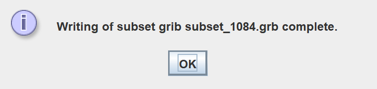

The  button selects the current waypoint file.

The  applies the current DC list. Greyed out if no changes have been made.

The  writes the current DCs to a waypoint file.

When  is selected and a set of waypoints is loaded, the following editing keyboard commands are invoked.

**D** – Deletes a waypoint

**E** – Edits a waypoint values

**I** – Inserts / Appends waypoints

**M** – Moves a waypoint

The  filters out any redundant waypoints, using a filter tolerance.

The next  filters out any redundant waypoints, using a filter tolerance and saves them to a file.

The  button opens the View Options form, where the predictor line, AIS boats and traces, wind barbs, additional waypoints, DC labels, land fill and the graphics font are set. See [5.3.2 View Options](0500-using-agl.md#532-view-options).

The 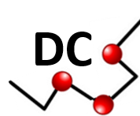 button turns the grey DC trace on and off. See [6.3.1 How it works](0600-dc-data-table.md#631-how-it-works).

The Append  button turns appending of DC plots on or off. Use **W** to clear the display.

The  button reloads the additional course waypoint file.

The  toggles between working with DCs and waypoints.

The  undoes any waypoint edits one at a time.

The  writes the current waypoints out as a gpx file.

The  computes waypoints and DCs into a route using maxVMG for waypoints.

The  computes waypoints and DCs into a route using maxVMC for waypoints.

The  converts waypoints and DCs into DCs only using maxVMG for waypoints.

The  converts maxVMG waypoints and DCs into a waypoint file.

The toolbars can also be undocked and re-docked by clicking and holding the grey stippled area of the toolbar next to the first icon as shown below.

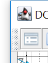

Undocked toolbars are shown below

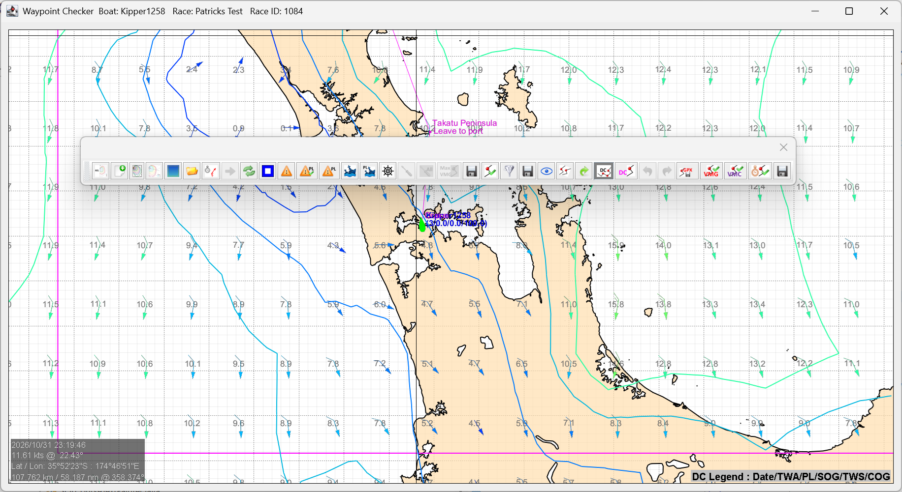

### 5.4.2 The Right Click Menu

A mouse right click in the graphics window will invoke a quick menu of options, which changes depending on whether DCs or waypoints are being worked on. Some commands are waypoint only. The one on the left is for waypoints and the one on the right is for DCs.

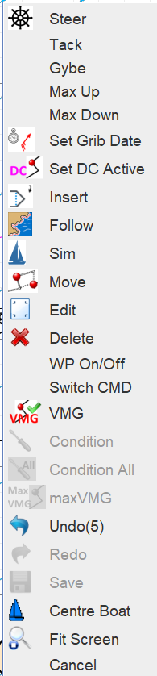 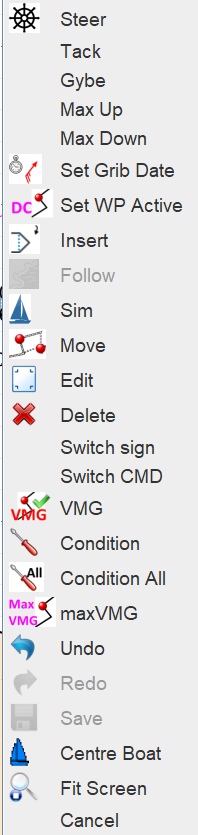

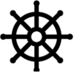 **Steer:** Invokes Setting a Course

**Tack:** Will tack the boat onto the opposite tack at max VMG. Pops a confirmation window showing the commands and includes performance loss minimisation. On selecting OK, the command is executed immediately.

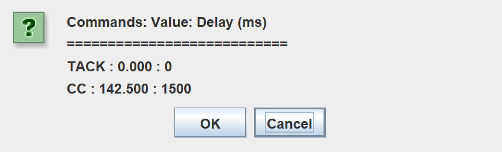

**Gybe:** Will gybe the boat onto the opposite tack at max VMG. Pops a confirmation window showing the commands and includes performance loss minimisation. On selecting OK, the command is executed immediately.

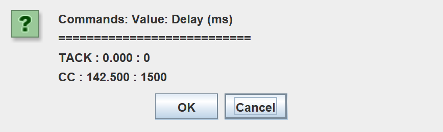

**Max Up:** Will set the boat at max VMG upwind on the same tack. Pops a confirmation window showing the commands and includes performance loss minimisation. On selecting OK, the command is executed immediately.

**Max Down:** Will set the boat at max VMG downwind on the same tack. Pops a confirmation window showing the commands and includes performance loss minimisation. On selecting OK, the command is executed immediately.

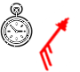 **Set Grib Date:** Sets the boat at the selected waypoint and updates the isotachs and wind barbs to that time

 **Set DC Active / Set WP Active:** Toggles between working on DCs and waypoints

 **Insert:** Inserts a waypoint / DC. Follow the prompts in the top right corner. If a waypoint, the editor will pop this form.


Select the control type from the drop-down, and change the other values if so desired.


 **Follow:** Inserts waypoints that go round the coast between two waypoints, so that a route that crosses an island or headland is taken round it. It is for waypoints only, not DCs, and it is available to SOL members. You need at least two waypoints.

1. Choose **Follow** from the right click menu. The prompt at the top right says **Select segment to insert ( right click cancel)**.

2. Click the line between the two waypoints that crosses the land. Inactive waypoints (those with a ! at the start of the name) are skipped: the segment is between the two active waypoints either side of your click. The waypoint editor pops up, as it does for **Insert**. The new waypoints take the name and command of the first waypoint of the segment, so change the control type there if you want something else.

   

3. The prompt now says **Click the side of the segment to pass on ( right click cancel)**, and a thin line follows the mouse from the segment. Click on the side of the segment that you want to pass the first island on. That side applies to the first island only. If there are more islands on the segment, each takes whichever side gives the shortest route.

   

4. AGL finds the coast that the segment crosses and inserts a waypoint at each corner of the coast that the route must go round (the convex hull), between where the segment first enters the coast and where it last leaves it. The Feedback area says how many waypoints were inserted. If there is nothing to insert, it says why, for example **The segment does not enter and leave any coastline**, and you can click another segment.

   

5. Right click cancels at either step. **Undo** and **Redo** on the menu and toolbar take the new waypoints out and put them back.

Two values on the **Parameters** tab, in the **Course & waypoints** box, set where the waypoints go. **Follow: offset from coast (m)** (10 to start with) moves each point that many metres out from the shore. **Follow: offset along track (m)** (0 to start with) then moves each point along the direction of travel. AGL then checks once more, and adds a point wherever the moved route would still cross the coast.

 **Move:** Moves a waypoint / DC. Follow the prompts in the top right corner. Note with DCs:

1.  If the DC type is TWA, the move will not set the twa to outside the optimal maxVMG range

2.  If the DC is moved over land, it will be moved back so as not to BBQ

 **Edit:** Edits a waypoint. Follow the prompts in the top right corner. The editor will pop this form, where the date and control type can be modified.


 **Delete:** Deletes a waypoint or DC. Follow the prompts in the top right corner

**WP On/Off:** Toggles waypoints on or off. If off, the waypoint is not used. Follow the prompts in the top right corner.

**Switch sign:** Switches the sign on a TWA DC. Follow the prompts in the top right corner

**Switch CMD:** DC only. Toggles CC and TWA and updates value accordingly. Follow the prompts in the top right corner.

 **VMG:** Computes waypoints and DCs into a route using maxVMG for waypoints, as the toolbar button does.

 **Condition:** Conditions DCs that are outside optimal VMG range to the optimal VMG

 **Condition All:** DC only. Conditions all the DCs that are outside the optimal VMG range to the optimal VMG.

 **maxVMG:** DC only. Sets the selected DC value to the max VMG.

 **Undo:** Undoes the last waypoint edit. The number of edits that can be undone is shown in brackets.

 **Redo:** Puts back the edit that was undone.

 **Save:** Saves the current waypoints.

 **Centre Boat:** Centres the screen on the boat

 **Fit Screen:** Fits the screen to the current waypoint/DC plot extents

 **Sim:** Starts the Simulator, or restarts it if it is already running. Left click where the boat is to start. Members only. See [9.1 Starting and Stopping the Simulator](0900-simulator.md#91-starting-and-stopping-the-simulator).

When the Simulator is running, an additional item, **Move Mark**, is added to the popup menu. The one on the left is for waypoints and the one on the right is for DCs.

 

 **Move Mark:** Moves a mark of the course while the Simulator is running, to test a missed mark or the finish line. The real race information is not changed. See [9.4 Marks and the Finish](0900-simulator.md#94-marks-and-the-finish).

### 5.4.3 Setting a Course 

The course setter is invoked with the letter C. Move the mouse until the desired course is found and left click with the mouse.


The mouse click pops the setter form.


The radio buttons toggle between TWA and CC commands. The required value can also be entered manually.  applies the command and sets the course immediately.  aborts and cancels the command.

### 5.4.4 MaxVMG Waypoints 

This section describes how to use the maxVMG waypoints and associated tools. The maxVMG waypoints are driven by a waypoint command stored with the waypoint. The command is made up of up to three characters, e.g. 1P+. The applicable commands are described below.

#### 5.4.4.1 Waypoint Commands

First letter controls for two letter commands are as follows

| **Command** | **Behaviour**                                                                                                                  |
|-------------|--------------------------------------------------------------------------------------------------------------------------------|
| **T**       | Drive twa                                                                                                                      |
| **C**       | Drive CC                                                                                                                       |
| **+**       | Drive maxVMG, starboard first and then tack/gybe on port. Honours the waypoint.                                                |
| **-**       | Drive maxVMG, port first and then tack/gybe on starboard. Honours the waypoint.                                                |
| **1**       | Drive maxVMG only, based on current boat TWA until the closest point to the waypoint is reached. Does not honour the waypoint. |
| **2**       | Drive direct and then maxVMG if required. Does not honour the waypoint.                                                        |
| **3**       | Drive maxVMG only qtVlm style. Will tack/gybe as necessary to reach the waypoint. Does not honour the waypoint.                |

The second letter controls performance loss, either P or N. e.g. CP will drive CC and apply performance loss when driving **TO** that waypoint. CN will drive CC and not apply PL when driving **TO** that waypoint.

**Caution:** Performance loss behaviour at the **current waypoint** that is **being rounded** is determined by the setting on the **waypoint being driven to**.

There are three commands which use three letters. Their behaviour is documented below

| **1<sup>st</sup>** | **2<sup>nd</sup>** | **3<sup>rd</sup>** | **Behaviour**                                                                                    |
|--------------------|--------------------|--------------------|--------------------------------------------------------------------------------------------------|
| **1, 2 or 3**      | **P or N**         | **+**              | Same behaviour as above, but starts out on starboard. Does not honour the waypoint. e.g. **2P+** |
| **1, 2 or 3**      | **P or N**         | **-**              | Same behaviour as above, but starts out on port. Does not honour the waypoint. e.g. **3P-**      |

Some examples of these waypoint types

**-P**


**+P (with waypoint date)**


**1P- (with waypoint date)**


**3P+ (with waypoint date)**


#### 5.4.4.2 Editing a Waypoint 

To change the waypoint name or command, use the Edit option and follow the prompts in the top right corner.

**Caution:** Make sure waypoint editing mode is active. This  icon must not be selected (grey borders). If it is, click the icon to deselect DC editing.

The maxVMG waypoint also supports a waypoint-based start time. A waypoint start can be delayed until a specific time and any existing DCs will be used to fill in the time from when the previous waypoint was reached until the time specified. The format is the same as before, and the date picker can be used.


### 5.4.5 Using Waypoint To DC 

After checking that the waypoints produce the desired result, the  can be used. The command generates a set of DCs that match the waypoint path. 

**Note:** If the boat is not moving, the DCs will be a snapshot at that time, and the DCs will move as time moves on. The only time that they are valid with a stopped boat is during the haulback, and the boat is stopped.

### 5.4.6 Conditioning DCs 

If some DCs show up as purple, they can be fixed using the **Condition** or **Condition All** option.


Select the DC to condition and follow the prompts in the top right corner. The DC will then be conditioned.


Continue until no DCs are left purple.

### 5.4.7 Danger Point

The DC Checker has been enhanced to include the danger point, inside which the execution of a round has the risk of failing. The boat may execute the rounding any time from the danger mark to the main DC. The danger mark is a scalable (10 m across) mark that is shown just before the main DC. This is shown below as the unlabelled cross.


### 5.4.8 Check WPs 

The application has the option to write a route out to a set of waypoints, then read them back in. The waypoint file is a simple csv file in the format

&lt;name&gt;, CP,&lt;lat&gt;,&lt;lon&gt;

The two letters CP must be provided after the name, as the library is used for other purposes.

An example of a waypoint file is shown below, which was produced by the write routine.

07/14 02:20:00/-130.3/ 100.0/ 6.1/ 10.9/ 76.7, CP , 60.005411 , 26.333079

07/14 02:25:00/-129.0/ 100.0/ 6.2/ 11.0/ 76.7, CP , 60.007374 , 26.349729

07/14 02:30:00/-128.0/ 100.0/ 6.3/ 11.2/ 76.8, CP , 60.009362 , 26.366626

07/14 02:35:00/-127.2/ 100.0/ 6.4/ 11.3/ 76.8, CP , 60.011375 , 26.383736

07/14 02:40:00/-126.6/ 100.0/ 6.4/ 11.4/ 76.8, CP , 60.013405 , 26.401028

07/14 02:45:00/-126.1/ 100.0/ 6.5/ 11.5/ 76.8, CP , 60.015451 , 26.418467

07/14 02:50:00/-125.9/ 100.0/ 6.5/ 11.6/ 76.8, CP , 60.017507 , 26.436020

07/14 02:55:00/-125.8/ 100.0/ 6.5/ 11.7/ 76.8, CP , 60.019568 , 26.453650

07/14 03:00:00/-126.0/ 100.0/ 6.5/ 11.7/ 76.8, CP , 60.021631 , 26.471310

07/14 03:05:00/-126.3/ 100.0/ 6.5/ 11.7/ 76.9, CP , 60.023691 , 26.488965

07/14 03:10:00/-126.9/ 100.0/ 6.5/ 11.7/ 76.9, CP , 60.025745 , 26.506597

07/14 03:15:00/-127.9/ 100.0/ 6.4/ 11.6/ 76.9, CP , 60.027784 , 26.524119

07/14 03:20:00/-128.9/ 100.0/ 6.4/ 11.5/ 76.9, CP , 60.029800 , 26.541475

The application can also read and write gpx files. A valid waypoint gpx file will have the following format

&lt;gpx xmlns="http://www.topografix.com/GPX/1/1"

xmlns:xsi="http://www.w3.org/2001/XMLSchema-instance"

xsi:schemaLocation="http://www.topografix.com/GPX/1/1 http://www.topografix.com/GPX/1/1/gpx.xsd"

version="1.1"

creator="AutoGribLoader"&gt;

&lt;wpt lat="-35.2" lon="-54.0"&gt;

&lt;name&gt;Punta DO &lt;/name&gt;

&lt;type&gt;RTWR 2016 - Leg 2 - Uruguay to New Zealand&lt;/type&gt;

&lt;/wpt&gt;

&lt;wpt lat="-52.3" lon="-68.3"&gt;

&lt;name&gt;Cabo 0&lt;/name&gt;

&lt;type&gt;RTWR 2016 - Leg 2 - Uruguay to New Zealand&lt;/type&gt;

&lt;/wpt&gt;

&lt;/gpx&gt;

A gpx file is recognised by the file extension .gpx.

### 5.4.9 Write WPs 

Will take the current set of DCs as plotted on the screen, and write them out as a waypoint file in the format shown above. If the file extension is not provided, the default .wpt will be used and the file will be a csv in the format

&lt;name&gt;, CP,&lt;lat&gt;,&lt;lon&gt;

If the extension .gpx is used, a gpx format file will be created which will contain both the waypoints, and a route connecting the waypoints.

### 5.4.10 Convert WPs to GPX  

Launches the file chooser in which the required .wpt file is selected. This file is then converted into a GPX file of the same name with the extension .gpx


### 5.4.11 AIS Button 

Opens the AIS Boat Chooser. Select the desired boats and click Add. Then click Apply to update the AIS boat list. The icon is on both the Parameters and DC Checker tabs.

### 5.4.12 Boat Data Table Button 

Opens the Boat Data Table shown below based on the AIS selected boats. Each of the columns is sortable by clicking on the column name. This is the same information that is used to create the AIS data feed. The top table is the standard data. The bottom table is the differences from the selected boat.

The table will now show the boat polar being used for that boat. The polar must exist in the polar library, and the polar library must have been set.


### 5.4.13 Boat Horn Radio Button

When checked, the boat horn will sound if

1.  The race has started

2.  The boat has not finished the race

3.  The boat has left the start, and

4.  The boat is twa 0.

### 5.4.14 Additional Course Waypoints Button 

Launches the Additional Course Waypoints file chooser.

### 5.4.15 qtVlm 

If you are a SOL member, and **qtVlm integration** is enabled on the Parameters tab, you will see two additional icons on the toolbar.

Launches qtVlm. This will perform the checks it needs and configure qtVLM as follows:

- Checks that the SOL map tiles and the race's links are in place, and that the qtVlm install is still the version the race was linked to. If not, it asks before it downloads or links anything

- Sets the grib to current_grib.grb

- Sets the polar to the current race polar

- Sets the boat name to match your user name

- Sets the maps to the matching resolution

- Turns the NMEA RMB messages on

- Sets the qtVlm NMEA port to match the AGL one (if different). If qtVlm is already connected on that port, it is left alone and no second qtVlm is started

  Minimises or maximises qtVlm, depending on the qtVlm current iconified state. This allows the user to pop the qtVlm session linked to this race, and not try to find it on the taskbar.

qtVlm's **Routing**, **Converting Routing to Route**, **Simplification result** and **Optimization results** windows can open behind other windows. The AGL Hub brings them to the front for you, one at a time, and shows a light orange frame round the AGL windows while one is open without the focus. This is described in [2.3.3.6 Managing qtVlm Dialogs](0200-installing-agl.md#2336-managing-qtvlm-dialogs) and is switched on and off with **Manage qtVlm dialogs?** on the hub's Launcher tab.

**Note:** On Linux, if this icon set is not on the toolbar, it means that there is no X11 support installed. To check if you have a real X11 session, enter

```
echo $XDG_SESSION_TYPE; command -v xdotool || echo "xdotool not installed"
```

If **xdotool not installed** is returned, you do not have X11. Install by entering the following in a Terminal window

```
sudo apt install xdotool
```

## 5.5 Import File Formats

### 5.5.1 GPX File

The import supports gpx files that have been exported in the route format. The file must be similar to the below.

*&lt;?xml version="1.0" encoding="UTF-8"?&gt;*

***&lt;gpx** version="1.1" **creator="Expedition** - https://www.ExpeditionMarine.com" xmlns:xsi="http://www.w3.org/2001/XMLSchema-instance" xmlns:exp="https://www.expeditionmarine.com/xmlschemas" xsi:schemaLocation="http://www.topografix.com/GPX/1/1 http://www.topografix.com/GPX/1/1/gpx.xsd https://www.expeditionmarine.com/xmlschemas https://www.expeditionmarine.com/xmlschemas/GpxExtensions.xsd" xmlns="http://www.topografix.com/GPX/1/1"&gt;*

***&lt;rte&gt;***

***&lt;rtept lat="-35.968317" lon="27.760750"&gt;***

***&lt;time&gt;**2025-06-17T10:07:40Z&lt;/time&gt;*

*&lt;/rtept&gt;*

*&lt;rtept lat="-35.922217" lon="27.844973"&gt;*

*&lt;time&gt;2025-06-17T10:32:20Z&lt;/time&gt;*

*&lt;/rtept&gt;*

*&lt;/rte&gt;*

*&lt;/gpx&gt;*

It must contain the tags of **&lt;gpx, &lt;rte&gt;, &lt;rtept lat =”….” lon =”…”&gt;** and **&lt;time&gt;**. Other tags may and will exist, but they are ignored. For example, the full Expedition **&lt;rtept&gt;** tag contains the following. Only the lat, lon and time are used. The rest are ignored.

*&lt;rtept **lat="-35.968317" lon="27.760750"**&gt;*

*&lt;name&gt;Opt0&lt;/name&gt;*

***&lt;time&gt;2025-06-17T10:07:40Z&lt;/time&gt;***

*&lt;extensions&gt;*

*&lt;exp:twd&gt;280&lt;/exp:twd&gt;*

*&lt;exp:tws&gt;20.2&lt;/exp:tws&gt;*

*&lt;exp:twa&gt;-136&lt;/exp:twa&gt;*

*&lt;exp:targtwa&gt;172&lt;/exp:targtwa&gt;*

*&lt;exp:bsp&gt;12.0&lt;/exp:bsp&gt;*

*&lt;exp:brg&gt;056&lt;/exp:brg&gt;*

*&lt;exp:rng&gt;4.95&lt;/exp:rng&gt;*

*&lt;exp:awa&gt;-101&lt;/exp:awa&gt;*

*&lt;exp:aws&gt;14.2&lt;/exp:aws&gt;*

*&lt;exp:motor&gt;false&lt;/exp:motor&gt;*

*&lt;exp:mslp&gt;1017.31&lt;/exp:mslp&gt;*

*&lt;/extensions&gt;*

*&lt;/rtept&gt;*

The **&lt;gpx** tag must contain the attribute **creator=”….”** It must also have the word **Expedition** or **qtVlm** somewhere in the value.

### 5.5.2 CSV File

The importer has been written to suit qtVlm csv file formats, but may suit other file formats. For the importer to work, it must have a header row with column names as defined below.

**Date; TWS ; TWD ; TWA ; SOG ; COG (T) ; AWS ; AWA ; LON BOAT ; LAT BOAT ;**

The column and data separator is set as “**;”** and no other separator will work. The file may have additional columns and the column order does not matter. **COG** may be defined as **COG** or **COG(T)** only. No other variants will work. Column names are not case-sensitive.

**Note:** The sign on **TWA** in the input file is ignored and is determined from **AWA** where a negative AWA has a positive TWA and vice versa.

Provided the file format matches these requirements, the loader should work.

#### 5.5.2.1 Date Format

The **Parameters** tab has a field called **DC import date format.** This is used to specify the date format of the DC import file. From qtVlm, csv route export, these will typically be either dd/MM/yyyy HH:mm or MM/dd/yyyy HH:mm. Other formats can be defined as per [SimpleDateFormat (Java SE 25 & JDK 25) (oracle.com)](https://docs.oracle.com/en/java/javase/25/docs/api/java.base/java/text/SimpleDateFormat.html).

## 5.6 Additional Waypoints

Additional waypoints are a set of waypoints of your own, kept apart from the course and from the DCs. They are shown in the graphics window so that you can compare a route with the DCs, for example the route you planned in a routing package.

They are loaded from the additional course waypoint file. The file chooser button selects the file, and the reload button loads it again after you change it. **Additional waypoints** in **View Options** turns them on and off.

The DC Data Table does not change them. When it loads a DC file it draws its own **grey DC trace** (see [6.3.1 How it works](0600-dc-data-table.md#631-how-it-works)), so you can leave your original route in the additional waypoints and see how far the DCs depart from it.


*Additional waypoints in the graphics window: the red line is the additional route, with the time of each point. The boat is the green one.*
