# 6 DC Data Table

The DC Data Table loads the DCs from a route file made by your routing package. This chapter shows how to export the route, how the DC Data Table reads it, how the DCs are sent to the DC Checker, and what the other buttons do.

## 6.1 Exporting Route Data from the Routing Package

### 6.1.1 Expedition GPX File

On the optimisation results, select the route to export and click the -&gt; gpx button. Save the file to your race folder, ensuring that it has a .gpx extension. If the route is not selected, Expedition will export both routes and AGL will only use the last route in the file.

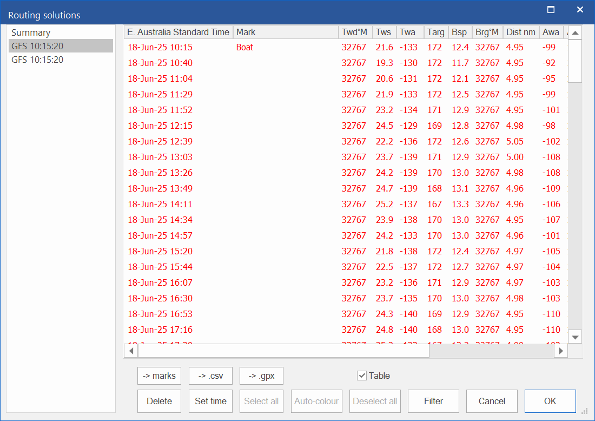

### 6.1.2 qtVlm GPX File

In qtVlm, select Route &gt; Export and then select the route to export. A file chooser will pop up, choose or create a file in your race folder, ensuring it has the extension .gpx. e.g. gpxroute.gpx.

On selecting save, this pop up will appear. Select **Detail** and make sure **As list of WPs** is not checked.

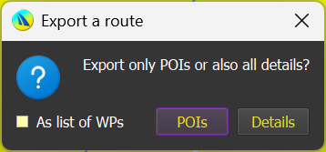

### 6.1.3 qtVlm CSV File

From the Route Logbook tab, select **Export (CSV Format)**, and select or create a file in your race folder with the extension .csv. e.g. route.csv. Make sure the **With raw data** is off.

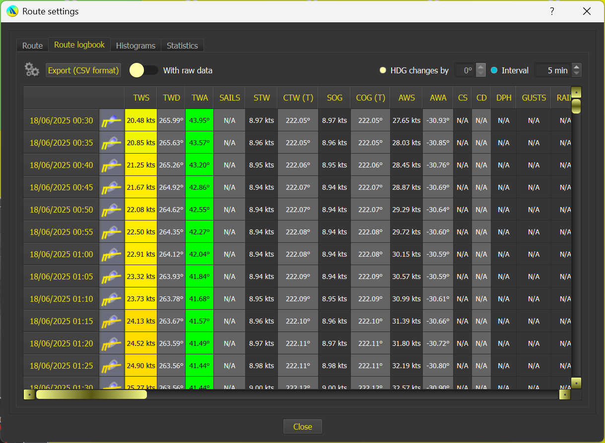

## 6.2 Loading the File

On the first time of using, a file chooser will be launched as shown below.

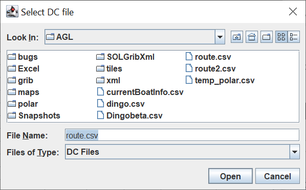

Select the import file and select **Open**. Provided the file is valid the DC Data table will be launched.

If the file is not valid, AGL says so and the DC Data table is not launched. 

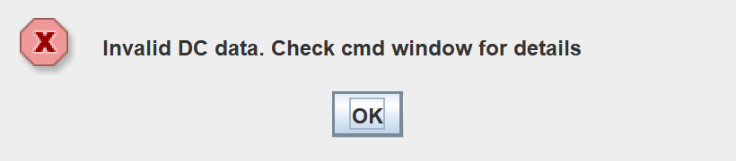

The command (cmd) window says what is wrong, for example a missing column or the line with bad data. Correct the file, or choose another one. The table then opens as shown below, ready for use.

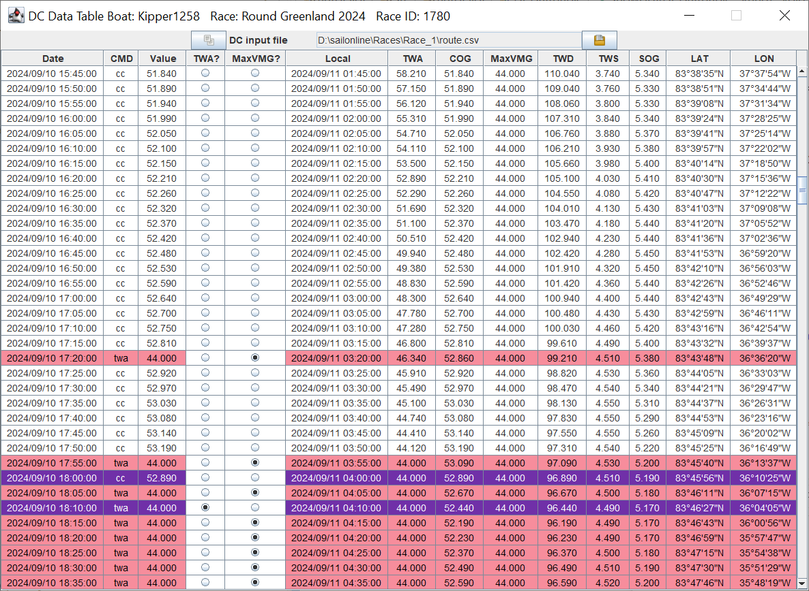

**Note:** AGL watches the DC file and loads the new data whenever it is modified (see **DC File Change Detection** below). This allows the user to keep reusing the same file for each import from the csv file.

During the load, AGL has checked if any DCs are outside the optimum VMG range, and if so, has automatically set the command to “twa” and the value to maxVMG. This can be turned off by deselecting the MaxVMG radio button, in which case the value and command will be set to COG/cc.

## 6.3 DC File Change Detection

AGL watches the DC file loaded in the DC Data Table, so you do not need to reload it by hand.

### 6.3.1 How it works

- When AGL starts, if the DC input file shown in the DC Data Table already exists, AGL begins watching it straight away. The DC Data Table stays hidden until it is needed. If the file does not exist yet, nothing is watched until you open the DC Data Table for the first time.
- When the DC file changes (for example, after you export a new route from qtVlm), AGL waits a moment to make sure the file has finished being written, then reloads it. The DC Data Table is brought to the front, and if the main AGL window was minimised it is restored first.
- Each time the DC Data Table loads, the DCs are also plotted in the graphics window as a grey trace: a grey dot for each DC, joined by a line, with a label (day and time) on every fourth DC. The  button on the graphics toolbar turns the trace on and off. The trace appears once the DC Data Table has been shown. The DC Data Table sends the trace straight to the graphics. It does not write a file, and it does not touch the additional waypoints (see [5.6 Additional Waypoints](0500-using-agl.md#56-additional-waypoints)). An example of the grey trace is shown below.

  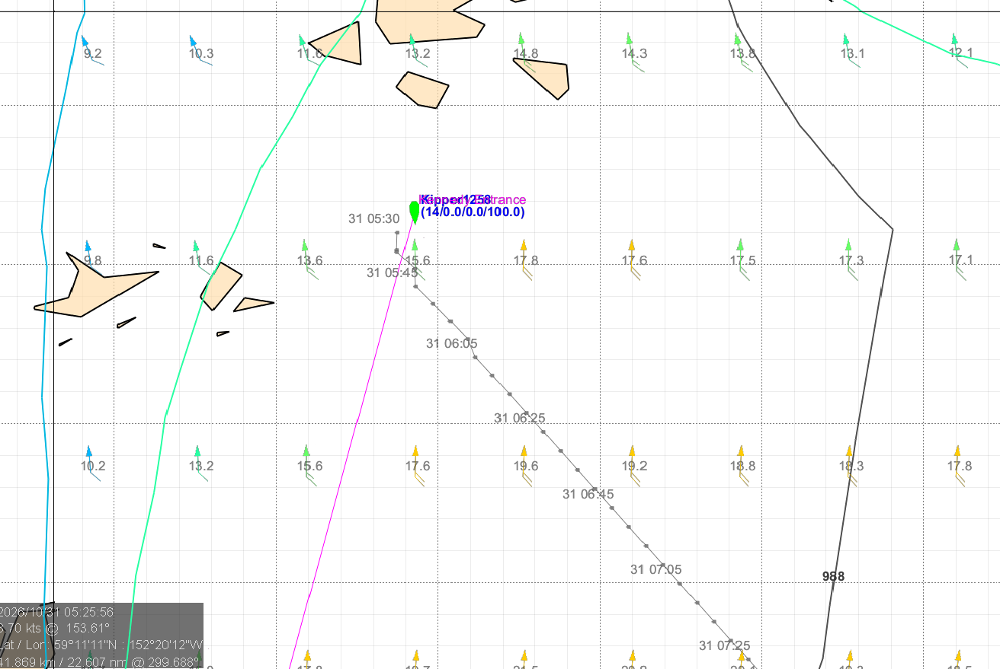

### 6.3.2 Changes to a different file

qtVlm can save its exports in a different folder from the one AGL is watching. To guard against this, when qtVlm shows its Save As confirmation after you export a route or a roadbook, AGL checks for 30 seconds for changes to files of the same type in the race folder, the qtVlm folder and the grib folder. If it finds a changed file that is not the one currently in use, it asks:

“A change has been detected in &lt;file&gt; which is not the file being used (&lt;current file&gt;). Use that file instead?”

- **OK** loads the changed file, and it becomes the DC input file.

- **Cancel** keeps the current file.

You are asked once for each change to a file, whatever you answer.

**Note:** If the DC file cannot be read when AGL starts, AGL says nothing. You will be asked about it when you open the DC Data Table.

## 6.4 Setting the DCs

The DCs first need to be transferred to the Delay Commands area on the DC Checker tab in the main AGL window. There are four possible options.

### 6.4.1 Send To

DCs can be sent to the **DC Checker** using the **Send To** option. All DCs from the first row of the table up to and including the selected DC will be sent to the **DC Checker**. In the example below, all DCs up to and including **2024/09/18 12:25:00** will be sent to the **DC Checker.**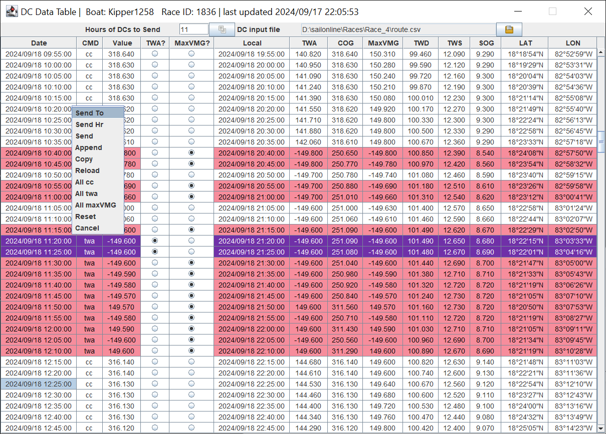

### 6.4.2 Send Hr

This option will send all DCs that are earlier than the number of hours specified in **Hours of DCs to Send** on the parameters bar at the top of the table. The number of hours (11) is added to the first DC time (2024/09/17 23:55:00) and all DCs up to 11 hours later (2024/09/18 10:55:00) are transferred to the **DC Checker**. The DCs that were sent are also highlighted as shown below.

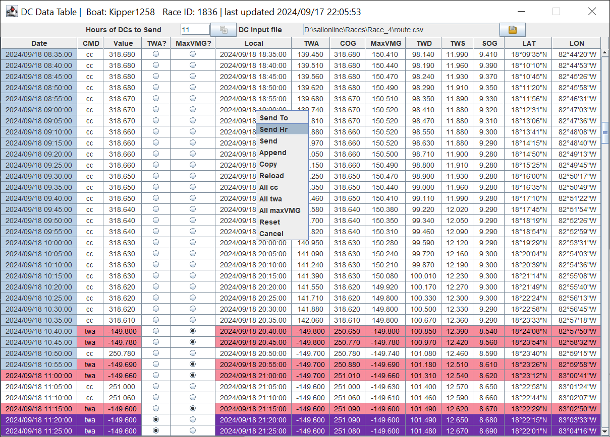

### 6.4.3 Send

The following steps do this.

1.  Select the desired DCs in the DC Data Table by clicking in the first cell and holding down the left mouse button to cover the rows of interest. The rows do not need to be contiguous.

    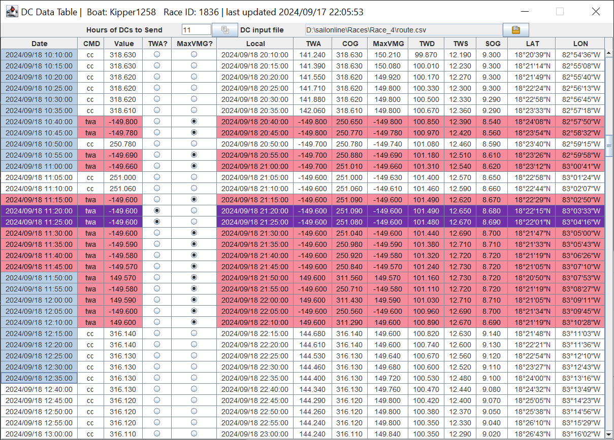

2.  The transfer can happen in one of three ways

    - Using the  button at the top of the table.

    - Using the right mouse click **Send** option

      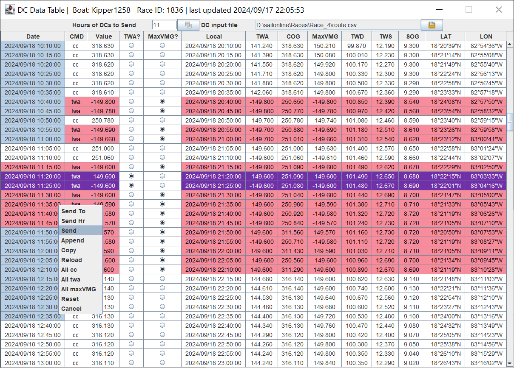

3.  Using Ctrl C / Ctrl V or right click **Copy** and Ctrl V in the **Delay Command** area on the **DC Checker** tab.

The DCs will now be transferred and ready for checking and setting in the normal way.

### 6.4.4 Append

All the previous DC transfers cleared the **Delay Commands** area with a complete new set. It is possible to append the selected DCs to those already sent to the **DC Checker.** To append, select the desired DCs (they must be selected as shown below) and use the **Append** option.

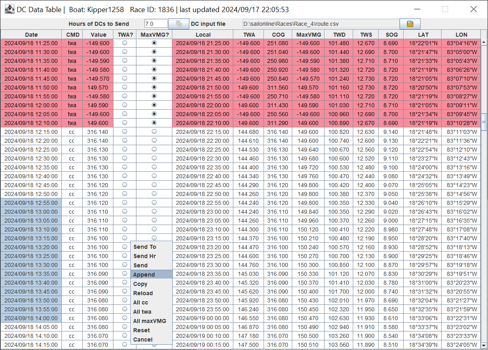

The selected DCs are added to the end of the existing ones as shown below, and can be processed in the normal way. Out of sequence appends and duplicates do not matter; the **DC Checker** will sort that out.

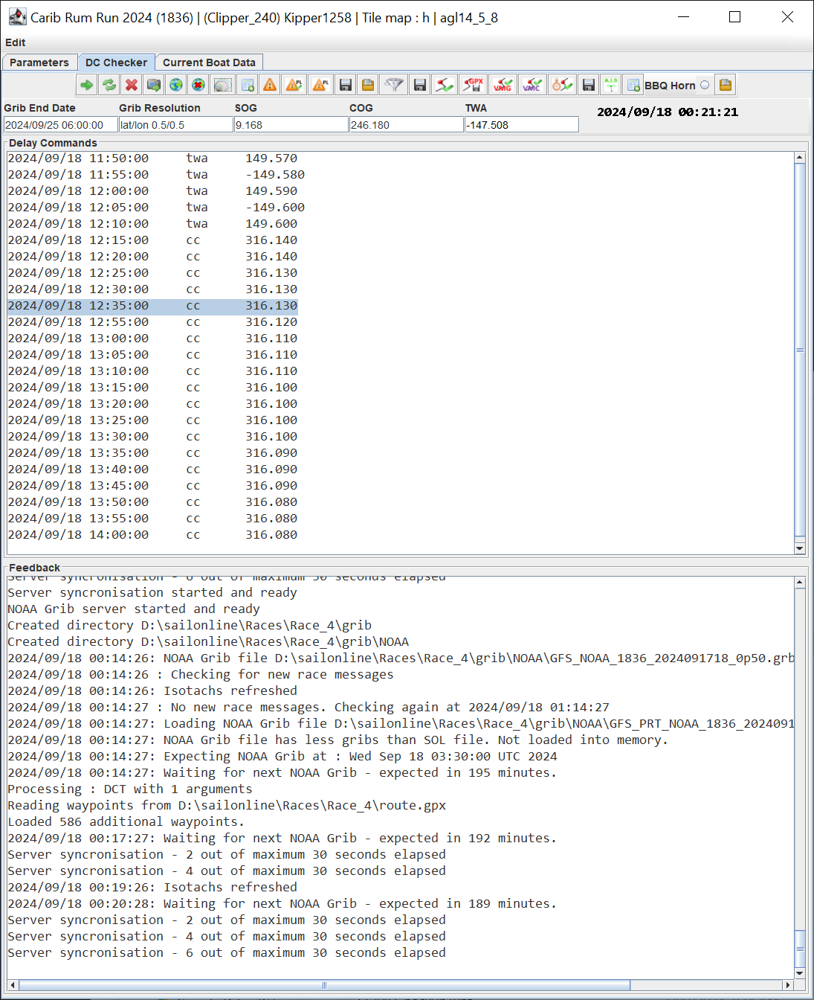

## 6.5 Other Buttons

### 6.5.1 Right Click Menu

The right click menu has the following options as shown below.

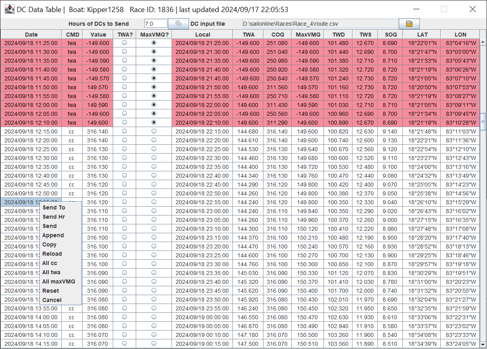

**Send To:** Sends all DCs from the first row to the selected row to the DC Checker.

**Send Hr:** Sends the number of hours of DCs specified to the DC Checker.

**Send**: Sends the selected DCs to the DC Checker.

**Append:** Appends the selected DCs to those already in the DC Checker.

**Copy:** Copies the selected DCs to clipboard.

**Reload:** Reloads the current selected DC input file. Useful if the same file name is used with each DC update.

**All cc:** Sets the selected DC values to the COG values and command to **cc**.

**All twa:** Sets the selected DC values to the **TWA** values and command to **twa**.

**All maxVMG:** Sets the selected DC values to the **MaxVMG** and command to **twa**.

**Cancel:** Aborts the pop-up menu and does nothing.

### 6.5.2 Send DC Button 

Same function as **Send** above.

### 6.5.3 Select File Button 

Opens the file chooser.

**Open** will open the selected file and update the table. **Cancel** will do nothing.
