# 8 Chats

The Chats tab in AGL is a replication of the SOL chats. In addition, it has Pushover and Telegram rooms that send you messages about key events such as BBQs, missed marks and Wx arrival, and Telegram lets you answer from your phone. When AGL starts the chats for the first time, it will open with the Pushover and English chats set.

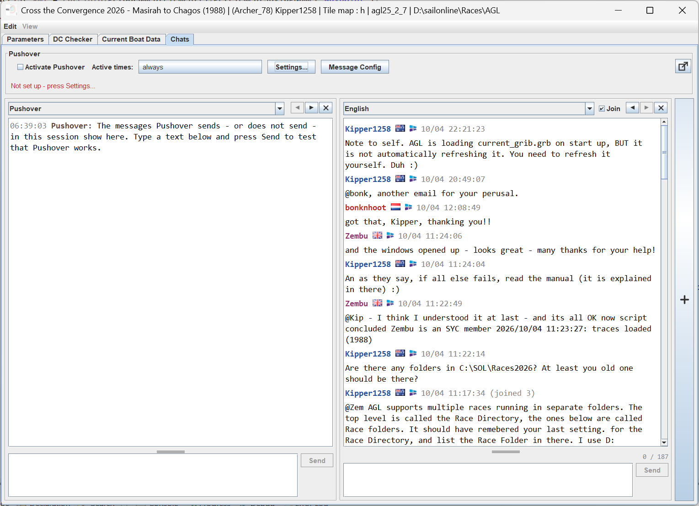

## 8.1 Managing Chats

To add another room, click on the **+** bar, and a new room will open. Select the desired room from the dropdown.

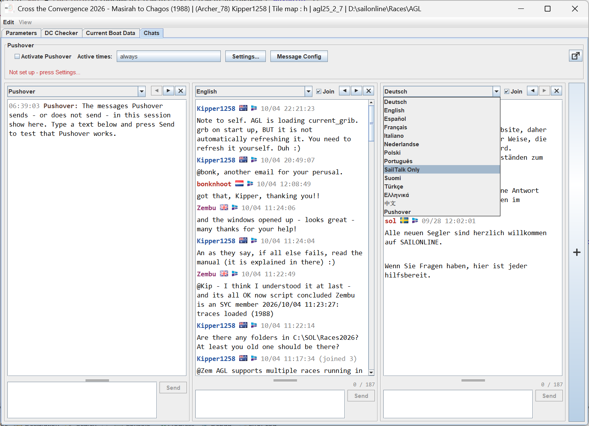

You can add up to 4 chats. The ◀ ▶ arrows at the top of the chat move the box left or right. The **X** closes the room.

### 8.1.1 Replying To Messages

Double clicking on a user will add to the message box **@&lt;user&gt;@HH:MM** ready to continue typing your message. e.g. **@Zembu@11:22**.

The message box will show how many characters have been used, and will automatically split your message into the 187 character SOL limit. It organises the message into reverse order so the message reads in the correct order when seen on the SOL chat page. Message parts are suffixed and prefixed with a `[p<n>]` where `<n>` is the number of the message part.

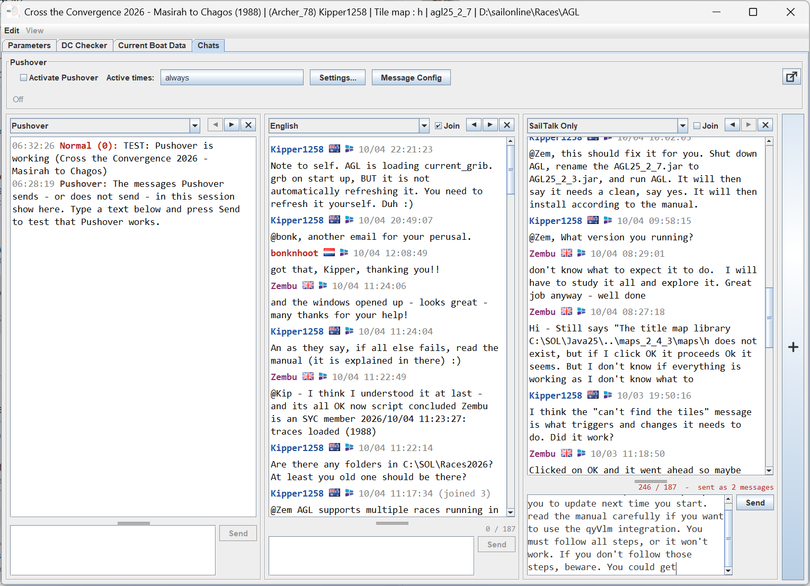

AGL will try to concatenate multi-part messages into one message if the **Join** checkbox is ticked. The two screenshots show the difference between raw (right) and **Join** (left).

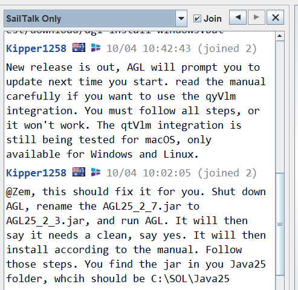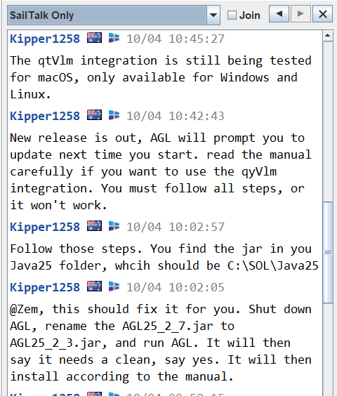

The message boxes can be resized by dragging the bar above the message box. The tooltip below is shown when the mouse is in the resize bar.

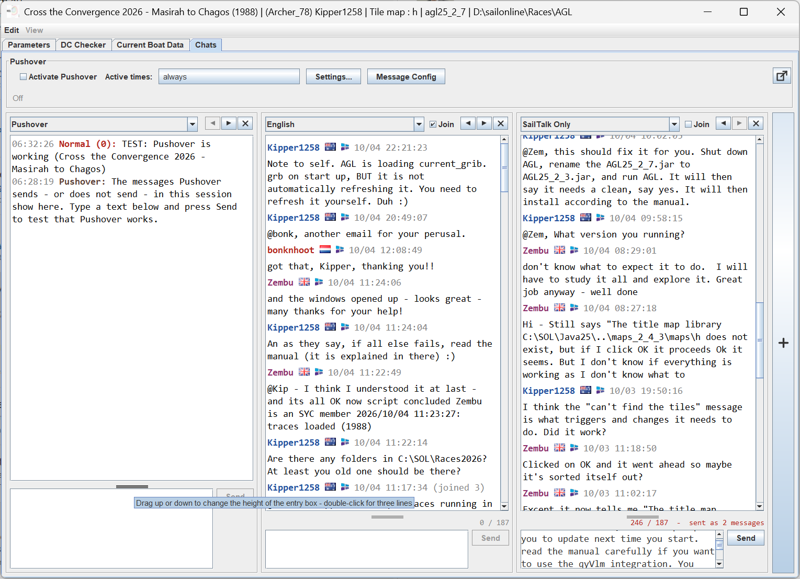

AGL shows text emoticons in the SOL chat rooms as emoji, so a message typed as `:)` reads as 🙂. Only the incoming messages you read are changed; what you send is sent exactly as you typed it, and the Pushover list is not changed.

An emoticon is only changed when it stands on its own: at the start of the message or after a space or an opening bracket, and followed by a space, the end of the message or punctuation. So "8) " in a numbered list, or "Re:Dave", are left alone. A repeated closing character counts as one, so `:)))` is one smile. Web addresses are never changed; they are shown as links, and a click opens them. The nose (the `-`) is optional in the ones that have it.

| Typed | Shown | Typed | Shown | Typed | Shown |
|---|---|---|---|---|---|
| :) :-) (: | 🙂 | :P :p :-P :-p | 😛 | &gt;:( &gt;:-( | 😠 |
| :( :-( | 🙁 | :O :o :-O :-o | 😮 | O:) O:-) | 😇 |
| :'( | 😢 | :/ :-/ | 😕 | 8-) B-) | 😎 |
| :D :-D | 😀 | :\| :-\| | 😐 | &lt;3 | ❤ |
| XD | 😆 | :\* :-\* | 😘 | (y) (Y) | 👍 |
| ;) ;-) | 😉 | :S :s :-S :-s | 😖 | (n) (N) | 👎 |

### 8.1.2 Setting Up Pushover

1. At **pushover.net**, make an account and an application for AGL. Upload an icon for the application on the same page, so AGL's messages carry it on your phone: use `agl.png` from your Java25 install folder (it is 150 x 150 and can be uploaded as it is). The icon is set on the Pushover website, not in AGL. The application gives you an **API token**. Your **user key** is on the Pushover home page. Both are 30 letters and digits.

   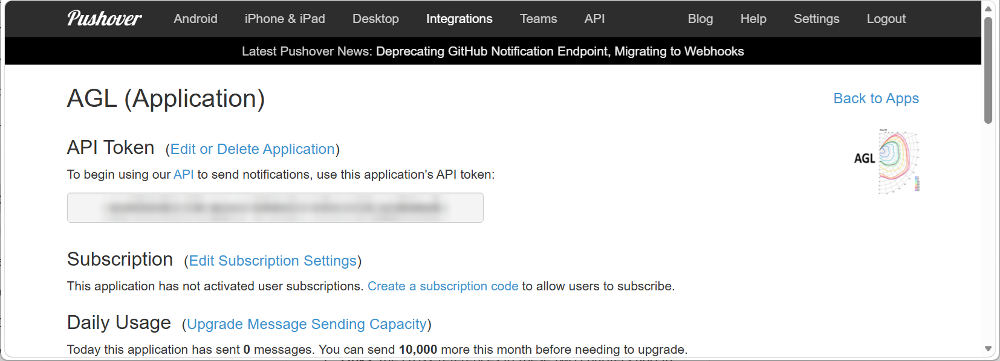

   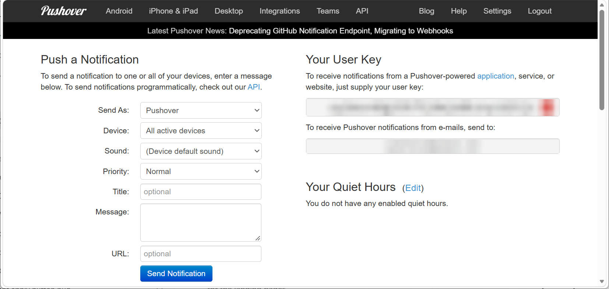

2. In the hub, open the **Pushover** menu and choose **Setup...**.

   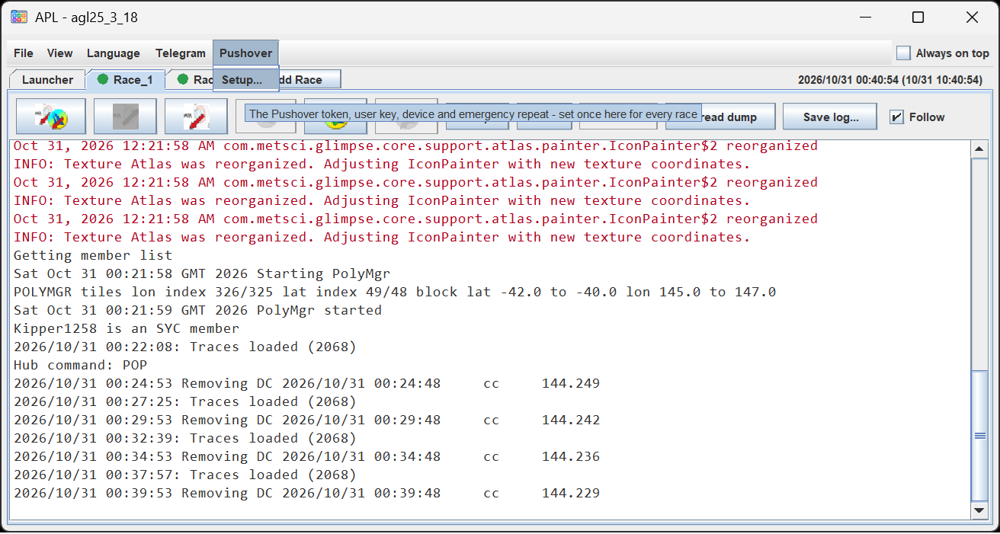

3. Enter the **Application API token** and your **User key**. If the key is a delivery group key, tick **Group**: AGL then puts the boat name in front of every message, so the people in the group know whose it is. Tick **Show the token and key** if you want to check what you typed.

   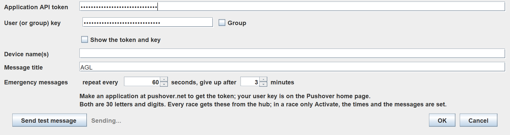

4. Leave **Device name(s)** empty to send to all your devices, or enter one or more names separated by commas. It is not used with a group key.

5. **Message title** is the title above each message on the phone.

6. **Emergency messages** repeat every number of seconds you set, and give up after the number of minutes you set.

7. Press **Send test message**. The phone should show "TEST: Pushover is working". Then **OK**.

   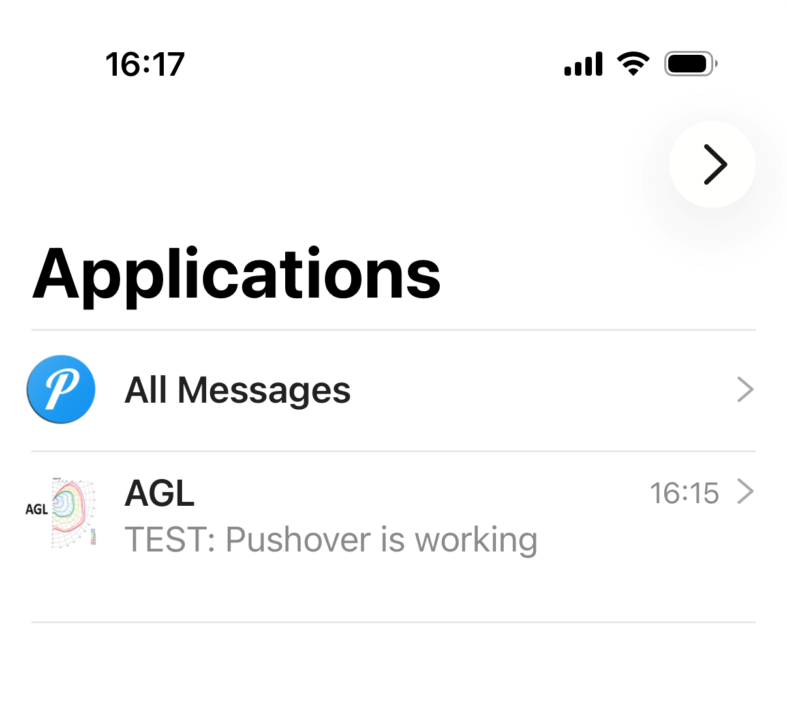

### 8.1.3 Setting Up Telegram

You need a Telegram bot of your own. It takes a few minutes.

1. Download the Telegram app for your mobile device. [Telegram Messenger](https://telegram.org/) shows what devices are supported, and how to get their app.

2. In Telegram, search for **@BotFather** and open the chat. Check that it has the blue tick, which shows it is the official bot. Press **Start** if it asks.

   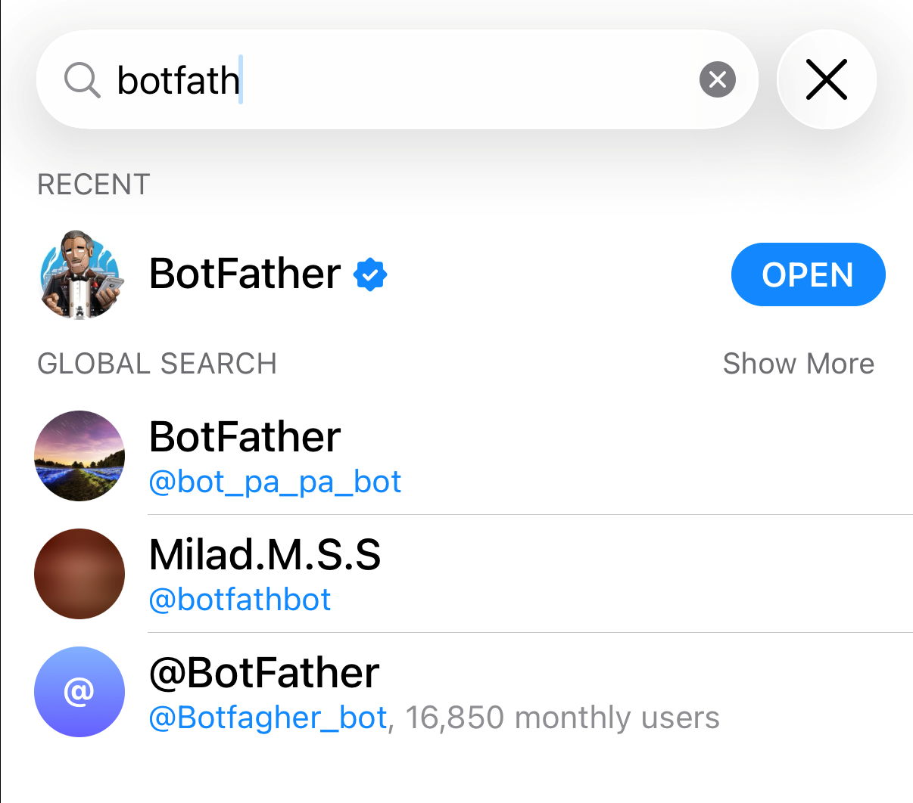

3. Send `/newbot`. BotFather asks for a name for your bot. Type a name, for example **AGL**. It is only the name shown in the chat.

   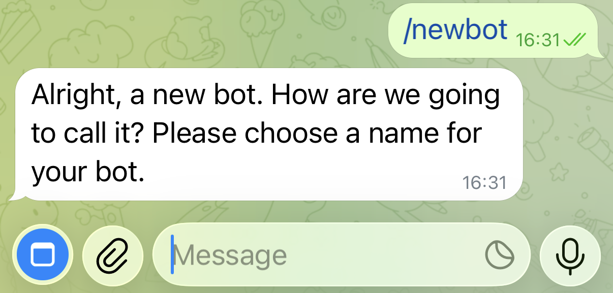

4. BotFather now asks for a username. A username must end in "bot". Use your **&lt;boat name&gt;bot**, e.g. **Kipper1258bot** for boat name **Kipper1258**. It must be unique across Telegram, so BotFather asks again if the name is taken.

   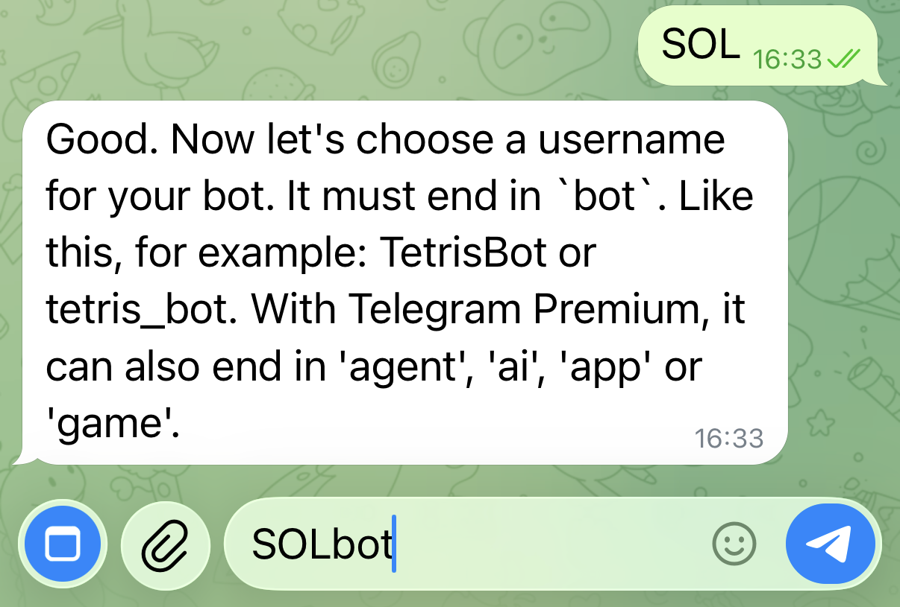

5. BotFather replies with a **token**. Copy it. The easiest way to get the token onto your PC is to open [Telegram Web](https://web.telegram.org/k/) in a browser, log in by scanning the QR code with the Telegram app on your phone (**Settings > Devices > Link Desktop Device**), open the BotFather chat there, and copy the token.

   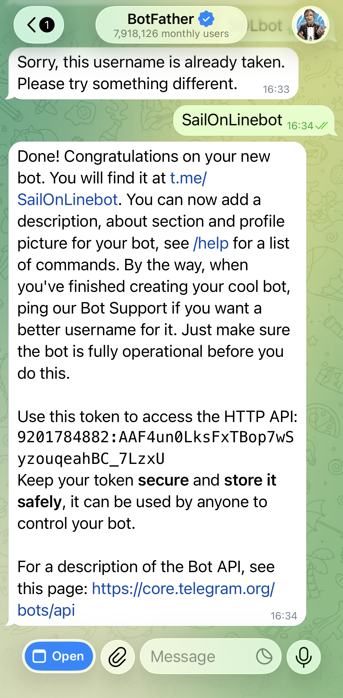

6. In the hub, open the **Telegram** menu and choose **Setup...**.

   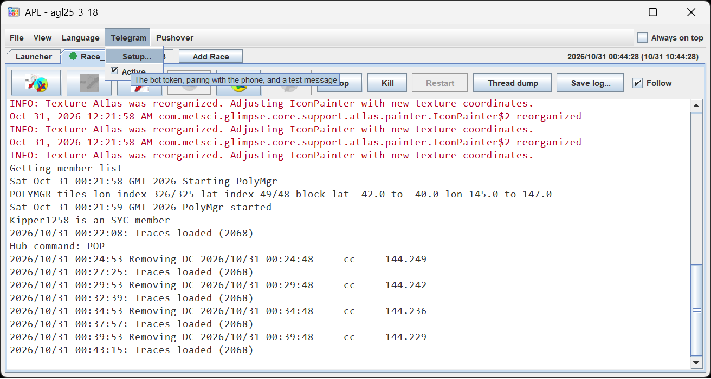
   
7. Paste the token into **Bot token**, and tick **Activate Telegram**. The hub reads the bot only while this is ticked. The status should change to **running**.

8. In Telegram, open your new bot and press **Start**.

9. In the hub, press **Pair**. It shows a code. In Telegram, send your bot `/pair` and the code. **Paired chat** then shows your chat. From now on the hub obeys only that chat.

10. Press **Send test**. The phone should show the test message.

   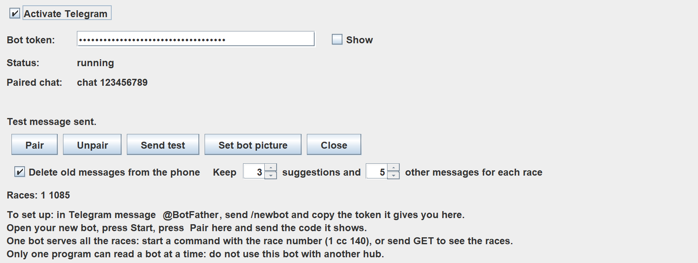

11. Once the test is successful, you can set the bot picture to `agl.png` by clicking on **Set bot picture**. Messages from AGL will carry the AGL icon.

Also on this form:

- **Delete old messages from the phone** keeps the Telegram thread short. The oldest messages, and your own commands, are deleted (Telegram only allows this for 48 hours).
- **Keep** *n* **suggestions and** *n* **other messages for each race**: the suggestions with buttons that are kept, and the messages of every other kind (alerts, replies and your commands). A new suggestion always replaces the one still open.
- **Unpair** stops AGL obeying the paired chat.

Things to know:

- **One bot serves all the races.** Start a command with the race number (for example `1 cc 140`), or send `GET` to see the races. You can also set the race first with `SET`.
- **Only one program can read a bot at a time.** Do not use the same bot with another hub.
- In the hub, the Telegram menu lists the races, with an **Active** tick for each. Telegram is used only for the races that are ticked.

### 8.1.4 In Each Race

On the Chats tab, tick **Activate Pushover** to switch Pushover on for the race. **Active times** sets when Pushover may send; a window that ends earlier than it starts runs over midnight, for example 22:00 to 06:00.
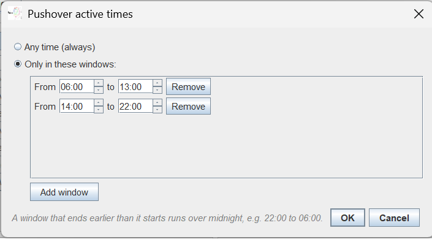 

**Message Config** shows the messages. For each one you can:

- tick **Pushover** and **Telegram** to choose where it goes,
- change the **text**. Leave it empty for the standard text. `<time left>` and `<time>` are filled in with how long it is to the event and when, and `<mark name>` with the mark,
- set the **priority**: Lowest sends no alert on the phone, Low is quiet, Normal, High ignores the phone's quiet hours, and Emergency repeats until you acknowledge it,
- set the **active times**: follow the global times, any time, or only in windows you choose,
- set the **lead**, in minutes, for the messages that have one,
- press the test button to send the message now, as a test.

The Pushover and Telegram rooms on the Chats tab show what has been sent, and what has not been sent and why. Type a text below the room and press **Send** to test that it works.

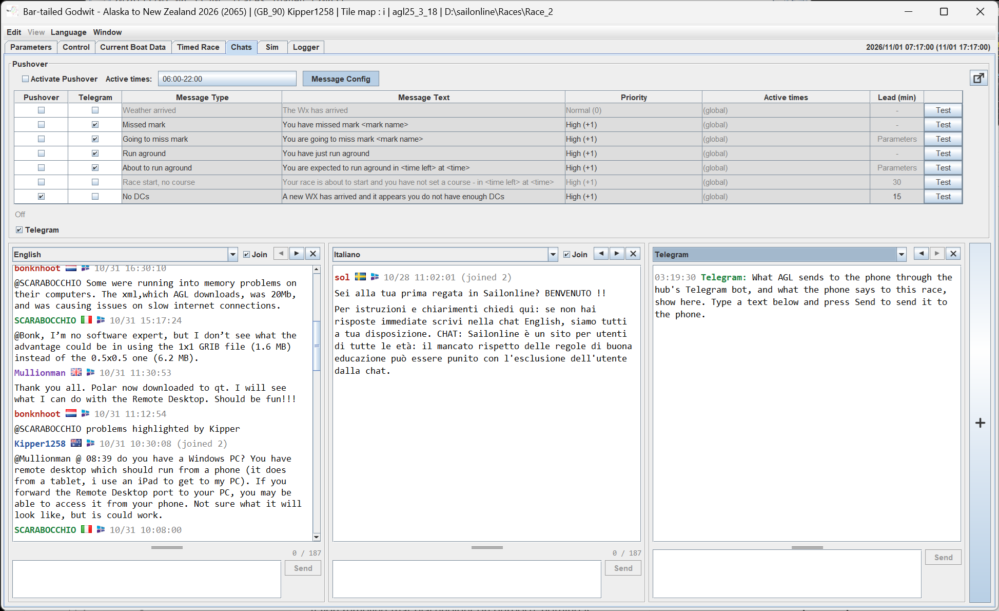

### 8.1.5 Answering from Your Phone

Telegram suggestions arrive with **Apply** and **Dismiss** buttons. A suggestion shows on the screen first. If you do not answer it, it goes to the phone as well.

On pressing **Apply**, the correction is applied and the message is update with the new boat information.

You can also send commands back to AGL to control your boat. Commands start with the race number, or you can `SET` the race first. They are for members only. `HELP` lists them; the main ones are:

| Command | What it does |
|---|---|
| `APPLY` *letter* | Answers the last suggestion, for example `APPLY E` |
| `CFG` | Shows the settings; `MSG` lists the messages, numbered |
| `BBQ`, `MARK` with `ON`, `OFF`, `LEAD n` or `WARN n` | Switches a check on or off, or sets how far ahead it looks and how much warning it gives |
| `FIX`, `PIC`, `TG`, `DRY`, `IC` with `ON` or `OFF` | Fix suggestions, pictures with a suggestion, Telegram, dry run, In Control |
| `EARLY n`, `HOLD n` | Early firing to ignore; minutes a suggestion waits on the screen before it goes to the phone |
| `MUTE n`, `UNMUTE` | Stops the alerts to the phone for *n* minutes |
| `CC` *degrees* | Steers a course |
| `TT` *degrees* | Steers a TWA |
| `CP` / `TP` *degrees* | As `CC` and `TT`, with performance loss |
| `PS` | Stops the AP |
| `STATUS` | The boat now |
| `HELP` | The list of commands |

Steering from the phone needs **In Control** to be ticked in AGL.

### 8.1.6 Testing Telegram

Before turning the live messaging on, it is advisable to use the [Simulator](0900-simulator.md) to test what is going to happen with each event, both on the console and with Telegram. We suggest you do the following tests on any race that has finished or is yet to start.

#### 8.1.6.1 BBQ Checking

1. [Start the Sim](0900-simulator.md#91-starting-and-stopping-the-simulator) in the graphics using the right click Sim  option near a coast.
2. Enable **BBQ Checking** and set a lead time that is longer than it takes to get to the coast.
3. Start the boat on a collision course that hits the coast, something similar to what would happen in a real race.
4. Check what happens and respond.
5. Click on the Sim tab in AGL and enter [**sim last**](0900-simulator.md#95-the-commands) in the **Command** box to stop the boat and return it to your start position.
6. Type [**tg idle on**](0900-simulator.md#96-testing-telegram-and-pushover). This now simulates that you are away from your computer.
7. Make sure **About to run aground** is checked under **Message Config**.
8. Repeat steps 3 and 4, and respond on your phone to the prompts. The dialogs will also appear on your console, ignore them for now.
9. Stop the boat as in step 5.
10. Now create some DCs that cross a coast. Set the boat on a course that does not hit the coast. Create some waypoints and then use the Waypoint to DCs icon  in the graphics.
11. Use BBQ Checker  to make sure you have a collision. Ignore the corrections.
12. Now set your DCs. You will be warned that there are collisions, use **Set Anyway**
13. Provided your collision is within the **BBQ lookahead** time set on the **Parameters** tab, you should get a warning and fix both on the phone and the console. Use either.

When finished, type [**sim off**](0900-simulator.md#95-the-commands) in the **Command** box, and the boat will now respond to the server.

#### 8.1.6.2 Missed Sea Marks

With the sim started, you are able to [move the marks of the course](0900-simulator.md#94-marks-and-the-finish). If the race only has land marks, move one out to sea with the **Move Mark**  from the right click menu. Now place the boat with **Sim**  near the mark, checking that the boat is heading to the mark you moved. If not, type [**leg &lt;n&gt;**](0900-simulator.md#94-marks-and-the-finish) where &lt;n&gt; is the leg number going to that mark. Then:

1. Enable **Check mark roundings** and set a lead time that is longer than it takes to get to the mark.
2. Start the boat on a course to miss the mark, something similar to what would happen in a real race.
3. Check what happens and respond.
4. Click on the Sim tab in AGL and enter [**sim last**](0900-simulator.md#95-the-commands) in the **Command** box to stop the boat and return it to your start position.
5. Type [**tg idle on**](0900-simulator.md#96-testing-telegram-and-pushover). This now simulates that you are away from your computer.
6. Make sure **Going to miss mark** is checked under **Message Config**.
7. Repeat steps 2 and 3, and respond on your phone to the prompts. The dialogs will also appear on your console, ignore them for now.
8. Stop the boat as in step 4.
9. Now create some DCs that miss the mark. Set the boat on a course that does not miss the mark. Create some waypoints and then use the Waypoint to DCs icon  in the graphics.
10. Use BBQ Checker  to make sure you have a miss. Ignore the corrections.
11. Now set your DCs. You will be warned that you are going to miss the mark, use **Set Anyway**
12. Provided your miss is within the **Mark lookahead** time set on the **Parameters** tab, you should get a warning and fix both on the phone and the console. Use either.

When finished, type [**sim off**](0900-simulator.md#95-the-commands) in the **Command** box, and the boat will now respond to the server.

#### 8.1.6.3 Missing the Finish Line

Testing the finish line is similar to Missed Sea Marks. Set the boat on the leg to the finish, and repeat the Missed Sea Marks tests. You can also move the finish to suit your wind conditions.
