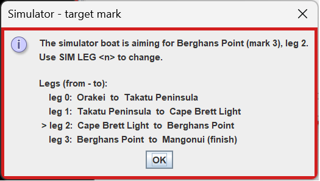
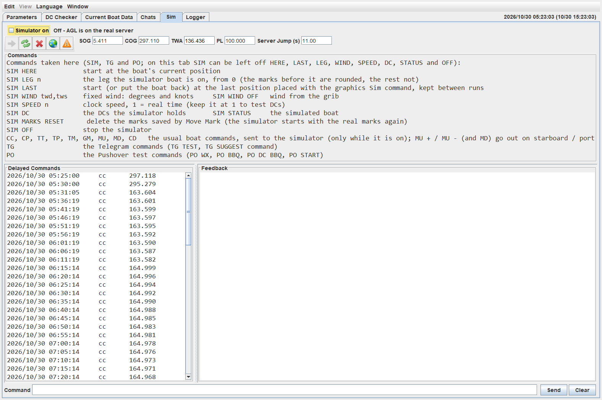
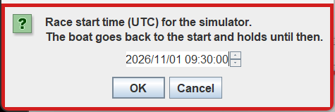

# 9 Simulator

The Simulator is a stand-in for the SailOnline server. It lets you test AGL, and what you will see on your phone, without touching your real boat: you place a boat anywhere on the chart, give it commands and DCs, and watch what AGL does. It is for members only.

The Simulator serves only the boat and the DCs. Everything else AGL asks the server for (the race information, the grib and so on) still comes from the real server, so the wind and the marks are the real ones unless you change them as described below.

## 9.1 Starting and Stopping the Simulator

There are four ways to start it. Commands are not case sensitive and can be entered in lower case:

- **Right click > Sim**  on the graphics chart. Left click where the boat is to start. If the Simulator is already running, it is stopped and restarted there. The position is remembered for **SIM LAST**.
- **Simulator on**, on the **Sim** tab. The boat starts at the position the boat has now.
- **SIM HERE**, typed in the **Command** box of the **Sim** tab. The same as **Simulator on**.
- **SIM LAST**, typed in the **Command** box. The boat starts again at the last position you placed with the right click Sim, even from an earlier run. It also puts the boat back there if the Simulator is already running.

You can also type a position as `SIM lat,lon`, or paste `SIM ,CP,lat,lon` as the graphics copy it. **SIM START** (see [9.3](#93-how-the-boat-behaves)) also starts the Simulator, at the boat's position, if it is not running.

A boat placed this way is stopped (TWA 0) with 100% performance, and the wind is the wind at that place. AGL then advises which leg is active (see [9.4](#94-marks-and-the-finish)).

To stop it, untick **Simulator on** or type **SIM OFF**. AGL goes back to the real server, and any marks you moved and any start time you set are put back.

While the Simulator runs, the **Sim** tab turns red and says **SIMULATION MODE**: the boat and the DCs go to the Simulator, and the real boat is not touched.

## 9.2 The Sim Tab

- **Simulator on** starts and stops it, and the line beside it says which server AGL is on. The frames of all AGL windows turn red when the simulator is running.
- The toolbar has the same buttons as the Control tab, in the same order: set DCs, refresh DCs, delete DCs, show the graphics and check DCs. The boat values beside it (SOG, COG, TWA, PL and the server jump) are those of the simulated boat while the Simulator is on.
- **Commands** lists what you can type.
- **Delayed Commands** shows the DCs the Simulator holds. They are the same DCs as on the Control tab.
- **Feedback** is the Simulator's own, and **Clear** empties it.
- **Command** is where you type. Only SIM, TG, PO and the boat commands are taken here. On this tab you can leave out the word SIM in front of HERE, LAST, LEG, WIND, SPEED, DC, STATUS, START and OFF.

## 9.3 How the Boat Behaves

The Simulator moves the boat the way the SOL server does: polar speed times performance, with the performance loss for each turn, and the recovery after it.

- **The hop.** Like the real server, it moves the boat once every 10 seconds. A request for the boat waits until the hop is over, and then the new position is sent. A DC that is due is applied at the start of the hop it falls in.

- **Commands and DCs.** CC, CP, TT, TP, TM, GM, MU, MD and CD are described in [9.5 The Commands](#95-the-commands) and go to the Simulator. DCs are set, listed, deleted and fired by the Simulator, as the server does. Nothing goes to SOL when the simulator is running.

- **Performance loss.** A boat you stop yourself (TWA 0) gets the normal loss from TWA 0 to its new TWA. A boat that is stopped by the coast restarts with 80% performance.

- **The coast.** A boat that reaches the coast stops where it is, with TWA 0. The next command that moves it starts it again with 80% performance.

- **Wind.** The wind comes from the grib. **SIM WIND** *twd,tws* sets a fixed wind in degrees and knots, and **SIM WIND OFF** goes back to the grib.

- **Clock speed.** **SIM SPEED** *n* sets the clock speed, 1 being real time. Keep it at 1 when you test DCs.

- **Race start.** **SIM START** sets a start time for the Simulator, so you can test a haulback start: the boat goes back to the first mark with no mark rounded, and holds there until the start. While it holds it keeps its heading and speed but does not move, loses no performance, and keeps any DCs it has. After the start it sails as usual. **SIM START** on its own asks for the time in a small form (UTC, a date spinner: the arrows move between the fields and up and down change them). 

  

  

  **SIM START** *n* sets the start *n* minutes from now with no form (a negative number is a start in the past). If the Simulator is not running, it starts first at the boat's position, as **SIM HERE** does. **SIM START CLEAR** puts the real start back, and the boat goes back to where you placed it. The real race information is not changed. The start time is kept in the Simulator's own copy of the race information, so the next run of the Simulator uses it again (a message says so), until **SIM START CLEAR** or **SIM RESET** removes it. **SIM OFF** gives AGL the real start time back.

## 9.4 Marks and the Finish

When you place the boat, AGL picks the closest mark as the one the boat is going to, and a message names it, with the leg from and to. If it is the wrong one, type **SIM LEG** *n*, where *n* is the number of the leg that goes to the mark you want, counting from 0. The marks before that leg count as rounded, and the rest as not rounded. **SIM HERE** keeps the real boat's own leg.

A mark counts as rounded when the boat crosses the outer half of the line that splits the angle at the mark, the way round the mark goes. If the boat crosses back, the mark is unrounded again. Each crossing is counted, so a miss has to be undone by going back and rounding the mark properly.

When the boat crosses the finish line, the Simulator stops it and marks it finished, and it ignores any more DCs.

**Move Mark**  on the right click menu moves a mark while the Simulator is running. This is the way to test a missed mark, or the finish line, wherever you are. The moved marks are kept in a copy of the race information used by the Simulator only, so the real race information is not changed. **SIM OFF** puts the real marks back. **SIM MARKS RESET** deletes the saved copy, so the next Simulator starts with the real marks.

## 9.5 The Commands

| Command | What it does |
|---|---|
| `SIM HERE` | Starts at the boat's current position |
| `SIM LAST` | Starts, or puts the boat back, at the last position placed with the graphics Sim |
| `SIM lat,lon` | Starts at that position |
| `SIM LEG` *n* | The leg the boat is on, from 0. The marks before it are rounded, the rest are not |
| `SIM WIND` *twd,tws* | A fixed wind, in degrees and knots. `SIM WIND OFF` goes back to the grib |
| `SIM SPEED` *n* | The clock speed. 1 is real time |
| `SIM DC` | Lists the DCs the Simulator holds |
| `SIM STATUS` | Shows the simulated boat |
| `SIM START` | Asks for a race start time (UTC) in a dialog and sets it. The race now behaves the same way that the server does, with haulback starting one hour before the race start. Starts the Simulator with the boat at the current position. |
| `SIM START` *n* | The race start *n* minutes from now, with no dialog. Behave the same way. |
| `SIM START CLEAR` | Removes the Simulator's start time. The real start is back, and the boat goes back to where it was placed |
| `SIM RESET` | Restores the original race information. All Simulator changes are removed. |
| `SIM OFF` | Stops the Simulator |
| `CC` *degrees* | Steers a course |
| `CP` *degrees* | As `CC`, with performance loss for the turn |
| `TT` *degrees* | Steers a TWA |
| `TP` *degrees* | As `TT`, with performance loss for the turn |
| `TM` | Tacks to the best upwind angle (MaxVMG) on the other tack |
| `GM` | Gybes to the best downwind angle (MaxVMG) on the other gybe |
| `MU` [*+* \| *-*] | Steers the best upwind angle (MaxVMG). `+` is starboard, `-` is port. Leave it off and AGL uses the tack the boat is on |
| `MD` [*+* \| *-*] | As `MU`, for the best downwind angle |
| `CD` | Sets the first DC in the DC list now, without waiting for its time |

The boat commands above are the ones you would type in the command box of a race. They are sent to the Simulator only while it is on, and `TM`, `GM`, `MU` and `MD` ask you to confirm before they go. The `TG` and `PO` test commands are in [9.6](#96-testing-telegram-and-pushover). Any other command on this tab is refused.

## 9.6 Testing Telegram and Pushover

The Simulator is the safe way to see what the messages on your phone look like and how to answer them, because it makes the events happen without a real boat. The test commands below can be typed on the **Sim** tab. Step by step tests are in [8.1.6 Testing Telegram](0800-chats.md#816-testing-telegram).

Telegram, with `TG` in front:

| Command | What it does |
|---|---|
| `TG TEST` | Sends a test message to the phone. `TG TEST` *n* sends a test suggestion with *n* **Apply** buttons (1 to 24) |
| `TG SUGGEST` *command* | Sends a test suggestion with **Apply** and **Dismiss**, for example `TG SUGGEST CC 140` |
| `TG A` [*n*] | Applies the last suggestion (the suggested option, or option *n*), as the **Apply** button would |
| `TG D` | Dismisses the last suggestion |
| `TG IDLE` [ON\|OFF\|AUTO] | Tests the "at the console" logic. ON pretends you are away from the computer, so the phone gets the suggestion, OFF pretends you are at the computer, and AUTO uses your real idle time. `TG IDLE` alone shows the state |
| `TG LANG` [*n*] [en\|it] | Shows a numbered dialog and sends its text to the phone, in the race's language or the one given. `TG LANG` lists them |

Pushover, with `PO` in front. Each is sent through the same checks as the real message; add `FORCE` to skip the checks.

| Command | Message |
|---|---|
| `PO WX` | Wx arrived |
| `PO BBQ` (or `PO BBQ NOW`) | Run aground |
| `PO DC BBQ` (or `PO BBQ SOON`) | About to run aground |
| `PO START` | Race start, no course |
| `PO NODC` | No DCs. Runs the check now, as if the lag after a Wx had passed |

The result of a test message shows in the Pushover and Telegram rooms on the Chats tab.
