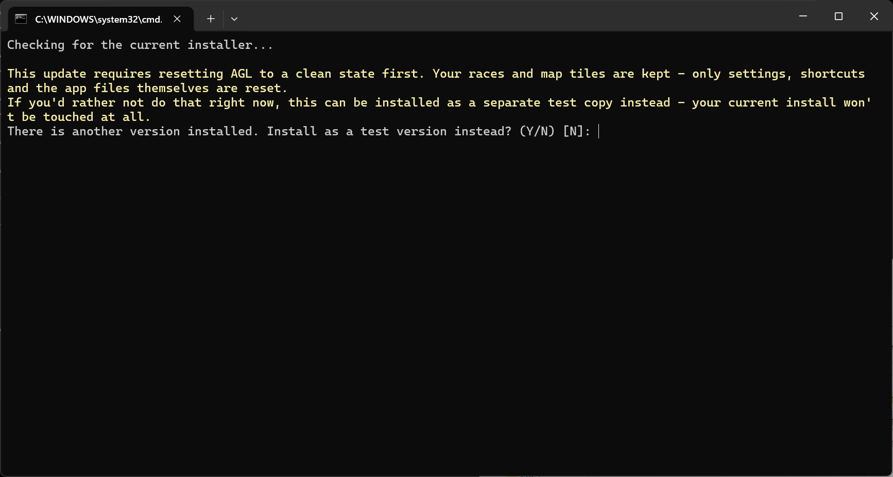

# AGL 25 Release Notes 25.4.0

AGL 25.4.0 is a major release with a lot of new functionality. The focus of this release has been to provide tools that reduce stupid mistakes, get out of trouble before it happens and to improve the efficiency of using both qtVlm and AGL. There are many changes, read the release note as to what they are, and the User Manual on how to use them.

## Version 25.4.0

### Enhancements

#### Checking your course before it goes to the server

1. AGL can now pre-check DCs for BBQs, missed sea marks and the finish line, with solutions offered to you before the DCs are set. Nothing is changed until you accept a suggestion. The DC Checker also marks the BBQs it finds with red dots, and Tack/Gybe later is available for land avoidance.

2. When a DC falls outside maxVMG, AGL now conditions the whole DC list, with Condition All and Set Anyway.

3. A new Follow command in the graphics popup menu adds waypoints along a coastline between two waypoints.

#### Messages to your phone

1. AGL can now message your phone live through Pushover and Telegram: weather arrived, about to run aground or run aground, going to miss or missed a mark, a race starting with no course, and the server DCs running out before the next Wx (No DCs). Emergency messages repeat until you acknowledge them on the phone.

2. Pushover is set up once in the hub for all races.

3. Telegram runs from a single bot in the hub, with channels for each race. AGL can propose a course change on your phone, and it is applied only when you confirm it there. A set of commands lets you check status and send course changes from the phone.

4. Replication of the SOL client chat rooms in a tear off chat tab.

5. Messages sent from AGL over 187 characters in length are split into parts and transmitted at once, and AGL attempts to join split messages into one message.

#### Graphics window

1. A View Options form in the graphics window replaces several toolbar icons, and adds DC label fields, a legend, Fill land polygons and Font -/+ for the graphics.

2. Grey DC trace in the graphics window, fed directly by the DC Data Table, with an on/off button; the additional waypoints are no longer overwritten by the DCs.

3. AIS boats are now plotted after a race has finished.

#### qtVlm, gribs and DCs

1. AGL warns you when you open Routing settings in qtVlm and the grib has not been refreshed since the last Wx download.

2. The linked qtVlm can be set up in Production mode, or in Test mode to try a new qtVlm release before upgrading. AGL offers to link it again if its set-up is broken, and checks that its map tiles are the set that goes with the SOL maps.

3. AGL checks that it has enough memory for the NOAA grib. If it runs out, the grib already loaded stays in use.

4. The DC Data Table now starts watching the DC file when AGL starts, reloads it when it changes, and asks whether to switch if qtVlm saves a changed file in a different folder.

5. Manage qtVlm dialogs: the qtVlm windows Routing, Converting Routing to Route, Simplification result and Optimization results are brought to the front, one at a time, when they are hidden behind other windows.

#### The AGL Hub and starting AGL

1. The AGL Hub: one window on the taskbar with a tab for each race, showing the race's console and its controls (Pop, Stow, qtVlm Pop, qtVlm Stow, Stop, Kill, Restart, Thread dump, Save log). It replaces a window on the taskbar for each race.

2. Add Race can start several race folders at once. Open starts AGL in each; Start also presses Apply for you. Folders that already have an AGL running are greyed and skipped.

3. Closing the hub can leave the races running (Close / Leave / Cancel). The next hub takes the running races up again.

4. Restart races after a shutdown: the hub starts the races again after a Windows update restart, a crash or a power cut.

5. AGL_autostart.bat sets up AGL to start when you sign in to Windows, Windows signing in by itself, and locking the screen after that sign-in.

6. The hub has its own text size (View \> Text Size), an Always on top box, a UTC clock with the computer's time in brackets, and a hub icon on each race's window that brings the hub to the front.

7. AGL starts in the hub and never starts a race or asks for a race folder by itself. Starting AGL again while the hub is open brings the hub to the front.

#### Windows, Parameters and logs

1. Text Size and Icon Size on the Parameters tab: Font -/+ and Icon -/+ with a preview of the icon size, applied with Apply Font. The font is always Dialog, so the font choice is gone.

2. Parameters are saved to the ini file as they are changed, so the Save and Refresh buttons are gone. A value that is not valid is not saved, and Feedback says so.

3. AGL remembers the hub and AGL window positions, and restores them on startup. A window whose size is wrong after it moves between screens of different scaling is repaired.

4. The Timed Race toolbar wraps on narrow windows.

5. Feedback now shows key information only. A new Logger tab holds the debug output. Logs are kept in `logger_<race>_current.txt` and rolled, and DC firing times can be logged to a file.

### Bug fixes – 25.4.0

1. General reliability and stability fixes

2. The wake up DC implementation was not working

3. Projection error when determining intersections with coastlines. Resulted in false intersections being determined

4. Fixed lock up if DCs were checked exactly when the Wx download started.

## Version 25.3.1

### Enhancements

1. A new grib file called current_grib.grb is made and is an exact replica of the gribs loaded into AGL’s memory. This grib file is updated every time a new grib or grib frame is replaced in memory. This can be loaded once into your routing package and simply refreshed to get the latest version.

2. NOAA gfs grib frames are loaded into memory as they arrive, updating AGL to be the same as the server will be when the SOL Wx arrives. Only available to SOL members.

3. Updating from versions earlier than 25.2.7 will follow the 25.2.7 update route.

4. All popup dialogs now launch at the mouse.

5. AGL detects existing sessions and will prevent multiple sessions starting from the same project.

Windows and Linux only. macOS will follow once working and will be enabled through the launcher when tested.

6. AGL can now make a separate instance of qtVlm which is linked to the current race. AGL can launch qtVlm with the correct polar for the race and current_grib.grb in slot 1.

> **Note:** This feature is available to SOL members only. It is a trial and may require a subscription payment to qtVlm for ongoing use.

7. Icons added to toolbar to maximise and minimise the qtVlm window linked to the race.

8. Validates port on startup to ensure no port mismatch for existing projects

9. Sets up qtVlm for SOL, and sets the matching tile set (High or Intermediate)

10. Sets the qtVlm polar to the race polar

11. Updates your boat name to match your SOL boat name

### Bug fixes – 25.3.1

1. The test to check if a file exists on disk now returns the correct answer.

2. General robustness and error trapping improvements

3. Fixed hang when boat list is empty, or not returned from the server

4. Fixed connection errors not being trapped by some classes.

## Version 25.2.7

**IMPORTANT:**

AGL 25.2.7 is a major update that builds on 25.1.5. The User Manual describes the installation procedure in Section 2.1 for each of the operating platforms. For the upgrade from 25.1.5, AGL needs to do a major reorganisation plus upgrade the runtime environment. This means that AGL can no longer run out of the current Java25 folder, and it needs to completely remove all files in that folder associated with previous releases. You will see the following prompt when you first try to upgrade. Entering **Y** will make a clean test install of the new version and will not touch your current install. You can use this if you would like to have a look at the new version, whilst still using the old version.

Once you are ready to upgrade, run the installer again and just press **Enter**. The installer will upgrade your system to the new version, and then clean up the test environment.

Once you have upgraded to 25.2.7, the AGL launcher will manage upgrades as described in the documentation.

**NOTE:** If you do decide to go down the test install path, only use that to be comfortable with what AGL does, and then move to the production system as soon as possible.

### Enhancements

1. Parameters tab usability improved. Tab key will now move between editable fields only and select the contents ready for overwriting.

2. Usability of date spinner improved. Date spinner now moves between the components with Tab, shift-Tab and a mouse click.

3. Releases now come from GitHub and the installer has been rewritten. It is started from a link in the User Manual, works the same way on Windows, Linux and macOS (aarch64 only), and no longer needs environment variables. Refer to section 2.1 of the User Manual.

4. The installer is split into components (application, Java runtime, libraries, launcher, map tiles and documents) and only gets what it needs. A file already in your Downloads folder is re-used only if it is the current version. Clean installs and patching are now the same process.

5. A cleaner script removes AGL’s settings, shortcuts and program files, so the computer looks as if AGL had never been installed. Race folders and map tiles are never removed. Refer to section 2.2 of the User Manual.

6. Documents are no longer named by version. The installer adds the current User Manual and Release Notes to the install folder (in Italian if your computer is set to Italian) and puts a link to each on the desktop. The title of each document shows the release it applies to, and the release version is controlled by the GitHub release.

7. AGL checks for a newer version each time it starts and, when you confirm, closes and runs the installer. If other AGL sessions are running, it asks to close them for you; each one closes as if you had clicked its close button, so its settings are saved. AGL cannot be started while an update is running. Refer to section 2.4 of the User Manual.

8. A release can require AGL to be cleaned before it is installed, for example when upgrading from an old version. AGL does this after you confirm, keeping your race folders and map tiles.

9. Java runtime has been upgraded to the latest version.

### Bug fixes – 25.2.7

1. Potential hangs and other reliability issues investigated and fixed.

## Version 25.2.1

### Enhancements

1. Parameters tab reorganised for readability. Number of columns and row spacing options provided to the user. View menu added to control behaviour.

2. Password is encrypted in the .ini file, and a show checkbox has been added.

3. NOAA download now checks if it is in the download window and if the previous grib is already downloaded. If not, it will get that first before starting the new download. Prevents needing to wait for the downloads to finish for the first grib.

4. New installer and patch scripts for Windows, Linux and macOS. The installer downloads the release, lets you choose where to install it, downloads the map tiles if they are missing, sets up the AGL environment and offers to create the desktop icon. The patch script applies an update to an existing install and restores the original files if anything goes wrong. Only the files for your operating system are installed. Refer to sections 2.1 and 2.2 of the User Manual.

### Bug fixes – 25.2.1

1. Condition All DCs will no longer hang

2. Converting waypoints to DCs no longer requires another DC Check

## Version 25.1.5

### Enhancements

1. Upgraded to Java 25

2. Upgraded to JOGL 2.6.0

3. Supports Linux (tested under Mint)

4. Several enhancements to the boat polar diagram.

### Bug fixes – 25.1.5

1. Icons are now visible again

2. Fixed the encoding used by the qtVlm csv export, which now loads correctly into the DC Data Table

## Version 24.2.3

### Enhancements

1. Installation and upgrade method simplified. Creates a desktop icon from which to launch AGL

2. A launcher has been written which

    1.  Checks for version changes and updates to the new version on confirmation

    2.  Launches a file chooser to select or create and select a parent race folder, then select or create and select a race folder. Once the parent folder has been created, the chooser launches with that folder as the working folder.

    3.  Launches AGL in the selected folder.

3. Supports macOS

### Bug fixes – 24.2.3

1. Flickering polygon fill no longer occurs. Polygon fill can be turned on

2. Current boat speed in Polar Diagram is now in kts, not m/s

## Version 24.2.0

### Enhancements

1. Add boat polar diagram. Opened with  icon.

2. Released version 2.4.7 maps in preparation for server upgrade.

### Bug fixes – 24.2.0

1. Timeout increased on obtaining token from server. Was causing logins to fail.

2. Enhanced map processing to cater for invalid map polygons.

## Version 24.1.8

### Enhancements

1. If your boat is in the AIS list, it will be shown in black following your boat. This is the actual position of your boat relative to all other boats.

2. Date spinner behaviour changed in both Parameters and DC Data Table. Refer to page 6 of User Manual

3. Added drop down lists for all waypoint commands.

### Bug fixes – 24.1.8

1. DC Data Table not handling -180/+180 latitudes correctly when gpx import was used.

## Version 24.1.1

### Enhancements

1. DC Data Table now supports the import of qtVlm and Expedition gpx files in route format. Read Section 6 in the user manual before using the DC Data Table.

2. File chooser now uses the directory of the current file as the default folder.

### Bug fixes – 24.1.1

1. Changed parameters are now saved when the font size is changed.

## Version 24.1.0

### Enhancements

1. Upgraded to run under Java 24.

**Important:** This version must be installed as a complete new install as described in the manual under section **2.1 Installing AGL 23 For the First Time**

### Bug fixes – 24.1.0

1. Fixed map creation exception where race area spans 180E/W.

## Version 23.1.21

### Enhancements

1. Sharing gribs is now user configurable. Share folder no longer needs to be removed to stop sharing.

2. Share grib lock added to prevent collisions if two people decide to share to the same location. The share lock uses the computer name and creates a locking file called \<computer name\>.share

### Bug fixes – 23.1.21

1. Fixed grib reduction routine to handle 180E/W where the grib spans that longitude and the race area does not.

## Version 23.1.16

### Enhancements

1. Reducing grib file to race limits is now user configurable.

2. Current working directory has been added to AGL window title

3. Current boat ranking has been added to the currentBoatInfo.csv as POSN.

4. AGL no longer waits for server synchronisation update on initialisation.

### Bug fixes – 23.1.16

1. Fixed grib reduction routine.

## Version 23.1.8

### Enhancements

1. Zoom limits have been removed from OpenGL DC Checker graphics.

2. Grib files and maps are now limited to the race area, reducing the amount of redundant data that is loaded.

3. Turning on and off of boat traces, additional route waypoints, wind barbs and contours and DC text is now saved and remembered on an AGL restart.

### Bug fixes – 23.1.8

1. Fixed wind barb rendering not extending to the full extent of the screen.

2. Fixed map generation failing if there was only one polygon on a level.

### Bug fixes – 23.1.5

1. Map folder location was using the setup for AGL14, not AGL23. So if AGL14 did not exist, the map folder could not be found.

## Version 23.1.3

### Enhancements

1. Added workaround for OpenGL polygon rendering issues. A new icon () has been added to the graphics window which toggles polygon fill on and off.

## Version 23.1.0

### Enhancements

1. Upgrade to Java 23

### Bug fixes – 23.1.0

1. VMG waypoints checker no longer crashes if it runs out of grib frames

2. Graphics font selection now maintains the selected font, if it was not selected as Arial
